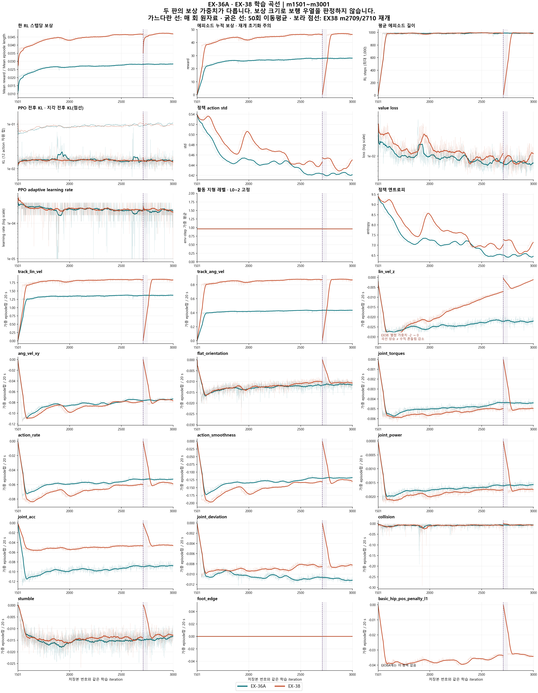

> 분류: A/평가 · 일반화 벤치마크 · 지표
> 작성: 오흥재 (analyst 분석) · 2026-10-29 20:42 대한민국 표준시
> 근거: 지정 실행 3개의 tfevents · 실행 params/manifest · 해당 커밋의 로그 코드 SHA 대조
> 요지: 두 판 모두 초반 상승 뒤 말기에 평평해졌고, EX-38 마지막 100회는 약한 내림세이나 지속 퇴보로 단정할 증거는 부족하다.
> 상태: CPU 곡선 분석 완료 · 보행 성능 판정은 영상·위상·독립 평가와 합쳐야 함 · 원자료 변경 없음

# EX-36A 대 EX-38 학습 곡선 · 10/29

**판단: EX-36A는 완만한 상승 뒤 평평해졌고, EX-38도 전체적으로 상승했으나 말기에는 평평하거나 약하게 내려간다. 두 판 모두 이 곡선만으로 수렴 완료·보행 개선·망각을 확정할 수 없다.**

적용 규칙: RULES-HUB §8.1·8.2, 실패 로그 R1·R4·R8·R12, M07·M27·M30. 숫자는 tfevents에서 생성했고, 보상 가중치·재개 초기화·지형 고정을 분리했다. 이번 의뢰는 학습 곡선 보완이므로 영상·접촉 위상 판독을 대신하지 않는다. 기존 승인·종료·연장 관문을 바꾸지 않는다.

## 판단과 근거

**EX-36A:** m1601~1700 → m2901~3000의 한 RL 스텝당 보상은 0.024147 → 0.028322로 17.29% 올랐다. 그러나 m2501~2600 이후 증가는 0.69%, 마지막 두 100회 창의 차이는 +0.31%뿐이다. 말기는 **평평함에 가깝고, 작게 더 오르는 상태**다. 마지막 창의 가중치를 제거한 선속도 점수는 0.92273 → 0.92424, 각속도 점수는 0.88080 → 0.88056다. 평균 보상이 올랐다고 회전까지 계속 좋아진다고 해석하지 않는다.

**EX-38:** 같은 초기·말기 창의 한 스텝당 보상은 0.040999 → 0.047096로 14.87% 올랐다. 하지만 마지막 두 100회 창에서는 0.047188 → 0.047096 (-0.20%). 선속도 점수 0.93241 → 0.93122, 각속도 점수 0.88566 → 0.88386, 에피소드 길이 991.44 → 986.41 step도 함께 조금 내려간다. **약한 말기 하락 신호는 있다. 다만 크기가 작고 한 창 간 비교여서 장기 퇴보·원인을 확정하지 않는다.**

EX-38의 value loss는 마지막 두 창에서 0.008069 → 0.009929 (+23.05%), action std는 0.43109 → 0.44298로 반등한다. 보상 하락과 함께 기록할 변화지만 value loss만으로 발산이라고 할 수는 없다. 말기 PPO 전후 KL은 0.01464이고, 해당 핵심 시계열에 NaN·Inf·회차 누락은 없다.

**계속 나아진다는 근거로 쓰면 안 되는 두 항목:** 지형 레벨은 두 판 모두 0.962565로 고정이다. L0/L1/L2 환경 수 1173/841/1058의 가중 평균이며, 더 어려운 지형을 배워 올라간 곡선이 아니다. EX-38의 `lin_vel_z` 벌점은 실제 로그에서 m1501 −2, m2709 -0.389333, m2710 -0.388000, m3001 0이다. 벌점이 줄어든 데는 가중치 완화가 포함되므로 몸의 수직 흔들림이 감소했다는 뜻이 아니다.

## 이어 학습 경계와 비교 범위

EX-36A는 **m1501~m3000, 1500개 기록**이다. m3001은 없으므로 채워 넣지 않았다. EX-38은 첫 실행 **m1501~2709, 1209개**와 재개 **m2710~3001, 292개**가 중복·빈 회차 없이 이어진다. 그림은 전체를 보이고, 아래 표의 말기 비교는 두 판에 실제로 있는 m3000까지다. EX-38 m3001의 한 스텝당 보상은 0.046721이며 한 점으로 결론을 바꾸지 않았다.

경계에서 EX-38 Mean reward는 **45.91087 → 0.39210**, Mean episode length는 **988.62 → 11.14**다. 새 프로세스의 reward/length 누적값과 최근 100개 종료 에피소드 버퍼가 0에서 다시 시작한다. `init_at_random_ep_len`은 환경의 종료 시계만 흩으므로 처음 종료된 에피소드 기록은 짧은 부분 구간이다. 물리 상태도 다시 reset됐다고 실행 영수증에 적혀 있다. **누적 보상 약 99% 하락을 정책 붕괴라고 읽는 것은 틀리다.**

요청한 비율로 나누면 경계 값은 0.046439 → 0.035196다. **나눗셈이 모든 재개 효과를 없애지는 않는다.** 초기에 종료되는 표본·자세·명령 이력이 바뀌기 때문이다. 재개 전 30회(m2680~2709)와 후 30회(m2710~2739)의 평균은 0.046619 → 0.045059 (-3.35%). m2750의 길이는 961.34 step까지 회복한다. 따라서 말기 추세는 재개 직후 창과 섞지 않고 m2801~2900 대 m2901~3000으로 따로 읽었다.

학습률은 EX-36A 1.000e-05~5.767e-04, EX-38 1.000e-05~5.767e-04다. 기록된 update 끝값이 하한 1e-5인 회차는 각각 16/1500, 1/1501이며 **하한에 계속 붙어 있지 않다**. EX-38 경계의 학습률 0.000170859 → 0.000256289는 갱신 후 값이다. 이 차이만으로 optimizer 복원 실패라고 할 수 없다.

## 그림 하나

원본 PNG: `C:\mai\wt\foothold-lab\analyst-ame2\_out\reports\curves-ex36a-ex38-1029\CURVES-EX36A-EX38-1029.png`. 3360×4320 px. 위 9칸은 주요 지표, 아래 15칸은 보상 항목 전부다. 굵은 선은 50회 이동평균이며 재개 경계에서 끊어 계산했다. 보라 음영 m2710~2751은 최대 1000 step ÷ rollout 24 step의 약 42회 초기 구간을 표시할 뿐 판정 제외 관문이 아니다. 원자료는 가는 선으로 모두 보인다. 학습률과 loss/KL은 작은 차이를 읽도록 로그 축을 쓴다.

## 표 하나

초기 = **m1601~1700**, 말기 = **m2901~3000**, 마지막 100회 변화 = **말기 평균 − m2801~2900 평균**. 시작 직후의 부분 에피소드를 피하기 위해 초기 비교는 두 판 모두 100회가 지난 뒤로 뒀다. 각 값은 회차별 스칼라 100개의 산술평균이다. 변화는 퍼센트가 아닌 해당 지표 단위다. 벌점 항목의 양수 변화는 덜 음수가 되었다는 뜻이다.

| 지표 | EX-36A 초기 → 말기 | 마지막 100회 변화 | EX-38 초기 → 말기 | 마지막 100회 변화 |
|---|---:|---:|---:|---:|
| 한 RL 스텝당 보상 | 0.02415 → 0.02832 | +8.858e-05 | 0.04100 → 0.04710 | -9.216e-05 |
| 에피소드 누적 보상 | 23.79128 → 28.01567 | +0.14261 | 40.30517 → 46.45722 | -0.32691 |
| 에피소드 길이 [step] | 985.25 → 989.16 | +1.96050 | 983.04 → 986.41 | -5.02620 |
| 선속도 추종 점수 [가중치 제거·0~1] | 0.88514 → 0.92424 | +0.00151 | 0.89509 → 0.93122 | -0.00119 |
| 각속도 추종 점수 [가중치 제거·0~1] | 0.82967 → 0.88056 | -0.00024 | 0.84066 → 0.88386 | -0.00181 |
| PPO 전후 KL | 0.01580 → 0.01541 | -2.694e-05 | 0.01591 → 0.01464 | -0.00051 |
| 지각 갱신 전후 KL | 0.07588 → 0.10304 | +0.00353 | 0.08300 → 0.09423 | -0.00056 |
| action std | 0.47915 → 0.42204 | -0.00122 | 0.51292 → 0.44298 | +0.01188 |
| value loss | 0.01078 → 0.00772 | -0.00032 | 0.01453 → 0.00993 | +0.00186 |
| PPO learning rate | 2.990e-04 → 2.282e-04 | -1.890e-06 | 2.687e-04 → 2.193e-04 | -2.439e-05 |
| 정책 엔트로피 | 7.97441 → 6.47301 | -0.03308 | 8.69632 → 6.93962 | +0.29800 |
| 활동 지형 평균 레벨 | 0.96257 → 0.96257 | 0 (부동소수점 오차 < 1e-6) | 0.96257 → 0.96257 | 0 (부동소수점 오차 < 1e-6) |
| track_lin_vel [가중 episode합/20s] | 1.29665 → 1.37015 | +0.00458 | 1.74695 → 1.83829 | -0.01230 |
| track_ang_vel [가중 episode합/20s] | 0.40665 → 0.43527 | +0.00104 | 0.82312 → 0.87274 | -0.00558 |
| lin_vel_z [가중 episode합/20s] | -0.02723 → -0.02232 | -6.131e-05 | -0.02839 → -0.00172 | +0.00223 |
| ang_vel_xy [가중 episode합/20s] | -0.09692 → -0.07416 | +0.00080 | -0.10525 → -0.07576 | -0.00015 |
| flat_orientation [가중 episode합/20s] | -0.01457 → -0.01142 | +1.145e-05 | -0.01406 → -0.01056 | -9.976e-06 |
| joint_torques [가중 episode합/20s] | -0.00561 → -0.00442 | -4.905e-06 | -0.00587 → -0.00498 | +3.537e-05 |
| action_rate [가중 episode합/20s] | -0.06748 → -0.05275 | +9.335e-05 | -0.08143 → -0.05816 | -0.00050 |
| action_smoothness [가중 episode합/20s] | -0.15610 → -0.11852 | +0.00041 | -0.18851 → -0.12749 | -0.00126 |
| joint_power [가중 episode합/20s] | -0.00194 → -0.00158 | +4.312e-06 | -0.00212 → -0.00174 | -1.867e-08 |
| joint_acc [가중 episode합/20s] | -0.10888 → -0.08776 | +0.00090 | -0.05594 → -0.04568 | -0.00032 |
| joint_deviation [가중 episode합/20s] | -0.01023 → -0.01121 | -0.00027 | -0.00928 → -0.00831 | +0.00020 |
| collision [가중 episode합/20s] | -0.01062 → -0.00679 | +0.00144 | -0.00958 → -0.00667 | -0.00017 |
| stumble [가중 episode합/20s] | -0.01443 → -0.01372 | +0.00053 | -0.01432 → -0.01271 | +0.00025 |
| foot_edge [가중 episode합/20s] | 0 → 0 | +0.000e+00 | 0 → 0 | +0.000e+00 |
| basic_hip_pos_penalty_l1 [가중 episode합/20s] | 항목 없음 | 해당 없음 | -0.03836 → -0.03402 | -0.00139 |
| 실제 lin_vel_z 가중치 | −2 고정 (cfg) | 0 (설정상 고정) | -1.80067 → -0.06733 | +0.13333 |

## 단위·해석에서 혼동하지 않을 것

- **한 걸음 = 발 한 번 디딤이 아니라 RL 환경 1 step(0.02초)**다. 각 회차에서 `Train/mean_reward / Train/mean_episode_length`를 먼저 계산하고 창 안에서 평균했다. 원 로그는 최근 끝난 100개 에피소드의 평균이므로 이 비율은 그 표본의 총보상/총기록 step과 같다. 모든 환경의 모든 step을 직접 합친 평균이나 에피소드별 보상률의 단순평균은 아니다.
- `Episode_Reward/*`는 **가중된 에피소드 보상 합을 최대 에피소드 20초로 나눈 값**이다. 실제 생존 시간으로 나눈 값이 아니며, 표본과 평균 방식도 위 `Train/*`와 다르다. 항목들을 더해 Mean reward/length와 정확히 같아야 한다고 검사하지 않는다. 재개 직후 함께 낮아지는 항목도 이 정의의 영향을 받는다.
- EX-38은 선속도 가중치 1.5→2, 각속도 0.5→1, 관절 가속도 −2.5e-7→−1e-7, hip 벌점 −0.05 추가, 수직 속도 벌점 완화를 함께 바꿨다. **EX-38 총보상과 EX-36A 총보상의 크기는 직접 성능 비교 불가**다. 표의 가중치 제거 추종 점수는 매 step `map_switch/*track*_per_s`를 on/off 환경 step 수로 합친 뒤 해당 고정 가중치로 나눴다. 여전히 여러 명령·지형을 섞은 학습 점수이며 좌우 회전·후진·횡이동의 독립 성공률은 아니다.
- KL 그림의 실선 `Loss/kl_probe/ppo_mean`은 고정 입력의 **PPO 갱신 전후** policy KL이다. 점선 `phi_mean`은 같은 방식의 **지각 갱신 전후** KL이다. `Loss/perception/kl`(추정망 잠재분포 손실)과 다르다. adaptive scheduler가 각 mini-batch에서 쓰는 KL 원값은 별도 기록이 없으므로, 이 probe가 설정 목표 .01을 넘는다는 이유로 scheduler 고장이라고 하지 않는다.
- EX-38의 말기 수직 벌점 감소에는 설계된 가중치 완화가 포함되고, 반대로 m3001 가중치가 0이어도 종료된 에피소드의 누적 벌점은 이전 step을 담을 수 있다. 그 회차의 episode 항목이 즉시 0이 아니어도 모순이 아니다.
- 위의 ‘평평함·약한 하락’은 **이 한 시드 기록을 창으로 요약한 설명**이다. 사전 등록된 통계적 수렴 검정이나 자동 중단 기준이 아니다. 겹치는 최근 100 에피소드·50회 이동평균 표본에 독립성 가정을 씌워 유의확률을 만들지 않았다. 영상·위상·지형별 평가를 읽지 않은 이 보고서로 보행 우열·원인·학습 종료를 판정하지 않는다.

## 원자료·재현

실행 폴더 세 곳(각 폴더의 tfevents 한 파일만 읽음):

1. `C:\Users\AI-WS01\s2_lab\basic_gait_runs\main\EX-36A-basic-share30_20261029_013052_21044`
2. `C:\Users\AI-WS01\s2_lab\basic_gait_runs\main\EX-38-basic-e1rew_20261029_040521_60072`
3. `C:\Users\AI-WS01\s2_lab\basic_gait_runs\main\EX-38-basic-e1rew_20261029_123840_163180`

실행 코드 HEAD는 EX-36A `cc9840a8`, EX-38 첫 실행 `5578c368`, 재개 `16f37ceb`다. 두 판은 같은 S-B10 m1500 부모 SHA `4d987818c7e25b89e77b7541feca3ddabedd444c5b20651eb29f3681da040d9d`를 영수증에 기록했다. 재개 부모는 m2709 SHA `b9db93b125ab53eb56a032676950a7c509da49643753b34a915dff559f7b7cd3`다. 이번에는 큰 checkpoint 자체를 다시 해시하지 않았으며 이 두 값의 출처는 실행 영수증이다.

`env.yaml`의 전 항목을 평탄화해 대조했다. EX-36A 대 EX-38은 위 보상 차이, GPU 번호·로그 경로가 다르다. EX-38 첫 실행 대 재개는 YAML상 로그 경로만 다르다. 수직 벌점 일정은 YAML의 초기 −2만으로는 알 수 없어 tfevents와 실제 코드 소비 경로를 함께 대조했다. 시드42·3072 env·24 step/update·활동 L0~2·명령 basic_gait_v1·force_gt=True·p_map_off=.1은 같다. GPU·실행 시각 차이와 재개 reset 때문에 단일 처치의 결정적 재현이라고 부르지 않는다.

로그 정의 근거(읽은 사본과 SHA는 아래 보존):

- `16f37ceb:foothold_s2/runners/start_runner.py:285~305, 386~395, 408~431, 501~507`: 시작 시 카운터/버퍼 초기화, 끝난 에피소드 수집, 두 KL probe, map_switch 보상 단위.
- 같은 커밋 `foothold_s2/scripts/train_start.py:158`: `runner.learn(..., init_at_random_ep_len=True)` 호출.
- 같은 커밋 `runners/map_switch.py:114~118,158~198`: on/off의 env-step 가중 평균.
- 같은 커밋 `rewards/basic_gait_bundle.py:35~41` 및 실제 `Loss/basic_reward/lin_vel_z_weight`: 일정은 재개 뒤에도 원래 시작 회차를 유지한다.
- 설치 `C:/Users/AI-WS01/anaconda3/envs/isaac311/Lib/site-packages/rsl_rl/runners/on_policy_runner.py:184~236`: episode 항목·Train 평균·std 기록. `algorithms/ppo.py:258~282`: mini-batch KL scheduler와 하한. 설치 `C:/isaac/IsaacLab/source/isaaclab/isaaclab/managers/reward_manager.py:119~120,150~157`: 시간 단위. 설치 라이브러리의 과거 바이트까지 실행 manifest가 봉인한 것은 아니므로 이 한계는 남는다.

지정 이벤트는 사본 생성 전후·분석 후 SHA를 대조한다. 요구한 핵심 지표·회차에 누락·중복·비유한 값 0. EX-38 첫 실행에서 off 집단 종료 에피소드 평균 두 태그는 같은 한 회차에 기록이 없지만 이 보고서의 핵심 평균이나 지형·추종 합산에는 쓰지 않았다. 없는 값을 0으로 채우지 않았다. 고정 코드 사본 11개는 실행 manifest의 imported SHA와 일치했다. 비율·가중 합산·0 분모 거절 3개 답 아는 입력과, CSV를 다른 합산법으로 재계산한 30개 평균 대조를 통과했다.

- 생성 코드: [analyze.py](curves-ex36a-ex38-1029/analyze.py), [render_report.py](curves-ex36a-ex38-1029/render_report.py)
- 회차별 원값: [EX36A_raw.csv](curves-ex36a-ex38-1029/EX36A_raw.csv), [EX38_raw.csv](curves-ex36a-ex38-1029/EX38_raw.csv). 100회 창 CSV·summary.json도 같은 폴더.
- 입력·설정 차이: [provenance.json](curves-ex36a-ex38-1029/provenance.json). 코드 출처: [source_provenance.json](curves-ex36a-ex38-1029/source_provenance.json). 재계산: [checks.json](curves-ex36a-ex38-1029/checks.json).
- 파일 해시: [SHA256SUMS.txt](curves-ex36a-ex38-1029/SHA256SUMS.txt). 원본 PNG를 열어 24개 패널·축·범례·재개 경계 표시를 확인했다.
- 실행: `C:/Users/AI-WS01/anaconda3/envs/isaac311-moects/python.exe -X utf8 analyze.py`, 이어서 같은 Python의 `render_report.py`. CPU로만 읽고 그리는 스크립트이며 학습·평가 코드를 import하지 않는다.

자기 분석 worktree에서 작성했다. 원격 main과 기존 분석 브랜치가 갈라져 `git pull --ff-only origin main`은 중단됐고, 강제 병합·rebase·공유 체크아웃 변경을 하지 않았다. 이번 산출만 별도로 보존한다.
