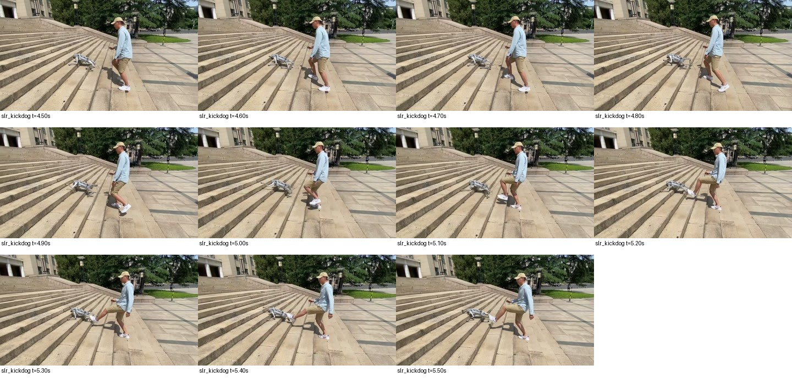

> 분류: A/평가 · 일반화 벤치마크 · 지표
> 작성: analyst · 2026-10-30
> 근거: D75 · 공식 프로젝트 영상 직접 추출 프레임 · 논문 원문 · 공개 코드 고정 커밋 · GitHub star 341개 목록
> 요지: 기억한 계단 발차기 장면에 가장 잘 맞는 후보는 SLR의 kickdog.mp4이며, 논문 외력과 공개 코드 기본값은 서로 다르다
> 상태: v0.1 · 후보 확인 · EX-40 밀기 값 미확정 유지 · 영상의 힘 크기와 해당 정책의 학습 설정 연결은 미확인

# 계단 위 발차기 후보와 학습 외란 설정

**SLR 공식 영상에서 계단을 오르는 Go2를 사람이 발로 차고, 이후에도 로봇이 계단을 오르는 장면을 확인했다.** [바로 볼 영상](https://11chens.github.io/SLR/static/videos/kickdog.mp4) · [공식 프로젝트](https://11chens.github.io/SLR/). 파란 셔츠, 베이지색 모자, 반바지를 입은 사람이 넓은 야외 돌계단에서 로봇 옆을 따라간다. 팀장이 기억한 영상과 같은지는 팀장의 확인이 남는다. ±0.5 m/s를 확정하거나 다른 수치로 바꾸지 않는다.

## 1. 직접 확인한 장면

| 후보 | 실제로 본 범위 | 계단 위 발차기 여부 | 증거와 한계 |
|---|---|---|---|
| **SLR · Go2** | 공식 `kickdog.mp4` 11.17초, 0~10.5초를 0.5초 간격으로 판독. 4.5~5.5초는 0.1초 간격으로 추가 확인 | **있음**. 특히 5.3~5.5초에 신발과 로봇 뒷부분이 맞닿는 장면, 이후 위쪽 진행 확인 | 아래 그림. 사람이 찬 힘·충격량·정확한 접촉점은 미측정. 모든 순간의 몸통 접촉 유무까지 판정한 것은 아님 |
| SLR · 다른 외란 영상 | `disturb_1.mp4`, `disturb_2.mp4`의 추출 프레임 | 확인한 구간은 평지 실내에서 줄로 다리를 당김 | 계단 발차기 증거로 합치지 않음 |
| MoE-CTS/RoboGauge · Go2 EDU | [Kick.mp4](https://robogauge.github.io/static/videos/Kick.mp4) 18.04초, 0.5초 간격 | 확인한 발차기는 **평지 실내** | 같은 사이트의 `Stairs`·`Spiral Stairs`는 별도 영상. 서로 다른 영상을 한 장면으로 합치지 않음 |
| CTS · A1/Aliengo, P1 | [공식 전체 영상](https://clearlab-sustech.github.io/concurrentTS/static/videos/full_video.mp4) 160.75초, 5초 간격 개요 판독 | 계단 주행과 평지 밀기가 서로 다른 분할 화면에 나옴. 계단 위 차기는 **미확인** | 45~90초 사족보행 결과 화면. 5초 표본이라 짧은 장면의 부재까지 증명하지 않음 |



SLR 전체 구간: [0~7.5초](push-kick-papers-1030/slr_kickdog_grid1.jpg) · [8~10.5초](push-kick-papers-1030/slr_kickdog_grid2.jpg). 위 프레임의 시간은 원본 영상 시간이다. 0.5초 개요 그림은 fps 필터 표본, 상세 그림은 해당 시간 seek 추출이다. 음성 판독은 하지 않았다. 영상으로 힘의 N 값을 추정하지 않았다.

## 2. 요청한 논문·프로젝트별 후보 표

`확인`은 직접 본 영상 프레임에 한정한다. `미확인`은 해당 장면이 없다는 뜻이 아니다. 논문에 숫자가 없으면 이웃 논문이나 구현 기본값으로 채우지 않았다. 표의 학습 숫자는 영상에서 찬 힘의 측정값이 아니다.

| 후보 · 로봇 | 공식 사이트·영상 | 계단 위 차기 | 학습 밀기 설정, 짧은 원문과 출처 |
|---|---|---|---|
| **SLR · Go2** | [사이트](https://11chens.github.io/SLR/) · [계단 발차기](https://11chens.github.io/SLR/static/videos/kickdog.mp4) | **확인**, §1 | [논문 v2 Appendix A.3, Table A2](https://arxiv.org/html/2406.04835v2#A1.SS3): “External Force”, xyz 각각 −30~30 N. 간격·지속시간은 표에 없음. 공개 코드와 불일치하므로 §3을 함께 읽음 |
| START · Lite3 | [논문·영상 링크가 있는 원문](https://arxiv.org/html/2512.13153v1) · [저자 영상](https://youtu.be/j85qVv_kVyI) | 영상 미확인. 영상 링크 열람은 시도했으나 재생 자료 미확보 | §II-D1: “domain randomization following” [31=PIE]. START 자체의 push 속도·힘·간격 수치 없음. PIE 표에도 push 행 없음 |
| PIE · Lite3 | [원문](https://arxiv.org/html/2408.13740v3) · [저자 영상](https://youtu.be/XsjFNcND6js) | 영상 미확인 | §III-C3, Table II “DOMAIN RANDOMIZATION RANGES”: 마찰·COM·모터·지연 등은 있으나 push 항 없음. 학습 밀기 힘·속도·간격 미기재 |
| AME-2 · ANYmal-D/TRON1, 공개 minimal은 G1 | [사이트](https://sites.google.com/leggedrobotics.com/ame-2) · [저자 영상](https://www.youtube.com/watch?v=FNA1crvtBLs) | 영상 미확인 | [논문 v3 Appendix B](https://arxiv.org/html/2601.08485v3#A2)에 push 수치 없음. minimal `8beb9a68`의 G1 `EventCfg`에는 주기적 밀기 등록이 없음. 아래 §3.3. G1 코드로 ANYmal 영상의 훈련 설정을 단정하지 않음 |
| HiPAN · Go1 | [사이트](https://sgvr.kaist.ac.kr/~Jeil/project_page_HiPAN/) · [공식 야외 영상](https://sgvr.kaist.ac.kr/~Jeil/project_page_HiPAN/assets/video/real_outdoor_1.mp4) | 사이트는 직접 열었으나 계단 발차기 프레임은 미확인 | [원문 v1](https://arxiv.org/html/2604.26504v1)의 학습·DR 설명에서 이 질문에 쓸 push 힘·속도·간격 숫자를 확인하지 못함. 하위 정책의 항법 성공을 외란 내성 수치로 바꾸지 않음 |
| JEPLO · Go2 | [사이트](https://asig-x.github.io/jeplo_web/) · [저자 영상](https://www.youtube.com/watch?v=HekLtX37ijs) | 전후좌우 계단 영상 목록은 있으나 발차기는 미확인 | [원문 v1 Appendix VII-A, Table IV](https://arxiv.org/html/2609.15770v1#S7.SS1): “Linear & angular push”, 0.25 Hz. Δvx·Δvy 각각 ±0.4 m/s, Δωx·Δωy·Δωz 각각 ±0.6 rad/s. 4초 간격. 코드 `460e2272`, cfg:86~99와 일치 |
| MoE-CTS / RoboGauge · Go2 EDU | [사이트](https://robogauge.github.io/complete/) · [발차기](https://robogauge.github.io/static/videos/Kick.mp4) | 평지 발차기 확인. 계단과는 별도 영상 | 공개 학습 코드 `6c95d9fe`의 `randomize_push_robot`: 4초마다 XY ±0.4 m/s와 roll·pitch·yaw ±0.6 rad/s를 지정. 우리 E1 원본 `28b4516d`도 같은 범위. §3.4. 사이트의 “Instant Drag (85~100N)”는 **실기 시연 표기**이며 학습 힘이 아님 |
| CTS · A1/Aliengo/P1 | [사이트](https://clearlab-sustech.github.io/concurrentTS/) · [공식 전체 영상](https://clearlab-sustech.github.io/concurrentTS/static/videos/full_video.mp4) | 계단과 평지 밀기 분할 화면 확인, 계단 위 차기는 미확인 | [원문 v2](https://arxiv.org/html/2405.10830v2) §III-B Table IV에서 학습 push 수치 확인 못함. §IV-A Fig.6의 “velocity change of approximately 2.5m/s”는 **강건성 평가** 조건. 학습값으로 인용하면 틀림 |
| DreamWaQ · A1 | [사이트](https://sites.google.com/view/dreamwaq) · [사이트 연결 영상](https://www.youtube.com/watch?v=gUhpe_72y2k) | 영상 미확인 | [원문 v2](https://arxiv.org/html/2301.10602v2) Table II에는 push 행 없음. §III-F “one-second interval”은 xyz 무작위 속도를 가하는 **평가**. Table III의 1.121±0.164 m/s는 내성 평가 결과이며 학습 설정이 아님 |
| DTC · ANYmal | [원문·보충자료](https://arxiv.org/html/2309.15462v2) · [RSL 영상](https://www.youtube.com/watch?v=nipH-yl8lR0) | 영상 미확인 | 보충자료 `Training Details`: “after 10 s”, twist 변화 U(−1,1), 원문의 단위는 m/s. 매 episode base wrench U(−15,15), foot force U(−2,2) N. base wrench의 힘·토크 단위를 하나의 N로 쓰지 않음. §3.5 |
| Walk These Ways · Go1 | [사이트](https://gmargo11.github.io/walk-these-ways/) · [저자 영상](https://www.youtube.com/watch?v=FViNnwLk5wI) | 사이트는 계단 주행·밀기 대응을 소개. 같은 계단 장면에서 찼는지는 미확인 | 공식 코드 `0e7236bd`: base cfg에는 XY ±1 m/s, 15초. 그러나 **실제 `scripts/train.py:66`은 `push_robots = False`**. 기본 cfg만 읽고 이 값으로 학습했다고 하면 틀림 |

참고로 팀장이 아닌 것 같다고 한 HIM과 Rudin도 대조용으로 남긴다. [HIM 사이트](https://junfenglong.com/HIMLoco/)는 계단 외란을 설명하지만 이 회차의 우선 후보는 직접 장면을 확인한 SLR이다. [HIM 논문 Appendix A.2 Table6](https://arxiv.org/html/2312.11460v3#A1.SS2)의 xyz±30 N과 [legged_gym 기본 코드](https://github.com/leggedrobotics/legged_gym/blob/8fa29acc6fd1910c3d9659eef6310bdd301cde0a/legged_gym/envs/base/legged_robot_config.py#L112)의 XY 속도±1 m/s·15초는 단위와 구현이 다르다. 이 둘로 기억한 영상의 정체나 EX-40 값을 확정하지 않는다.

## 3. 논문 수치와 코드 실제 소비 대조

### 3.1 SLR: ±30 N 표를 그대로 켜진 학습값으로 읽으면 틀린다

고정 코드: [11chens/SLR-master@8b454a142401ebcf87c33f26bb7b7dba7c0f7e6e](https://github.com/11chens/SLR-master/tree/8b454a142401ebcf87c33f26bb7b7dba7c0f7e6e).

| 자리 | 직접 읽은 내용 | 의미 |
|---|---|---|
| [configs/go2_config.py:172~174](https://github.com/11chens/SLR-master/blob/8b454a142401ebcf87c33f26bb7b7dba7c0f7e6e/configs/go2_config.py#L172) | push=True, interval=15 s, max XY speed=1 m/s | 속도 밀기는 켜져 있음 |
| [같은 파일:186~188](https://github.com/11chens/SLR-master/blob/8b454a142401ebcf87c33f26bb7b7dba7c0f7e6e/configs/go2_config.py#L186) | `disturbance = False`, force range ±30, interval=8 | ±30 N 외력 경로는 공개 기본 설정에서 꺼져 있음 |
| [envs/legged_robot.py:563~567](https://github.com/11chens/SLR-master/blob/8b454a142401ebcf87c33f26bb7b7dba7c0f7e6e/envs/legged_robot.py#L563) · :971 | 속도 간격은 초를 dt로 나눈 step. disturbance는 common_step_counter % 8 | 숫자8을 8초라고 읽으면 틀림. 외력 활성 시 정책 step 단위 |
| [같은 파일:1123~1135](https://github.com/11chens/SLR-master/blob/8b454a142401ebcf87c33f26bb7b7dba7c0f7e6e/envs/legged_robot.py#L1123) | root XY velocity에 새 표본 **대입**. 별도 force는 body0·LOCAL_SPACE | 속도에 ±1을 더하는 구현이 아님. force 호출 뒤 물리적으로 유지되는 시간은 이번 정적 판독으로 확정하지 않음 |
| [train.py:4·20](https://github.com/11chens/SLR-master/blob/8b454a142401ebcf87c33f26bb7b7dba7c0f7e6e/train.py#L4) | Go2RoughCfg를 읽어 go2 task에 등록 | 다른 설정으로 덮는 훈련 진입점을 이 파일에서 발견하지 못함 |

논문과 공개 기본 코드의 차이는 확인됐다. **계단 발차기 영상의 체크포인트가 이 커밋의 이 설정으로 만들어졌다는 연결 증거는 없다.** 따라서 영상의 성공을 “±30 N 학습 덕분”이나 “15초·±1 m/s만으로 충분”이라고 설명하지 않는다.

### 3.2 Walk These Ways: 상속 기본값보다 train.py가 우선

[base cfg:266~268](https://github.com/Improbable-AI/walk-these-ways/blob/0e7236bdc81ce855cbe3d70345a7899452bdeb1c/go1_gym/envs/base/legged_robot_config.py#L266)에는 push=True·15초·XY1이 있다. [train.py:66](https://github.com/Improbable-AI/walk-these-ways/blob/0e7236bdc81ce855cbe3d70345a7899452bdeb1c/scripts/train.py#L66)이 이를 False로 덮는다. 같은 진입점 :48~51의 중력 무작위화 ±1, 8초 간격은 다른 외란이다. 발차기와 같은 힘 파형이라고 간주하지 않는다.

### 3.3 AME-2 minimal: helper 존재가 학습 활성 증거는 아니다

우리 명세가 참고한 [ame2_minimal@8beb9a688d67882828019583f7d5a78e3517f233](https://github.com/leggedrobotics/ame2_minimal/tree/8beb9a688d67882828019583f7d5a78e3517f233)의 [ame2_env_cfg.py:322~405](https://github.com/leggedrobotics/ame2_minimal/blob/8beb9a688d67882828019583f7d5a78e3517f233/ame2/ame2/tasks/ame2_env_cfg.py#L322)에는 재질·질량·COM·이득·reset·assistive_force가 있으며 주기적 push 등록은 없다. [mdp/events.py:322~334](https://github.com/leggedrobotics/ame2_minimal/blob/8beb9a688d67882828019583f7d5a78e3517f233/ame2/ame2/tasks/mdp/events.py#L322)의 push helper는 속도에 변화를 **가산**하지만, 함수가 있다는 것과 이 task에서 호출된다는 것은 다르다. PLAY의 push=None 한 줄만으로 훈련 값을 역추정하지 않았다.

### 3.4 JEPLO와 MoE-CTS: 선속도뿐 아니라 각속도도 흔든다

[JEPLO cfg:86~99](https://github.com/ASIG-X/JEPLO/blob/460e2272907af053d6e66b57fec71fdbe6ca1774/training/go2_parkour/go2_parkour/tasks/go2_loco_env_cfg.py#L86), [현재 MoE 학습 cfg:259~272](https://github.com/wty-yy/go2_rl_gym/blob/6c95d9feef4814c25eb6536e61bb38e1d1d718d4/source/go2_rl_lab/go2_rl_lab/tasks/mixed/env_cfg.py#L259)는 4초마다 x,y±0.4·roll,pitch,yaw±0.6을 지정한다. 우리 E1 코드 `C:/isaac/ext/go2_rl_robotlab` HEAD `28b4516d22617b11aeaf8ead63cc00b0c0bcd1bd`, `source/robot_lab/robot_lab/tasks/go2/env_cfg.py:304~317`도 같은 범위다.

설치 Isaac Lab `source/isaaclab/isaaclab/envs/mdp/events.py:1046~1073`의 소비 함수는 현재 root velocity에 표본을 **가산**한다. 따라서 SLR의 새 XY속도 대입과 이름만 비슷하고 실제 처치는 다르다. 현재 공개 MoE 코드·우리 E1 코드의 일치는 확인했지만, 웹 영상 체크포인트의 정확한 훈련 커밋은 미확인이다.

### 3.5 DTC: 훈련과 강건성 평가의 강도가 다르다

[보충자료 Training Details](https://arxiv.org/html/2309.15462v2)는 훈련 중 10초 뒤 twist offset U(−1,1), episode별 base wrench±15와 각 발 힘±2 N을 적었다. 같은 자료의 `Experimental Setup for Solver Rate Benchmark`는 5초 뒤 U(−2,2)를 가하며, 훈련 때보다 두 배라고 명시한다. 뒤의 값을 학습 범위로 복사하면 안 된다. twist의 회전 성분과 wrench의 토크 성분까지 본문의 단일 m/s 또는 N 표기로 모두 해석하는 것도 피한다. 원문에서 단위·성분이 명확하지 않은 부분은 미확인으로 남긴다.

## 4. GitHub star와 검색 범위

2026-10-30 `gh api user/starred --paginate --slurp`로 **341개**를 받았다. 원자료는 `C:/mai/wt/foothold-lab/analyst-ame2/_out/dr_sources/starred_20261030.json`. 개수는 저장된 목록을 다시 세었다. 341개 저장소의 영상을 모두 본 것은 아니다.

| star에서 찾은 관련 저장소 | 이번 조사에서 쓴 범위 |
|---|---|
| [ASIG-X/JEPLO](https://github.com/ASIG-X/JEPLO) | 공식 사이트·논문·학습 cfg |
| [leggedrobotics/ame2_minimal](https://github.com/leggedrobotics/ame2_minimal) | 공식 사이트·논문·기존 고정 코드 |
| [wty-yy/go2_rl_lab](https://github.com/wty-yy/go2_rl_lab) · [wertyuilife2/go2_rl_robotlab](https://github.com/wertyuilife2/go2_rl_robotlab) · [RoboGauge](https://github.com/wty-yy/RoboGauge) | MoE 계열 사이트·Kick 영상·훈련 cfg |
| [leggedrobotics/legged_gym](https://github.com/leggedrobotics/legged_gym) | 기본 push 구현 대조. 팀장 기억의 우선 후보에서는 제외 |
| [arclab-hku/MGDP](https://github.com/arclab-hku/MGDP) · [open-diffloco](https://github.com/MartinOpat/open-diffloco) · [php_parkour](https://github.com/amazon-far/php_parkour) · [parkour_mjlab](https://github.com/yhx1203/parkour_mjlab) | 관련 목록으로 식별. 이 회차에서 계단 발차기 장면·훈련 push 수치는 미확인 |

웹 검색어: `quadruped robot kicked stairs SLR kickdog`, `Deep Tracking Control kick stairs`, `Walk These Ways push training`, 각 논문명과 `push`, `external force`, `domain randomization`. 기술 결론은 검색 요약이나 제3자 소개가 아니라 위 원문·저자 사이트·저자 코드에 근거했다. SLR은 star 목록에서 찾았다고 주장하지 않는다.

## 5. EX-40에 바로 결론 낼 수 있는 것과 남는 것

- **확인됨:** 비슷한 크기의 Go2가 계단에서 발차기를 받고도 진행하는 공개 시연이 있다. 우리 목표가 선행에 전혀 없는 것은 아니다.
- **확인됨:** 힘 N, 순간 속도 변화 m/s, 현재 속도 대입, 지속 외력은 서로 다른 처치다. 같은 숫자만 보고 강도를 비교하면 안 된다.
- **미확인:** 영상의 타격력·지속시간·접촉점, 해당 정책의 정확한 학습 설정, 우리 정책의 같은 내성. 영상만 보고 ±0.5를 충분·부족으로 판정할 수 없다.
- **설계 제안:** 이후 결정에서는 선속도 외란과 회전 외란, 몸통/발 접촉, 지속시간, 계단 위 보행 위상을 구분한다. 이번 조사로 새 힘이나 각속도 항을 실행에 넣지는 않는다.
- **D75 유지:** EX-40 밀기 최종값·간격은 미확정. 이미 돌고 있는 W51의 ±0.5 진단 조건은 바꾸지 않았으며, 이는 훈련값 승인과 별개다.

## 6. 재현 자료와 미확인 범위

증거 폴더: `C:/mai/wt/foothold-lab/analyst-ame2/_out/reports/push-kick-papers-1030/`. 원본 영상은 그 worktree의 `_out/dr_sources/push_videos/`에 보존하며 git에는 넣지 않는다. 프레임 그림·추출 도구·영상 메타데이터·SHA 목록만 남긴다. 상세 추출 예:

```powershell
python _out/reports/push-kick-papers-1030/contact_sheets.py _out/dr_sources/push_videos/slr_kickdog.mp4 --output _out/reports/push-kick-papers-1030/slr_detail --start 4.5 --duration 1 --step 0.1
```

SLR `kickdog.mp4` SHA256 `8ac346511887a582db72fb67dede30ce7366ee26cbe645e4a0ca4b699a396a27`; MoE `Kick.mp4` `d00d3bb0426eccbac914a3afc2c82527e9f5dabfc9221641cbf71c25a5bf4c35`; CTS `full_video.mp4` `3d2c15d98f58f4ff407d269456036c4cf2ac0864c3ee158275c05e24f04a4e15`.

원문·프로젝트 페이지는 직접 열었다. 유튜브는 web fetch 제한/429가 있었고, 별도 HTTP 페이지 응답을 받아도 재생 자료를 확보하지 못한 후보는 `미확인`으로 표시했다. 최종 [링크 점검](push-kick-papers-1030/link_checks.json)은 이 문서의 서로 다른 URL **54/54가 HTTP 200**이었다. 이는 페이지 또는 MP4 HEAD 응답 확인이며, 영상 판독을 뜻하지 않는다. SLR·MoE·CTS는 내려받은 실제 영상에서 프레임을 추출했다. 코드·논문은 원문과 별도로 링크를 열고, 해석에 사용한 고정 커밋과 행을 위에 남겼다. GPU·실기 타격·새 학습·훈련 코드 변경은 이 조사에서 하지 않았다.

## 변경 기록

| 판 | 변경 |
|---|---|
| v0.1 | D75 후보 조사. SLR 장면 확인, 논문·코드 활성값 불일치와 평가/학습 수치 구분. 밀기 최종값은 미확정 유지 |
