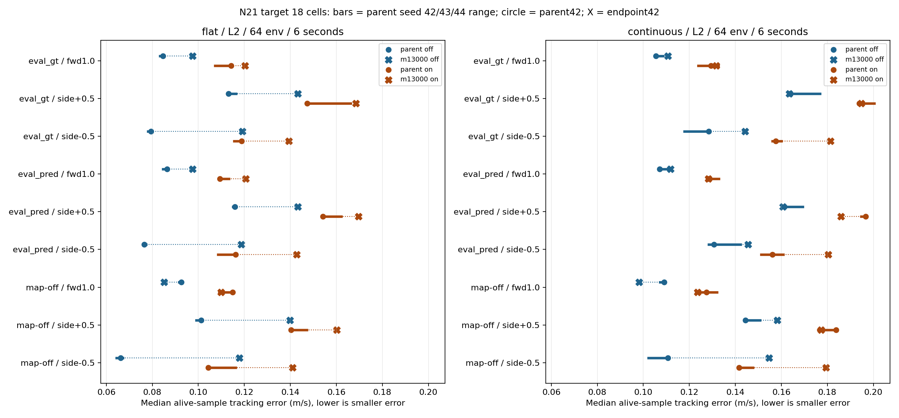

> 분류: A/평가 · 일반화 벤치마크 · 지표
> 작성: analyst · 2026-11-08 21:00 KST
> 근거: 원자료 실측 · N21 JSON 16판 및 NPZ 384개 CPU 재검산 · 부모 시드 42/43/44
> 요지: DR-on 빠른 전진·옆걸음 오차가 더 큰 18칸은 그대로이며, 격차 축소와 실제 오차 감소는 다르다
> 상태: record_only 기록 해석 완료 · 승급/통과 판정 없음 · m13000 시드 반복 미측정

# N21 0단계 끝: 부모 m12000과 m13000 비교

## 먼저 읽을 결과

**오전 18칸이 줄었는가: 아니오.** 빠른 전진과 양쪽 옆걸음의 18/18칸 모두 m13000에서도 DR-on 오차가 off보다 크고, 18칸 모두 그 격차가 부모의 시드 폭 W를 넘는다. 다만 격차의 크기는 12칸에서 작아지고 6칸에서 커졌다. 이는 통계적 유의성이나 실패 판정이 아니다.

**격차 축소를 강건성 개선으로 읽으면 안 된다.** 축소된 12칸 중 10칸은 on 오차 자체가 줄지 않았다. off 오차가 더 크게 늘어 간격이 좁아진 것이다. 격차도 줄고 on 오차도 줄어든 것은 연속 7종 복원 side+0.5, 연속 7종 끔 side+0.5의 2칸이다. 전체 18칸 중 on 오차 자체가 줄어든 것은 4칸이다.

살아남는 것과 명령을 잘 따르는 것은 다르다. 아래 생존 합은 여러 명령·지도에서 반복한 env-시도 수이며, 독립 로봇 수나 통합 성공률이 아니다. 정지 두 성분을 따로 세므로 조건당 추종 오차는 27성분이다.

| 지형 | DR | 부모 생존 합 | m13000 생존 합 | 오차 감소/증가 성분 | 부모 폭보다 큰 감소/증가 |
| --- | --- | --- | --- | --- | --- |
| 평지 | off | 1536/1536 | 1536/1536 | 9/18 | 8/16 |
| 평지 | on | 1536/1536 | 1533/1536 | 15/12 | 10/7 |
| 연속 7종 | off | 1530/1536 | 1535/1536 | 12/15 | 8/13 |
| 연속 7종 | on | 1530/1536 | 1527/1536 | 20/7 | 10/3 |

## 비교 조건과 실제 검사

- 부모: EX-41 local model_6000, 누적 m12000, SHA `1c6af6319c823c718af4965064f1c312b0d25177f5223a49c323aab3b6f1e613`.
- 이번: EX-42 local model_1000, 누적 m13000, SHA `20365a2c6d70f94f65f1114471f7df198e56d86db6d02d89cea43c666b95e768`.
- 모든 판: L2 · 64 env · 300 step · dt 0.02 s · 6 s · 대표 8명령 · 지도 셋. 이번 시드는 42 하나다. `n21_point=parent_e0`는 평가 계약 이름이며 저장본이 부모라는 뜻이 아니다. 실제 checkpoint SHA로 구별했다.
- 명령 숫자, 지형 종류와 열·레벨 배정, fixed_terrain, 복원한 지도/추정기 설정이 부모 seed42와 같음을 assert했다. assignment SHA는 종류/레벨 배정 해시다. 지형 메시 높이장 전체의 바이트 동일성은 이 영수증으로 확인할 수 없다.

| 지형 | DR | 부모 seed42 GPU | m13000 GPU | 부모 코드 | m13000 코드 | 배정 SHA 앞 12자 |
| --- | --- | --- | --- | --- | --- | --- |
| 평지 | off | cuda:1 | cuda:1 | 1771ee04 | 7916a52f | 7aaf40350d38 |
| 평지 | on | cuda:0 | cuda:0 | d1dfd4f9 | 7916a52f | 7aaf40350d38 |
| 연속 7종 | off | cuda:0 | cuda:1 | 1771ee04 | 7916a52f | 0fa58f201d3d |
| 연속 7종 | on | cuda:0 | cuda:0 | d1dfd4f9 | 7916a52f | 0fa58f201d3d |

**교란 조건:** 이번 on/off는 GPU도 다르다. 연속 지형 off는 부모→자식 비교에서도 GPU0→GPU1로 바뀌었다. 부모 seed42와 이번 평가 코드도 같은 HEAD가 아니다. 부모 seed43/44와 이번은 실제 import 모듈 SHA가 전부 같지만, 부모 seed42와는 eval_map_modes·n21_dr_record·start_runner 3모듈이 다르다. [오전 코드 차이](N21-seedwidth-1108/source_diff_d1dfd4f9_to_7916a52.txt)는 off 영수증 지원 및 EX-42 학습/저장 경로 변경을 보인다. 그래도 같은 코드·같은 GPU를 강제한 짝 실험이라고 부르지 않는다. [전체 프로토콜](N21-s0end-1108/protocol.csv).

DR-on 실제 질량·마찰 배열은 범위 안이고 부모 seed42와 각 24칸 모두 완전히 같았다. 밀기 seed·시각도 같으며 실제 Δv의 차이는 아래처럼 작지만 바이트까지 같지는 않다. DR-off에는 물리값 readback이 없으므로 설정에서 껐다는 기록 이상을 주장하지 않는다.

| 지형 | base 질량 kg 최소~최대 | 정지 마찰 최소~최대 | 운동 마찰 최소~최대 | 질량/마찰 동일 칸 | 부모와 밀기 Δv 최대 차 m/s |
| --- | --- | --- | --- | --- | --- |
| 평지 | 6.011162~9.919346 | 0.216203~1.181125 | 0.216203~1.103655 | 24/24 | 1.19e-07 |
| 연속 7종 | 6.011162~9.919346 | 0.216203~1.181125 | 0.216203~1.103655 | 24/24 | 1.19e-07 |

DR-on은 마찰만 바꾼 조건이 아니다. 질량·COM·구동기 이득/세기·행동 지연·밀기를 포함하므로 차이를 마찰 하나에 돌릴 수 없다.

## 수치의 뜻과 시드 폭

- 추종 오차: 각 env에서 첫 종료 전 살아 있는 시간의 절댓값 오차를 평균하고, 64개 env 값의 중앙값을 구했다. 전진/후진은 vx, 옆걸음은 vy, 회전은 yaw를 본다. 정지는 XY 속도(m/s)와 yaw 속도(rad/s)를 따로 본다.
- 생존: 300스텝 끝의 `alive_end` 합. 도중 죽은 env의 오차도 죽기 전 자료로 계산되므로 오차가 낮아도 생존이 나쁠 수 있다. 그래서 두 열을 따로 남긴다.
- 조건별 폭 w = 부모 seed42/43/44 최댓값−최솟값. Δ = m13000(seed42)−부모(seed42). `Δ폭밖`은 abs(Δ)>w이다. `값범위밖`은 이번 값이 부모 최솟값~최댓값 바깥이라는 별개 뜻이다. 둘을 혼동하지 않게 전부 기록했다.
- 오전 18칸의 DR 격차 비교는 원래 정의 그대로 W=max(w_on,w_off), g=오차_on−오차_off를 쓴다. 이번 g와 부모의 3개 g 범위도 CSV에 남겼다.
- 세 시드의 최솟값~최댓값은 신뢰구간이 아니다. 평가 시드 변경은 초기 상태·지형 생성·DR 표본을 함께 바꾸며, 학습 시드 일반화가 아니다. 새 저장본은 반복 측정이 없어 변동폭을 모른다. 부모 폭이 0인 생존도 실제 실패 확률이 0이라는 뜻은 아니다.

## 오전에 짚은 18칸

단위는 모두 m/s. off/on 숫자를 나란히 두어 격차 축소가 어느 쪽 변화에서 왔는지 보인다. Δg가 음수면 격차 축소다. 모든 행에서 이번 g>W지만 이를 통과/실패 문턱으로 쓰지 않는다.

| 지형 | 지도 | 명령 | 부모 off/on | m13000 off/on | 부모 g | 이번 g | Δg | 부모 W |
| --- | --- | --- | --- | --- | --- | --- | --- | --- |
| 평지 | 정답 | fwd1.0 | 0.0846/0.1142 | 0.0975/0.1203 | 0.0296 | 0.0228 | -0.0068 | 0.0069 |
| 평지 | 정답 | side+0.5 | 0.1130/0.1473 | 0.1432/0.1684 | 0.0342 | 0.0252 | -0.0090 | 0.0190 |
| 평지 | 정답 | side-0.5 | 0.0794/0.1188 | 0.1191/0.1393 | 0.0394 | 0.0202 | -0.0192 | 0.0033 |
| 평지 | 복원 | fwd1.0 | 0.0864/0.1093 | 0.0974/0.1207 | 0.0229 | 0.0233 | +0.0003 | 0.0040 |
| 평지 | 복원 | side+0.5 | 0.1159/0.1542 | 0.1432/0.1697 | 0.0382 | 0.0264 | -0.0118 | 0.0079 |
| 평지 | 복원 | side-0.5 | 0.0764/0.1163 | 0.1186/0.1427 | 0.0398 | 0.0241 | -0.0157 | 0.0077 |
| 평지 | 끔 | fwd1.0 | 0.0927/0.1149 | 0.0851/0.1098 | 0.0223 | 0.0248 | +0.0025 | 0.0059 |
| 평지 | 끔 | side+0.5 | 0.1012/0.1403 | 0.1399/0.1601 | 0.0391 | 0.0203 | -0.0188 | 0.0069 |
| 평지 | 끔 | side-0.5 | 0.0662/0.1044 | 0.1178/0.1410 | 0.0382 | 0.0232 | -0.0150 | 0.0118 |
| 연속 7종 | 정답 | fwd1.0 | 0.1054/0.1293 | 0.1106/0.1317 | 0.0239 | 0.0211 | -0.0028 | 0.0087 |
| 연속 7종 | 정답 | side+0.5 | 0.1636/0.1939 | 0.1635/0.1947 | 0.0304 | 0.0312 | +0.0009 | 0.0131 |
| 연속 7종 | 정답 | side-0.5 | 0.1285/0.1575 | 0.1442/0.1813 | 0.0291 | 0.0371 | +0.0081 | 0.0106 |
| 연속 7종 | 복원 | fwd1.0 | 0.1072/0.1283 | 0.1118/0.1283 | 0.0211 | 0.0165 | -0.0046 | 0.0045 |
| 연속 7종 | 복원 | side+0.5 | 0.1613/0.1966 | 0.1607/0.1858 | 0.0353 | 0.0252 | -0.0102 | 0.0080 |
| 연속 7종 | 복원 | side-0.5 | 0.1306/0.1562 | 0.1455/0.1803 | 0.0255 | 0.0348 | +0.0093 | 0.0139 |
| 연속 7종 | 끔 | fwd1.0 | 0.1091/0.1274 | 0.0982/0.1236 | 0.0183 | 0.0254 | +0.0071 | 0.0090 |
| 연속 7종 | 끔 | side+0.5 | 0.1443/0.1838 | 0.1583/0.1773 | 0.0395 | 0.0190 | -0.0205 | 0.0078 |
| 연속 7종 | 끔 | side-0.5 | 0.1107/0.1416 | 0.1546/0.1794 | 0.0309 | 0.0247 | -0.0062 | 0.0084 |



그림: 가로 굵은 선은 부모 세 시드의 범위, 동그라미는 부모 seed42, X는 m13000 seed42. 파랑은 DR-off, 갈색은 DR-on이다.

## 생존 변화가 있는 칸

전체 96칸 중 seed42 부모 대비 생존 수가 바뀐 14칸만 아래에 펼쳤다. 나머지는 전체 표/CSV에 같은 값으로 남겼다.

| 지형 | DR | 지도 | 명령 | 부모→이번 /64 | 부모 3시드 범위 | Δ폭밖 | 값범위밖 |
| --- | --- | --- | --- | --- | --- | --- | --- |
| 평지 | on | 복원 | side+0.5 | 64→62 | 64~64 | 예 | 예 |
| 평지 | on | 끔 | spin-1.2 | 64→63 | 64~64 | 예 | 예 |
| 연속 7종 | off | 정답 | fwd1.0 | 63→64 | 63~64 | 아니오 | 아니오 |
| 연속 7종 | off | 정답 | back0.5 | 63→64 | 63~64 | 아니오 | 아니오 |
| 연속 7종 | off | 복원 | fwd1.0 | 62→64 | 62~64 | 아니오 | 아니오 |
| 연속 7종 | off | 끔 | fwd1.0 | 62→64 | 62~64 | 아니오 | 아니오 |
| 연속 7종 | off | 끔 | side-0.5 | 64→63 | 64~64 | 예 | 예 |
| 연속 7종 | on | 정답 | back0.5 | 62→64 | 62~64 | 아니오 | 아니오 |
| 연속 7종 | on | 정답 | side+0.5 | 64→63 | 62~64 | 아니오 | 아니오 |
| 연속 7종 | on | 정답 | side-0.5 | 64→63 | 62~64 | 아니오 | 아니오 |
| 연속 7종 | on | 복원 | spin+1.2 | 64→63 | 64~64 | 예 | 예 |
| 연속 7종 | on | 복원 | spin-1.2 | 64→63 | 64~64 | 예 | 예 |
| 연속 7종 | on | 복원 | back0.5 | 64→62 | 64~64 | 예 | 예 |
| 연속 7종 | on | 끔 | back0.5 | 63→64 | 63~64 | 아니오 | 아니오 |

## 성분별 전체 표

Δ는 이번−부모이므로 오차에서 음수는 감소, 양수는 증가다. 생존은 각 /64. 정지 두 성분 때문에 동일 생존이 두 행에 반복된다. 속도와 각속도의 값을 더하지 않는다. [전체 vx/vy/yaw 288성분](N21-s0end-1108/all_axis_components.csv)에는 명령 주축 이외의 오차도 보존했다.

### 평지 · DR-off

| 지도 | 명령·성분 | 단위 | 생존 부모→이번 | 오차 부모→이번 | Δ | 부모 범위 | w | Δ폭밖/값범위밖 |
| --- | --- | --- | --- | --- | --- | --- | --- | --- |
| 정답 | fwd0.5 · vx 오차 | m/s | 64→64 | 0.0756→0.0578 | -0.0178 | 0.0756~0.0768 | 0.0012 | 예/예 |
| 정답 | fwd1.0 · vx 오차 | m/s | 64→64 | 0.0846→0.0975 | +0.0129 | 0.0834~0.0846 | 0.0012 | 예/예 |
| 정답 | spin+1.2 · yaw 오차 | rad/s | 64→64 | 0.0908→0.0838 | -0.0070 | 0.0908~0.0913 | 0.0005 | 예/예 |
| 정답 | spin-1.2 · yaw 오차 | rad/s | 64→64 | 0.1146→0.1160 | +0.0014 | 0.1146~0.1159 | 0.0013 | 예/예 |
| 정답 | back0.5 · vx 오차 | m/s | 64→64 | 0.0761→0.1022 | +0.0262 | 0.0738~0.0761 | 0.0022 | 예/예 |
| 정답 | side+0.5 · vy 오차 | m/s | 64→64 | 0.1130→0.1432 | +0.0302 | 0.1130~0.1164 | 0.0033 | 예/예 |
| 정답 | side-0.5 · vy 오차 | m/s | 64→64 | 0.0794→0.1191 | +0.0397 | 0.0781~0.0799 | 0.0018 | 예/예 |
| 정답 | stop · 정지 XY 속도 | m/s | 64→64 | 0.0321→0.0324 | +0.0002 | 0.0314~0.0321 | 0.0007 | 아니오/예 |
| 정답 | stop · 정지 yaw 속도 | rad/s | 64→64 | 0.0724→0.0785 | +0.0061 | 0.0724~0.0739 | 0.0015 | 예/예 |
| 복원 | fwd0.5 · vx 오차 | m/s | 64→64 | 0.0771→0.0578 | -0.0194 | 0.0765~0.0775 | 0.0010 | 예/예 |
| 복원 | fwd1.0 · vx 오차 | m/s | 64→64 | 0.0864→0.0974 | +0.0110 | 0.0846~0.0864 | 0.0018 | 예/예 |
| 복원 | spin+1.2 · yaw 오차 | rad/s | 64→64 | 0.0916→0.0842 | -0.0074 | 0.0916~0.0919 | 0.0003 | 예/예 |
| 복원 | spin-1.2 · yaw 오차 | rad/s | 64→64 | 0.1163→0.1152 | -0.0011 | 0.1147~0.1163 | 0.0016 | 아니오/아니오 |
| 복원 | back0.5 · vx 오차 | m/s | 64→64 | 0.0778→0.1032 | +0.0254 | 0.0745~0.0778 | 0.0033 | 예/예 |
| 복원 | side+0.5 · vy 오차 | m/s | 64→64 | 0.1159→0.1432 | +0.0273 | 0.1150~0.1165 | 0.0015 | 예/예 |
| 복원 | side-0.5 · vy 오차 | m/s | 64→64 | 0.0764→0.1186 | +0.0422 | 0.0763~0.0772 | 0.0009 | 예/예 |
| 복원 | stop · 정지 XY 속도 | m/s | 64→64 | 0.0324→0.0325 | +0.0001 | 0.0318~0.0324 | 0.0006 | 아니오/예 |
| 복원 | stop · 정지 yaw 속도 | rad/s | 64→64 | 0.0725→0.0785 | +0.0060 | 0.0725~0.0741 | 0.0016 | 예/예 |
| 끔 | fwd0.5 · vx 오차 | m/s | 64→64 | 0.0733→0.0570 | -0.0163 | 0.0727~0.0738 | 0.0011 | 예/예 |
| 끔 | fwd1.0 · vx 오차 | m/s | 64→64 | 0.0927→0.0851 | -0.0076 | 0.0917~0.0928 | 0.0011 | 예/예 |
| 끔 | spin+1.2 · yaw 오차 | rad/s | 64→64 | 0.0921→0.0841 | -0.0080 | 0.0921~0.0921 | 0.0000 | 예/예 |
| 끔 | spin-1.2 · yaw 오차 | rad/s | 64→64 | 0.1113→0.1100 | -0.0013 | 0.1104~0.1114 | 0.0009 | 예/예 |
| 끔 | back0.5 · vx 오차 | m/s | 64→64 | 0.0845→0.1106 | +0.0261 | 0.0813~0.0851 | 0.0038 | 예/예 |
| 끔 | side+0.5 · vy 오차 | m/s | 64→64 | 0.1012→0.1399 | +0.0387 | 0.0992~0.1016 | 0.0024 | 예/예 |
| 끔 | side-0.5 · vy 오차 | m/s | 64→64 | 0.0662→0.1178 | +0.0516 | 0.0643~0.0672 | 0.0029 | 예/예 |
| 끔 | stop · 정지 XY 속도 | m/s | 64→64 | 0.0311→0.0327 | +0.0016 | 0.0307~0.0311 | 0.0005 | 예/예 |
| 끔 | stop · 정지 yaw 속도 | rad/s | 64→64 | 0.0726→0.0781 | +0.0055 | 0.0726~0.0742 | 0.0016 | 예/예 |

### 평지 · DR-on

| 지도 | 명령·성분 | 단위 | 생존 부모→이번 | 오차 부모→이번 | Δ | 부모 범위 | w | Δ폭밖/값범위밖 |
| --- | --- | --- | --- | --- | --- | --- | --- | --- |
| 정답 | fwd0.5 · vx 오차 | m/s | 64→64 | 0.0813→0.0770 | -0.0043 | 0.0793~0.0835 | 0.0042 | 예/예 |
| 정답 | fwd1.0 · vx 오차 | m/s | 64→64 | 0.1142→0.1203 | +0.0061 | 0.1073~0.1142 | 0.0069 | 아니오/예 |
| 정답 | spin+1.2 · yaw 오차 | rad/s | 64→64 | 0.0947→0.0889 | -0.0058 | 0.0947~0.0978 | 0.0031 | 예/예 |
| 정답 | spin-1.2 · yaw 오차 | rad/s | 64→64 | 0.1139→0.1090 | -0.0048 | 0.1099~0.1139 | 0.0040 | 예/예 |
| 정답 | back0.5 · vx 오차 | m/s | 64→64 | 0.0814→0.0881 | +0.0067 | 0.0814~0.0947 | 0.0134 | 아니오/아니오 |
| 정답 | side+0.5 · vy 오차 | m/s | 64→64 | 0.1473→0.1684 | +0.0211 | 0.1473~0.1662 | 0.0190 | 예/예 |
| 정답 | side-0.5 · vy 오차 | m/s | 64→64 | 0.1188→0.1393 | +0.0205 | 0.1155~0.1188 | 0.0033 | 예/예 |
| 정답 | stop · 정지 XY 속도 | m/s | 64→64 | 0.0657→0.0654 | -0.0003 | 0.0657~0.0705 | 0.0047 | 아니오/예 |
| 정답 | stop · 정지 yaw 속도 | rad/s | 64→64 | 0.0738→0.0733 | -0.0004 | 0.0738~0.0767 | 0.0030 | 아니오/예 |
| 복원 | fwd0.5 · vx 오차 | m/s | 64→64 | 0.0891→0.0806 | -0.0084 | 0.0857~0.0891 | 0.0034 | 예/예 |
| 복원 | fwd1.0 · vx 오차 | m/s | 64→64 | 0.1093→0.1207 | +0.0114 | 0.1093~0.1133 | 0.0040 | 예/예 |
| 복원 | spin+1.2 · yaw 오차 | rad/s | 64→64 | 0.0962→0.0891 | -0.0071 | 0.0944~0.0962 | 0.0019 | 예/예 |
| 복원 | spin-1.2 · yaw 오차 | rad/s | 64→64 | 0.1129→0.1078 | -0.0051 | 0.1124~0.1152 | 0.0028 | 예/예 |
| 복원 | back0.5 · vx 오차 | m/s | 64→64 | 0.0869→0.0925 | +0.0056 | 0.0869~0.0950 | 0.0081 | 아니오/아니오 |
| 복원 | side+0.5 · vy 오차 | m/s | 64→62 | 0.1542→0.1697 | +0.0155 | 0.1542~0.1621 | 0.0079 | 예/예 |
| 복원 | side-0.5 · vy 오차 | m/s | 64→64 | 0.1163→0.1427 | +0.0265 | 0.1085~0.1163 | 0.0077 | 예/예 |
| 복원 | stop · 정지 XY 속도 | m/s | 64→64 | 0.0681→0.0647 | -0.0033 | 0.0669~0.0688 | 0.0019 | 예/예 |
| 복원 | stop · 정지 yaw 속도 | rad/s | 64→64 | 0.0747→0.0751 | +0.0004 | 0.0741~0.0764 | 0.0023 | 아니오/아니오 |
| 끔 | fwd0.5 · vx 오차 | m/s | 64→64 | 0.0806→0.0751 | -0.0054 | 0.0806~0.0854 | 0.0049 | 예/예 |
| 끔 | fwd1.0 · vx 오차 | m/s | 64→64 | 0.1149→0.1098 | -0.0051 | 0.1091~0.1149 | 0.0059 | 아니오/아니오 |
| 끔 | spin+1.2 · yaw 오차 | rad/s | 64→64 | 0.0974→0.0894 | -0.0080 | 0.0965~0.0974 | 0.0009 | 예/예 |
| 끔 | spin-1.2 · yaw 오차 | rad/s | 64→63 | 0.1107→0.1076 | -0.0031 | 0.1095~0.1130 | 0.0036 | 아니오/예 |
| 끔 | back0.5 · vx 오차 | m/s | 64→64 | 0.0857→0.0925 | +0.0068 | 0.0857~0.1007 | 0.0151 | 아니오/아니오 |
| 끔 | side+0.5 · vy 오차 | m/s | 64→64 | 0.1403→0.1601 | +0.0199 | 0.1403~0.1471 | 0.0069 | 예/예 |
| 끔 | side-0.5 · vy 오차 | m/s | 64→64 | 0.1044→0.1410 | +0.0366 | 0.1044~0.1162 | 0.0118 | 예/예 |
| 끔 | stop · 정지 XY 속도 | m/s | 64→64 | 0.0628→0.0589 | -0.0040 | 0.0628~0.0693 | 0.0064 | 아니오/예 |
| 끔 | stop · 정지 yaw 속도 | rad/s | 64→64 | 0.0747→0.0725 | -0.0022 | 0.0745~0.0762 | 0.0017 | 예/예 |

### 연속 7종 · DR-off

| 지도 | 명령·성분 | 단위 | 생존 부모→이번 | 오차 부모→이번 | Δ | 부모 범위 | w | Δ폭밖/값범위밖 |
| --- | --- | --- | --- | --- | --- | --- | --- | --- |
| 정답 | fwd0.5 · vx 오차 | m/s | 64→64 | 0.0868→0.0747 | -0.0121 | 0.0868~0.0886 | 0.0018 | 예/예 |
| 정답 | fwd1.0 · vx 오차 | m/s | 63→64 | 0.1054→0.1106 | +0.0052 | 0.1054~0.1085 | 0.0031 | 예/예 |
| 정답 | spin+1.2 · yaw 오차 | rad/s | 64→64 | 0.0919→0.0853 | -0.0066 | 0.0905~0.0919 | 0.0014 | 예/예 |
| 정답 | spin-1.2 · yaw 오차 | rad/s | 64→64 | 0.1162→0.1149 | -0.0014 | 0.1162~0.1176 | 0.0014 | 아니오/예 |
| 정답 | back0.5 · vx 오차 | m/s | 63→64 | 0.1129→0.1318 | +0.0189 | 0.1095~0.1161 | 0.0065 | 예/예 |
| 정답 | side+0.5 · vy 오차 | m/s | 64→64 | 0.1636→0.1635 | -0.0001 | 0.1636~0.1767 | 0.0131 | 아니오/예 |
| 정답 | side-0.5 · vy 오차 | m/s | 64→64 | 0.1285→0.1442 | +0.0157 | 0.1179~0.1285 | 0.0106 | 예/예 |
| 정답 | stop · 정지 XY 속도 | m/s | 64→64 | 0.0318→0.0323 | +0.0005 | 0.0317~0.0318 | 0.0001 | 예/예 |
| 정답 | stop · 정지 yaw 속도 | rad/s | 64→64 | 0.0724→0.0779 | +0.0055 | 0.0724~0.0737 | 0.0014 | 예/예 |
| 복원 | fwd0.5 · vx 오차 | m/s | 64→64 | 0.0895→0.0744 | -0.0151 | 0.0874~0.0909 | 0.0035 | 예/예 |
| 복원 | fwd1.0 · vx 오차 | m/s | 62→64 | 0.1072→0.1118 | +0.0046 | 0.1072~0.1114 | 0.0042 | 예/예 |
| 복원 | spin+1.2 · yaw 오차 | rad/s | 64→64 | 0.0906→0.0837 | -0.0069 | 0.0906~0.0923 | 0.0017 | 예/예 |
| 복원 | spin-1.2 · yaw 오차 | rad/s | 64→64 | 0.1173→0.1165 | -0.0008 | 0.1173~0.1181 | 0.0008 | 예/예 |
| 복원 | back0.5 · vx 오차 | m/s | 64→64 | 0.1145→0.1376 | +0.0232 | 0.1145~0.1158 | 0.0013 | 예/예 |
| 복원 | side+0.5 · vy 오차 | m/s | 64→64 | 0.1613→0.1607 | -0.0006 | 0.1613~0.1693 | 0.0080 | 아니오/예 |
| 복원 | side-0.5 · vy 오차 | m/s | 64→64 | 0.1306→0.1455 | +0.0149 | 0.1284~0.1423 | 0.0139 | 예/예 |
| 복원 | stop · 정지 XY 속도 | m/s | 64→64 | 0.0321→0.0323 | +0.0002 | 0.0317~0.0321 | 0.0004 | 아니오/예 |
| 복원 | stop · 정지 yaw 속도 | rad/s | 64→64 | 0.0725→0.0780 | +0.0055 | 0.0725~0.0737 | 0.0012 | 예/예 |
| 끔 | fwd0.5 · vx 오차 | m/s | 64→64 | 0.0830→0.0682 | -0.0148 | 0.0804~0.0846 | 0.0042 | 예/예 |
| 끔 | fwd1.0 · vx 오차 | m/s | 62→64 | 0.1091→0.0982 | -0.0109 | 0.1073~0.1091 | 0.0018 | 예/예 |
| 끔 | spin+1.2 · yaw 오차 | rad/s | 64→64 | 0.0917→0.0844 | -0.0073 | 0.0917~0.0939 | 0.0023 | 예/예 |
| 끔 | spin-1.2 · yaw 오차 | rad/s | 64→64 | 0.1119→0.1103 | -0.0016 | 0.1119~0.1139 | 0.0020 | 아니오/예 |
| 끔 | back0.5 · vx 오차 | m/s | 64→64 | 0.1333→0.1404 | +0.0072 | 0.1234~0.1333 | 0.0099 | 아니오/예 |
| 끔 | side+0.5 · vy 오차 | m/s | 64→64 | 0.1443→0.1583 | +0.0140 | 0.1443~0.1507 | 0.0064 | 예/예 |
| 끔 | side-0.5 · vy 오차 | m/s | 64→63 | 0.1107→0.1546 | +0.0440 | 0.1022~0.1107 | 0.0084 | 예/예 |
| 끔 | stop · 정지 XY 속도 | m/s | 64→64 | 0.0310→0.0327 | +0.0017 | 0.0307~0.0312 | 0.0005 | 예/예 |
| 끔 | stop · 정지 yaw 속도 | rad/s | 64→64 | 0.0727→0.0776 | +0.0048 | 0.0727~0.0743 | 0.0015 | 예/예 |

### 연속 7종 · DR-on

| 지도 | 명령·성분 | 단위 | 생존 부모→이번 | 오차 부모→이번 | Δ | 부모 범위 | w | Δ폭밖/값범위밖 |
| --- | --- | --- | --- | --- | --- | --- | --- | --- |
| 정답 | fwd0.5 · vx 오차 | m/s | 64→64 | 0.0998→0.0876 | -0.0122 | 0.0951~0.0998 | 0.0047 | 예/예 |
| 정답 | fwd1.0 · vx 오차 | m/s | 64→64 | 0.1293→0.1317 | +0.0024 | 0.1239~0.1326 | 0.0087 | 아니오/아니오 |
| 정답 | spin+1.2 · yaw 오차 | rad/s | 64→64 | 0.0996→0.0891 | -0.0105 | 0.0981~0.1002 | 0.0022 | 예/예 |
| 정답 | spin-1.2 · yaw 오차 | rad/s | 64→64 | 0.1159→0.1084 | -0.0075 | 0.1104~0.1194 | 0.0090 | 아니오/예 |
| 정답 | back0.5 · vx 오차 | m/s | 62→64 | 0.1230→0.1172 | -0.0058 | 0.1230~0.1310 | 0.0080 | 아니오/예 |
| 정답 | side+0.5 · vy 오차 | m/s | 64→63 | 0.1939→0.1947 | +0.0008 | 0.1939~0.2004 | 0.0065 | 아니오/아니오 |
| 정답 | side-0.5 · vy 오차 | m/s | 64→63 | 0.1575→0.1813 | +0.0238 | 0.1560~0.1601 | 0.0040 | 예/예 |
| 정답 | stop · 정지 XY 속도 | m/s | 64→64 | 0.0655→0.0615 | -0.0040 | 0.0655~0.0695 | 0.0039 | 예/예 |
| 정답 | stop · 정지 yaw 속도 | rad/s | 64→64 | 0.0750→0.0748 | -0.0002 | 0.0750~0.0771 | 0.0021 | 아니오/예 |
| 복원 | fwd0.5 · vx 오차 | m/s | 64→64 | 0.0986→0.0846 | -0.0140 | 0.0964~0.1009 | 0.0045 | 예/예 |
| 복원 | fwd1.0 · vx 오차 | m/s | 64→64 | 0.1283→0.1283 | +0.0000 | 0.1283~0.1328 | 0.0045 | 아니오/아니오 |
| 복원 | spin+1.2 · yaw 오차 | rad/s | 64→63 | 0.0983→0.0887 | -0.0096 | 0.0967~0.0994 | 0.0027 | 예/예 |
| 복원 | spin-1.2 · yaw 오차 | rad/s | 64→63 | 0.1170→0.1107 | -0.0063 | 0.1156~0.1170 | 0.0014 | 예/예 |
| 복원 | back0.5 · vx 오차 | m/s | 64→62 | 0.1281→0.1166 | -0.0115 | 0.1256~0.1331 | 0.0075 | 예/예 |
| 복원 | side+0.5 · vy 오차 | m/s | 63→63 | 0.1966→0.1858 | -0.0108 | 0.1948~0.1966 | 0.0018 | 예/예 |
| 복원 | side-0.5 · vy 오차 | m/s | 63→63 | 0.1562→0.1803 | +0.0241 | 0.1512~0.1608 | 0.0096 | 예/예 |
| 복원 | stop · 정지 XY 속도 | m/s | 64→64 | 0.0674→0.0645 | -0.0029 | 0.0674~0.0691 | 0.0017 | 예/예 |
| 복원 | stop · 정지 yaw 속도 | rad/s | 64→64 | 0.0745→0.0738 | -0.0007 | 0.0745~0.0769 | 0.0024 | 아니오/예 |
| 끔 | fwd0.5 · vx 오차 | m/s | 64→64 | 0.0880→0.0807 | -0.0073 | 0.0868~0.0943 | 0.0075 | 아니오/예 |
| 끔 | fwd1.0 · vx 오차 | m/s | 64→64 | 0.1274→0.1236 | -0.0038 | 0.1229~0.1320 | 0.0090 | 아니오/아니오 |
| 끔 | spin+1.2 · yaw 오차 | rad/s | 64→64 | 0.0986→0.0941 | -0.0044 | 0.0986~0.0998 | 0.0012 | 예/예 |
| 끔 | spin-1.2 · yaw 오차 | rad/s | 64→64 | 0.1109→0.1117 | +0.0008 | 0.1089~0.1127 | 0.0038 | 아니오/아니오 |
| 끔 | back0.5 · vx 오차 | m/s | 63→64 | 0.1301→0.1190 | -0.0111 | 0.1301~0.1445 | 0.0144 | 아니오/예 |
| 끔 | side+0.5 · vy 오차 | m/s | 64→64 | 0.1838→0.1773 | -0.0065 | 0.1760~0.1838 | 0.0078 | 아니오/아니오 |
| 끔 | side-0.5 · vy 오차 | m/s | 63→63 | 0.1416→0.1794 | +0.0378 | 0.1416~0.1477 | 0.0061 | 예/예 |
| 끔 | stop · 정지 XY 속도 | m/s | 64→64 | 0.0623→0.0591 | -0.0032 | 0.0623~0.0697 | 0.0074 | 아니오/예 |
| 끔 | stop · 정지 yaw 속도 | rad/s | 64→64 | 0.0744→0.0732 | -0.0012 | 0.0744~0.0771 | 0.0026 | 아니오/예 |

## 오전의 기준선 도달 성분도 같은 기준으로 보존

오전 parent DR-off seed42의 env별 오차 중앙값을 각 칸의 설명용 기준으로 고정했다. 이번 off 중앙값으로 기준을 다시 만들지 않았다. 정지는 두 성분이 모두 기준 이하일 때 도달이다. 이는 승인된 성공률이나 새 관문이 아니다. [96칸의 기준선 도달·생존·교집합](N21-s0end-1108/reach_survival.csv)을 모두 저장했다. 죽기 전 잠깐 낮은 오차를 낸 env도 도달에 들 수 있으므로 교집합과 생존을 분리했다.

| 지형 | DR | 기준선 도달 부모→이번 | 끝 생존 부모→이번 | 두 조건 모두 부모→이번 |
| --- | --- | --- | --- | --- |
| 평지 | off | 726→549 | 1536→1536 | 726→549 |
| 평지 | on | 342→413 | 1536→1533 | 342→413 |
| 연속 7종 | off | 726→695 | 1530→1535 | 726→695 |
| 연속 7종 | on | 425→500 | 1530→1527 | 425→500 |

## 쉬운 map64 및 어려운 지형 결과와 연결

lead decisions.tsv 20:2x·20:3x 기록은 쉬운 map64에서 옆걸음 오차 증가, 어려운 L3~L5의 빠른 전진에서 복원·끔 오차 감소를 보고했다. 이번 N21에서도 평지 양쪽 옆걸음의 오차는 세 지도·on/off에서 모두 부모보다 크다. 연속 지형 L2에서는 특히 side−가 세 지도·on/off에서 모두 커졌다. 반면 빠른 전진 끔의 오차는 평지·연속 지형 on/off에서 모두 작아졌다. 이 방향은 서로 다른 기술/조건의 변화가 섞여 있음을 보여준다.

**비교 한계:** 어려운 지형 기록은 여기서 새로 재계산한 결과가 아니다. [lead 원문 발췌](N21-s0end-1108/lead_context.txt)는 출처로만 보존했다. map64·L3~L5·N21 L2는 명령 묶음·지형 난이도·DR·GPU 조건이 다르므로 합쳐 성공률을 만들거나, 지각 개선이 옆걸음 저하의 원인이라고 말할 수 없다. 발 위상·미끄럼·발 들기·보상 원인은 이번 자료만으로 미확인이다.

## 재현·검증과 남은 한계

- 답을 아는 입력 15개 통과: 중앙값, 폭과 경계값, 범위밖과 폭밖 구별, NaN 거절, 격차 축소와 on 개선 구별, 도달과 생존 분리.
- 부모 288개 + 이번 96개 = NPZ 384개를 다시 열어 회차/시드/장치/코드 정체성, alive_end, alive 시간 합, 단조 종료를 확인. 이번 모든 칸의 vx 오차는 NPZ에서 재계산해 JSON과 atol 2e-6으로 대조했다.
- vy·yaw 원시 시계열은 이 NPZ에 없다. 해당 값은 JSON의 64개 env별 집계에서 재집계했으며, 시뮬 원시 프레임부터 독립 재계산한 것은 아니다. 영상은 이번에 새로 보지 않았다.
- 6초 안에서의 거동만 보인다. 장시간 넘어짐률·미경험 지형 일반화·장기 회복·인과는 확인할 수 없다. 2초 밀기는 정지 측정 창과 겹치므로 정지 오차도 외란 포함 값이다.
- 보고서에는 원자료로 계산한 수치를 썼다. [audit.json](N21-s0end-1108/audit.json)에 원자료 경로·SHA·환경 계약을, [SHA256SUMS](N21-s0end-1108/SHA256SUMS)에 산출 해시를 남겼다. 소스·프로세스·운영 원장·GPU는 변경하지 않았다.

```powershell
$env:PYTHONUTF8='1'; $env:PYTHONDONTWRITEBYTECODE='1'
& 'C:/Users/AI-WS01/anaconda3/envs/isaac311/python.exe' '_out/reports/N21-s0end-1108/analyze.py'
& 'C:/Users/AI-WS01/anaconda3/envs/isaac311/python.exe' '_out/reports/N21-s0end-1108/report.py'
```

기존 정의: [오전 N21 판독](REPORT-analyst-N21-1108.md) · [부모 세 시드 폭](REPORT-analyst-N21-seedwidth-1108.md).
