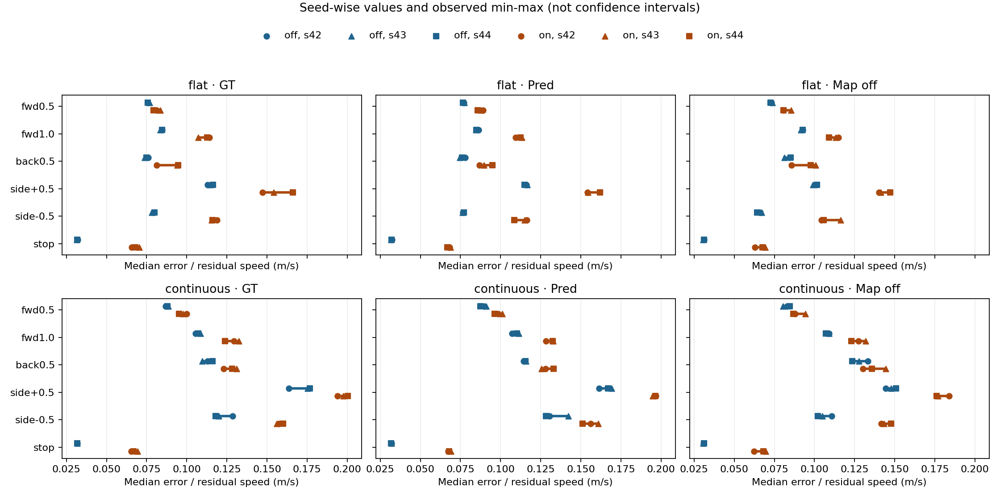
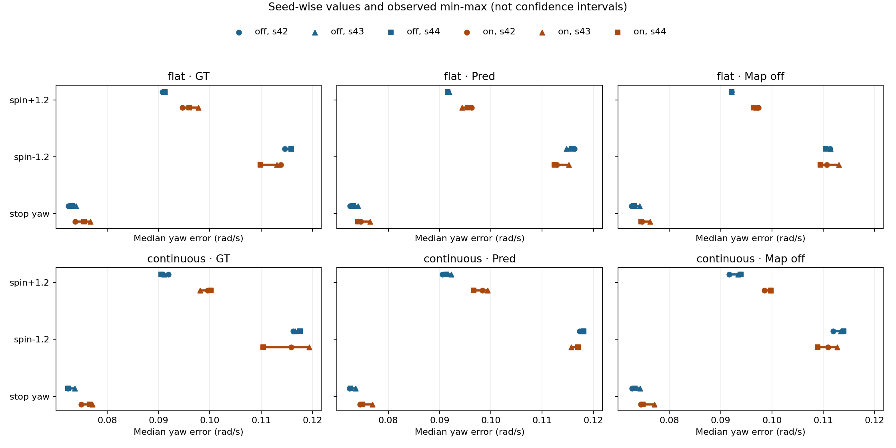

> 분류: A/평가 · N21 시드 간 폭
> 작성: analyst · 2026-11-08 13:29:29
> 근거: 같은 m12000 평가 영수증 12개 · NPZ 288개 · seed42/43/44 · 오전 N21 표 재대조
> 요지: 시드별 생존과 추종 오차의 범위를 분리하고, 오전 DR 차이를 그 관측 폭과 비교한다.
> 상태: record_only 기술 통계 · 승급/중단 판정 없음 · GPU/Kit 신규 실행 없음

# N21 · 시드 42·43·44 사이의 관측 폭

## 먼저 읽을 내용

- [실측] 생존 48칸 중 오전 on/off 차이의 크기가 양쪽 시드 폭보다 큰 칸은 0개, 폭 이하인 칸은 48개다. 추종 오차·정지 잔류 속도 54성분은 각각 41개와 13개다. 정지의 m/s와 rad/s는 별도 성분이다.
- [실측] 세 시드 모두 같은 방향의 on/off 차이를 보인 오차 성분은 50/54다. 이 수와 위의 폭 비교는 다른 질문이다. 모든 칸의 실제 숫자는 아래 표와 CSV에 있다.
- [해석 한계] 이 폭은 신뢰구간이나 합격선이 아니다. 세 평가 시드에서 관측한 최솟값과 최댓값일 뿐이며, 그 안에 드는 차이를 “효과 없음”이라고 부르지 않는다. 밖에 있는 차이도 통계적 유의성이나 DR 인과 효과로 확정하지 않는다.
- [조건] 같은 정책·L2·64 env·300 step이지만 seed42는 이전 코드 판, 평지 off는 GPU1이다. seed43/44는 고정 7916a52·GPU0이다. 변경된 코드의 평가 경로를 대조했고 아래에 범위를 적었다. 연속 지형 생성 시드도 바뀌므로 순수한 동일 장면 재측정 잡음이 아니다.

- [실측] 평지·연속 지형의 전진1.0·횡±0.5는 지도 셋, 총 18칸 모두 세 시드에서 on 오차가 더 컸다. 오전 차이는 모두 폭보다 컸다. 현재 평가의 on 조건에서 큰 오차가 반복 관측됐다는 뜻이며, 학습을 더 해야 하는지의 판정은 아니다.
- [실측 반례] 평지·복원·회전−1.2의 Δ42는 -0.0034 rad/s, 폭은 0.0028 rad/s라 크기만 보면 “큼”이다. 하지만 시드별 차이는 -0.00343, +0.00044, -0.00333 rad/s로 부호가 뒤집힌다. 이 칸을 “DR에서 회전 개선”이라고 읽지 않는다.

## 1. 실제로 다른 시드였나

영수증 eval_seed, run_identity.eval_seed, 각 NPZ의 run_identity를 각각 대조했다. 아래 12판은 모두 기대한 시드와 일치한다. checkpoint SHA는 모두 `1c6af6319c823c718af4965064f1c312b0d25177f5223a49c323aab3b6f1e613`이다. actor/critic은 같은 저장본이며 새로 학습한 시드 세 개가 아니다.

| 지형 | DR | seed | 코드 HEAD | GPU | NPZ 수 |
| --- | --- | --- | --- | --- | --- |
| flat | off | 42 | 1771ee04 | cuda:1 | 24 |
| flat | off | 43 | 7916a52f | cuda:0 | 24 |
| flat | off | 44 | 7916a52f | cuda:0 | 24 |
| flat | on | 42 | d1dfd4f9 | cuda:0 | 24 |
| flat | on | 43 | 7916a52f | cuda:0 | 24 |
| flat | on | 44 | 7916a52f | cuda:0 | 24 |
| continuous | off | 42 | 1771ee04 | cuda:0 | 24 |
| continuous | off | 43 | 7916a52f | cuda:0 | 24 |
| continuous | off | 44 | 7916a52f | cuda:0 | 24 |
| continuous | on | 42 | d1dfd4f9 | cuda:0 | 24 |
| continuous | on | 43 | 7916a52f | cuda:0 | 24 |
| continuous | on | 44 | 7916a52f | cuda:0 | 24 |

| 지형 | 시드 짝 | 질량이 다른 env | 마찰이 다른 env | 밀기 배열이 다른 칸 |
| --- | --- | --- | --- | --- |
| flat | 42/43 | 64/64 | 64/64 | 24/24 |
| flat | 42/44 | 64/64 | 64/64 | 24/24 |
| flat | 43/44 | 64/64 | 64/64 | 24/24 |
| continuous | 42/43 | 64/64 | 64/64 | 24/24 |
| continuous | 42/44 | 64/64 | 64/64 | 24/24 |
| continuous | 43/44 | 64/64 | 64/64 | 24/24 |

| 지형 | DR | 시드 짝 | start_xy 다른 칸 | vx 시계열 다른 칸 |
| --- | --- | --- | --- | --- |
| flat | off | 42/43 | 24/24 | 24/24 |
| flat | off | 42/44 | 24/24 | 24/24 |
| flat | off | 43/44 | 24/24 | 24/24 |
| flat | on | 42/43 | 24/24 | 24/24 |
| flat | on | 42/44 | 24/24 | 24/24 |
| flat | on | 43/44 | 24/24 | 24/24 |
| continuous | off | 42/43 | 24/24 | 24/24 |
| continuous | off | 42/44 | 24/24 | 24/24 |
| continuous | off | 43/44 | 24/24 | 24/24 |
| continuous | on | 42/43 | 24/24 | 24/24 |
| continuous | on | 42/44 | 24/24 | 24/24 |
| continuous | on | 43/44 | 24/24 | 24/24 |

DR-on 질량 가산 −1~+3 kg·정적/동적 마찰 0.2~1.2 범위와 dynamic≤static을 세 시드 모두 다시 확인했다. 같은 시드에서는 평지/연속 지형의 질량·마찰이 같고, 각 판의 24칸에서도 같은 물성을 재사용한다. 따라서 이를 6개 또는 72개의 독립 물리 시드로 세지 않는다. DR-off의 실제 물성 배열은 여전히 기록에 없어 nominal 물성 실측 검증은 미완이다.

영수증의 terrain_hash는 env에 배정된 종류·레벨·열의 해시다. 모든 판에서 같은 배치를 확인했지만 메시 바이트 동일성을 뜻하지 않는다. N21은 `configure_terrain(..., eval_seed)`로 지형 생성기 seed도 바꾼다. 연속 지형의 무작위 기하가 영향을 받는 범위는 이 평가 변동에 포함되며, 메시 자체는 영수증에 보존되지 않았다.

## 2. 어떻게 폭을 계산했나

1. 각 env의 생존 중 명령 대비 절대오차 평균을 구한 뒤 64 env 중앙값을 구한다. 전진·후진은 vx, 횡 이동은 vy, 회전은 wz다. 정지는 수평 속도와 yaw 절댓값을 따로 쓴다. 중간 종료 env도 살아 있던 구간의 오차에 포함되므로 생존 표를 같이 본다.
2. 그렇게 얻은 seed42/43/44 중앙값 세 개의 min~max가 조건별 시드 범위이며, 폭은 max−min이다. 생존은 각 시드의 끝까지 생존 인원(분모64) 세 개로 같은 계산을 한다. 세 시드의 env를 한데 섞어 중앙값을 다시 만들지 않는다.
3. 오전 차이 Δ42 = on42−off42. 비교 폭 W = max(on 폭, off 폭). 절댓값(Δ42)>W이면 “큼”, 같거나 작으면 “안”으로 적는다[분석 정의]. 한쪽의 작은 폭만 골라 비교하지 않는다. 수치 반올림 전 값으로 계산한다.
4. `comparison.csv`에는 세 개의 on−off 차이와 범위 겹침도 같이 넣었다. “큼”이면서도 새 시드에서 부호가 바뀔 수 있다. 이는 실제 답을 아는 반례로 생성기를 확인했다. 어느 표기도 학습 판정에 연결하지 않는다.

## 3. 생존 · 세 시드 인원과 범위

인원 단위이며 모든 분모는64다. 각 묶음의 순서는42/43/44. Δ42가 양수면 오전 on에서 더 많이 살아남은 것이다. 생존은 정상 보행·추종 성공을 의미하지 않는다.

### 평지

| 지도·명령 | off 42/43/44 | on 42/43/44 | off 범위 | on 범위 | Δ42 | W | 폭 비교 |
| --- | --- | --- | --- | --- | --- | --- | --- |
| 정답 · fwd0.5 | 64 / 64 / 64 | 64 / 64 / 64 | 64~64 | 64~64 | 0 | 0 | 안 |
| 정답 · fwd1.0 | 64 / 64 / 64 | 64 / 64 / 64 | 64~64 | 64~64 | 0 | 0 | 안 |
| 정답 · spin+1.2 | 64 / 64 / 64 | 64 / 64 / 64 | 64~64 | 64~64 | 0 | 0 | 안 |
| 정답 · spin-1.2 | 64 / 64 / 64 | 64 / 64 / 64 | 64~64 | 64~64 | 0 | 0 | 안 |
| 정답 · back0.5 | 64 / 64 / 64 | 64 / 64 / 64 | 64~64 | 64~64 | 0 | 0 | 안 |
| 정답 · side+0.5 | 64 / 64 / 64 | 64 / 64 / 64 | 64~64 | 64~64 | 0 | 0 | 안 |
| 정답 · side-0.5 | 64 / 64 / 64 | 64 / 64 / 64 | 64~64 | 64~64 | 0 | 0 | 안 |
| 정답 · stop | 64 / 64 / 64 | 64 / 64 / 64 | 64~64 | 64~64 | 0 | 0 | 안 |
| 복원 · fwd0.5 | 64 / 64 / 64 | 64 / 64 / 64 | 64~64 | 64~64 | 0 | 0 | 안 |
| 복원 · fwd1.0 | 64 / 64 / 64 | 64 / 64 / 64 | 64~64 | 64~64 | 0 | 0 | 안 |
| 복원 · spin+1.2 | 64 / 64 / 64 | 64 / 64 / 64 | 64~64 | 64~64 | 0 | 0 | 안 |
| 복원 · spin-1.2 | 64 / 64 / 64 | 64 / 64 / 64 | 64~64 | 64~64 | 0 | 0 | 안 |
| 복원 · back0.5 | 64 / 64 / 64 | 64 / 64 / 64 | 64~64 | 64~64 | 0 | 0 | 안 |
| 복원 · side+0.5 | 64 / 64 / 64 | 64 / 64 / 64 | 64~64 | 64~64 | 0 | 0 | 안 |
| 복원 · side-0.5 | 64 / 64 / 64 | 64 / 64 / 64 | 64~64 | 64~64 | 0 | 0 | 안 |
| 복원 · stop | 64 / 64 / 64 | 64 / 64 / 64 | 64~64 | 64~64 | 0 | 0 | 안 |
| 끔 · fwd0.5 | 64 / 64 / 64 | 64 / 64 / 64 | 64~64 | 64~64 | 0 | 0 | 안 |
| 끔 · fwd1.0 | 64 / 64 / 64 | 64 / 64 / 64 | 64~64 | 64~64 | 0 | 0 | 안 |
| 끔 · spin+1.2 | 64 / 64 / 64 | 64 / 64 / 64 | 64~64 | 64~64 | 0 | 0 | 안 |
| 끔 · spin-1.2 | 64 / 64 / 64 | 64 / 64 / 64 | 64~64 | 64~64 | 0 | 0 | 안 |
| 끔 · back0.5 | 64 / 64 / 64 | 64 / 64 / 64 | 64~64 | 64~64 | 0 | 0 | 안 |
| 끔 · side+0.5 | 64 / 64 / 64 | 64 / 64 / 64 | 64~64 | 64~64 | 0 | 0 | 안 |
| 끔 · side-0.5 | 64 / 64 / 64 | 64 / 64 / 64 | 64~64 | 64~64 | 0 | 0 | 안 |
| 끔 · stop | 64 / 64 / 64 | 64 / 64 / 64 | 64~64 | 64~64 | 0 | 0 | 안 |

### 연속 7종 혼합

| 지도·명령 | off 42/43/44 | on 42/43/44 | off 범위 | on 범위 | Δ42 | W | 폭 비교 |
| --- | --- | --- | --- | --- | --- | --- | --- |
| 정답 · fwd0.5 | 64 / 64 / 64 | 64 / 64 / 64 | 64~64 | 64~64 | 0 | 0 | 안 |
| 정답 · fwd1.0 | 63 / 64 / 63 | 64 / 64 / 64 | 63~64 | 64~64 | 1 | 1 | 안 |
| 정답 · spin+1.2 | 64 / 64 / 64 | 64 / 64 / 64 | 64~64 | 64~64 | 0 | 0 | 안 |
| 정답 · spin-1.2 | 64 / 64 / 64 | 64 / 64 / 64 | 64~64 | 64~64 | 0 | 0 | 안 |
| 정답 · back0.5 | 63 / 64 / 64 | 62 / 63 / 64 | 63~64 | 62~64 | -1 | 2 | 안 |
| 정답 · side+0.5 | 64 / 64 / 64 | 64 / 62 / 64 | 64~64 | 62~64 | 0 | 2 | 안 |
| 정답 · side-0.5 | 64 / 64 / 64 | 64 / 64 / 62 | 64~64 | 62~64 | 0 | 2 | 안 |
| 정답 · stop | 64 / 64 / 64 | 64 / 64 / 64 | 64~64 | 64~64 | 0 | 0 | 안 |
| 복원 · fwd0.5 | 64 / 64 / 64 | 64 / 64 / 64 | 64~64 | 64~64 | 0 | 0 | 안 |
| 복원 · fwd1.0 | 62 / 64 / 63 | 64 / 64 / 64 | 62~64 | 64~64 | 2 | 2 | 안 |
| 복원 · spin+1.2 | 64 / 64 / 64 | 64 / 64 / 64 | 64~64 | 64~64 | 0 | 0 | 안 |
| 복원 · spin-1.2 | 64 / 64 / 64 | 64 / 64 / 64 | 64~64 | 64~64 | 0 | 0 | 안 |
| 복원 · back0.5 | 64 / 64 / 63 | 64 / 64 / 64 | 63~64 | 64~64 | 0 | 1 | 안 |
| 복원 · side+0.5 | 64 / 64 / 63 | 63 / 63 / 64 | 63~64 | 63~64 | -1 | 1 | 안 |
| 복원 · side-0.5 | 64 / 64 / 63 | 63 / 64 / 64 | 63~64 | 63~64 | -1 | 1 | 안 |
| 복원 · stop | 64 / 64 / 64 | 64 / 64 / 64 | 64~64 | 64~64 | 0 | 0 | 안 |
| 끔 · fwd0.5 | 64 / 64 / 64 | 64 / 64 / 64 | 64~64 | 64~64 | 0 | 0 | 안 |
| 끔 · fwd1.0 | 62 / 64 / 63 | 64 / 64 / 64 | 62~64 | 64~64 | 2 | 2 | 안 |
| 끔 · spin+1.2 | 64 / 64 / 64 | 64 / 64 / 64 | 64~64 | 64~64 | 0 | 0 | 안 |
| 끔 · spin-1.2 | 64 / 64 / 64 | 64 / 63 / 64 | 64~64 | 63~64 | 0 | 1 | 안 |
| 끔 · back0.5 | 64 / 64 / 64 | 63 / 64 / 64 | 64~64 | 63~64 | -1 | 1 | 안 |
| 끔 · side+0.5 | 64 / 64 / 63 | 64 / 64 / 64 | 63~64 | 64~64 | 0 | 1 | 안 |
| 끔 · side-0.5 | 64 / 64 / 64 | 63 / 64 / 63 | 64~64 | 63~64 | -1 | 1 | 안 |
| 끔 · stop | 64 / 64 / 64 | 64 / 64 / 64 | 64~64 | 64~64 | 0 | 0 | 안 |

## 4. 추종 오차 중앙값 · 세 시드 범위

Δ42가 양수면 오전 on의 오차가 더 컸다는 뜻이다. “같은 방향”은 42·43·44 모두 on−off가 양수(+), 음수(−)인지이며, 섞이면 “혼합”이다. 단위가 다른 정지 성분은 합산하지 않는다.

점은 각 시드, 선분은 관측 min~max다. 신뢰구간이 아니다. 파랑은off, 갈색은on이다.

### 평지

| 지도·명령·성분 | 단위 | off min~max | on min~max | Δ42 | W | 폭 비교 | 세 시드 방향 |
| --- | --- | --- | --- | --- | --- | --- | --- |
| 정답 · fwd0.5 · vx | m/s | 0.0756~0.0768 | 0.0793~0.0835 | 0.0056 | 0.0042 | 큼 | + |
| 정답 · fwd1.0 · vx | m/s | 0.0834~0.0846 | 0.1073~0.1142 | 0.0296 | 0.0069 | 큼 | + |
| 정답 · spin+1.2 · wz | rad/s | 0.0908~0.0913 | 0.0947~0.0978 | 0.0039 | 0.0031 | 큼 | + |
| 정답 · spin-1.2 · wz | rad/s | 0.1146~0.1159 | 0.1099~0.1139 | -0.0007 | 0.0040 | 안 | − |
| 정답 · back0.5 · vx | m/s | 0.0738~0.0761 | 0.0814~0.0947 | 0.0053 | 0.0134 | 안 | + |
| 정답 · side+0.5 · vy | m/s | 0.1130~0.1164 | 0.1473~0.1662 | 0.0342 | 0.0190 | 큼 | + |
| 정답 · side-0.5 · vy | m/s | 0.0781~0.0799 | 0.1155~0.1188 | 0.0394 | 0.0033 | 큼 | + |
| 정답 · stop · stop_xy | m/s | 0.0314~0.0321 | 0.0657~0.0705 | 0.0336 | 0.0047 | 큼 | + |
| 정답 · stop · stop_wz | rad/s | 0.0724~0.0739 | 0.0738~0.0767 | 0.0013 | 0.0030 | 안 | + |
| 복원 · fwd0.5 · vx | m/s | 0.0765~0.0775 | 0.0857~0.0891 | 0.0119 | 0.0034 | 큼 | + |
| 복원 · fwd1.0 · vx | m/s | 0.0846~0.0864 | 0.1093~0.1133 | 0.0229 | 0.0040 | 큼 | + |
| 복원 · spin+1.2 · wz | rad/s | 0.0916~0.0919 | 0.0944~0.0962 | 0.0046 | 0.0019 | 큼 | + |
| 복원 · spin-1.2 · wz | rad/s | 0.1147~0.1163 | 0.1124~0.1152 | -0.0034 | 0.0028 | 큼 | 혼합/0 |
| 복원 · back0.5 · vx | m/s | 0.0745~0.0778 | 0.0869~0.0950 | 0.0091 | 0.0081 | 큼 | + |
| 복원 · side+0.5 · vy | m/s | 0.1150~0.1165 | 0.1542~0.1621 | 0.0382 | 0.0079 | 큼 | + |
| 복원 · side-0.5 · vy | m/s | 0.0763~0.0772 | 0.1085~0.1163 | 0.0398 | 0.0077 | 큼 | + |
| 복원 · stop · stop_xy | m/s | 0.0318~0.0324 | 0.0669~0.0688 | 0.0357 | 0.0019 | 큼 | + |
| 복원 · stop · stop_wz | rad/s | 0.0725~0.0741 | 0.0741~0.0764 | 0.0021 | 0.0023 | 안 | + |
| 끔 · fwd0.5 · vx | m/s | 0.0727~0.0738 | 0.0806~0.0854 | 0.0073 | 0.0049 | 큼 | + |
| 끔 · fwd1.0 · vx | m/s | 0.0917~0.0928 | 0.1091~0.1149 | 0.0223 | 0.0059 | 큼 | + |
| 끔 · spin+1.2 · wz | rad/s | 0.0921~0.0921 | 0.0965~0.0974 | 0.0053 | 0.0009 | 큼 | + |
| 끔 · spin-1.2 · wz | rad/s | 0.1104~0.1114 | 0.1095~0.1130 | -0.0006 | 0.0036 | 안 | 혼합/0 |
| 끔 · back0.5 · vx | m/s | 0.0813~0.0851 | 0.0857~0.1007 | 0.0011 | 0.0151 | 안 | + |
| 끔 · side+0.5 · vy | m/s | 0.0992~0.1016 | 0.1403~0.1471 | 0.0391 | 0.0069 | 큼 | + |
| 끔 · side-0.5 · vy | m/s | 0.0643~0.0672 | 0.1044~0.1162 | 0.0382 | 0.0118 | 큼 | + |
| 끔 · stop · stop_xy | m/s | 0.0307~0.0311 | 0.0628~0.0693 | 0.0317 | 0.0064 | 큼 | + |
| 끔 · stop · stop_wz | rad/s | 0.0726~0.0742 | 0.0745~0.0762 | 0.0020 | 0.0017 | 큼 | + |

### 연속 7종 혼합

| 지도·명령·성분 | 단위 | off min~max | on min~max | Δ42 | W | 폭 비교 | 세 시드 방향 |
| --- | --- | --- | --- | --- | --- | --- | --- |
| 정답 · fwd0.5 · vx | m/s | 0.0868~0.0886 | 0.0951~0.0998 | 0.0130 | 0.0047 | 큼 | + |
| 정답 · fwd1.0 · vx | m/s | 0.1054~0.1085 | 0.1239~0.1326 | 0.0239 | 0.0087 | 큼 | + |
| 정답 · spin+1.2 · wz | rad/s | 0.0905~0.0919 | 0.0981~0.1002 | 0.0077 | 0.0022 | 큼 | + |
| 정답 · spin-1.2 · wz | rad/s | 0.1162~0.1176 | 0.1104~0.1194 | -0.0004 | 0.0090 | 안 | 혼합/0 |
| 정답 · back0.5 · vx | m/s | 0.1095~0.1161 | 0.1230~0.1310 | 0.0101 | 0.0080 | 큼 | + |
| 정답 · side+0.5 · vy | m/s | 0.1636~0.1767 | 0.1939~0.2004 | 0.0304 | 0.0131 | 큼 | + |
| 정답 · side-0.5 · vy | m/s | 0.1179~0.1285 | 0.1560~0.1601 | 0.0291 | 0.0106 | 큼 | + |
| 정답 · stop · stop_xy | m/s | 0.0317~0.0318 | 0.0655~0.0695 | 0.0337 | 0.0039 | 큼 | + |
| 정답 · stop · stop_wz | rad/s | 0.0724~0.0737 | 0.0750~0.0771 | 0.0026 | 0.0021 | 큼 | + |
| 복원 · fwd0.5 · vx | m/s | 0.0874~0.0909 | 0.0964~0.1009 | 0.0091 | 0.0045 | 큼 | + |
| 복원 · fwd1.0 · vx | m/s | 0.1072~0.1114 | 0.1283~0.1328 | 0.0211 | 0.0045 | 큼 | + |
| 복원 · spin+1.2 · wz | rad/s | 0.0906~0.0923 | 0.0967~0.0994 | 0.0078 | 0.0027 | 큼 | + |
| 복원 · spin-1.2 · wz | rad/s | 0.1173~0.1181 | 0.1156~0.1170 | -0.0003 | 0.0014 | 안 | − |
| 복원 · back0.5 · vx | m/s | 0.1145~0.1158 | 0.1256~0.1331 | 0.0136 | 0.0075 | 큼 | + |
| 복원 · side+0.5 · vy | m/s | 0.1613~0.1693 | 0.1948~0.1966 | 0.0353 | 0.0080 | 큼 | + |
| 복원 · side-0.5 · vy | m/s | 0.1284~0.1423 | 0.1512~0.1608 | 0.0255 | 0.0139 | 큼 | + |
| 복원 · stop · stop_xy | m/s | 0.0317~0.0321 | 0.0674~0.0691 | 0.0353 | 0.0017 | 큼 | + |
| 복원 · stop · stop_wz | rad/s | 0.0725~0.0737 | 0.0745~0.0769 | 0.0021 | 0.0024 | 안 | + |
| 끔 · fwd0.5 · vx | m/s | 0.0804~0.0846 | 0.0868~0.0943 | 0.0050 | 0.0075 | 안 | + |
| 끔 · fwd1.0 · vx | m/s | 0.1073~0.1091 | 0.1229~0.1320 | 0.0183 | 0.0090 | 큼 | + |
| 끔 · spin+1.2 · wz | rad/s | 0.0917~0.0939 | 0.0986~0.0998 | 0.0069 | 0.0023 | 큼 | + |
| 끔 · spin-1.2 · wz | rad/s | 0.1119~0.1139 | 0.1089~0.1127 | -0.0010 | 0.0038 | 안 | − |
| 끔 · back0.5 · vx | m/s | 0.1234~0.1333 | 0.1301~0.1445 | -0.0032 | 0.0144 | 안 | 혼합/0 |
| 끔 · side+0.5 · vy | m/s | 0.1443~0.1507 | 0.1760~0.1838 | 0.0395 | 0.0078 | 큼 | + |
| 끔 · side-0.5 · vy | m/s | 0.1022~0.1107 | 0.1416~0.1477 | 0.0309 | 0.0084 | 큼 | + |
| 끔 · stop · stop_xy | m/s | 0.0307~0.0312 | 0.0623~0.0697 | 0.0313 | 0.0074 | 큼 | + |
| 끔 · stop · stop_wz | rad/s | 0.0727~0.0743 | 0.0744~0.0771 | 0.0017 | 0.0026 | 안 | + |

## 5. 어디까지 말할 수 있나

- [실측] 해당 m12000 정책을 같은 명령·레벨·표본 길이에서 평가했을 때의 관측 폭을 얻었다. 64 env·6초를 3회 평가했으며, 학습 시드 일반화 시험은 아니다. 시드 범위는 샘플을 더 얻으면 넓어질 수 있다.
- [한계] 오전 on은d1dfd4f9, off는1771ee04, 이번 반복은7916a52다. source_sha256 비교와 git diff에서 on 평가기에 대한 변경은 off 모드 허용·영수증이고, start_runner 변경은 EX42 학습 전이·회차 경로다. 이번 N21 평가 호출 경로의 바뀐 처치는 찾지 못했으나 모든 판이 동일 바이너리였다고 적지 않는다. diff 원문은 산출 폴더에 보존했다.
- [한계] 평지 off seed42는GPU1, seed43/44는GPU0이다. 따라서 세 시드의 폭에 장치·실행 비결정성이 함께 섞일 수 있다. 같은 seed on/off도 DR의 추가 난수 소비 때문에 초기 자세·관측 잡음 궤적이 같지 않다.
- [한계] DR은 마찰 하나가 아니라 질량·COM·이득·세기·지연·밀기 묶음이다. 명령 시작 2초에 단 한 번 미는 평가이므로 정지 오차에는 밀기 뒤 회복 움직임이 들어간다. 어느 DR 성분이 차이를 만들었는지는 이 표로 분리할 수 없다.
- [한계] 연속 지형 혼합은 계단15+역형계단15+boxes12+rough12+경사4+역경사4+stage_stairs2다. 전체64의 폭이 희소한 종류별 안정성을 보증하지 않는다. 어려운 L5/L9, 장시간, 명령 전환, 실기는 범위 밖이다.
- [한계] vx와 생존은 NPZ 원시 시계열에서 다시 셌다. vy/wz 원시 시계열은 이 NPZ에 없으므로 JSON의 env별 요약을 재집계한 수준이다. 영상·접촉 위상·발 미끄럼을 새로 판독하지 않았으며, 숫자만으로 보행 품질 또는 넘어짐 원인을 단정하지 않는다.

## 6. 재현과 근거

| 항목 | 근거 |
| --- | --- |
| 원자료·해시 | N21-seedwidth-1108/audit.json inputs · JSON12/NPZ288 · 원자료는 읽기만 |
| 시드→지형/환경 | runner-ex42-w65-7916a52/foothold_s2/eval/eval_map_modes.py:157 · n21_dr_record.py:167 |
| 시드→각 명령 reset | 같은 eval_map_modes.py:399~408 · 평균 행동 :465 |
| 밀기 시드·시각 | 같은 eval_dr_mode.py:171~174 · readback.push_events[0], 모든 셀 2.0초 |
| 지형 생성기의 seed | C:/isaac/isaaclab/source/isaaclab/isaaclab/terrains/terrain_generator.py:139~148 · :363 |
| 오전 대조 | REPORT-analyst-N21-1108.md · N21-1108/audit.json, seed42 48칸 생존·54오차 성분 일치 |
| CSV | cells.csv: 각 시드값 · comparison.csv: 폭·차이 · seed_array_checks.csv: 실제 배열 비교 |
| 생성기 | N21-seedwidth-1108/n21_seedwidth_1108.py · n21_seedwidth_report_1108.py |
| 답을 아는 입력 | 9건: 중앙값·폭 경계·부호 반전·0폭·행 비교·단위 분리·비유한값 거절 |

집계기에서 입력 해시를 보존하고, JSON↔NPZ의 시드·체크포인트·GPU·생존·alive 샘플 수를 대조했다. 모든 오차 중앙값은 NumPy와 표준 라이브러리 statistics.median의 두 계산이 일치했다. 결과 후 임계값을 넓히거나 승급 판정을 만들지 않았다.

재현: 보존한 `n21_seedwidth_1108.py --out <집계 폴더>` 실행 뒤 `n21_seedwidth_report_1108.py --audit-dir <집계 폴더>`를 실행한다. CPU Python은 `C:/Users/AI-WS01/anaconda3/envs/isaac311/python.exe`. 입력은 위 원자료 경로 그대로 필요하다.
