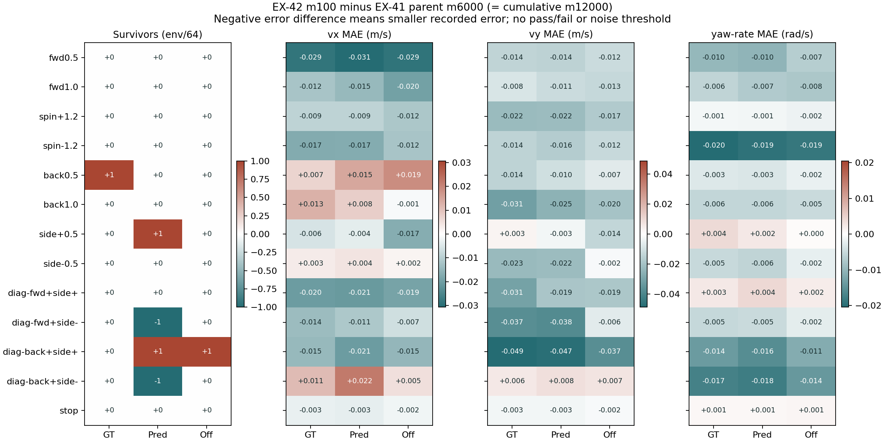
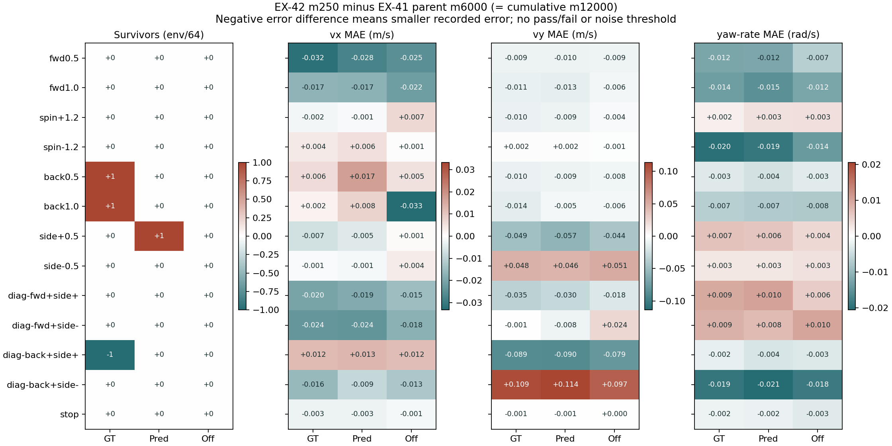
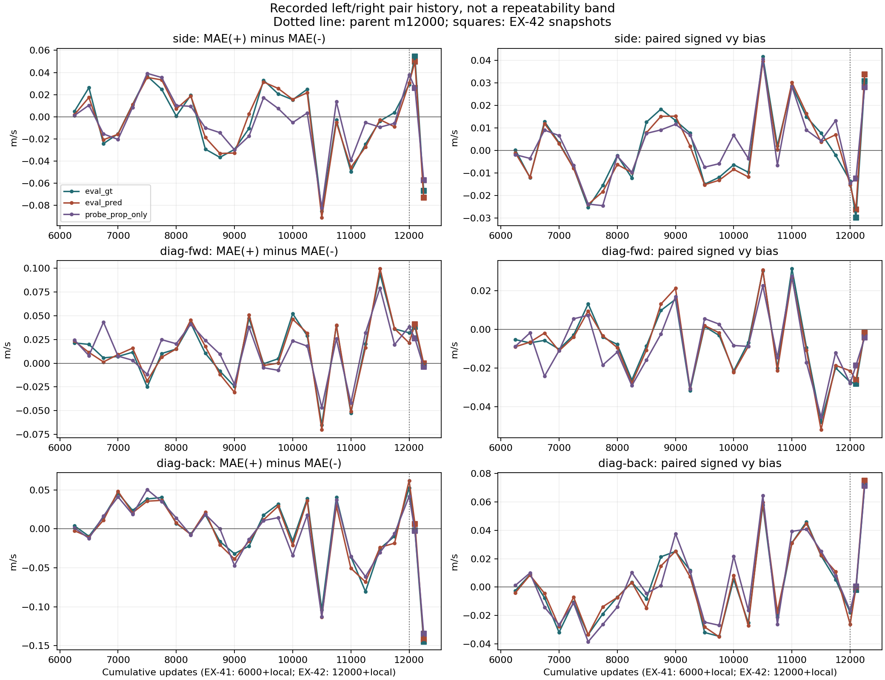

> 분류: A/평가 · EX-42 0 단계 경계 비교
> 작성: analyst · 2026-11-08T15:01:27
> 근거: EX-41 map64 부모와 경계 기록 · EX-42 완료 map64 · JSON/NPZ 직접 재집계
> 요지: 생존과 vx·vy·yaw 속도 오차를 따로 비교한다. 지형 배치 해시와 조건을 먼저 확인한다.
> 상태: record_only · 승급/중단 판정 없음 · CPU 분석만

# EX-42 0 단계 map64 경계 비교

현재 완료되어 포함된 EX-42 저장본은 m100, m250이다. EX-41 부모는 로컬 m6000, 누적 m12000이다. EX-42 m100은 부모 뒤 추가 100회이며 EX-41 m100과 같은 시점이 아니다.

표의 숫자는 생성기가 원자료에서 읽었다. EX-41 m250~m5750은 서로 다른 학습 상태의 기록으로, 그 최솟값~최댓값을 같은 정책의 재측정 폭이라고 부르지 않는다.

## 먼저 읽을 기록

각 성분이 서로 반대로 움직일 수 있으므로 한 점수로 합치지 않았다. 아래는 전진·좌우 횡이동·뒤 대각 이동의 해당 속도 성분이다. 모두 절대 오차 중앙값(m/s)이며, 낮을수록 이 기록에서 명령과 가깝다. 판정이나 원인 추론은 하지 않는다.

| 지도 | 명령·성분 | 부모 | EX-42 m100 | EX-42 m250 |
| --- | --- | --- | --- | --- |
| 정답 | fwd1.0 · vx | 0.0994 | 0.0874 | 0.0825 |
| 복원 | fwd1.0 · vx | 0.1012 | 0.0866 | 0.0839 |
| 끔 | fwd1.0 · vx | 0.1042 | 0.0846 | 0.0823 |
| 정답 | side+0.5 · vy | 0.1457 | 0.1485 | 0.0972 |
| 복원 | side+0.5 · vy | 0.1497 | 0.1468 | 0.0925 |
| 끔 | side+0.5 · vy | 0.1369 | 0.1233 | 0.0929 |
| 정답 | side-0.5 · vy | 0.1166 | 0.0939 | 0.1641 |
| 복원 | side-0.5 · vy | 0.1192 | 0.0972 | 0.1654 |
| 끔 | side-0.5 · vy | 0.0988 | 0.0972 | 0.1500 |
| 정답 | diag-back+side+ · vy | 0.1717 | 0.1230 | 0.0831 |
| 복원 | diag-back+side+ · vy | 0.1708 | 0.1234 | 0.0812 |
| 끔 | diag-back+side+ · vy | 0.1518 | 0.1147 | 0.0726 |
| 정답 | diag-back+side- · vy | 0.1191 | 0.1249 | 0.2281 |
| 복원 | diag-back+side- · vy | 0.1091 | 0.1171 | 0.2228 |
| 끔 | diag-back+side- · vy | 0.1102 | 0.1172 | 0.2075 |

[실측에서 복원] 최신 m250의 횡이동 짝 공통 vy 치우침은 지도 셋에서 +0.0281~+0.0338 m/s, 뒤 대각 짝은 +0.0714~+0.0749 m/s다. 양수는 몸좌표 +y 방향이다. 명령을 뺀 짝의 치우침 정의와 복원 한계는 3b절에 적었다.

## 1. 먼저 비교 조건

[실측] 포함된 26판의 39칸 지형 배치 해시는 모두 `c3884d686592596ee6ac7b2cdfc94e0b1d3f6d84dbca66c52ad20a0400e2358f`다. JSON의 해시만 읽지 않고 각 NPZ의 level·column·kind와 64칸 표를 대조했고, level/column 배열에서 해시를 다시 만들었다. 이 해시는 지형 배치이지 메시 기하 전체의 해시가 아니다. 메시 바이트의 동일성은 미확인이다.

[실측] 부모와 각 판의 동일 칸 NPZ start_xy 차이 최댓값은 0.00000000 m다. 같은 시작 좌표인 것은 확인했지만, 이것만으로 모든 물리 상태가 같다고 단정하지 않는다.

| 항목 | 부모와 EX-42 |
| --- | --- |
| 환경·시간 | 64 env · 300 step · dt 0.02 s = 6초 |
| 지형 | 연속 7종 · 23열 · L0/L1/L2 = 23/23/18 env · 별도 평지 칸 없음 |
| 명령·지도 | 13개 고정 명령 × 정답/복원/끔 = 39칸 · 독립 reset |
| 시드·관측 | eval_seed 42 · actor 98 / critic 666 · pose_cmd [0,0] |
| DR 표시 | dr_off=[physics_material, add_base_mass] 동일 · 물성 실측 배열은 이 map64에 없음 |
| 지형 승급 | 평가 중 terrain_levels 계열 curriculum 끔 · 고정 칸 |
| 차이 | EX-41 GPU1 / EX-42 GPU0, 실행 코드 HEAD 다름. 엄격한 동일 실행 조건의 인과 비교는 불가 |
| 정책 | 다른 학습 저장본. 부모 SHA·각 저장본 SHA는 입력 목록에 기록 |


| 판 | 회차 | code HEAD | GPU | 저장된 force_gt | JSON SHA 앞12 | 평가 설정 대조 |
| --- | --- | --- | --- | --- | --- | --- |
| EX-41 | 250 | 2b01df9a | cuda:1 | True | 44915066e932 | 일치 |
| EX-41 | 500 | 2b01df9a | cuda:1 | True | cbd61951fe90 | 일치 |
| EX-41 | 750 | 2b01df9a | cuda:1 | True | 07ce92284643 | 일치 |
| EX-41 | 1000 | 2b01df9a | cuda:1 | True | b6ee864cb02f | 일치 |
| EX-41 | 1250 | 2b01df9a | cuda:1 | True | 581b3da8a9ed | 일치 |
| EX-41 | 1500 | 2b01df9a | cuda:1 | True | e7c3e446ab7c | 일치 |
| EX-41 | 1750 | f3727983 | cuda:1 | True | ebf66ffd2ee6 | 일치 |
| EX-41 | 2000 | f3727983 | cuda:1 | True | ffeeb4781aa8 | 일치 |
| EX-41 | 2250 | f3727983 | cuda:1 | True | 9fc33909091f | 일치 |
| EX-41 | 2500 | 17b4bad6 | cuda:1 | True | a12ae4f7bf39 | 일치 |
| EX-41 | 2750 | 17b4bad6 | cuda:1 | True | 8cb4578ec6d2 | 일치 |
| EX-41 | 3000 | 432e2f10 | cuda:1 | True | 19308e2e0ffd | 일치 |
| EX-41 | 3250 | 432e2f10 | cuda:1 | True | 55201f99516c | 일치 |
| EX-41 | 3500 | 432e2f10 | cuda:1 | True | e5be1809540d | 일치 |
| EX-41 | 3750 | 432e2f10 | cuda:1 | True | bcf91f59f79b | 일치 |
| EX-41 | 4000 | 432e2f10 | cuda:1 | True | ef3b8fc16bb1 | 일치 |
| EX-41 | 4250 | 432e2f10 | cuda:1 | True | 43708db723bd | 일치 |
| EX-41 | 4500 | 432e2f10 | cuda:1 | True | 9991c46104e0 | 일치 |
| EX-41 | 4750 | 432e2f10 | cuda:1 | True | f59e4d7aa598 | 일치 |
| EX-41 | 5000 | 432e2f10 | cuda:1 | True | 73c49c0fa795 | 일치 |
| EX-41 | 5250 | 432e2f10 | cuda:1 | True | 90c5c1b60677 | 일치 |
| EX-41 | 5500 | 432e2f10 | cuda:1 | True | b7ee8da5cef2 | 일치 |
| EX-41 | 5750 | 432e2f10 | cuda:1 | False | 49c7dfc1212b | 일치 |
| EX-41 | 6000 | 432e2f10 | cuda:1 | False | 4acc0fcfdef5 | 일치 |
| EX-42 | 100 | eae0bed7 | cuda:0 | False | 475cb5b59300 | 일치 |
| EX-42 | 250 | eae0bed7 | cuda:0 | False | 8d53a0ea0bf8 | 일치 |

저장본의 force_gt_saved는 EX-41 m250~5500에서 True, m5750·부모 m6000·현재 EX-42에서 False다. 이는 학습 저장 상태의 차이이며 평가기의 지도 선택과 구분한다. 모든 포함 판에서 실제 gt_used는 정답 19200/19200, 복원·끔 0/19200임을 확인했다. 과거 범위에는 이런 학습 상태 변화도 들어 있다.

평가 코드 변경: 부모 432e2f10 → EX-42 eae0bed7에서 N21 DR 선택 경로가 추가됐다. extended 13명령과 map_mode_cells.summarize의 오차 식은 바뀌지 않았다. DRMode의 off 경로는 begin/step/collect에서 즉시 반환한다. StartRunner 변경은 EX-42 학습·저장·부모 이식 경로다. 다만 CPU 소스 대조는 GPU 재현 실험을 대신하지 않는다. 전체 diff는 [ex42-s0-map64-1108/source_diff.txt](ex42-s0-map64-1108/source_diff.txt)에 남겼다. 이 소스 대조는 eae0bed7 범위다. 후속 재생성 때 다른 HEAD가 들어오면 위 입력 표를 보고 별도 대조해야 한다.

## 2. 숫자의 뜻

- 생존은 마지막 스텝까지 종료되지 않은 env 수 / 64다. 성공률이나 목표 도달률이 아니다.
- vx·vy·yaw 열은 각 env가 살아 있던 스텝의 절대 추종 오차 평균을 먼저 구한 뒤, env들 사이 중앙값을 구한다. vx·vy는 m/s, yaw는 yaw 각도 오차가 아니라 wz 각속도 오차(rad/s)다.
- 명령이 0인 성분도 계산한다. 예를 들어 전진 중 vy는 옆으로 새는 속도, wz는 원치 않는 회전이다. 정지는 세 성분 모두 잔류 속도다.
- 넘어진 env도 넘어지기 전 자료는 오차 중앙값에 남긴다. 마지막까지 살아남은 env만 고르지 않는다. 종료 뒤 자료는 제외하므로 조기 종료가 낮은 오차처럼 보일 수 있어 생존을 반드시 함께 읽는다.
- vx·생존·살아 있던 스텝 수는 NPZ로 다시 계산했다. vy/wz 시간열은 NPZ에 없어 JSON의 env별 평균을 재집계했다. 부호 있는 vy는 식으로 복원 가능한 횡/대각 칸만 3b절에 따로 적었다. 보행 위상·발 미끄럼·영상 판독은 이번 표에 없다.

## 3. 부모와 EX-42 저장본을 나란히

오차 칸은 `부모 → 현재 (현재−부모)`다. 음수는 이번 기록에서 오차가 작다는 뜻이다. 통계적 개선이나 다음 단계 통과를 뜻하지 않는다. 원래 정밀도와 분모는 CSV에 보존했다.

### EX-42 m100

[실측] 생존이 부모보다 많은/같은/적은 칸: 4/33/2 (39칸).

**정답 (eval_gt)**

| 명령 | 끝 생존 | vx 오차 m/s | vy 오차 m/s | wz 오차 rad/s |
| --- | --- | --- | --- | --- |
| fwd0.5 | 64/64 → 64/64 | 0.0851 → 0.0564 (-0.0288) | 0.0458 → 0.0319 (-0.0139) | 0.0911 → 0.0812 (-0.0099) |
| fwd1.0 | 64/64 → 64/64 | 0.0994 → 0.0874 (-0.0120) | 0.0486 → 0.0402 (-0.0084) | 0.0938 → 0.0879 (-0.0059) |
| spin+1.2 | 64/64 → 64/64 | 0.0409 → 0.0320 (-0.0089) | 0.0542 → 0.0318 (-0.0224) | 0.0908 → 0.0898 (-0.0010) |
| spin-1.2 | 64/64 → 64/64 | 0.0565 → 0.0391 (-0.0174) | 0.0510 → 0.0366 (-0.0144) | 0.1171 → 0.0967 (-0.0204) |
| back0.5 | 63/64 → 64/64 | 0.1026 → 0.1097 (+0.0071) | 0.0442 → 0.0300 (-0.0142) | 0.0837 → 0.0806 (-0.0031) |
| back1.0 | 63/64 → 63/64 | 0.1288 → 0.1417 (+0.0129) | 0.0761 → 0.0448 (-0.0313) | 0.1000 → 0.0942 (-0.0057) |
| side+0.5 | 64/64 → 64/64 | 0.0562 → 0.0506 (-0.0056) | 0.1457 → 0.1485 (+0.0027) | 0.0875 → 0.0915 (+0.0040) |
| side-0.5 | 64/64 → 64/64 | 0.0400 → 0.0433 (+0.0033) | 0.1166 → 0.0939 (-0.0227) | 0.0940 → 0.0889 (-0.0052) |
| diag-fwd+side+ | 64/64 → 64/64 | 0.0814 → 0.0609 (-0.0204) | 0.1518 → 0.1211 (-0.0306) | 0.0908 → 0.0933 (+0.0025) |
| diag-fwd+side- | 64/64 → 64/64 | 0.0847 → 0.0710 (-0.0137) | 0.1197 → 0.0827 (-0.0371) | 0.0898 → 0.0845 (-0.0053) |
| diag-back+side+ | 64/64 → 64/64 | 0.0856 → 0.0711 (-0.0145) | 0.1717 → 0.1230 (-0.0487) | 0.1001 → 0.0862 (-0.0138) |
| diag-back+side- | 64/64 → 64/64 | 0.0917 → 0.1029 (+0.0112) | 0.1191 → 0.1249 (+0.0058) | 0.1187 → 0.1015 (-0.0173) |
| stop | 64/64 → 64/64 | 0.0219 → 0.0188 (-0.0031) | 0.0185 → 0.0156 (-0.0029) | 0.0723 → 0.0732 (+0.0009) |


**복원 (eval_pred)**

| 명령 | 끝 생존 | vx 오차 m/s | vy 오차 m/s | wz 오차 rad/s |
| --- | --- | --- | --- | --- |
| fwd0.5 | 64/64 → 64/64 | 0.0844 → 0.0537 (-0.0307) | 0.0458 → 0.0313 (-0.0145) | 0.0910 → 0.0807 (-0.0103) |
| fwd1.0 | 64/64 → 64/64 | 0.1012 → 0.0866 (-0.0146) | 0.0512 → 0.0397 (-0.0115) | 0.0962 → 0.0890 (-0.0072) |
| spin+1.2 | 64/64 → 64/64 | 0.0408 → 0.0318 (-0.0090) | 0.0539 → 0.0319 (-0.0219) | 0.0906 → 0.0894 (-0.0011) |
| spin-1.2 | 64/64 → 64/64 | 0.0558 → 0.0385 (-0.0172) | 0.0522 → 0.0357 (-0.0165) | 0.1163 → 0.0969 (-0.0194) |
| back0.5 | 64/64 → 64/64 | 0.0939 → 0.1084 (+0.0145) | 0.0427 → 0.0323 (-0.0104) | 0.0843 → 0.0809 (-0.0034) |
| back1.0 | 64/64 → 64/64 | 0.1290 → 0.1371 (+0.0081) | 0.0731 → 0.0478 (-0.0253) | 0.1016 → 0.0959 (-0.0056) |
| side+0.5 | 63/64 → 64/64 | 0.0556 → 0.0519 (-0.0037) | 0.1497 → 0.1468 (-0.0029) | 0.0886 → 0.0910 (+0.0024) |
| side-0.5 | 64/64 → 64/64 | 0.0413 → 0.0457 (+0.0044) | 0.1192 → 0.0972 (-0.0220) | 0.0942 → 0.0884 (-0.0058) |
| diag-fwd+side+ | 64/64 → 64/64 | 0.0801 → 0.0592 (-0.0210) | 0.1441 → 0.1255 (-0.0187) | 0.0896 → 0.0939 (+0.0043) |
| diag-fwd+side- | 64/64 → 63/64 | 0.0843 → 0.0730 (-0.0113) | 0.1228 → 0.0846 (-0.0381) | 0.0914 → 0.0864 (-0.0050) |
| diag-back+side+ | 63/64 → 64/64 | 0.0887 → 0.0682 (-0.0205) | 0.1708 → 0.1234 (-0.0474) | 0.1040 → 0.0883 (-0.0157) |
| diag-back+side- | 64/64 → 63/64 | 0.0827 → 0.1047 (+0.0219) | 0.1091 → 0.1171 (+0.0080) | 0.1185 → 0.1005 (-0.0180) |
| stop | 64/64 → 64/64 | 0.0222 → 0.0188 (-0.0034) | 0.0186 → 0.0156 (-0.0030) | 0.0723 → 0.0732 (+0.0009) |


**끔 (probe_prop_only)**

| 명령 | 끝 생존 | vx 오차 m/s | vy 오차 m/s | wz 오차 rad/s |
| --- | --- | --- | --- | --- |
| fwd0.5 | 64/64 → 64/64 | 0.0795 → 0.0506 (-0.0289) | 0.0406 → 0.0288 (-0.0118) | 0.0883 → 0.0816 (-0.0068) |
| fwd1.0 | 64/64 → 64/64 | 0.1042 → 0.0846 (-0.0196) | 0.0473 → 0.0345 (-0.0128) | 0.0945 → 0.0867 (-0.0078) |
| spin+1.2 | 64/64 → 64/64 | 0.0436 → 0.0318 (-0.0117) | 0.0518 → 0.0344 (-0.0174) | 0.0915 → 0.0898 (-0.0017) |
| spin-1.2 | 64/64 → 64/64 | 0.0499 → 0.0379 (-0.0120) | 0.0525 → 0.0401 (-0.0123) | 0.1123 → 0.0935 (-0.0188) |
| back0.5 | 64/64 → 64/64 | 0.0981 → 0.1168 (+0.0187) | 0.0397 → 0.0330 (-0.0067) | 0.0838 → 0.0818 (-0.0020) |
| back1.0 | 64/64 → 64/64 | 0.1552 → 0.1542 (-0.0010) | 0.0690 → 0.0495 (-0.0195) | 0.1012 → 0.0961 (-0.0051) |
| side+0.5 | 64/64 → 64/64 | 0.0563 → 0.0393 (-0.0170) | 0.1369 → 0.1233 (-0.0135) | 0.0916 → 0.0920 (+0.0004) |
| side-0.5 | 64/64 → 64/64 | 0.0433 → 0.0451 (+0.0019) | 0.0988 → 0.0972 (-0.0016) | 0.0964 → 0.0942 (-0.0022) |
| diag-fwd+side+ | 64/64 → 64/64 | 0.0713 → 0.0522 (-0.0191) | 0.1276 → 0.1091 (-0.0186) | 0.0906 → 0.0926 (+0.0020) |
| diag-fwd+side- | 64/64 → 64/64 | 0.0764 → 0.0698 (-0.0066) | 0.0893 → 0.0829 (-0.0063) | 0.0872 → 0.0848 (-0.0024) |
| diag-back+side+ | 63/64 → 64/64 | 0.0899 → 0.0748 (-0.0151) | 0.1518 → 0.1147 (-0.0371) | 0.1034 → 0.0919 (-0.0115) |
| diag-back+side- | 64/64 → 64/64 | 0.0916 → 0.0967 (+0.0052) | 0.1102 → 0.1172 (+0.0070) | 0.1187 → 0.1045 (-0.0142) |
| stop | 64/64 → 64/64 | 0.0211 → 0.0191 (-0.0020) | 0.0181 → 0.0163 (-0.0018) | 0.0725 → 0.0735 (+0.0010) |




### EX-42 m250

[실측] 생존이 부모보다 많은/같은/적은 칸: 3/35/1 (39칸).

**정답 (eval_gt)**

| 명령 | 끝 생존 | vx 오차 m/s | vy 오차 m/s | wz 오차 rad/s |
| --- | --- | --- | --- | --- |
| fwd0.5 | 64/64 → 64/64 | 0.0851 → 0.0532 (-0.0319) | 0.0458 → 0.0364 (-0.0094) | 0.0911 → 0.0786 (-0.0125) |
| fwd1.0 | 64/64 → 64/64 | 0.0994 → 0.0825 (-0.0169) | 0.0486 → 0.0377 (-0.0109) | 0.0938 → 0.0802 (-0.0136) |
| spin+1.2 | 64/64 → 64/64 | 0.0409 → 0.0391 (-0.0019) | 0.0542 → 0.0443 (-0.0098) | 0.0908 → 0.0925 (+0.0017) |
| spin-1.2 | 64/64 → 64/64 | 0.0565 → 0.0603 (+0.0038) | 0.0510 → 0.0526 (+0.0016) | 0.1171 → 0.0973 (-0.0198) |
| back0.5 | 63/64 → 64/64 | 0.1026 → 0.1087 (+0.0060) | 0.0442 → 0.0338 (-0.0104) | 0.0837 → 0.0808 (-0.0030) |
| back1.0 | 63/64 → 64/64 | 0.1288 → 0.1309 (+0.0021) | 0.0761 → 0.0624 (-0.0137) | 0.1000 → 0.0933 (-0.0067) |
| side+0.5 | 64/64 → 64/64 | 0.0562 → 0.0494 (-0.0068) | 0.1457 → 0.0972 (-0.0485) | 0.0875 → 0.0942 (+0.0067) |
| side-0.5 | 64/64 → 64/64 | 0.0400 → 0.0390 (-0.0009) | 0.1166 → 0.1641 (+0.0475) | 0.0940 → 0.0967 (+0.0026) |
| diag-fwd+side+ | 64/64 → 64/64 | 0.0814 → 0.0609 (-0.0205) | 0.1518 → 0.1168 (-0.0350) | 0.0908 → 0.1001 (+0.0093) |
| diag-fwd+side- | 64/64 → 64/64 | 0.0847 → 0.0612 (-0.0235) | 0.1197 → 0.1189 (-0.0009) | 0.0898 → 0.0984 (+0.0086) |
| diag-back+side+ | 64/64 → 63/64 | 0.0856 → 0.0978 (+0.0122) | 0.1717 → 0.0831 (-0.0886) | 0.1001 → 0.0980 (-0.0021) |
| diag-back+side- | 64/64 → 64/64 | 0.0917 → 0.0760 (-0.0157) | 0.1191 → 0.2281 (+0.1090) | 0.1187 → 0.0997 (-0.0190) |
| stop | 64/64 → 64/64 | 0.0219 → 0.0193 (-0.0026) | 0.0185 → 0.0180 (-0.0006) | 0.0723 → 0.0706 (-0.0018) |


**복원 (eval_pred)**

| 명령 | 끝 생존 | vx 오차 m/s | vy 오차 m/s | wz 오차 rad/s |
| --- | --- | --- | --- | --- |
| fwd0.5 | 64/64 → 64/64 | 0.0844 → 0.0565 (-0.0278) | 0.0458 → 0.0360 (-0.0098) | 0.0910 → 0.0788 (-0.0122) |
| fwd1.0 | 64/64 → 64/64 | 0.1012 → 0.0839 (-0.0173) | 0.0512 → 0.0386 (-0.0126) | 0.0962 → 0.0809 (-0.0153) |
| spin+1.2 | 64/64 → 64/64 | 0.0408 → 0.0397 (-0.0011) | 0.0539 → 0.0449 (-0.0090) | 0.0906 → 0.0939 (+0.0034) |
| spin-1.2 | 64/64 → 64/64 | 0.0558 → 0.0615 (+0.0057) | 0.0522 → 0.0538 (+0.0017) | 0.1163 → 0.0974 (-0.0189) |
| back0.5 | 64/64 → 64/64 | 0.0939 → 0.1110 (+0.0171) | 0.0427 → 0.0334 (-0.0093) | 0.0843 → 0.0802 (-0.0040) |
| back1.0 | 64/64 → 64/64 | 0.1290 → 0.1369 (+0.0079) | 0.0731 → 0.0677 (-0.0054) | 0.1016 → 0.0943 (-0.0073) |
| side+0.5 | 63/64 → 64/64 | 0.0556 → 0.0508 (-0.0048) | 0.1497 → 0.0925 (-0.0572) | 0.0886 → 0.0949 (+0.0063) |
| side-0.5 | 64/64 → 64/64 | 0.0413 → 0.0398 (-0.0015) | 0.1192 → 0.1654 (+0.0462) | 0.0942 → 0.0969 (+0.0027) |
| diag-fwd+side+ | 64/64 → 64/64 | 0.0801 → 0.0612 (-0.0189) | 0.1441 → 0.1144 (-0.0298) | 0.0896 → 0.0997 (+0.0101) |
| diag-fwd+side- | 64/64 → 64/64 | 0.0843 → 0.0604 (-0.0239) | 0.1228 → 0.1146 (-0.0081) | 0.0914 → 0.0989 (+0.0075) |
| diag-back+side+ | 63/64 → 63/64 | 0.0887 → 0.1017 (+0.0130) | 0.1708 → 0.0812 (-0.0897) | 0.1040 → 0.1004 (-0.0037) |
| diag-back+side- | 64/64 → 64/64 | 0.0827 → 0.0737 (-0.0090) | 0.1091 → 0.2228 (+0.1138) | 0.1185 → 0.0980 (-0.0205) |
| stop | 64/64 → 64/64 | 0.0222 → 0.0194 (-0.0028) | 0.0186 → 0.0180 (-0.0006) | 0.0723 → 0.0704 (-0.0019) |


**끔 (probe_prop_only)**

| 명령 | 끝 생존 | vx 오차 m/s | vy 오차 m/s | wz 오차 rad/s |
| --- | --- | --- | --- | --- |
| fwd0.5 | 64/64 → 64/64 | 0.0795 → 0.0543 (-0.0252) | 0.0406 → 0.0319 (-0.0087) | 0.0883 → 0.0817 (-0.0067) |
| fwd1.0 | 64/64 → 64/64 | 0.1042 → 0.0823 (-0.0219) | 0.0473 → 0.0409 (-0.0064) | 0.0945 → 0.0822 (-0.0123) |
| spin+1.2 | 64/64 → 64/64 | 0.0436 → 0.0505 (+0.0069) | 0.0518 → 0.0479 (-0.0040) | 0.0915 → 0.0949 (+0.0034) |
| spin-1.2 | 64/64 → 64/64 | 0.0499 → 0.0504 (+0.0005) | 0.0525 → 0.0514 (-0.0010) | 0.1123 → 0.0983 (-0.0140) |
| back0.5 | 64/64 → 64/64 | 0.0981 → 0.1034 (+0.0053) | 0.0397 → 0.0321 (-0.0076) | 0.0838 → 0.0812 (-0.0026) |
| back1.0 | 64/64 → 64/64 | 0.1552 → 0.1219 (-0.0333) | 0.0690 → 0.0632 (-0.0059) | 0.1012 → 0.0936 (-0.0075) |
| side+0.5 | 64/64 → 64/64 | 0.0563 → 0.0571 (+0.0008) | 0.1369 → 0.0929 (-0.0440) | 0.0916 → 0.0958 (+0.0042) |
| side-0.5 | 64/64 → 64/64 | 0.0433 → 0.0469 (+0.0036) | 0.0988 → 0.1500 (+0.0513) | 0.0964 → 0.0996 (+0.0032) |
| diag-fwd+side+ | 64/64 → 64/64 | 0.0713 → 0.0565 (-0.0148) | 0.1276 → 0.1095 (-0.0181) | 0.0906 → 0.0961 (+0.0056) |
| diag-fwd+side- | 64/64 → 64/64 | 0.0764 → 0.0588 (-0.0176) | 0.0893 → 0.1134 (+0.0241) | 0.0872 → 0.0971 (+0.0099) |
| diag-back+side+ | 63/64 → 63/64 | 0.0899 → 0.1015 (+0.0116) | 0.1518 → 0.0726 (-0.0791) | 0.1034 → 0.1004 (-0.0030) |
| diag-back+side- | 64/64 → 64/64 | 0.0916 → 0.0789 (-0.0127) | 0.1102 → 0.2075 (+0.0973) | 0.1187 → 0.1003 (-0.0184) |
| stop | 64/64 → 64/64 | 0.0211 → 0.0196 (-0.0015) | 0.0181 → 0.0185 (+0.0004) | 0.0725 → 0.0696 (-0.0028) |



## 3b. 좌우 짝과 부호 있는 vy

대칭 열 ΔE = +방향 vy 절대 오차 중앙값 − −방향 vy 절대 오차 중앙값이다. ΔE<0이면 +방향의 오차가 더 작고, >0이면 −방향의 오차가 더 작다. 0에 가깝더라도 양쪽 모두 못 따라갈 수 있으므로 E+·E−를 같이 둔다. 문턱이나 합격률은 만들지 않았다.

| 저장본 | 지도 | 짝 | E+ m/s | E− m/s | 대칭 ΔE m/s | 끝 생존 + / − |
| --- | --- | --- | --- | --- | --- | --- |
| 부모 m6000 | 정답 | side | 0.1457 | 0.1166 | +0.0291 | 64/64 · 64/64 |
| 부모 m6000 | 정답 | diag-fwd | 0.1518 | 0.1197 | +0.0320 | 64/64 · 64/64 |
| 부모 m6000 | 정답 | diag-back | 0.1717 | 0.1191 | +0.0526 | 64/64 · 64/64 |
| 부모 m6000 | 복원 | side | 0.1497 | 0.1192 | +0.0305 | 63/64 · 64/64 |
| 부모 m6000 | 복원 | diag-fwd | 0.1441 | 0.1228 | +0.0214 | 64/64 · 64/64 |
| 부모 m6000 | 복원 | diag-back | 0.1708 | 0.1091 | +0.0618 | 63/64 · 64/64 |
| 부모 m6000 | 끔 | side | 0.1369 | 0.0988 | +0.0381 | 64/64 · 64/64 |
| 부모 m6000 | 끔 | diag-fwd | 0.1276 | 0.0893 | +0.0383 | 64/64 · 64/64 |
| 부모 m6000 | 끔 | diag-back | 0.1518 | 0.1102 | +0.0416 | 63/64 · 64/64 |
| EX-42 m100 | 정답 | side | 0.1485 | 0.0939 | +0.0545 | 64/64 · 64/64 |
| EX-42 m100 | 정답 | diag-fwd | 0.1211 | 0.0827 | +0.0385 | 64/64 · 64/64 |
| EX-42 m100 | 정답 | diag-back | 0.1230 | 0.1249 | -0.0019 | 64/64 · 64/64 |
| EX-42 m100 | 복원 | side | 0.1468 | 0.0972 | +0.0497 | 64/64 · 64/64 |
| EX-42 m100 | 복원 | diag-fwd | 0.1255 | 0.0846 | +0.0409 | 64/64 · 63/64 |
| EX-42 m100 | 복원 | diag-back | 0.1234 | 0.1171 | +0.0064 | 64/64 · 63/64 |
| EX-42 m100 | 끔 | side | 0.1233 | 0.0972 | +0.0262 | 64/64 · 64/64 |
| EX-42 m100 | 끔 | diag-fwd | 0.1091 | 0.0829 | +0.0261 | 64/64 · 64/64 |
| EX-42 m100 | 끔 | diag-back | 0.1147 | 0.1172 | -0.0025 | 64/64 · 64/64 |
| EX-42 m250 | 정답 | side | 0.0972 | 0.1641 | -0.0669 | 64/64 · 64/64 |
| EX-42 m250 | 정답 | diag-fwd | 0.1168 | 0.1189 | -0.0021 | 64/64 · 64/64 |
| EX-42 m250 | 정답 | diag-back | 0.0831 | 0.2281 | -0.1450 | 63/64 · 64/64 |
| EX-42 m250 | 복원 | side | 0.0925 | 0.1654 | -0.0729 | 64/64 · 64/64 |
| EX-42 m250 | 복원 | diag-fwd | 0.1144 | 0.1146 | -0.0003 | 64/64 · 64/64 |
| EX-42 m250 | 복원 | diag-back | 0.0812 | 0.2228 | -0.1417 | 63/64 · 64/64 |
| EX-42 m250 | 끔 | side | 0.0929 | 0.1500 | -0.0572 | 64/64 · 64/64 |
| EX-42 m250 | 끔 | diag-fwd | 0.1095 | 0.1134 | -0.0039 | 64/64 · 64/64 |
| EX-42 m250 | 끔 | diag-back | 0.0726 | 0.2075 | -0.1349 | 63/64 · 64/64 |

부호 있는 평균 vy는 원시 vy 시간열의 직접 재계산이 아니라 저장된 투영 적분에서 복원한 값이다. 평가기 식은 P = Σalive(vx·cx + vy·cy)/sqrt(cx²+cy²)·dt다. 따라서 cy≠0이면 env별 mean(vy) = (sqrt(cx²+cy²)·P − cx·Ivx)/(cy·살아 있던 스텝 수·dt)다. Ivx는 NPZ body_vx_integral_m이다. 여섯 횡/대각 명령에서 이 식을 썼다. cy=0인 전진·후진·회전·정지는 이 자료만으로 signed vy를 알 수 없어 미확인으로 남긴다.

아래 mean(vy)는 env별 생존 중 평균을 64 env에 같은 비중으로 평균한 값이다. 양수는 몸좌표 +y(side+) 방향이다. 명령 자체가 ±0.5이므로 부호만으로 치우침이라고 하지 않는다. bias± = mean(vy±) − 명령(±0.5), 공통 치우침 b = (mean(vy+) + mean(vy−))/2다. b>0이면 짝 전체가 +y쪽, b<0이면 −y쪽으로 기운 기록이다. b=0도 양쪽 추종이 좋다는 뜻은 아니다. 시간 가중 평균과 env별 복원값은 CSV에 별도로 보존했다.

| 저장본 | 지도 | 짝 | mean(vy+) m/s | mean(vy−) m/s | bias+ / bias− m/s | 공통 b m/s |
| --- | --- | --- | --- | --- | --- | --- |
| 부모 m6000 | 정답 | side | +0.3407 | -0.3679 | -0.1593 / +0.1321 | -0.0136 |
| 부모 m6000 | 정답 | diag-fwd | +0.3319 | -0.3865 | -0.1681 / +0.1135 | -0.0273 |
| 부모 m6000 | 정답 | diag-back | +0.3092 | -0.3448 | -0.1908 / +0.1552 | -0.0178 |
| 부모 m6000 | 복원 | side | +0.3375 | -0.3682 | -0.1625 / +0.1318 | -0.0153 |
| 부모 m6000 | 복원 | diag-fwd | +0.3376 | -0.3805 | -0.1624 / +0.1195 | -0.0215 |
| 부모 m6000 | 복원 | diag-back | +0.3073 | -0.3595 | -0.1927 / +0.1405 | -0.0261 |
| 부모 m6000 | 끔 | side | +0.3591 | -0.3884 | -0.1409 / +0.1116 | -0.0147 |
| 부모 m6000 | 끔 | diag-fwd | +0.3571 | -0.4131 | -0.1429 / +0.0869 | -0.0280 |
| 부모 m6000 | 끔 | diag-back | +0.3260 | -0.3589 | -0.1740 / +0.1411 | -0.0165 |
| EX-42 m100 | 정답 | side | +0.3392 | -0.3989 | -0.1608 / +0.1011 | -0.0298 |
| EX-42 m100 | 정답 | diag-fwd | +0.3676 | -0.4239 | -0.1324 / +0.0761 | -0.0281 |
| EX-42 m100 | 정답 | diag-back | +0.3636 | -0.3672 | -0.1364 / +0.1328 | -0.0018 |
| EX-42 m100 | 복원 | side | +0.3417 | -0.3942 | -0.1583 / +0.1058 | -0.0262 |
| EX-42 m100 | 복원 | diag-fwd | +0.3650 | -0.4172 | -0.1350 / +0.0828 | -0.0261 |
| EX-42 m100 | 복원 | diag-back | +0.3671 | -0.3675 | -0.1329 / +0.1325 | -0.0002 |
| EX-42 m100 | 끔 | side | +0.3634 | -0.3884 | -0.1366 / +0.1116 | -0.0125 |
| EX-42 m100 | 끔 | diag-fwd | +0.3852 | -0.4226 | -0.1148 / +0.0774 | -0.0187 |
| EX-42 m100 | 끔 | diag-back | +0.3725 | -0.3719 | -0.1275 / +0.1281 | +0.0003 |
| EX-42 m250 | 정답 | side | +0.3912 | -0.3298 | -0.1088 / +0.1702 | +0.0307 |
| EX-42 m250 | 정답 | diag-fwd | +0.3824 | -0.3859 | -0.1176 / +0.1141 | -0.0017 |
| EX-42 m250 | 정답 | diag-back | +0.4147 | -0.2707 | -0.0853 / +0.2293 | +0.0720 |
| EX-42 m250 | 복원 | side | +0.3970 | -0.3294 | -0.1030 / +0.1706 | +0.0338 |
| EX-42 m250 | 복원 | diag-fwd | +0.3811 | -0.3847 | -0.1189 / +0.1153 | -0.0018 |
| EX-42 m250 | 복원 | diag-back | +0.4221 | -0.2724 | -0.0779 / +0.2276 | +0.0749 |
| EX-42 m250 | 끔 | side | +0.4003 | -0.3440 | -0.0997 / +0.1560 | +0.0281 |
| EX-42 m250 | 끔 | diag-fwd | +0.3815 | -0.3900 | -0.1185 / +0.1100 | -0.0042 |
| EX-42 m250 | 끔 | diag-back | +0.4328 | -0.2900 | -0.0672 / +0.2100 | +0.0714 |

**EX-41 경계에서도 부호가 뒤집혔는가**

아래는 EX-41 m250~m6000의 인접 경계 사이에서 ΔE 부호가 바뀐 횟수와 위치다. 0으로 반올림하지 않은 원값을 썼고, 1e−12는 부동소수점 0 구분용일 뿐 보행 문턱이 아니다. 저장본마다 정책이 다르므로 이런 방향 뒤집힘은 관측된 이력이지 재측정 폭이나 원인 증거가 아니다.

| 지도 | 짝 | ΔE 최소~최대 m/s | 부호 뒤집힘 수 | 인접 회차(로컬) |
| --- | --- | --- | --- | --- |
| 정답 | side | -0.0854~+0.0368 | 6 | 500→750, 1000→1250, 2250→2500, 3250→3500, 4250→4500, 5500→5750 |
| 정답 | diag-fwd | -0.0650~+0.0939 | 10 | 1250→1500, 1500→1750, 2500→2750, 3000→3250, 3250→3500, 3500→3750, 4250→4500, 4500→4750, 4750→5000, 5000→5250 |
| 정답 | diag-back | -0.1041~+0.0526 | 12 | 250→500, 500→750, 2000→2250, 2250→2500, 2500→2750, 3250→3500, 3750→4000, 4000→4250, 4250→4500, 4500→4750, 4750→5000, 5750→6000 |
| 복원 | side | -0.0910~+0.0355 | 6 | 500→750, 1000→1250, 2250→2500, 3000→3250, 4250→4500, 5750→6000 |
| 복원 | diag-fwd | -0.0699~+0.0997 | 10 | 1250→1500, 1500→1750, 2500→2750, 3000→3250, 3250→3500, 3500→3750, 4250→4500, 4500→4750, 4750→5000, 5000→5250 |
| 복원 | diag-back | -0.1132~+0.0618 | 11 | 500→750, 2000→2250, 2250→2500, 2500→2750, 3250→3500, 3750→4000, 4000→4250, 4250→4500, 4500→4750, 4750→5000, 5750→6000 |
| 끔 | side | -0.0823~+0.0392 | 10 | 500→750, 1000→1250, 2250→2500, 3250→3500, 3750→4000, 4000→4250, 4250→4500, 4500→4750, 4750→5000, 5750→6000 |
| 끔 | diag-fwd | -0.0468~+0.0792 | 10 | 1250→1500, 1500→1750, 2750→3000, 3000→3250, 3250→3500, 3750→4000, 4250→4500, 4500→4750, 4750→5000, 5000→5250 |
| 끔 | diag-back | -0.1130~+0.0504 | 12 | 250→500, 500→750, 2000→2250, 2250→2500, 2500→2750, 3250→3500, 3750→4000, 4000→4250, 4250→4500, 4500→4750, 4750→5000, 5750→6000 |



[전체 경계 좌우 짝 숫자](ex42-s0-map64-1108/symmetry_pairs.csv) · [부호 뒤집힘의 전후 값](ex42-s0-map64-1108/symmetry_sign_history.json) · [env별 signed vy 복원](ex42-s0-map64-1108/signed_vy_envs.csv)

[CPU 검증] 실제 map_mode_cells.summarize에 답을 아는 vx/vy와 종료 마스크를 넣은 18개 입력에서 signed vy 복원값이 예상과 일치했다. 최대 수치 차이는 3.06e-08 m/s다. [시험 코드](ex42-s0-map64-1108/verify_known_input.py) · [영수증](ex42-s0-map64-1108/known_producer_test.json). 실제 자료에서도 각 env의 복원된 평균 오차 크기가 기록된 평균 절대오차보다 크지 않은지, 복원된 평균 vy 크기가 평균 수평 속력보다 크지 않은지 대조했다.

## 4. EX-41 경계 기록의 범위

EX-41 로컬 m250~m5750의 23개 저장본 범위다. 부모 m6000은 위 비교표에 따로 뒀다. 이 범위에는 학습 진행·단계/DR 변경·코드 변경이 함께 들어 있다. 재측정 잡음·허용 오차로 쓰지 않는다. 24개 EX-41 저장본의 936칸 전체 숫자는 [cells.csv](ex42-s0-map64-1108/cells.csv), 경계별 출처는 [inputs.json](ex42-s0-map64-1108/inputs.json)에 있다.

| 지도 | 명령 | 끝 생존 min~max /64 | vx 오차 min~max m/s | vy 오차 min~max m/s | wz 오차 min~max rad/s |
| --- | --- | --- | --- | --- | --- |
| 정답 | fwd0.5 | 64~64 | 0.0492~0.0896 | 0.0295~0.0554 | 0.0690~0.0891 |
| 정답 | fwd1.0 | 63~64 | 0.0703~0.1470 | 0.0325~0.0564 | 0.0695~0.0929 |
| 정답 | spin+1.2 | 64~64 | 0.0307~0.0623 | 0.0329~0.0649 | 0.0753~0.1512 |
| 정답 | spin-1.2 | 64~64 | 0.0330~0.0638 | 0.0304~0.0599 | 0.0775~0.1105 |
| 정답 | back0.5 | 63~64 | 0.0548~0.1606 | 0.0281~0.0468 | 0.0714~0.0995 |
| 정답 | back1.0 | 63~64 | 0.0782~0.1790 | 0.0336~0.0736 | 0.0752~0.0986 |
| 정답 | side+0.5 | 63~64 | 0.0348~0.0739 | 0.0672~0.1556 | 0.0757~0.1077 |
| 정답 | side-0.5 | 63~64 | 0.0333~0.0738 | 0.0640~0.1758 | 0.0730~0.1074 |
| 정답 | diag-fwd+side+ | 63~64 | 0.0463~0.0973 | 0.0593~0.1953 | 0.0715~0.0941 |
| 정답 | diag-fwd+side- | 63~64 | 0.0491~0.1062 | 0.0605~0.1518 | 0.0760~0.0972 |
| 정답 | diag-back+side+ | 61~64 | 0.0616~0.1311 | 0.0669~0.1404 | 0.0793~0.1127 |
| 정답 | diag-back+side- | 62~64 | 0.0571~0.1441 | 0.0575~0.2135 | 0.0762~0.1180 |
| 정답 | stop | 64~64 | 0.0139~0.0211 | 0.0124~0.0195 | 0.0653~0.0835 |
| 복원 | fwd0.5 | 64~64 | 0.0499~0.0913 | 0.0318~0.0550 | 0.0704~0.0879 |
| 복원 | fwd1.0 | 63~64 | 0.0696~0.1490 | 0.0341~0.0587 | 0.0709~0.0934 |
| 복원 | spin+1.2 | 64~64 | 0.0305~0.0598 | 0.0324~0.0711 | 0.0754~0.1485 |
| 복원 | spin-1.2 | 64~64 | 0.0335~0.0642 | 0.0305~0.0598 | 0.0773~0.1117 |
| 복원 | back0.5 | 64~64 | 0.0557~0.1587 | 0.0295~0.0456 | 0.0728~0.1011 |
| 복원 | back1.0 | 63~64 | 0.0820~0.1742 | 0.0357~0.0773 | 0.0773~0.1010 |
| 복원 | side+0.5 | 62~64 | 0.0355~0.0721 | 0.0698~0.1475 | 0.0762~0.1076 |
| 복원 | side-0.5 | 63~64 | 0.0338~0.0722 | 0.0610~0.1757 | 0.0716~0.1072 |
| 복원 | diag-fwd+side+ | 63~64 | 0.0485~0.1010 | 0.0602~0.1898 | 0.0727~0.0931 |
| 복원 | diag-fwd+side- | 62~64 | 0.0504~0.1089 | 0.0571~0.1557 | 0.0763~0.1024 |
| 복원 | diag-back+side+ | 62~64 | 0.0618~0.1324 | 0.0657~0.1316 | 0.0795~0.1146 |
| 복원 | diag-back+side- | 63~64 | 0.0587~0.1447 | 0.0587~0.2163 | 0.0774~0.1195 |
| 복원 | stop | 64~64 | 0.0137~0.0213 | 0.0124~0.0197 | 0.0654~0.0839 |
| 끔 | fwd0.5 | 63~64 | 0.0493~0.0811 | 0.0296~0.0545 | 0.0718~0.0887 |
| 끔 | fwd1.0 | 63~64 | 0.0716~0.1466 | 0.0330~0.0762 | 0.0720~0.0955 |
| 끔 | spin+1.2 | 64~64 | 0.0311~0.0656 | 0.0329~0.0683 | 0.0748~0.1688 |
| 끔 | spin-1.2 | 64~64 | 0.0338~0.0702 | 0.0306~0.0620 | 0.0800~0.1128 |
| 끔 | back0.5 | 64~64 | 0.0558~0.1578 | 0.0297~0.0453 | 0.0721~0.0980 |
| 끔 | back1.0 | 63~64 | 0.0761~0.1629 | 0.0368~0.0732 | 0.0758~0.1025 |
| 끔 | side+0.5 | 62~64 | 0.0358~0.0737 | 0.0674~0.1347 | 0.0767~0.1154 |
| 끔 | side-0.5 | 63~64 | 0.0373~0.0743 | 0.0618~0.1579 | 0.0737~0.1140 |
| 끔 | diag-fwd+side+ | 63~64 | 0.0502~0.0908 | 0.0554~0.1620 | 0.0739~0.0952 |
| 끔 | diag-fwd+side- | 63~64 | 0.0505~0.1106 | 0.0520~0.1306 | 0.0779~0.1008 |
| 끔 | diag-back+side+ | 61~64 | 0.0581~0.1355 | 0.0567~0.1166 | 0.0806~0.1130 |
| 끔 | diag-back+side- | 63~64 | 0.0606~0.1356 | 0.0577~0.1878 | 0.0787~0.1206 |
| 끔 | stop | 64~64 | 0.0146~0.0218 | 0.0136~0.0204 | 0.0656~0.0844 |

## 5. 오전 N21 시드 폭은 참고치만

N21은 같은 부모의 seed42/43/44, 별도 평지 또는 연속 지형 L2, 대표 8명령이다. 현재 표는 연속 7종의 L0~2 혼합·13명령이다. 지형 배치·명령 범위·시드 조건이 달라 N21 폭을 EX-42 차이의 합격선이나 유의성 기준으로 쓰지 않는다. 특히 back1.0과 대각 4명령에는 N21 대응 칸이 없다. 아래는 연속 지형 off/on 각각의 관측 폭만 옮겼다. N21의 stop 선형값은 vx가 아닌 수평 속력이며 다른 성분으로 표기한다.

| 지도 | 명령 | 성분·단위 | off 세 시드 폭 | on 세 시드 폭 |
| --- | --- | --- | --- | --- |
| 정답 | fwd0.5 | alive · env/64 | 0.0000 | 0.0000 |
| 정답 | fwd0.5 | vx · m/s | 0.0018 | 0.0047 |
| 정답 | fwd1.0 | alive · env/64 | 1.0000 | 0.0000 |
| 정답 | fwd1.0 | vx · m/s | 0.0031 | 0.0087 |
| 정답 | spin+1.2 | alive · env/64 | 0.0000 | 0.0000 |
| 정답 | spin+1.2 | wz · rad/s | 0.0014 | 0.0022 |
| 정답 | spin-1.2 | alive · env/64 | 0.0000 | 0.0000 |
| 정답 | spin-1.2 | wz · rad/s | 0.0014 | 0.0090 |
| 정답 | back0.5 | alive · env/64 | 1.0000 | 2.0000 |
| 정답 | back0.5 | vx · m/s | 0.0065 | 0.0080 |
| 정답 | side+0.5 | alive · env/64 | 0.0000 | 2.0000 |
| 정답 | side+0.5 | vy · m/s | 0.0131 | 0.0065 |
| 정답 | side-0.5 | alive · env/64 | 0.0000 | 2.0000 |
| 정답 | side-0.5 | vy · m/s | 0.0106 | 0.0040 |
| 정답 | stop | alive · env/64 | 0.0000 | 0.0000 |
| 정답 | stop | stop_xy · m/s | 0.0001 | 0.0039 |
| 정답 | stop | stop_wz · rad/s | 0.0014 | 0.0021 |
| 복원 | fwd0.5 | alive · env/64 | 0.0000 | 0.0000 |
| 복원 | fwd0.5 | vx · m/s | 0.0035 | 0.0045 |
| 복원 | fwd1.0 | alive · env/64 | 2.0000 | 0.0000 |
| 복원 | fwd1.0 | vx · m/s | 0.0042 | 0.0045 |
| 복원 | spin+1.2 | alive · env/64 | 0.0000 | 0.0000 |
| 복원 | spin+1.2 | wz · rad/s | 0.0017 | 0.0027 |
| 복원 | spin-1.2 | alive · env/64 | 0.0000 | 0.0000 |
| 복원 | spin-1.2 | wz · rad/s | 0.0008 | 0.0014 |
| 복원 | back0.5 | alive · env/64 | 1.0000 | 0.0000 |
| 복원 | back0.5 | vx · m/s | 0.0013 | 0.0075 |
| 복원 | side+0.5 | alive · env/64 | 1.0000 | 1.0000 |
| 복원 | side+0.5 | vy · m/s | 0.0080 | 0.0018 |
| 복원 | side-0.5 | alive · env/64 | 1.0000 | 1.0000 |
| 복원 | side-0.5 | vy · m/s | 0.0139 | 0.0096 |
| 복원 | stop | alive · env/64 | 0.0000 | 0.0000 |
| 복원 | stop | stop_xy · m/s | 0.0004 | 0.0017 |
| 복원 | stop | stop_wz · rad/s | 0.0012 | 0.0024 |
| 끔 | fwd0.5 | alive · env/64 | 0.0000 | 0.0000 |
| 끔 | fwd0.5 | vx · m/s | 0.0042 | 0.0075 |
| 끔 | fwd1.0 | alive · env/64 | 2.0000 | 0.0000 |
| 끔 | fwd1.0 | vx · m/s | 0.0018 | 0.0090 |
| 끔 | spin+1.2 | alive · env/64 | 0.0000 | 0.0000 |
| 끔 | spin+1.2 | wz · rad/s | 0.0023 | 0.0012 |
| 끔 | spin-1.2 | alive · env/64 | 0.0000 | 1.0000 |
| 끔 | spin-1.2 | wz · rad/s | 0.0020 | 0.0038 |
| 끔 | back0.5 | alive · env/64 | 0.0000 | 1.0000 |
| 끔 | back0.5 | vx · m/s | 0.0099 | 0.0144 |
| 끔 | side+0.5 | alive · env/64 | 1.0000 | 0.0000 |
| 끔 | side+0.5 | vy · m/s | 0.0064 | 0.0078 |
| 끔 | side-0.5 | alive · env/64 | 0.0000 | 1.0000 |
| 끔 | side-0.5 | vy · m/s | 0.0084 | 0.0061 |
| 끔 | stop | alive · env/64 | 0.0000 | 0.0000 |
| 끔 | stop | stop_xy · m/s | 0.0005 | 0.0074 |
| 끔 | stop | stop_wz · rad/s | 0.0015 | 0.0026 |

## 6. 재현·미도착 자료

현재 대기/제외 목록: `[{"iteration": 500, "reason": "map_modes.json not arrived"}, {"iteration": 750, "reason": "map_modes.json not arrived"}, {"iteration": 1000, "reason": "map_modes.json not arrived"}]`. JSON이 없거나 일부만 기록된 판은 0점으로 채우지 않는다. 완료된 JSON과 39 NPZ가 들어온 뒤 같은 명령을 다시 실행하면 m500·m750·m1000까지 자동 포함한다. 자동 GPU 실행·상주 감시는 하지 않는다.

```powershell
$env:PYTHONUTF8='1'; $env:PYTHONDONTWRITEBYTECODE='1'
& 'C:/Users/AI-WS01/anaconda3/envs/isaac311/python.exe' 'D:/mai-wt/foothold-lab/analyst-ex41-score-name-1102/_out/reports/ex42-s0-map64-1108/recompute.py' --self-test
& 'C:/Users/AI-WS01/anaconda3/envs/isaac311/python.exe' 'D:/mai-wt/foothold-lab/analyst-ex41-score-name-1102/_out/reports/ex42-s0-map64-1108/recompute.py'
```

[실측] 답 아는 입력 8묶음 PASS: 생존/중앙값/성분 분리/조기 종료 전 자료 유지/NaN·중복 env 거절/지형 해시 돌연변이/부호 있는 vy 복원과 식별 불가 조건. 실제 26판·1014 NPZ를 대조했다. 입력 JSON과 NPZ 해시, 출처, 실행 코드 HEAD, env별 분모는 기계 판독 파일에 남겼다.

- [전체 칸·분모](ex42-s0-map64-1108/cells.csv)
- [부모 대비 성분별 차이와 EX-41 과거 범위](ex42-s0-map64-1108/comparison.csv)
- [조건·입력·NPZ 검증](ex42-s0-map64-1108/inputs.json)
- [답 아는 입력 결과](ex42-s0-map64-1108/self_test.json)
- [재생성 코드](ex42-s0-map64-1108/recompute.py)
- [산출물 해시](ex42-s0-map64-1108/SHA256SUMS)
- [고정 지형 배치 해시 식 · fixed_terrain.py:91](https://github.com/foothold-project/foothold-lab/blob/eae0bed799dce0e39b04d157ad4e3e79ecb87653/foothold_s2/eval/fixed_terrain.py#L91)
- [성분별 env 평균 식 · map_mode_cells.py:157](https://github.com/foothold-project/foothold-lab/blob/eae0bed799dce0e39b04d157ad4e3e79ecb87653/foothold_s2/eval/map_mode_cells.py#L157)
- [DR off 즉시 반환 경로 · eval_dr_mode.py:520](https://github.com/foothold-project/foothold-lab/blob/eae0bed799dce0e39b04d157ad4e3e79ecb87653/foothold_s2/eval/eval_dr_mode.py#L520)

판정: 없음. 현재 자료에서 관측된 숫자를 기록했으며 보행 개선·퇴행의 원인과 통계적 확실성은 미확인이다.
