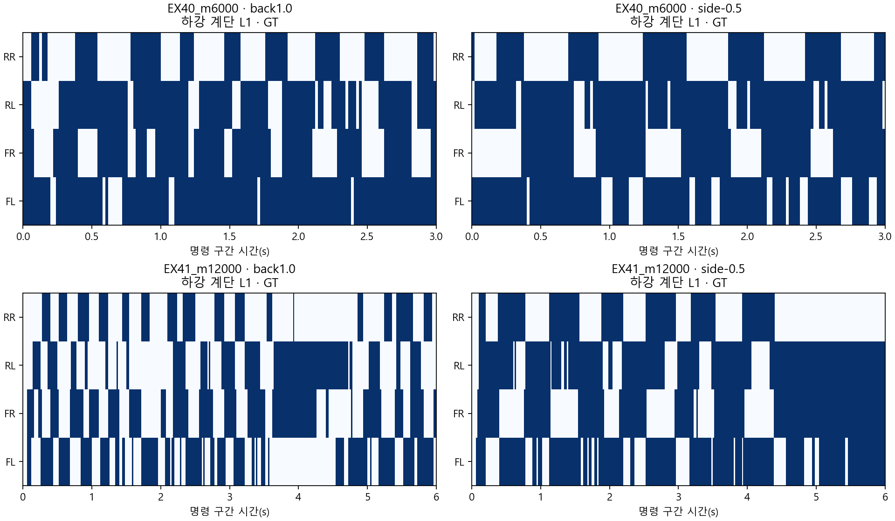

> 분류: A/평가 · 일반화 벤치마크 · 지표
> 작성: analyst · 2026-11-08
> 근거: EX40 m6000/EX41 누적 m12000의 영상 review NPZ 64개 · EX41 local m6000 W86 원장
> 요지: RR의 짧은 접지와 끌림은 명령별로 다르다. 전체 시간 분모로는 덜 끌려 보여도 접지 중 분모로는 RR 끌림이 더 높다
> 상태: CPU 재계산 확인됨 · 영상 원자료의 발 힘은 미기록 · 새 GPU 실행 없음

# RR 뒤쪽 다리: 덜 딛는 것과 끌리는 것

## 먼저 답

**숫자에도 흔적이 있었다. 다만 전체 명령 평균과 분모 때문에 덜 드러났다.** 학습 W86에서 RR 끌림 0.323은 전체 유효 시간에 대한 비율이다. RR이 접지하는 시간 자체가 짧기 때문에 이 숫자만으로 RR이 덜 끈다고 말하면 안 된다.

**확인됨:** 영상 원자료에서도 후진·한쪽 옆걸음·한쪽 회전에는 RR 접지 시간이 RL보다 짧다. 하지만 전진에서는 새 저장본 RR 접지가 RL보다 길고, 반대 회전에서도 관계가 뒤집힌다. 따라서 `모든 명령에서 RR이 항상 약하다`는 결론은 맞지 않는다.

**미확인:** 한 발에 실제로 체중을 덜 싣는지, 액추에이터나 관절 문제가 있는지는 이 촬영 자료로 확정할 수 없다. 64개 review NPZ 모두 발별 원시 접촉 힘이 없다. 접촉 bool은 힘 1 N 초과 여부일 뿐 힘의 크기가 아니다. 학습 W86 평균 힘은 명령별 영상의 힘을 대신하지 못한다.

## 학습 전체 평균: 같은 자료도 분모에 따라 뜻이 달라진다

아래는 전달받은 요약을 그대로 옮기지 않고 w86_6000_7b74699e5de6.json의 분자·분모로 다시 계산했다. 이는 local m6000에서 기록된 73,728 env-step, 3,072 env×24 step인 한 갱신의 묶음이다. 처음부터 m6000까지 전체 평균도, 영상의 선택 환경 하나도 아니다.

| 발 | 끌림/전체 유효 시간 | 끌림/움직임 명령 접지 시간 | 접촉 비율 | 스윙/전체 | 스윙 높이 평균(cm) | 평균 접촉 힘 크기(N) |
|---|---:|---:|---:|---:|---:|---:|
| FL | 0.366 | 0.584 | 0.707 | 0.273 | 4.43 | 45.95 |
| FR | 0.346 | 0.576 | 0.683 | 0.299 | 5.20 | 44.79 |
| RL | 0.324 | 0.612 | 0.599 | 0.371 | 5.18 | 33.20 |
| RR | 0.323 | 0.653 | 0.561 | 0.405 | 5.80 | 31.23 |

W86 끌림은 `접지 AND 발바닥-직하 지형 <2 cm AND 발 세계 XY 속도 >5 cm/s`, 분모는 따로 선택한다. 코드: rewards/w86.py:164~182, w86_runtime.py:267~272. 양성 끌림 분자는 같고 분모만 바뀐다. RR은 FL보다 전체 비율은 낮지만 **접지하며 움직이는 동안의 비율은 높다.** 이는 현재 문턱의 운동학 지표이며 발이 걸려서 진행이 막힌다는 확정 판정은 아니다.

평균 힘은 수직 하중 Fz가 아니라 접촉 힘 벡터의 크기다(w86_runtime.py:279~287). 비접촉으로 분류한 시간의 힘은 0~1 N이므로, 접촉 시간만의 평균 힘 크기를 다음 범위로만 좁힐 수 있다.

| 뒤발 | 접촉 시간만 평균 힘의 가능한 범위(N) |
|---|---:|
| RL | 54.75~55.42 |
| RR | 54.87~55.65 |

두 범위가 겹친다. RR 전체 평균 힘이 낮다는 사실을 `딛는 순간에도 힘을 못 쓴다`로 바꾸면 안 된다. **덜 자주 딛는 것**은 확인되지만 **딛을 때 약한 것**은 이 집계만으로 확인되지 않는다.

## 영상 자료와 계산법

EX40 영상 16개, EX41 단계 끝 채택 영상 48개를 읽었다. 원본 경로·체크포인트 SHA·NPZ SHA·완료 영수증 대조는 [sources.json](rr-gait-1108/sources.json), 네 발·명령·지도·지형·시간창별 1016행은 [feet_rows.csv](rr-gait-1108/feet_rows.csv)에 있다.

- 접지 시간·비율은 기록된 foot_contact를 그대로 사용한다. 촬영기 record_c_layer.py:1948~1949의 힘 벡터 크기 >1 N 기준이다.
- 명령 변경 직후 0.2초는 제외하고, 해당 구간의 첫 종료 전까지만 계산한다. 마지막 2초 창도 별도 재계산하여 표본 선택의 영향을 볼 수 있게 했다.
- 완전한 비접지 구간의 발 궤적 정점에서 이륙·착지 높이를 선형 연결한 기준선을 뺀 값을 **스윙 궤적 들기**로 기록한다. 단순 계단 높이 차이를 다리 들기로 세지 않기 위한 계산이다. 이는 실제 바닥 여유 높이와 다르다.
- 1 N 문턱이 한두 프레임 깜박이는 것을 보행 주기로 부르지 않는다. 접지/스윙 지속시간은 원래 구간과 3프레임(0.06초) 이상 구간을 둘 다 남긴다. 0.06초는 분석용 가정이며 학습/졸업 문턱이 아니다.
- **끌림·지면 여유는 근사치:** review에는 발 직하 광선·발 속도가 없으므로 세계 발 좌표의 50 Hz 차분과 GT 지도 최근접 높이를 사용했다. 3×3 이웃 높이 차가 2 cm 이하인 평탄 패치만 사용하고, 지도 밖·잘린 값·리셋 차분은 제외했다. 발 구 중심 보정 2.2 cm를 빼며 발 자세에 따른 최대 2 mm 중심 이동은 미기록이다. W86의 정확한 발 직하 광선·순간 속도와 동등하지 않다. 가장자리·계단 모서리는 제외돼 그곳의 끌림은 **미확인**이다.
- EX40의 연속 명령 3초와 EX41의 독립 명령 6초, 환경 번호·시작 상태·촬영 코드가 다르다. 다음 표는 명령별 비대칭을 찾는 기록이며 저장본 간 효과 크기의 통제 비교가 아니다.

## 명령별 네 발 · 정답 지도 대표 칸

각 칸의 순서는 **FL / FR / RL / RR**. 접지는 실제 측정, 높이/끌림은 위 정의의 별도 지표다. 전진·후진·옆·정지는 하강 계단 L1이며, EX40 회전만 상승 계단 L1이므로 두 모델 회전을 같은 지형 비교라고 읽지 않는다. 힘은 모든 칸 미측정이다.

### EX40_m6000

| 명령 | 측정 시간(s) | 접지 비율(4발) | 스윙 궤적 들기(cm, 4발) | 접지 중 끌림 근사 비율(4발) | 지면 높이 유효 비율(4발) |
|---|---:|---|---|---|---|
| fwd1.0 | 2.80 | 0.65 / 0.47 / 0.70 / 0.63 | 11.21 / 18.26 / 7.43 / 10.64 | 0.87 / 0.96 / 0.97 / 0.85 | 0.75 / 0.72 / 0.62 / 0.67 |
| back1.0 | 2.80 | 0.91 / 0.66 / 0.78 / 0.43 | 1.93 / 3.11 / 1.71 / 9.19 | 0.94 / 0.78 / 0.87 / 1.00 | 0.71 / 0.44 / 0.56 / 0.51 |
| side+0.5 | 2.80 | 0.61 / 0.69 / 0.58 / 0.74 | 6.13 / 3.40 / 5.27 / 2.42 | 0.07 / 0.16 / 0.11 / 0.22 | 1.00 / 1.00 / 1.00 / 1.00 |
| side-0.5 | 2.80 | 0.80 / 0.66 / 0.88 / 0.47 | 1.77 / 4.22 / 0.77 / 8.38 | 0.22 / 0.05 / 0.30 / 0.08 | 1.00 / 1.00 / 1.00 / 1.00 |
| spin+1.2 | 2.80 | 0.69 / 0.81 / 0.91 / 0.52 | 3.10 / 2.41 / 0.62 / 5.16 | 0.09 / 0.05 / 0.19 / 0.04 | 1.00 / 1.00 / 1.00 / 1.00 |
| spin-1.2 | 2.80 | 0.89 / 0.86 / 0.66 / 0.81 | 1.06 / 1.49 / 3.62 / 1.97 | 0.10 / 0.15 / 0.04 / 0.21 | 1.00 / 1.00 / 1.00 / 1.00 |
| stop | 2.80 | 0.99 / 1.00 / 1.00 / 0.95 | 미측정 / 미측정 / 미측정 / 미측정 | 0.02 / 0.00 / 0.00 / 0.01 | 1.00 / 1.00 / 1.00 / 1.00 |

### EX41_m12000

| 명령 | 측정 시간(s) | 접지 비율(4발) | 스윙 궤적 들기(cm, 4발) | 접지 중 끌림 근사 비율(4발) | 지면 높이 유효 비율(4발) |
|---|---:|---|---|---|---|
| fwd1.0 | 5.80 | 0.56 / 0.59 / 0.68 / 0.70 | 12.33 / 13.14 / 9.50 / 10.07 | 0.78 / 0.84 / 0.86 / 0.87 | 0.78 / 0.82 / 0.79 / 0.80 |
| back1.0 | 5.80 | 0.51 / 0.54 / 0.46 / 0.35 | 2.32 / 7.37 / 8.34 / 10.17 | 0.55 / 0.59 / 0.40 / 0.90 | 0.52 / 0.82 / 0.80 / 0.82 |
| side+0.5 | 5.80 | 0.49 / 0.83 / 0.70 / 0.62 | 9.70 / 2.71 / 8.12 / 2.17 | 0.09 / 0.11 / 0.05 / 0.23 | 0.67 / 0.79 / 0.93 / 0.48 |
| side-0.5 | 5.80 | 0.75 / 0.64 / 0.81 / 0.42 | 1.22 / 10.04 / 5.08 / 13.32 | 0.26 / 0.05 / 0.19 / 0.06 | 0.62 / 0.96 / 0.88 / 0.90 |
| spin+1.2 | 5.80 | 0.77 / 0.89 / 0.81 / 0.64 | 2.97 / 2.21 / 2.00 / 9.58 | 0.09 / 0.07 / 0.21 / 0.06 | 1.00 / 1.00 / 1.00 / 1.00 |
| spin-1.2 | 5.80 | 0.78 / 0.90 / 0.78 / 0.86 | 2.94 / 3.27 / 5.51 / 1.32 | 0.19 / 0.09 / 0.10 / 0.23 | 1.00 / 1.00 / 1.00 / 1.00 |
| stop | 5.80 | 1.00 / 1.00 / 1.00 / 1.00 | 미측정 / 미측정 / 미측정 / 미측정 | 0.00 / 0.00 / 0.02 / 0.00 | 1.00 / 1.00 / 1.00 / 1.00 |

접지 시간(s)은 위 비율×측정 시간이며 CSV에 발마다 직접 기록했다. 정지의 스윙 들기 `미측정`은 완전한 스윙 구간이 없다는 뜻이다. 높이 0으로 채우지 않았다.

색이 진한 부분이 접지다. 그림은 각 원래 명령 구간 전체이며 표는 첫 0.2초를 제외한다. RR이 적게 딛는 것, 접촉 문턱이 짧게 끊기는 것, 아예 안 딛는 것을 구별해야 한다.

## 좌우 차와 지도 세 모드

값은 RR−RL 접지 비율(%p). 음수면 RR 접지가 더 짧다. 명령별 차이를 단일 평균으로 지우지 않는다.

| 저장본 · 명령 | GT | Pred | 끔 | 마지막 2초 GT |
|---|---:|---:|---:|---:|
| EX40_m6000 · fwd1.0 | -7.1 | -9.3 | -8.6 | -10.0 |
| EX40_m6000 · back1.0 | -35.0 | -25.7 | -28.6 | -33.0 |
| EX40_m6000 · side+0.5 | 15.7 | 15.7 | 18.6 | 14.0 |
| EX40_m6000 · side-0.5 | -40.7 | -35.0 | -39.3 | -44.0 |
| EX40_m6000 · spin+1.2 | -38.6 | -35.7 | -32.1 | -31.0 |
| EX40_m6000 · spin-1.2 | 15.7 | 5.7 | 15.0 | 21.0 |
| EX40_m6000 · stop | -5.0 | 2.9 | -9.3 | 0.0 |
| EX41_m12000 · fwd1.0 | 1.7 | 1.4 | 10.3 | 0.0 |
| EX41_m12000 · back1.0 | -10.7 | 자료 없음 | -4.1 | -29.0 |
| EX41_m12000 · side+0.5 | -8.3 | 자료 없음 | 10.0 | -60.0 |
| EX41_m12000 · side-0.5 | -39.3 | -39.0 | -20.3 | -67.0 |
| EX41_m12000 · spin+1.2 | -16.9 | -16.2 | -20.7 | -7.0 |
| EX41_m12000 · spin-1.2 | 8.3 | 12.1 | 14.1 | -1.0 |
| EX41_m12000 · stop | 0.0 | 0.0 | 0.0 | 0.0 |

## 판단: 확인됨과 미확인

**그림에서 긴 빈 구간도 숫자로 확인된다.** 새 저장본 GT side−0.5의 마지막 2초 실제 vy 평균은 -0.067 m/s(명령 −0.5), yaw 속도는 0.203 rad/s다. 이 창에서 RR은 최대 1.60초 연속 비접촉이다. 해당 장면은 정상 속도로 걸으며 잠깐 비대칭인 경우와 달리, 옆 이동이 느려진 상태에서 한쪽 발을 오래 안 딛는 구간도 포함한다. 접지 힘 크기나 원인은 여전히 미확인이다.

1. **접지 비대칭 확인됨.** 예를 들어 EX41 GT 후진1.0에서 RR/RL 접지는 0.348/0.455, side−0.5는 0.421/0.814다. 전진1.0에서는 0.700/0.683으로 RR이 더 짧지 않다. 회전 부호를 바꾸면 RR/RL 관계도 달라진다. 반복 시드 폭과 정상 동물의 문턱이 없으므로 임상적인 `절뚝거림` 진단으로 부르지 않는다.
2. **끌림과 접지 비대칭은 별개다.** EX41 GT 후진에서 RR 접지 중 끌림 근사 비율은 RL보다 높다. 반면 side−0.5는 RR이 훨씬 덜 딛지만 접지 중 끌림 근사 비율도 RL보다 낮다. 눈에 보이는 비대칭을 모두 `RR 끌림 증가` 한 원인으로 묶을 수 없다.
3. **정지에서 RR이 항상 뜬다는 주장은 이번 대표 칸과 맞지 않는다.** EX41 GT 정지 영상에서는 네 발 접촉 비율이 모두 1이다. 전진 후 정지 영상과 독립 정지 영상의 시작 상태가 달라, 과거 전환 문제까지 해결됐다고 말하지 않는다.
4. **하중과 원인은 미확인.** 원시 Fz/힘의 적분, 발·몸 자세, 토크·관절 한계와 동기화한 기록이 있어야 RR이 실제로 덜 지지하는지, 회전/횡명령에 필요한 비대칭인지, 제어/지형 영향인지 가를 수 있다. 발 접촉 시간만으로 근력·액추에이터 고장·한쪽 관절 약화라고 단정하지 않는다.
5. **우선 기록에서 빠진 것:** 다음 승인된 촬영 시 발별 net_forces_w(3축), body_lin_vel_w, W86과 같은 발바닥 직하 ground_z, 발 quaternion을 review NPZ에 남겨야 동일 정의로 명령별 하중·끌림을 직접 잴 수 있다. 이번에는 촬영/학습 코드를 변경하지 않았다.

## 재현

`isaac311/python.exe _out/reports/rr-gait-1108/analyze.py` 뒤 `report.py`. 접지 구간 경계, 정지 발, 알려진 끌림, 지면 정보 부재, 두 yaw의 평지 높이로 먼저 7개 답 아는 시험을 실행한다. 원자료와 운영 코드는 읽기만 했다.
