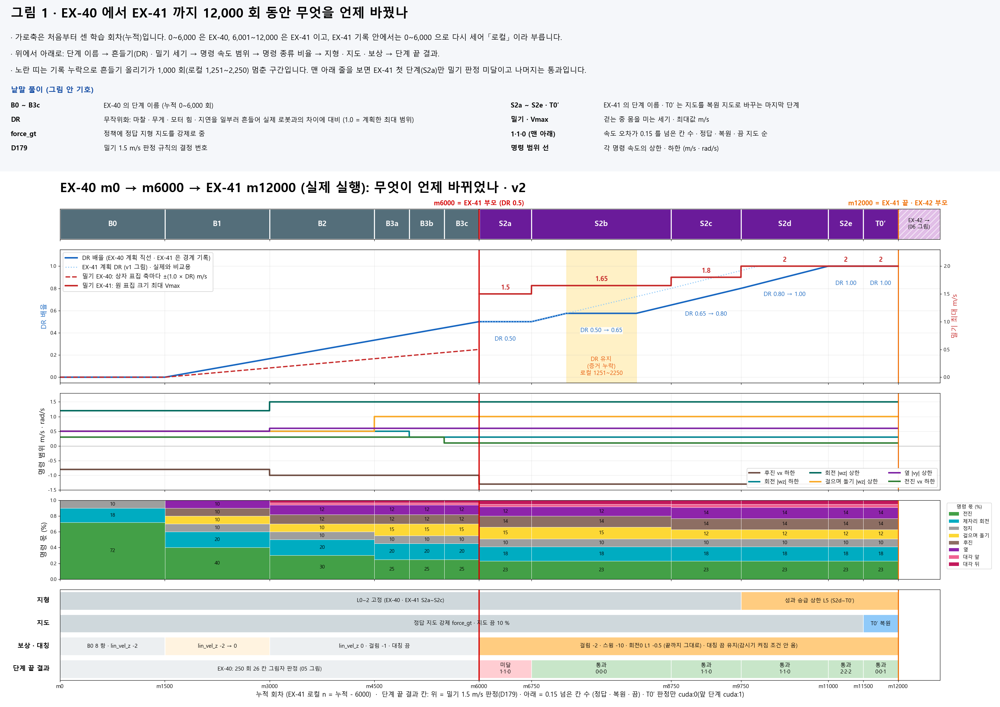
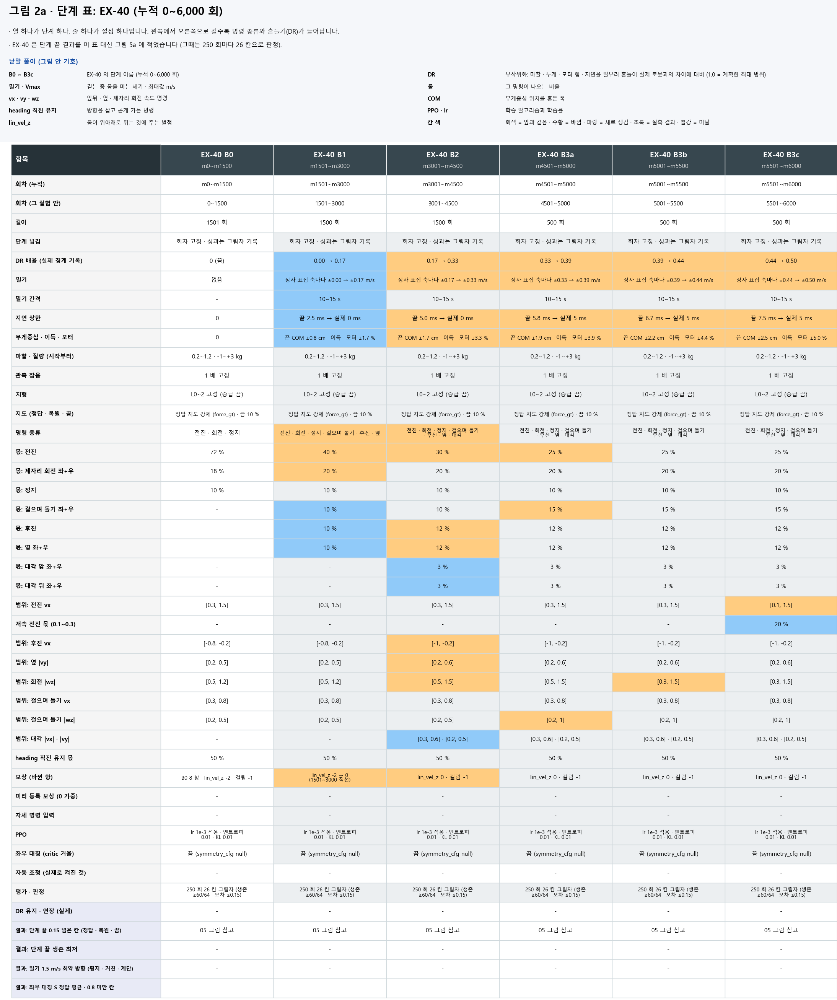
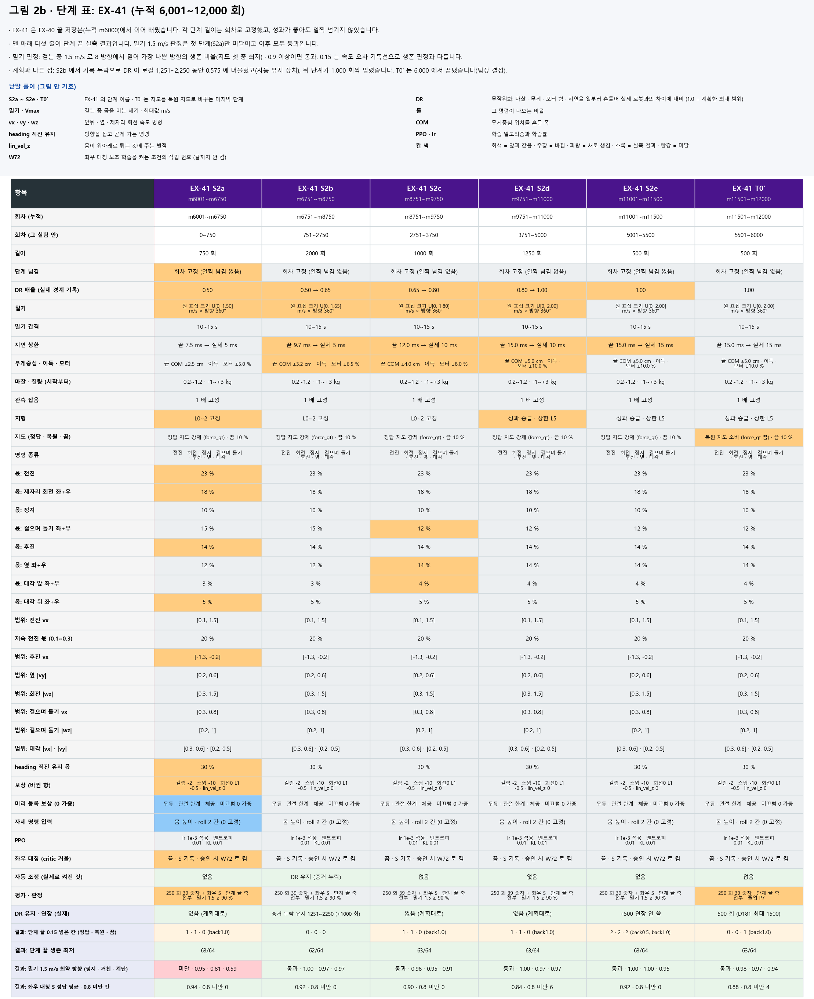
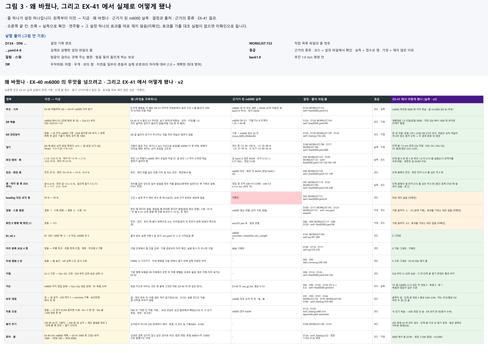
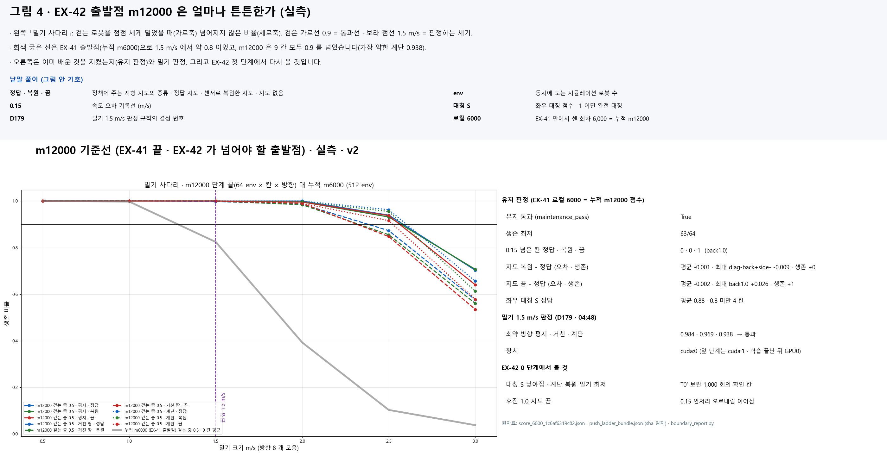
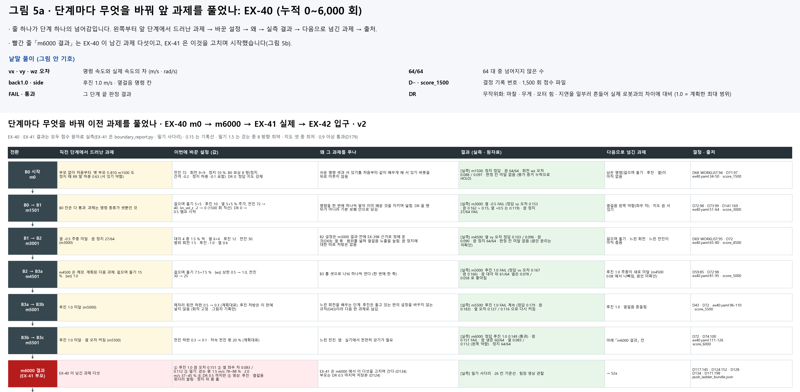
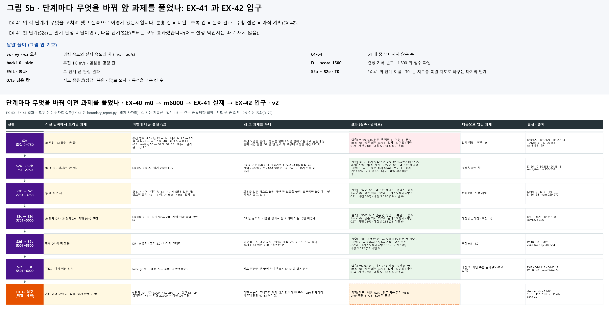
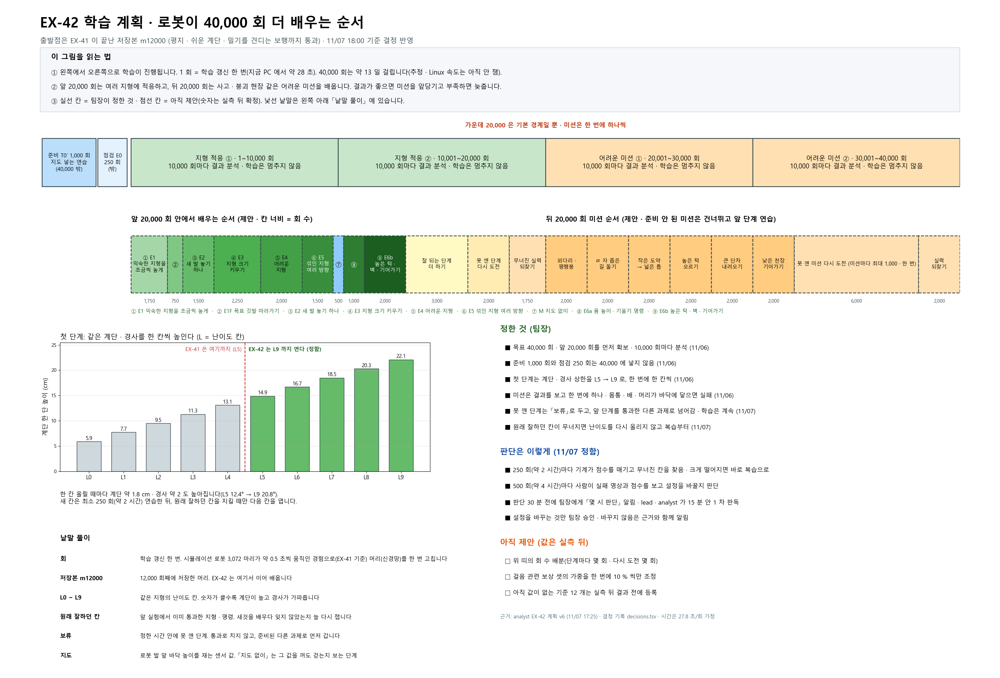

<!-- 승격: 2026-11-07 · 원본 inbox/jay/20261103-curriculum-lineage (v2 그림 · make_lineage_v2.py) · inbox/jay/20261104-ex41-restart (EX41R-250-LOG · decisions.tsv) · 작성 오흥재 · 이슈 #555 -->
# [계보 3] 정본 m12000 · EX-41 이 끝난 자리와 EX-42 로 넘기는 것

> 분류: 리서치
> 작성: 오흥재 · 2026-11-07 09:03
> 근거: 실측 (EX-41 경계 기록 26 줄 · 250 경계 점수 24 개 · 단계 끝 밀기 판정 6 번 · 학습 중 밀기 측정) · 코드 (실제 기동판 ex41-fixed5000.yaml 2b01df9a)
> 요지: EX-41 마지막 저장본 m12000 을 정본으로 채택한다. 기본 명령 보행은 DR 1.0 · 지형 레벨 L5 까지 오르는 학습 끝에, 연속 지형 L0~2 유지 판정을 지도 셋 모두에서 통과했다. 명령 1.5 m/s 로 걷는 중 1.5 m/s 밀기는 단계 끝 판정(시드 하나)을 다섯 번 연속 통과했지만, 학습 중 따로 잰 계단 측정에서는 미달이 셋 있었다. 후진 1.0 과 좌우 대칭은 EX-42 로 넘긴다
> 상태: 확정 (정본 채택 팀장 2026-11-07 08:5x)
> 판: v1.5
> 입구: result

## 한눈에

| 무엇 | 값 |
|---|---|
| 정본 | EX-41 `model_6000.pt` · 누적 회차 **m12000** · sha256 `1c6af6319c823c718af4965064f1c312b0d25177f5223a49c323aab3b6f1e613` |
| 부모 | EX-40 m6000 (DR 0.5 마지막 저장본 · sha `d5e9ec40…`) |
| 다음 | EX-42 의 부모. 0 단계 T0′ 보완 1,000 회 뒤 지형 40,000 회 |
| 유지 판정 | `확인됨` 통과 · 생존 최저 63/64 · 서기 64/64 (지도 정답 · 복원 · 끔 모두) |
| 0.15 넘은 칸 | `확인됨` 정답 0 · 복원 0 · 끔 1 (후진 1.0, 0.155) |
| 밀기 1.5 m/s (명령 1.5 m/s 걷기 · 단계 끝 판정) | `확인됨` 9 칸 모두 통과 · 가장 약한 칸 계단 · 복원 0.938 (64 판 중 60) |
| 지도 셋 | `확인됨` 복원 - 정답 평균 오차 차 -0.001 · 끔 - 정답 -0.002 (map64 명령 시험 · 연속 지형 L0~2 · 선속도와 회전을 섞은 평균). 오차 차는 작지만 걷는 모양이 같은지는 `미확인` |
| 계단에서 지도 | `확인됨` 계단 종류에 따라 반대. 역형 계단(L2 · L5)은 정답 · 복원 지도를 켠 쪽이 이동 비 +0.09 ~ +0.13 (네 방향 모두), 정방향 계단은 지도를 끈 쪽이 +0.12 ~ +0.15 (네 방향 모두). 복원과 정답 차는 최대 0.032. 지도로 단차를 미리 읽는지는 `미확인` ([analyst 대조](https://github.com/foothold-project/foothold-lab/blob/359615b1/inbox/jay/20261106-ex41-stage-reports/W18-W10-FINAL-NOTE.md) 359615b1) |
| 넘기는 과제 | 후진 1.0 이 0.15 언저리를 오르내림 · 좌우 대칭 S 가 끝에서 낮아짐(0.8 미만 4 칸) · 계단 밀기 여유 · 정방향 계단에서 지도가 손해 · 마지막 구간에 계단 왼쪽(명령 +vy) 옆걸음 12/12 칸 감소 |

읽는 법. **0.15** 는 명령을 얼마나 정확히 따르는지 재는 경계 보고의 기록선이다(오차 m/s 또는 rad/s). 생존 판정과 다르다. **밀기 1.5 m/s** 는 명령 1.5 m/s 로 걷는 로봇을 1.5 m/s 로 8 방향에서 밀어(방향마다 64 env) 가장 나쁜 방향의 생존 비율을 본다. [계보 1] · [계보 2] 의 m6000 밀기 숫자는 명령 0.5 m/s 로 걷는 중에 잰 사다리라 다른 시험이다(m6000 은 명령 1.5 칸을 잰 적이 없다). 지도 셋 가운데 가장 낮은 값이 0.9 이상이면 통과다(D179). **지도 셋** 은 정답 지도(eval_gt) · 깊이 영상으로 복원한 지도(eval_pred) · 지도 끔(probe_prop_only) 이다.

## 1. 계보 · 어디서 와서 어디로 가나

- 9 월 말까지의 방향 전환과 처음부터 학습으로 간 까닭은 [우리는 왜 여덟 번 방향을 틀었나](20260928-rl-lineage.md) 에 있다.
- EX-41 을 시작할 때(11/03) 쓴 첫 계보는 [첫 정본 계보 · EX-40 m0~m6000 에서 EX-41 로 넘길 때](20261103-ex40-ex41-curriculum-lineage-v1.md) 에 그대로 남겨 두었다. 이 문서의 그림 1~5 는 그 판을 EX-41 실측으로 다시 그린 것이고, 그림 6(EX-42 계획)은 새로 더했다.
- EX-40 은 처음부터(m0) 기본 명령 보행을 쌓아 m6000(DR 0.5)까지 왔다. EX-41 은 그 m6000 을 부모로 받아 DR 을 1.0 까지 올리고, 밀기 · 후진 · 끌림을 고치려고 설정을 바꾸고(효과가 판정으로 확인된 것은 밀기뿐이다), 지형 레벨을 성과로 올린 뒤, 마지막에 복원 지도로 바꿨다.
- 이 문서의 정본 m12000 이 EX-42(지형 적응과 미션) 의 출발점이다.

## 2. 계획과 다르게 간 것

- **S2b 가 1,000 회 길어졌다.** 로컬 1251~2250 에 DR 이 0.575 에서 멈췄다. 까닭은 성적 미달이 아니라 그 경계의 **점수 증거가 늦게 와서** DR 을 올리지 않는 안전장치가 작동한 것이다. 두 경계 회복 뒤 같은 기울기로 다시 올랐다. 그래서 뒤 단계가 모두 1,000 회씩 밀렸다.
- **T0′ 는 500 회로 끝났다.** 기동판은 최대 1,500 회까지 허용했지만, 팀장 결정으로 로컬 6000(누적 m12000) 에서 끝냈다. 모자란 것은 EX-42 0 단계 1,000 회에서 보완한다.
- **보상 가중은 끝까지 바뀌지 않았다.** 걸림 -2 · 스윙 -10 · 회전 0 명령 때 L1 -0.5 가 모든 경계 기록에서 같다. 좌우 대칭(critic 거울)도 끝까지 꺼져 있었다. 켜는 조건(정답 S 평균 0.8 미만 두 번 연속)이 오지 않았다.

## 3. 단계마다 결과

| 단계 | 누적 회차 | 로컬 | DR | 단계 끝 0.15 넘은 칸 (정답 · 복원 · 끔) | 생존 최저 | 밀기 1.5 m/s 최약 (명령 1.5 걷기 · 평지 · 거친 · 계단) | 대칭 S 정답 평균 |
|---|---|---|---|---|---|---|---|
| S2a | m6001~m6750 | 0~750 | 0.50 | 1 · 1 · 0 (back1.0) | 63/64 | **미달** · 0.953 · 0.812 · 0.594 | 0.94 (0.8 미만 0) |
| S2b | m6751~m8750 | 751~2750 | 0.50 → 0.65 | 0 · 0 · 0 | 62/64 | 통과 · 1.000 · 0.969 · 0.969 | 0.92 (0.8 미만 0) |
| S2c | m8751~m9750 | 2751~3750 | 0.65 → 0.80 | 1 · 1 · 0 (back1.0) | 63/64 | 통과 · 0.984 · 0.953 · 0.906 | 0.90 (0.8 미만 0) |
| S2d | m9751~m11000 | 3751~5000 | 0.80 → 1.00 | 1 · 1 · 0 (back1.0) | 63/64 | 통과 · 1.000 · 0.969 · 0.969 | 0.84 (0.8 미만 6) |
| S2e | m11001~m11500 | 5001~5500 | 1.00 | 2 · 2 · 2 (back0.5, back1.0) | 63/64 | 통과 · 1.000 · 1.000 · 0.953 | 0.92 (0.8 미만 0) |
| T0′ | m11501~m12000 | 5501~6000 | 1.00 | 0 · 0 · 1 (back1.0) | 63/64 | 통과 · 0.984 · 0.969 · 0.938 | 0.88 (0.8 미만 4) |

표의 숫자는 생성기(`make_lineage_v2.py`)가 경계 보고 도구 출력과 밀기 사다리 원자료에서 읽은 값이다. 손으로 옮기지 않았다.

**해석.**

- `확인됨` 강한 밀기(명령 1.5 m/s 로 걷는 중 1.5 m/s)는 단계 끝 판정(시드 42 하나)에서 S2a 계단 0.59 로 미달했지만 S2b 부터 끝까지 다섯 번 연속 통과했다. 다만 학습 중 따로 잰 계단 측정에서는 미달이 셋 있었다. m8250 9 시드 최약 방향 평균 0.854(통과 1/9), m9500 3 시드 0.828 · 0.812 · 0.859, m11250 0.891 이다(`EX41R-250-LOG.md:187` · `:375` · `decisions.tsv:115`). 그래서 「다섯 번 연속 통과」 는 단계 끝 한 시드 판정의 결과이고, 계단 밀기 여유는 크지 않다.
- `확인됨` 후진 1.0 은 단계 끝 여섯 번 중 다섯 번 0.15 를 넘었다. 무너지지는 않았지만(생존은 늘 62/64 이상) 0.15 언저리를 오르내렸다. 단계 끝 여섯 번에서 넘은 명령은 늘 back1.0 이었다(S2e 에만 back0.5 추가). 250 경계 전체로 보면 넘는 명령이 경계마다 바뀌어(`EX41R-250-LOG.md:404`), 한 기술이 계속 무너진 것은 아니라고 본다 `추측` (학습 시드 하나).
- 좌우 대칭 S 는 S2d(지형 레벨 상승과 DR 이 같이 들어온 구간) 와 T0′(복원 지도로 바뀐 구간) 에서 낮아졌다. 두 구간 모두 두 가지가 바뀌었거나 새 입력이 들어온 곳이라, 원인 하나로 가를 수 없다 `미확인`.

## 4. 정본 기준선 · EX-42 가 넘어야 할 출발점

- 명령 0.5 m/s 로 걷는 중 1.5 m/s 로 밀었을 때 8 방향 평균 생존은 m6000 약 0.82 에서 m12000 거의 1.0 이다. 두 측정은 같은 크기 표본이다(방향마다 64 env · 8 방향 · 시드 42). 3 절 표의 단계 끝 판정(명령 1.5 m/s 걷기)과는 다른 시험이다.
- **장치 단서.** m12000 단계 끝 밀기 판정만 GPU0(cuda:0) 에서 쟀다. 학습이 끝나면 밀기 묶음이 GPU0 로 가는 기존 동작이다. 앞 단계 판정은 GPU1 이다. 영수증 맨 위의 장치 칸은 대기열 값(cuda:1)을 옮겨 적어 실제와 다르게 적힌다(`decisions.tsv:211` · `:213`). 이 결함은 EX-42 출발 관문표에 넣었다.

## 5. 단계마다 무엇을 풀었나

## 6. EX-42 로 넘기는 것

팀장이 정한 것.

- 목표는 지형 40,000 회다. 20,000 회를 먼저 확보하고 10,000 회 블록마다 분석한다. 블록 끝에서 학습을 멈추지 않는다.
- 0 단계 T0′ 보완 1,000 회와 E0 250 회는 40,000 에서 뺀다.
- E1 의 첫 변경은 같은 지형 종류에서 상한 L5 → L9 다. 경계마다 한 단계씩, 성과와 유지가 통과할 때만 올린다.
- 회차 시계(EX-41 식)를 뼈대로, 단계마다 최소 · 최대 체류를 둔다. 미달은 보류로 남기고 선행이 갖춰진 다른 과제로 간다. 극복할 근거가 있으면 재도전한다.
- 이미 배운 칸(유지 칸)이 무너지면, 시간이 지났다는 이유만으로 난도를 다시 올리지 않는다. 학습은 계속하면서 마지막으로 안정했던 조건을 복습하거나 선행이 갖춰진 다른 과제로 옮긴다 (11/07 17:25).
- 어려운 미션(틈 점프 · 높은 턱 · 외다리 · ㄹ 자 좁은 길 · 낮은 천장)은 결과에 따라 한 번에 하나씩 연다. 몸통 · 배 · 머리 접촉은 금지다.
- 판단 주기 (11/07 17:25). 기계 감시(점수 · 유지 하락 감지 · 상한 +1)는 250 회마다, 사람 판단(실패 영상 · 설정 변경)은 500 회마다 한다. 유지 칸이 크게 떨어지면 250 회에서 바로 다룬다.
- 사람 판단 전에 팀장에게 판단 시각을 미리 알린다. lead · analyst 가 1 차 판독을 하고(analyst 계획의 「15 분 안」 은 가안이지 팀장 결정이 아니다), 팀장이 참여할 수 있으면 함께 정한다. 설정을 바꾸는 것만 승인 뒤 다음 경계에 적용하고, 바꾸지 않음은 근거와 함께 알린다.

EX-42 0 단계에서 먼저 볼 것.

- 좌우 대칭 S 회복 (T0′ 에서 0.8 미만 4 칸)
- 계단 · 복원 지도 밀기 여유 (0.938)
- 후진 1.0 지도 끔 (0.155)

## 7. 이 문서가 「미확인」 으로 남기는 것

- `미확인` 스윙 · 걸림 · 회전 L1 벌점과 heading 몫의 **따로 잰 효과**. 끝까지 같은 가중이었고 대조 실험이 없다.
- `미확인` 학습 시드 하나의 결과다. 여러 시드 일반화는 전체 과정 뒤 검증 계획에 있다.
- `미확인` 단계 끝 영상 가운데 어두운 화면으로 실패한 9 편(S2e 3 · m12000 6) 중 6 편은 세 번째 시도로 다시 찍어 채웠고(시드는 원장에 없다), m12000 의 3 편(후진 1.0 복원 · 옆 +0.5 복원 · 대각 앞 정답)은 같은 칸 3 회 실패라 결측으로 남겼다. 어두운 화면의 원인은 아직 모른다.
- `미확인` m12000 밀기 판정의 장치 차이(cuda:0 대 앞 단계 cuda:1)가 값에 준 영향.

## 원자료

- 경계 기록 · 점수 · 사고: [`inbox/jay/20261104-ex41-restart/`](https://github.com/foothold-project/foothold-lab/tree/ebf1673e/inbox/jay/20261104-ex41-restart) (EX41R-250-LOG.md · EX41R-INCIDENTS.md · decisions.tsv · ebf1673e 고정 · origin/main 에는 아직 없다)
- 그림 생성기와 입력: [`inbox/jay/20261103-curriculum-lineage/`](https://github.com/foothold-project/foothold-lab/tree/ebf1673e/inbox/jay/20261103-curriculum-lineage) `make_lineage_v2.py` · `make_lineage_v3.py` (읽는 법 머리 · 낱말 풀이 · 그림 2 · 5 나눔 · 그림 6 다시 그림) · `data-v2/`
- 단계 보고서: [`inbox/jay/20261106-ex41-stage-reports/`](https://github.com/foothold-project/foothold-lab/tree/359615b1/inbox/jay/20261106-ex41-stage-reports) (S2a ~ T0′ · analyst 브랜치 359615b1 고정)
- EX-42 계획: analyst `PLAN-ex42-terrain-blocks-1106.md` v6 (11/07 17:25 결정 반영)

## 판 이력

- v1.0 (2026-11-07): m12000 정본 채택. EX-41 실제 실행 결과와 EX-42 계획을 계보 그림 v2 여섯 장으로 정리.
- v1.1 (2026-11-07 10:00): 「한눈에」 지도 셋 줄 정정. analyst 독립 대조(VERIFY-W10-MAP3 e10fd0df)가 「평지 명령 시험」 · 「셋이 거의 같다」 를 틀렸다고 짚었다. 시험은 연속 지형 L0~2 이고, 평균은 선속도와 회전을 섞은 값이며, 오차 차가 작다고 걷는 모양이 같다고는 말할 수 없다.
- v1.2 (2026-11-07 13:07): 「계단에서 지도」 줄 추가. m12000 계단 점수(W78 · 대기열 747) 를 analyst 가 m11500 과 대조(359615b1 · NPZ 480 재계산). 지도 효과가 계단 종류에 따라 반대라는 것과 계단 왼쪽 옆걸음 감소를 넘기는 과제에 더함.
- v1.3 (2026-11-07 18:48): 그림을 팀 밖 사람도 읽게 고침(팀장 17:4x). 그림마다 「요점」 과 「낱말 풀이」 머리를 달고, 너무 넓은 그림 2 · 5 는 EX-40 · EX-41 로 나눴다. 그림 4 의 「m6000」 이 로컬 6000(= 누적 m12000)과 누적 m6000 을 섞어 쓰던 것을 바로잡았다. 그림 6 과 6 절은 11/07 17:25 결정(유지 미회복 때 재상승 없음 · 기계 250 · 사람 500 · 사전 알림)으로 고쳤다. 영상 결측은 3 차 시도 결과(9 편 중 6 편 채움 · 3 편 결측)로 고쳤다.
- v1.4 (2026-11-08): 제목 앞에 연재 번호 [계보 3] 을 닮. 이때 손으로 더한 연재 순서 목록은 f4c2b190(11/09)에서 지웠고, 지금은 사이트 빌드가 [계보 N] 제목에서 만든다. 본문 그대로.
- v1.5 (2026-11-09): 11/09 사실 감사 반영. 「밀기 1.5 m/s」 를 명령 1.5 m/s 걷기 단계 끝 판정으로 밝히고 명령 0.5 사다리와 나눔 · 「다섯 번 연속 통과」 에 학습 중 계단 미달 셋을 붙이고 「가장 크게 넘은 과제」 를 뺌 · 두 사다리 env 수가 같다고 바로잡음(그림 4 제목 오기는 캡션에 적음) · 생존 최저 62/64 · 「경계마다 바뀜」 을 단계 끝과 250 경계로 나눔 · 유지 판정 지형 L0~2 와 학습 상한 L5 를 나눔 · 「고치고」 를 「고치려고 바꾸고」 로 · 장치 칸 원인 · 「15 분」 은 가안 · 영상 재촬영 시드 원장에 없음 · 원자료 폴더를 커밋 고정 링크로.
