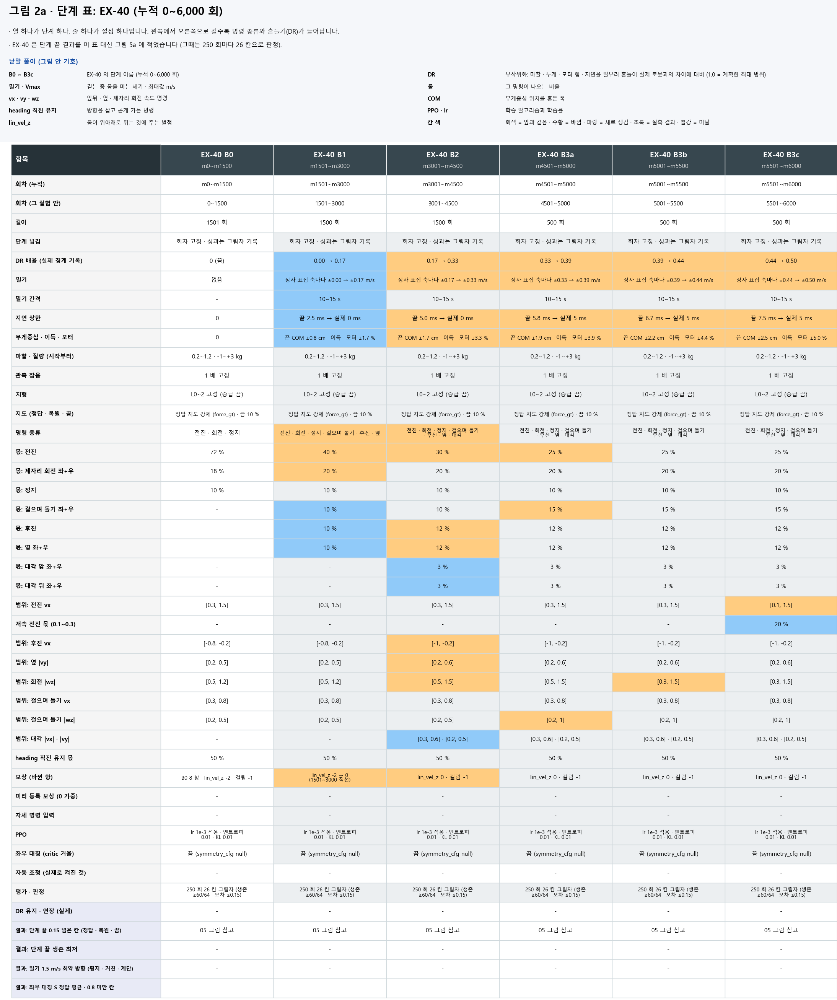
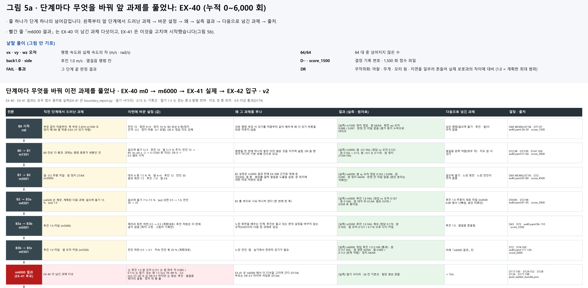
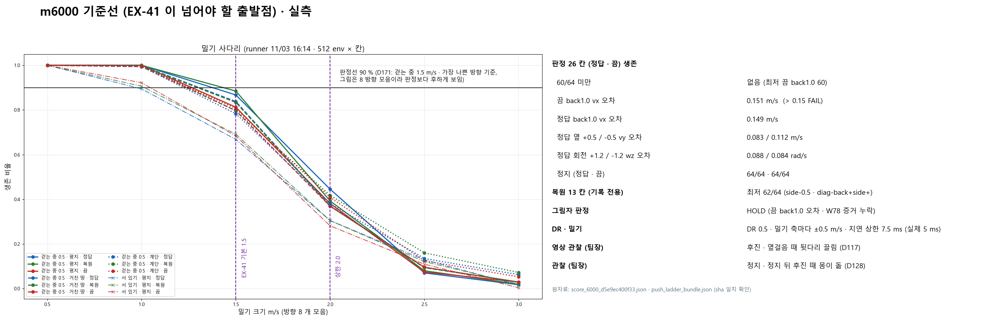

<!-- 승격: 2026-11-08 · 원본 inbox/jay/20261103-m6000-analysis/M6000-ANALYSIS.md · inbox/jay/20261103-curriculum-lineage/CURRICULUM-LINEAGE.md · inbox/jay/20261101-ex41/FACTS-EX40-1101-for-W82.md · inbox/jay/20261101-ex41/EX41-LAUNCH-GAPS.md · inbox/jay/20261028-plan/WORKLIST.md · inbox/jay/20261104-ex41-restart/decisions.tsv · 실행 폴더 C:/Users/AI-WS01/s2_lab/ex40_main_20261031_041313 · 작성 오흥재 · 이슈 #555 -->
# [계보 1] EX-40 · 처음부터 m6000 까지

> 분류: 리서치
> 작성: 오흥재 · 2026-11-08 22:50
> 근거: 실측 (EX-40 실행 폴더의 train_start_status.json · stage_log.jsonl · stage_loop.log · m6000 점수 score.json · 밀기 사다리 · C층 216 칸 재생 목록과 영수증) · 코드 (ex40.yaml sha 66a519b2) · 결정 (WORKLIST D68~D144 · decisions.tsv C76)
> 요지: EX-40 은 부모 없이 m0 부터 한 프로세스로 기본 명령 보행을 쌓아 m6000(DR 0.5)에서 B 단계를 마쳤고, 평지 · 낮은 지형 13 명령을 지도 셋 모두에서 거의 다 살아서 해냈다. 남은 약점(후진 1.0 · 좌우 차 · 밀기 · 뒷다리 끌림 · 몸 돌기)을 EX-41 이 m6000 에서 이어 받았다
> 상태: 확정
> 판: v1.1
> 입구: result
> 연재: m0 → m6000
> 연재 제목: EX-40 기본 명령 보행
> 연재 설명: B0 ~ B3c · DR 0 → 0.5

## 먼저 알아 둘 말

- **회차(m)**: 학습이 정책을 한 번 고친 횟수. m6000 은 6,000 번째 고친 뒤 저장한 것(저장본)이다.
- **DR (도메인 무작위화)**: 무게중심 · 모터 세기 · 지연 · 밀기 같은 물리값을 일부러 흔들어 실제 로봇과의 차이에 대비하는 것. 1.0 이 계획한 최대 범위다.
- **지도 셋**: 정답 지도(eval_gt) · 깊이 영상으로 복원한 지도(eval_pred) · 지도 끔(probe_prop_only).
- **26 칸**: 13 명령(전진 · 후진 · 옆 · 대각 · 제자리 회전 · 정지) × 정답 · 끔 두 모드. 칸마다 64 대를 300 step(6 초) 동안 돌려 끝까지 산 수와 명령 추종 오차를 잰다(map64 · `steps 300` · `policy_dt_s 0.02`). 지형은 평지가 아니라 연속 지형 일곱 종류 L0~2 다. 오차 기록선은 0.15 (m/s 또는 rad/s).

## 한눈에

| 무엇 | 값 | 출처 |
|---|---|---|
| 실행 | 프로세스 하나(PID 26240) · 이어 받기 없음 · 8,001 갱신 · m8000 에서 `done` | train_start_status.json · map_ratio_events.jsonl 2 행 (`resumed: false`) |
| 동시 로봇 수 | 3,072 env | map_ratio_events.jsonl 2 행 |
| 시작 · m6000 · m8000 | 10/31 04:14 · 11/01 23:10 · 11/02 13:44 (저장본 파일 시각) | main/EX-40-B-main_20261031_041337_26240 |
| m6000 sha256 | `d5e9ec400f33…` | stage_log.jsonl (D 진입 증거) |
| 26 칸 | 모두 생존 ≥ 60/64 · 0.15 넘은 칸은 끔 후진 1.0 하나 (0.151) | score.json |
| 서 있기 | 정답 · 복원 · 끔 모두 64/64 | score.json |
| 복원 지도 13 칸 | 기록 전용 · 최저 62/64 | score.json |
| 밀기 1.5 m/s | 명령 0.5 m/s 로 걷는 중 사다리: 방향 모음 78~88 % · 가장 나쁜 방향 평지 72~84 % · 계단 75~77 % (지도 셋 범위). 전진 1.0 m/s 로 걷는 중 250 밀기 확인(다른 시험): 가장 나쁜 방향 평지 82.8 % · 계단 70.3 % | [계보 2] 5 절 · push_ladder_bundle.json · EX41-250-LOG.md:91-96 |

## 1. 무엇을 배웠나

EX-40 은 부모 저장본 없이 m0 부터 시작했다(D68). 명령을 한꺼번에 주지 않고 단계마다 하나씩 쌓았다. 단계 넘김은 회차로 정해 두었고, 성과 판정은 「그림자」로만 적었다(D72). 그림자 기록은 판정 결과를 남기기만 하고 학습 진행에는 쓰지 않는다는 뜻이다.

| 단계 | 누적 회차 | 이 단계에서 새로 연 것 |
|---|---|---|
| B0 | m0~m1500 | 전진 72 % · 제자리 회전 9+9 % · 정지 10 %. 서 있기를 처음부터 배움. DR 0 |
| B1 | m1501~m3000 | 걸으며 돌기 · 후진(범위 [−0.8, −0.2]) · 옆걸음. DR 0 → 0.5 직선 램프 시작 |
| B2 | m3001~m4500 | 대각 네 종류 1.5 % 씩. 후진 [−1.0, −0.2] · 옆 [0.2, 0.6] · 회전 상한 1.5 |
| B3a | m4501~m5000 | 걸으며 돌기 7.5+7.5 % · 그때 회전 상한 1.0 |
| B3b | m5001~m5500 | 제자리 회전 하한 0.5 → 0.3 (느린 회전) |
| B3c | m5501~m6000 | 전진 하한 0.3 → 0.1 (느린 전진) |

- 위 범위와 몫은 실행 기록 stage_log.jsonl 의 단계 진입 줄(B1 · B2 · B3a · B3b · B3c · D · T0 일곱 번, 증거 종류 `fixed`)과 같다.
- **지형**은 L0~2 로 고정했다. 일곱 종류(상자 · 경사 둘 · 계단 둘 · 거친 바닥 · 무대 계단)가 23 열에 깔렸다(map_ratio_events.jsonl 1 행).
- **지도**는 정답 지도를 강제로 넣었고(force_gt), 10 % 만 지도를 끄고 배웠다(p_off 0.1, map_switch.jsonl 0 회차). 복원 지도로는 B 단계 동안 학습하지 않았다.
- **DR** 은 m6000 에서 0.5 였다. 이때 밀기는 x · y 축마다 ±0.5 m/s, 간격 10~15 s, 지연 상한 7.5 ms(실제 5 ms), 무게중심 ±2.5 cm, 이득 · 모터 ±5 % 다([계보 2] 2 절, D75 · D76).

**그래서** m6000 은 「평지 · 낮은 지형에서 정답 지도를 보며, DR 절반 세기로, 기본 13 명령을 배운 정책」이다.

## 2. 어떻게 돌았나

- **학습은 한 번도 끊기지 않았다.** 프로세스 하나가 m0 부터 m8000 까지 갔고 이어 받기(resume)가 없다(train_start_status.json `segment_index 0` · `completed_updates 8001`).
- m0 에서 m6000 까지 걸린 시간은 저장본 파일 시각으로 약 43 시간이다(10/31 04:14 → 11/01 23:10). 계획 때 추정은 m0~m6500 에 약 43 시간이었다(D72).
- **평가 · 영상은 학습과 따로 돌았다.** 단계 끝마다 평가 · 촬영 · 전 프레임 검사를 도는 고리(stage_loop)가 m1500 부터 m8000 까지 여덟 단계를 모두 `done` 으로 넘겼다(stage_loop.log 63 행 `all stages done`). 다만 `done` 이 모든 평가의 성공은 아니다. W57(yaw · 시작 각도 축) 평가는 여덟 단계 모두 rc=1 이었고 재시도도 rc=5 라 한 번도 성공하지 않았다. m1500 은 촬영 없이, m4500 은 촬영 rc=1 인 채로 `done` 이 적혔다(stage_loop.log 3-4 · 12-16 행). 이 고리는 11/01 13:37 에 한 번 다시 띄웠다(stage_loop.log 17 행). 학습 프로세스는 그대로였다.
- **촬영 실패와 재시도.** m5500 · m8000 은 첫 회에 영상이 0 편이라 「NOT done」으로 남았다가 다음 회에 다시 찍어 끝냈다(stage_loop.log 30 · 56 행).

### 사고 기록

| 일 | 무엇 | 출처 |
|---|---|---|
| 그림자 판정이 거의 다 HOLD | 31 번 채점 가운데 마지막 PASS 는 m1250. m1500~m8000 은 전부 HOLD | EX41-LAUNCH-GAPS.md:60 |
| 원인 (유력 가설) | W57(yaw · 시작 각도 축) 하위 프로세스가 표준 핸들 없이 뜰 때 sha256sum 이 「Bad file descriptor」로 죽어 rc=1, 증거 파일이 비었다는 가설. 재현은 됐지만 EX-40 로그에서 그 오류 문자열은 찾지 못했다(stderr 미보존 · 미확인) | EX41-LAUNCH-GAPS.md G14 · 79 행 정정 |
| m6000 에서도 같음 | 판정 `HOLD` · 끔 후진 1.0 FAIL 하나 + axis_v2.json 없음 + W57 rc=1 | score.json `problems` |
| 감독기 결함 | m1000 HOLD 뒤 점수기를 다시 부르지 않음. 별도 평가 고리(score-watch-b)로 대신 진행 | D78 |

HOLD 는 「실패」가 아니라 「증거가 모자라 판정을 못 함」이다. 26 칸 숫자 자체는 score.json 에 다 남아 있다.

**그래서** 학습은 깨끗하게 이어졌지만, 그림자 판정은 증거 누락 때문에 m1500 부터 제 역할을 못 했다. 이 결함은 EX-41 기동 전에 고칠 항목(G14)으로 넘어갔다.

## 3. 도중에 본 것

- **서 있기**: m3000 에 지도 끔 서 있기가 27/64 였다가 m3250 부터 64/64 가 됐다(FACTS-EX40-1101 §4).
- **몸 돌기(yaw 치우침)**: 회전 명령이 0 인데 전진 6 초 동안 몸이 한쪽으로 돈다. 정답 지도 중앙값이 m4750 에 1.0 m/s 전진에서 +21.7° 까지 컸고 m5000 에 +2.5° 였다. 저장본마다 95 % env 가 같은 쪽으로 돈다(FACTS-EX40-1101 §1).
- **후진 1.0 은 흔들렸다**: B3 구간 정답 지도 오차가 0.080 · 0.102 · 0.167 · 0.128 · 0.179 · 0.170 · 0.149 로 오르내렸다. 같은 m6000 을 시드 42 · 43 으로 두 번 재면 칸 차이 최대 0.008 이라, 이 흔들림은 평가 잡음이 아니라 정책이 경계마다 달라진 것이다(M6000-ANALYSIS §2-2).
- **학습 곡선**: 보상은 m1500 까지 약 43 으로 오르고 m6000 에는 약 46 이었다(tfevents `Train/mean_reward` 25 회 평균 m1475~1500 43.0 · m5976~6000 45.9). 에피소드 길이는 거의 끝까지(20 초) 갔다. B1 진입에서 한 번 내려갔다가 회복했다(M6000-ANALYSIS §1-1).

**그래서** 후진 1.0 은 m5000 부터 끝까지 남은 과제였고, 몸 돌기는 숫자로 이미 보였다.

## 4. m6000 결과

### 4-1. 26 칸과 서 있기 (score.json)

| 칸 | 정답 지도 | 지도 끔 |
|---|---|---|
| 후진 1.0 오차 · 생존 | 0.149 · 64/64 | **0.151 · 60/64** |
| 옆 +0.5(왼쪽) / −0.5(오른쪽) vy 오차 | 0.083 / 0.112 | 0.091 / 0.100 |
| 회전 +1.2 / −1.2 wz 오차 | 0.088 / 0.084 | 0.088 / 0.088 |
| 전진 1.0 오차 | 0.088 | 0.093 |
| 서 있기(flat_stand) | 64/64 | 64/64 |

- 26 칸 모두 생존 ≥ 60/64. 가장 낮은 칸이 끔 후진 1.0 의 60/64 다.
- 복원 지도 13 칸(기록 전용)은 최저 62/64 (옆 −0.5 · 대각 뒤 왼쪽 diag-back+side+. 명령 +vy 가 왼쪽이다), 서 있기 64/64.
- 지형 종류로 나누면 후진 1.0 이 0.15 를 넘는 곳은 계단 오르막 0.154 · 거친 바닥 0.158 · 무대 계단 0.175 였다(M6000-ANALYSIS §2-1). 무대 계단은 env 2 대의 값이라 근거가 약하다.

### 4-2. 밀기 사다리

걷는 중인 로봇(명령 0.5 m/s)을 여러 세기로 8 방향에서 밀어 끝까지 산 비율을 봤다(방향 하나에 64 env · 세기마다 512 env, [계보 2] 5 절). 서 있기는 4 방향(0 · 90 · 180 · 270°) × 64 = 세기마다 256 env 다(push_ladder_bundle.json).

| 밀기 세기 | 걷는 중 (방향 모음) | 서 있기 |
|---|---|---|
| 1.0 m/s | 99~100 % | 89~92 % |
| 1.5 m/s | 78~88 % | 67~69 % |
| 2.0 m/s | 37~45 % | 28~31 % |
| 2.5 m/s | 7~16 % | 11~13 % |

같은 사다리에서 가장 나쁜 방향만 보면 1.5 m/s 가 평지 72~84 % · 계단 75~77 % · 거친 바닥 67~78 % 다(지도 셋 범위 · push_ladder_bundle.json). 평지 82.8 % · 계단 70.3 % 라는 숫자도 있지만, 그것은 이 사다리가 아니라 **전진 1.0 m/s** 로 걸을 때 잰 250 밀기 확인(64 env × 8 방향 · 정답 지도) 값이라 위 표와 조건이 다르다(EX41-250-LOG.md:91-96). 학습 때 밀기는 ±0.5 m/s 까지였다.

### 4-3. 발 끌림 기준선

W78 계단 옆걸음 칸에서 접지 중 발이 끌린 비율은 왼쪽 10.1 % · 오른쪽 12.6 %, 발 들림 높이 중앙값은 3.4 · 2.1 cm 였다(M6000-ANALYSIS §3-3, W78 칸 · 64 env). 이 칸은 계단을 요청했지만 64 env 가 상자 12 · 계단 30 등 여러 지형에 나뉘어 있고, 숫자는 그 전부를 묶은 값이다(terrain_skill_v2.json `by_terrain_kind`).

**그래서** m6000 은 「살아남기」는 거의 다 되고, 「명령을 정확히 따르기」와 「세게 밀려도 버티기」가 남았다.

## 5. m6000 C층 영상 216 편

- 재생 목록: `C:/Users/AI-WS01/s2_lab/_playlists/EX40-C-m06000-all216-v34-1105.m3u8` (216 항목).
- 구성: 지형 12 종류 × 레벨 L0~5 × 지도 셋 = 216. 학습에 없던 성긴 지형(평균대 · 틈 · 디딤돌 등)과 L3~5 도 들어 있다.
- 파일 이름 끝 표시: success 154 편 · fail 62 편. 216 편 모두 450 프레임 전 프레임 검사 통과(REPORT-C76-ALL216-1105 · decisions.tsv C76 08:12).
- 한 편은 18 초 · 450 프레임, 명령은 전진 1.0 하나다(영수증 `step_contract`).

**「success」의 뜻.** 파일 이름의 success 는 **「18 초 촬영 동안 리셋이 없었다」**는 뜻일 뿐이다. 「지형을 건넜다」는 뜻이 아니다. 촬영 영수증에는 넘어짐을 자동으로 판정하는 칸이 없다. 예를 들어 `D:/mai-tmp/scripter/c76_stepping_retry/out/attempts/balance_beams_L3_eval_pred/01/EX40-balance_beams_L3_env12-m6000-eval_pred-1x/review.json` 은 69544 행 `resets 0`, 69547 행 `termination_semantics: reset is recorded with active termination items; no automatic fall label` 이고, 재생 목록에서 이 칸은 `…balance_beams_L3-m6000-eval_pred-1x-success.mp4` 다. 평균대를 끝까지 건넜는지는 영상을 보고 따로 판단해야 하며, 이 문서는 그것을 재지 않았다(미확인).

**그래서** C층 216 편은 「m6000 이 어떤 지형에서 어떻게 움직이나」를 보는 자료이고, 성공률 숫자로 읽으면 안 된다.

## 6. m6000 뒤 · EX-40 은 더 갔지만 EX-41 은 m6000 에서 갈랐다

- EX-40 은 계획대로 이어 갔다. m6001~m7500 은 D 단계(DR 1.0 까지), m7501~m8000 은 T0 단계(복원 지도 소비, force_gt 끔)다(D74 · stage_log.jsonl T0 진입 줄 `force_gt: false`). T0 동안 정답 지도 사용 비율은 평균 0.151 이었다(D136).
- 원래 설계는 EX-41 을 m7500 에서 시작하는 안이었다(D96). 11/02 팀장 결정으로 부모를 **m6000** 으로 바꿨다(D124).
- 원장에 적힌 까닭: m6000 은 DR 0.5 마지막 저장본이다(D124 원문은 이 한 줄과 SHA 뿐이다). 기록은 「같은 부모에서 갈라진 두 정책 묶음의 성과 비교」로 남기고, DR 이 원인이라고 단정하지 않는다(D124). EX-41 은 m6000 에서 이전 버릇을 고치며 간다(D134).
- 같은 날 정한 것: C층 정본 저장본은 m6000(D131), m8000 은 C층 촬영을 하지 않음(D134), 앱에 넘길 저장본도 m6000 기준(D144).
- m7500 이 아니라 m6000 을 고른 데 대한 더 자세한 비교 근거 문장은 원장에서 찾지 못했다(미확인). D89 는 「넘길 저장본은 판정 통과 저장본 가운데 250 회 yaw 표로 고른다」 였는데 m6000 은 그림자 판정 HOLD 였다. 이 규칙을 어떻게 처리했는지도 원장에 없다(미확인).

**그래서** EX-40 의 D · T0 구간(m6001~m8000)은 기록으로 남았지만 다음 실험의 출발점은 아니다. 계보는 m6000 에서 EX-41 로 이어진다.

## 7. EX-41 에 넘긴 과제

| 과제 | m6000 실측 · 관찰 | EX-41 이 바꾼 것 | 출처 |
|---|---|---|---|
| 후진 1.0 | 오차 0.149 · 0.157 · 0.151 (정답 · 복원 · 끔), 끔 생존 60/64 | 후진 범위 −1.0 → −1.3 · 몫 12 → 14 % | D105 · D96 |
| 좌우 차 | 옆 왼쪽(+vy) 0.083 대 오른쪽(−vy) 0.112 (정답) | 좌우 몫을 같은 양으로 · 250 회마다 대칭 S 기록 | D91 · D161 · D174 |
| 뒷다리 끌림 | 후진 때 뒷다리, 옆걸음 때 반대쪽 뒷다리 (팀장 영상) | 스윙 −10 · 걸림 −1 → −2 | D117 · D123 |
| 몸 돌기 | 정지 · 정지 뒤 후진 때 몸이 돎 (팀장 관찰) | 회전 0 명령 때 회전 L1 −0.5 | D86 · D89 · D128 |
| 밀기 | 명령 0.5 m/s 로 걷는 중 1.5 m/s 밀기 방향 모음 78~88 % | 원 표집 1.5 → 2.0 m/s | D168 · D171 |

EX-41 이 이 과제를 실제로 어떻게 풀었는지는 [계보 3] 에 있다.

**그래서** EX-40 의 결과는 「무엇이 되나」보다 「무엇이 남았나」로 다음 실험의 설계를 정했다.

## 판 이력

- v1.0 (2026-11-08): 처음 씀.
- v1.1 (2026-11-09): 11/09 사실 감사 반영. map64 를 300 step(6 초) · 연속 지형 L0~2 로 · 옆걸음 좌우 부호 바로잡음(+vy 가 왼쪽, 0.083 이 왼쪽) · 밀기 숫자를 명령 0.5 사다리와 전진 1.0 250 밀기 확인으로 나눔 · 서 있기 밀기 4 방향 256 env 와 2.0 · 2.5 m/s 값 채움 · 보상 「m1500 약 43 · m6000 약 46」 · stage_loop `done` 과 W57 실패를 나눔 · G14 원인을 가설로 · D124 인용에서 원장에 없는 말 뺌 · 무대 계단 2 env · W78 칸 지형 구성 단서.
