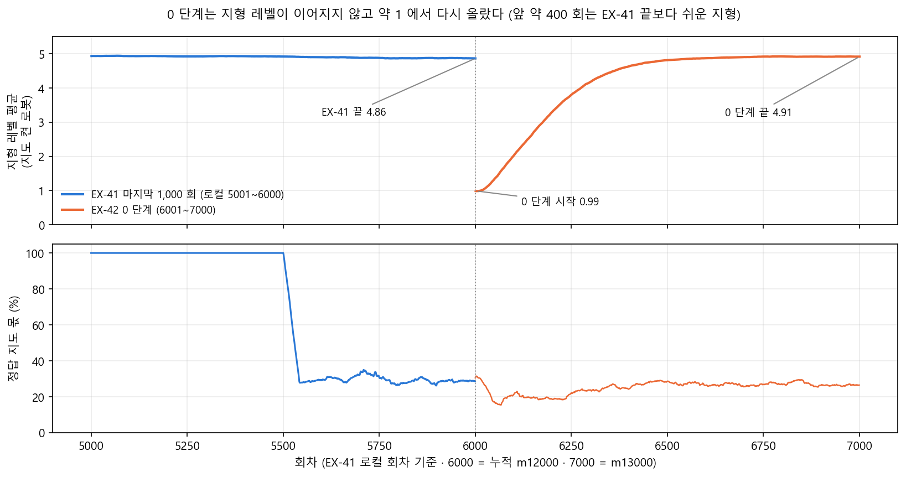
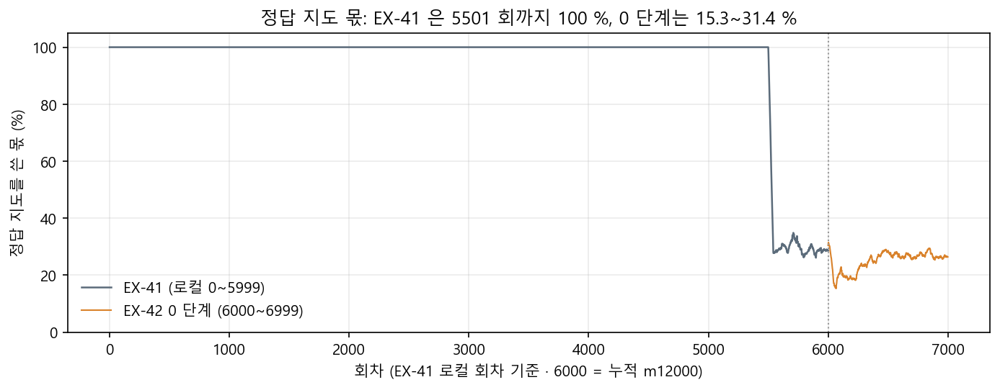
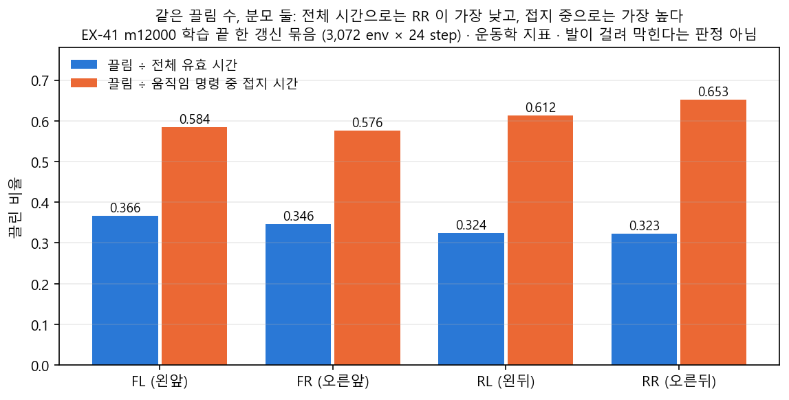
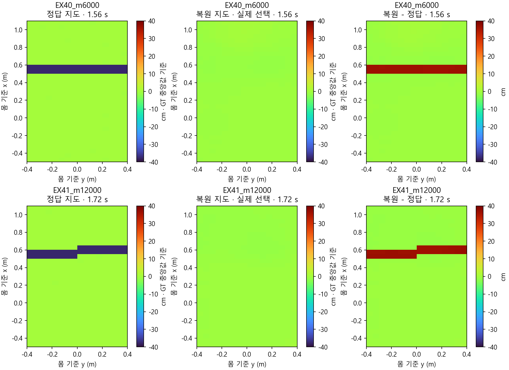

<!-- 승격: 2026-11-08 · 원본 foothold_s2/curriculum/ex42-prep.yaml (17bf4d2e) · s2_lab/ex42_main_20261108_123914 (manifest.json · map_stats.jsonl · map_switch.jsonl) · D:/mai-tmp/lead/ex42_s0_map64 · ex42_s0_end · inbox/jay/20261104-ex41-restart (decisions.tsv · EX41R-INCIDENTS.md) · analyst REPORT-analyst-N21-s0end-1108.md (3e3312f7) · 작성 오흥재 · 이슈 #555 -->
# [계보 4] EX-42 0 단계 · 복원 지도 1,000 회

> 분류: 리서치
> 작성: 오흥재 · 2026-11-08 22:50
> 근거: 실측 (0 단계 학습 기록 1,000 줄 · 쉬운 지형 map64 6 판 · 어려운 지형 L3~L5 9 판 · analyst N21 판독 3e3312f7) · 코드 (ex42-prep.yaml 17bf4d2e · ex41-fixed5000.yaml)
> 요지: 정본 m12000 에서 복원 지도로 1,000 회를 더 배워 m13000 이 됐다. 어려운 지형 오차는 대체로 조금 줄었고 지도 끔 · 복원 쪽만 뚜렷이 준 것은 빠른 전진 1.0 하나다. 쉬운 지형 옆걸음 추종은 몇 cm/s 나빠졌으며, 생존은 같았다. 지형 레벨은 다시 시작했고 측정 GPU 가 섞였으며 시드 하나다
> 상태: 확정
> 판: v1.2
> 입구: result
> 연재: m13000
> 연재 제목: EX-42 0 단계
> 연재 설명: 복원 지도 1,000 회

## 한눈에

| 무엇 | 값 |
|---|---|
| 출발 | 정본 m12000 (EX-41 `model_6000.pt` · sha `1c6af631…`) |
| 끝 | m13000 (EX-42 0 단계 `model_1000.pt` · sha `20365a2c…`) |
| 실행 | 11/08 12:39:16 시작 · `model_1000.pt` 저장 20:09 · 1,000/1,000 회 · 환경 step 73,728,000 |
| 복원 지도로 배운 양 | EX-41 6,000 회 전체 2,234 만 step → 0 단계 1,000 회에서 4,984 만 step 더함. 누적 약 3.2 배 |
| 쉬운 지형 (L0~2) | 생존 2,491 → 2,492 (/2,496) · 옆걸음 추종 오차 세 지도 모두 커짐 |
| 어려운 지형 (L3~5) | L5 빠른 전진 오차 복원 0.132 → 0.116 · 끔 0.145 → 0.110 · 전진 0.5 · 회전 +1.2 는 정답 지도까지 지도 셋 모두 조금 줄음 · 생존 비슷 · 부모 GPU0 · m13000 GPU1 |
| 판단 | 계획대로 다음 단계로 간다. E0 (부모 · 지형 확인 250 회) 뒤 E1 에서 지형 상한 L5 → L9 를 한 단계씩 |

낱말 풀이.

- **회 (update)**: 로봇 3,072 마리가 함께 조금 걸어 보고, 그 경험으로 신경망을 한 번 고치는 단위다. 누적 회차 m12000 은 처음부터 12,000 번 고쳤다는 뜻이다.
- **정답 지도 · 복원 지도 · 지도 끔**: 로봇 발밑 높이 지도를 어떻게 주는가다. 정답 지도는 시뮬레이터가 아는 참값, 복원 지도는 깊이 카메라 영상으로 추정한 값, 지도 끔은 지도 없이 몸 감각만 쓰는 것이다. 실제 로봇에는 정답 지도가 없다.
- **추종 오차**: 명령한 속도와 실제 속도의 차이(m/s)다. 작을수록 말을 잘 듣는다.
- **DR (domain randomization)**: 무게 · 마찰 · 모터 세기 같은 물리값을 일부러 흔들어 학습시키는 것이다. DR 1.0 은 계획한 흔들기 폭을 다 쓴 상태다.

그래서 이 문서는 「실제 로봇처럼 추정한 지도로 1,000 회를 더 배우면 무엇이 달라지나」 에 답한다.

## 1. 0 단계는 무엇이었나

정본 문서(계보 3) 는 EX-41 의 마지막 단계 T0′ 가 500 회로 끝났고, 모자란 것을 EX-42 0 단계 1,000 회에서 보완한다고 적었다. 이 0 단계의 설정은 `ex42-prep.yaml` 96~137 줄 `stage_zero` 에 있다.

| 항목 | 값 | 줄 |
|---|---|---|
| 근거 단계 | EX-41 `T0_prime` (ex41-fixed5000.yaml) | 98~102 |
| 부모 | 누적 12000 · sha `1c6af631…` | 103~106 |
| 길이 | 최소 1,000 · 최대 1,000 · 연장 0 | 107~110 |
| 명령 | 13 종 (전진 0.23 · 후진 0.14 · 서기 0.10 · 회전 좌우 각 0.09 등) | 111~124 |
| 정답 지도 강제 | 끔 (`force_gt: false`) | 134 |
| 지형 | 성과 따라 오름 · 상한 L5 | 135~137 |

DR 은 EX-41 끝과 같은 1.0 이다(정본 문서 3 절 표의 T0′ 줄). 학습은 GPU1 에서, 중간 점수는 GPU0 에서 쟀다.

명령 몫 · 범위 · DR 1.0 · `force_gt` 끔은 EX-41 마지막 단계와 같다(`ex42_application.jsonl` stage_config). 그러나 **지형 레벨은 이어지지 않고 다시 시작했다.** 지도 켠 로봇의 지형 레벨 평균이 it 1 0.99 · it 101 2.04 · it 301 4.18 · it 501 4.81 로 올라 끝 4.91 이 됐다. EX-41 끝은 4.86 이다(두 실행의 `map_switch.jsonl` `on.terrain_level_mean`). 앞 약 400 회는 EX-41 끝보다 쉬운 지형에서 배운 셈이다.

그래서 0 단계는 새 명령 · DR 설정이 아니라 EX-41 마지막 단계의 설정으로 1,000 회 더 배운 것이지만, 지형 레벨이 처음부터 다시 오른 만큼 「같은 조건」 은 아니다.

## 2. 0 단계가 실제로 바꾼 것 · 복원 지도 학습량

학습 기록 `map_stats.jsonl` 의 `use_gt_frac` 은 지도를 켠 로봇 가운데 정답 지도를 받은 비율이다. `map_switch.jsonl` 은 매 회 정답 · 복원 · 끔 step 수를 센다.

| | EX-41 (6,000 회) | EX-42 0 단계 (1,000 회) |
|---|---|---|
| 정답 지도 100 % 구간 | 5,501 회까지 | 없음 |
| 정답 지도 비율 (지도 켠 로봇 중) | 5,502 회부터 내려가 끝 29 % | 15 ~ 31 % · 평균 25 % |
| step 몫 정답 · 복원 · 끔 | 85.0 % · 5.0 % · 9.9 % | 22.5 % · 67.6 % · 9.9 % |
| 복원 지도 step 수 | 22,335,814 | 49,836,734 |
| 끝 지형 높이 평균 | 4.86 | 4.91 (it 1 의 0.99 에서 다시 오름) |

- `map_stats` 의 it 는 0 부터 센다. EX-41 은 it 0~5500 이 1.0 이고 it 5501(= 5,502 번째 회) 에서 0.99 로 처음 내려간다.
- 0 단계 비율은 it 39~242 사이 189 회에서 21 % 아래로 내려갔다(최저 15.3 %, it 67). 19:1x 기록의 「21~31 %」(`decisions.tsv:361`)는 맞지 않는 값이라, 1,000 회 전체를 다시 계산한 15.3~31.4 % · 평균 24.9 % 로 고친다(`decisions.tsv:372`).
- 끔 몫 9.9 % 는 둘 다 같다. 설정 `p_off` 0.1 과 맞는다.

**계획과 다른 점.** `ex41-fixed5000.yaml` 377~379 줄은 T0′ 시작을 회차 번호 4501(`fixed_update`)로 적었고, 실제 진입은 회차 번호 5501(= 5,502 번째 회)이다. 같은 셈법으로 정확히 1,000 회 밀렸고, 정본 문서 2 절의 S2b 1,000 회 연장과 맞는다. 단계 기계가 5501 에 T0′ 로 들어갔고(`stage_log.jsonl:179306` stage_enter S2e → T0_prime · iteration 5501), 정답 지도 강제 해제가 그 단계 설정으로 같은 회차에 적용됐다(`ex41_application.jsonl:24` T0_prime · iteration 5501 · force_gt false · applied).

그래서 0 단계 1,000 회는 명령 · DR 로는 「같은 설정 연장」(지형 레벨은 다시 시작)이지만 복원 지도 학습량으로는 EX-41 전체의 두 배가 넘는 양을 한 번에 넣은 단계다.

## 3. 쉬운 지형 · 무너지지 않았나

시험: map64 (연속 지형 L0~2 · 64 마리 · 300 step(6 초) · 13 명령 × 지도 3 = 39 칸 · 시드 42). 지형 배정 해시 `c3884d68` 이 여섯 판 모두 같다. 오차는 마리마다 살아 있는 동안의 평균 오차를 구하고 64 마리의 중앙값을 낸 것이다.

| 지도 | 명령 | 부모 m12000 | m13000 | 차이 |
|---|---|---|---|---|
| 정답 | 빠른 전진 1.0 | 0.099 | 0.107 | +0.008 |
| 정답 | 옆 +0.5 | 0.146 | 0.156 | +0.010 |
| 정답 | 옆 −0.5 | 0.117 | 0.140 | +0.023 |
| 복원 | 빠른 전진 1.0 | 0.101 | 0.105 | +0.004 |
| 복원 | 옆 −0.5 | 0.119 | 0.138 | +0.019 |
| 끔 | 빠른 전진 1.0 | 0.104 | 0.097 | −0.007 |
| 끔 | 옆 −0.5 | 0.099 | 0.143 | +0.044 |
| 전체 | 끝까지 생존 | 2,491/2,496 | 2,492/2,496 | +1 |

중간 저장본의 흐름 (정답 지도 · 빠른 전진 / 옆 + / 옆 −).

| 저장본 | 100 | 250 | 500 | 750 | 1000 |
|---|---|---|---|---|---|
| 빠른 전진 | 0.087 | 0.083 | 0.107 | 0.107 | 0.107 |
| 옆 + | 0.148 | 0.097 | 0.101 | 0.156 | 0.156 |
| 옆 − | 0.094 | 0.164 | 0.099 | 0.109 | 0.140 |
| 생존 (/2,496) | 2,493 | 2,493 | 2,489 | 2,487 | 2,492 |

- 250 에서 좌우가 엇갈렸다(옆 + 좋아짐 · 옆 − 나빠짐). 시드 42 · 43 · 44 로 다시 재 보니 이 엇갈림은 시드 폭보다 컸고(decisions 16:0x), 500 에서 양쪽 다 부모보다 나아졌다. 750 에서는 옆 + 만 부모보다 나빠졌고(0.146 → 0.156) 옆 − 는 아직 나았다(0.117 → 0.109). 양쪽 다 부모보다 나빠진 것은 1000 이다.
- 장치가 다르다. 부모는 GPU1(cuda:1), 0 단계 저장본은 GPU0(cuda:0) 에서 쟀다.
- 학습 조건도 섞였다. 0 단계는 지형 레벨이 다시 시작해 앞 약 400 회를 EX-41 끝보다 쉬운 지형에서 배웠다(1 절 그림 0). 옆걸음 변화가 복원 지도 학습 때문인지, 지형 재시작 때문인지는 가를 수 없다(`미확인`).

그래서 쉬운 지형은 생존이 그대로이고, 옆걸음 추종이 세 지도 모두 몇 cm/s 나빠졌다. 학습 중에는 오르내렸으므로 끝 한 점을 추세로 읽지 않는다.

## 4. 어려운 지형 · 지도 없이 더 잘 걷나

시험: 높이 고정 L3 · L4 · L5 · core 4 명령(전진 0.5 · 1.0 · 회전 ±1.2) × 지도 3 · 64 마리 · 시드 42. 아래는 빠른 전진 1.0 의 vx 추종 오차다.

| 높이 | 지도 | 부모 m12000 | m12750 | m13000 |
|---|---|---|---|---|
| L5 | 정답 | 0.125 | 0.130 | 0.122 |
| L5 | 복원 | 0.132 | 0.122 | 0.116 |
| L5 | 끔 | 0.145 | 0.128 | 0.110 |
| L4 | 정답 | 0.109 | 0.122 | 0.117 |
| L4 | 복원 | 0.117 | 0.117 | 0.119 |
| L4 | 끔 | 0.132 | 0.119 | 0.102 |
| L3 | 정답 | 0.111 | 0.119 | 0.112 |
| L3 | 복원 | 0.113 | 0.115 | 0.114 |
| L3 | 끔 | 0.116 | 0.111 | 0.099 |

- 생존(지도마다 4 명령 × 64 = 256): 부모 254~256, m13000 253~256. 거의 같다.
- 빠른 전진 1.0 만 보면 **지도 끔** 이 뚜렷하다. 세 높이 모두 줄었고 L5 에서 가장 크게(0.035) 줄었다. **복원** 은 L5 에서만 줄었고 L3 · L4 는 조금 늘었다. **정답** 은 L4 에서 오히려 늘었다.
- 다른 명령은 모양이 다르다(그림 2). 전진 0.5 와 회전 +1.2 는 **정답 지도까지 지도 셋 모두** 오차가 0.005~0.015 줄었다(예: L5 정답 전진 0.5 0.091 → 0.082 · 회전 +1.2 0.091 → 0.083). 회전 −1.2 는 거의 그대로다(차 0.006 이하). 그래서 「지도 끔 · 복원에만 생긴 효과」 는 core 4 명령 중 빠른 전진 하나에서만 보인다.
- 장치가 다르다. 부모 · m12750 은 GPU0, m13000 은 GPU1 에서 쟀다. 저장본 말고 GPU 도 바뀌었으므로 두 번째 변수다.
- 처음 건 L3~L5 평가 5 판은 13 명령 묶음과 높이 고정이 맞지 않아 오류로 끝났다(I51). 위 숫자는 core 묶음으로 다시 잰 판이다.

그래서 1,000 회 뒤 어려운 지형 오차는 대체로 조금 줄었다. 「지도가 없거나 부정확할 때 특히 좋아졌다」 는 빠른 전진 1.0 에서만 보이고, 저장본과 함께 측정 GPU 도 바뀌었으므로(부모 GPU0 · m13000 GPU1) 시드 하나 · 장치 교란 아래의 관찰이다.

## 5. 물리값을 흔들면 · N21

N21 은 같은 저장본을 DR 켬 · 끔으로 나란히 재는 기록 전용 시험이다(평지 · 연속 7 종 · L2 · 8 명령 × 지도 3). analyst 가 부모 시드 42/43/44 의 폭과 견줬다(REPORT-analyst-N21-s0end-1108.md, 3e3312f7).

- 오전에 「DR 을 켜면 오차가 더 크다」 고 짚은 18 칸(빠른 전진 · 옆걸음 ±)은 m13000 에서도 **18/18 그대로** 였다. 모두 부모 시드 폭보다 크다(11 줄).
- 격차가 줄어든 12 칸 가운데 **10 칸은 DR 끔 쪽 오차가 늘어서** 좁아졌다. on 오차 자체가 줄어든 칸은 18 칸 중 4 칸이다(13 줄).
- 생존 합은 평지 off 1536 → 1536, on 1536 → 1533, 연속 off 1530 → 1535, on 1530 → 1527 (/1536) 이다(19~22 줄).
- 교란 조건: on/off 와 부모/자식 사이에 GPU 와 평가 코드 HEAD 가 일부 다르다(38 줄). m13000 은 시드 반복을 아직 안 쟀다(5 줄).

그래서 「격차가 줄었다」 를 「DR 에 강해졌다」 로 읽으면 안 된다. 3 절의 쉬운 지형 옆걸음 악화와 같은 방향의 신호다.

## 6. 돌리는 동안 생긴 일

| 번호 | 시각 | 무엇 | 교훈 |
|---|---|---|---|
| I45 | 11:08 | 첫 기동이 자기 시작 영수증 때문에 13 초 만에 죽음 | 가짜 경로 시험 통과는 실제 통과가 아니다 |
| I46 | 11:20 | 두 번째 기동이 wrapper 속성 오류로 죽음 | 같은 종류. 가짜 env 를 실제처럼 감싸 시험 |
| I47 | 12:05 | lead 가 넣은 대기열 항목이 GPU0 배분기를 10 분 멈춤 | 띄운 뒤 첫 증거를 보고 「시작」 이라 쓴다 |
| I48 | 16:25 | 체인 P1 행이 막기 감시기보다 먼저 GPU1 에서 돎(실해 없음) | 5 초 간격 감시는 경쟁에 진다 |
| I49 | 17:44 | Orca 자동 업데이트로 orca CLI 가 잠시 사라짐 | 학습 · 감시기는 계속 |
| I50 | 19:2x | lead 기록 커밋 51 개가 원격에 안 올라가 있었음 | 커밋 뒤 origin..HEAD 0 확인 |
| I51 | 18:55 | 어려운 지형 평가 5 판이 오류 뒤에도 「끝 · rc 0」 | Isaac 종료 코드 말고 산출물로 판정 |
| I52 | 20:0x | 사이트 빌드를 timeout 900 이 중간에 끊음 | 시간을 재고 상한을 둔다 |

규칙 위반도 하나 있었다. 학습은 GPU0 에서 하는 것이 규칙인데 0 단계를 GPU1(화면 GPU) 에서 띄웠다(M91 · decisions 17:5x). 속도는 27.4 초/회로 같았고 영상이 없어 렌더 충돌은 없었다. 조치는 「Linux 이어 가기는 GPU0 · runner 의 cuda:1 고정 제거」 로 정했다(`decisions.tsv:358`). Linux 에서 실제로 GPU0 로 돈 것은 아직 확인하지 않았다(`미확인`).

그래서 학습 자체는 한 번도 끊기지 않았지만, 시작 전 두 번(I45 · I46)은 「가짜 경로 시험 통과」 때문에, 평가 다섯 판(I51)은 띄우기 전 짧은 실제 시험을 하지 않아서 다시 해야 했다(`EX41R-INCIDENTS.md:105-109`).

## 7. 판단과 다음

판단 (팀장 11/08 21:45 lead 창 직접 입력 「전진, 옆걸음, 크게 문제있는 상황인가? 즉 그냥 원래 우리 계획대로 진행해도 되지 않아?」 · lead 답 「계획대로 가도 된다」 · `decisions.tsv:372` 11/08 22:5x 줄. 원장 줄은 요약이고 인용 원문은 lead 창 입력을 lead 가 확인한 것).

- 어려운 지형 빠른 전진 1.0 에서 지도 끔 · 복원 지도 오차가 줄었다. 다른 명령은 정답 지도도 같이 줄었다(GPU 교란 아래 · 시드 하나).
- 쉬운 지형 옆걸음 추종은 몇 cm/s 나빠졌다.
- 생존은 그대로다.
- 시드 하나의 결과다.
- 계획대로 간다. 다음은 **E0** (부모 저장본 · 지형 메시 확인 250 회, ex42-prep.yaml 140 줄) 이고, 그 뒤 **E1** 은 지형 상한을 L5 → L9 로 경계마다 한 단계씩 올린다(11/06 결정 · 11/08 19:0x 재확인, decisions 360 줄).
- 시드 반복 측정은 E1 을 막지 않고 Linux 에서 E1 과 나란히 돌리자는 것이 lead 권고다. 이 권고에 대한 팀장 답은 아직 없다.

그래서 0 단계는 「보완 목적은 이뤘고 대가는 작다」 로 닫고 E0 를 거쳐 E1 로 넘어간다.

## 8. 더 볼 것 · 오른쪽 뒷다리 (RR)

RR 은 Go2 의 오른쪽 뒷발(`RR_foot`)이다. 새로 본 문제가 아니다. 10/30 D68 이 부모 S-B10 m1500 의 서 있기 RR 문제를 이미 짚었다(탐침 `s2_lab/rr_probe_20261030_lead01/data/rr_stance.json` · 부모 서 있기 RR 접지 비율 0.781 대 다른 발 0.967~0.987 · [계보 0] 6 절).

EX-41 학습 끝(m12000) 의 W86 기록 `w86_6000_7b74699e5de6.json` 에서 네 발을 나란히 놓으면 RR 이 눈에 띈다. 이 기록은 학습 끝 **한 갱신** 묶음(3,072 env × 24 step = 73,728 env-step)이고, 학습 전체 평균이 아니다.

| 발 | 공중 비율 (swing_frames ÷ 73,728) | 평균 발 힘 (N) |
|---|---|---|
| FL (왼앞) | 0.273 | 45.9 |
| FR (오른앞) | 0.299 | 44.8 |
| RL (왼뒤) | 0.371 | 33.2 |
| RR (오른뒤) | 0.405 | 31.2 |

- 공중 비율은 `record.feet.swing_frames`, 평균 힘은 `record.all_link_contact.links.<발>.mean_force_n` 에서 읽었다.
- RR 은 가장 오래 떠 있다(덜 자주 딛는다). 평균 발 힘이 낮은 것은 그 때문이고, 디딜 때만 따로 보면 RL 54.75~55.42 N · RR 54.87~55.65 N 으로 겹친다. 「디딜 때 약하다」 는 확인되지 않았다.
- 끌림은 분모에 따라 뜻이 바뀐다. 전체 시간으로 나누면 RR 0.323 으로 낮아 보이지만, 「움직이라는 명령 중 땅을 딛고 있는 시간」 으로 나누면 RR 0.653 으로 네 발 중 가장 높다(FL 0.584). 이것은 문턱(접지 · 직하 지형 2 cm 미만 · 발 속도 5 cm/s 초과)으로 센 운동학 지표이고, 발이 걸려 막힌다는 판정이 아니다(`REPORT-analyst-rr-gait-1108.md:28`).

- 영상 원자료 64 개를 명령별로 나눠 보면 후진 · 한쪽 옆걸음 · 한쪽 회전에서 RR 접지가 RL 보다 짧고, 반대 회전에서는 뒤집힌다. 전진은 저장본에 따라 다르다. 새 저장본(EX-41 m12000)은 RR 이 RL 보다 조금 길고, EX-40 m6000 은 RR 이 7.1 %p 짧다(`REPORT-analyst-rr-gait-1108.md:90` · `:97`). 「모든 명령에서 RR 이 약하다」 는 맞지 않는다(analyst `REPORT-analyst-rr-gait-1108.md` · 0aa5afdb).

그래서 RR 은 「덜 딛는다」 까지는 확인됐다. 「딛는 동안 더 끌린다」 는 W86 한 갱신 묶음의 접지 중 분모 지표에서만 그렇다. analyst 는 둘을 한 원인으로 묶지 말라고 적었다. 영상에서 옆 −0.5 는 RR 이 훨씬 덜 딛지만 접지 중 끌림 근사 비율은 RL 보다 낮다(`REPORT-analyst-rr-gait-1108.md:110`). 원인(정책 비대칭 · 관절)은 `미확인` 이다. 다음 촬영 때 발별 접촉 힘을 기록에 남기자는 것은 analyst 권고이고(같은 보고 :113), 정해진 일은 아니다.

## 9. 더 볼 것 · 틈 지형과 복원 지도

C층 영상을 본 팀장 질문(11/08 22:3x · L0 틈에서도 지도를 안 쓰고 걷는 것 같고 복원 지도에 틈이 하나도 안 나온다는 물음 · `decisions.tsv:371` 요약) 에 analyst 가 원자료로 답했다(`REPORT-analyst-gap-map-1108.md` · 10da4962).

| 무엇 | 값 |
|---|---|
| L0 틈은 실제로 있나 | 있다. 폭 0.10 m · 깊이 0.376 m · 틈 셋 |
| 정답 지도에 찍히나 | 찍힌다. 두 면 차이 0.376 m |
| 복원 지도에 찍히나 | 거의 안 찍힌다. 같은 자리 깊이 m6000 0.039 m · m12000 0.002 m |

- 복원 지도는 정책이 실제 로봇에서 쓸 지도다. 이 지도가 틈을 거의 그리지 못한다는 것은 확인됐다. 다만 정책이 지도를 얼마나 쓰는지는 이 영상만으로 가를 수 없다. analyst 는 「정책이 지형을 정확히 읽어 발을 놓는다고 증명할 수 없고, 반대로 지도를 전혀 안 쓴다고 할 수도 없다」 고 적었다(`REPORT-analyst-gap-map-1108.md:13`).
- 팀장 판단(11/08 23:1x): 학습 때 틈 지형을 본 적이 없어서 복원 지도가 틈을 못 그릴 수 있다. EX-42 계획(ex42-prep.yaml 186~204 줄)에서 E2 의 첫 새 지형은 징검돌 `start_stones_l0` 이고, 틈 `start_gap_l0` 은 평균대와 함께 대안으로만 적혀 있다. 틈을 언제 넣을지는 아직 정하지 않았다(`미확인`).
- 원인은 넷 중 무엇인지 아직 모른다(학습 노출 · 카메라가 틈 바닥을 못 봄 · 지도 전체 평균 손실에 좁은 틈이 묻힘 · 코드). Linux 전환 뒤 E1 과 함께 가르는 진단을 짧게 돌린다(팀장 23:1x ok).

그래서 넓은 틈 0.90 / 1.00 m 미션 블록 전에 「복원 지도가 틈을 그리는가」 를 먼저 확인한다.

## 10. 이 문서가 「미확인」 으로 남기는 것

- `미확인` m13000 의 시드 반복 폭. 쉬운 지형 · 어려운 지형 · N21 모두 시드 42 하나다.
- `미확인` 장치(GPU0 대 GPU1) 가 숫자에 준 몫.
- `미확인` 0 단계 지형 레벨 재시작이 쉬운 지형 옆걸음 변화에 준 몫.
- `미확인` RR 뒷다리 비대칭의 원인.

## 원자료

- 0 단계 설정: `foothold_s2/curriculum/ex42-prep.yaml` 96~137 (17bf4d2e) · EX-41 계획 `ex41-fixed5000.yaml` 377~382
- 실행: `C:/Users/AI-WS01/s2_lab/ex42_main_20261108_123914/main/EX-42-B-stagezero_20261108_123914/` (manifest.json · map_stats.jsonl · map_switch.jsonl)
- EX-41 비교: `C:/Users/AI-WS01/s2_lab/ex41_main_20261104_235522/main/EX-41-B-main_20261104_235522/` (map_stats.jsonl · map_switch.jsonl)
- 쉬운 지형: 부모 `ex41_main_20261104_235522/eval/score-watch/model_6000_1c6af6319c82/evaluation/map64/` · 0 단계 `D:/mai-tmp/lead/ex42_s0_map64/model_{100,250,500,750,1000}/map64/`
- 어려운 지형: `D:/mai-tmp/lead/ex42_s0_map64/hard/` (m12000 · m12750) · `D:/mai-tmp/lead/ex42_s0_end/map64_L3~L5/` (m13000)
- N21: analyst `_out/reports/REPORT-analyst-N21-s0end-1108.md` (fc3b90ce · 3e3312f7)
- 기록: `inbox/jay/20261104-ex41-restart/decisions.tsv` 321~374 줄 · `EX41R-INCIDENTS.md` I45~I52

## 판 이력

- v1.0 (2026-11-08 22:57 첫 게시 d5e03a27): 처음 씀. 같은 판에서 23:06 3bf663df 가 8 절 RR 을 analyst 명령별 판독으로 다시 썼고, 23:17 dca1c073 가 그림과 9 절 틈 절을 더했다.
- v1.1 (2026-11-09): 11/09 사실 감사 반영. 0 단계 지형 레벨이 0.99 에서 다시 시작한 것을 적고 「같은 조건」 을 바로잡음(그림 0 추가 · 3 절 교란으로 적음) · 「21~31 %」 의 틀린 원인 문장을 빼고 고친 숫자만 둠 · T0′ 진입 회차 5501 을 stage_log · ex41_application 으로 닫음 · 750 흐름 문장 · 어려운 지형 그림을 core 4 명령 전부로 다시 그리고 「끔 · 복원만 좋아짐」 을 빠른 전진 한정으로 · M91 조치를 미실행으로 · I51 원인 · 팀장 21:45 인용 근거를 decisions.tsv:372 로 · 22:3x 질문은 원장 요약으로 · RR 정의와 10/30 D68 연결 · RR 끌림 · 전진 뒤집힘을 analyst 보고에 맞춤 · 발별 힘 기록은 권고로 · 틈 지도 그림 추가와 정책 해석 완화 · 기록 범위 321~374.
- v1.2 (2026-11-09 03:2x): 0 단계 다음을 「E1」 로만 적은 세 곳을 「E0 (250 회) 뒤 E1」 로 바로잡음 (ex42-prep.yaml stages 의 첫 단계는 E0 · 11/09 재귀 점검).
