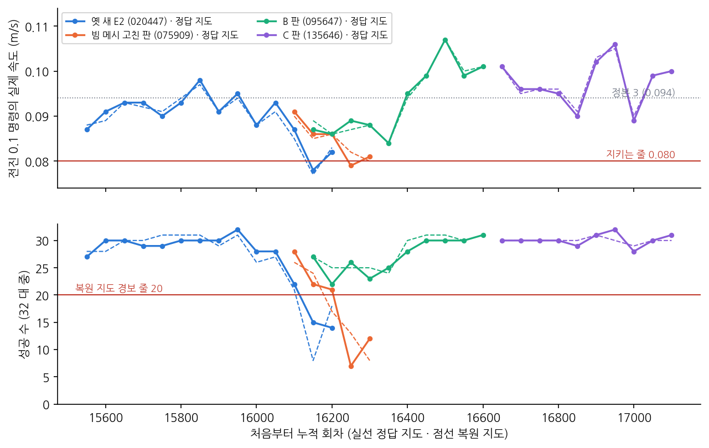
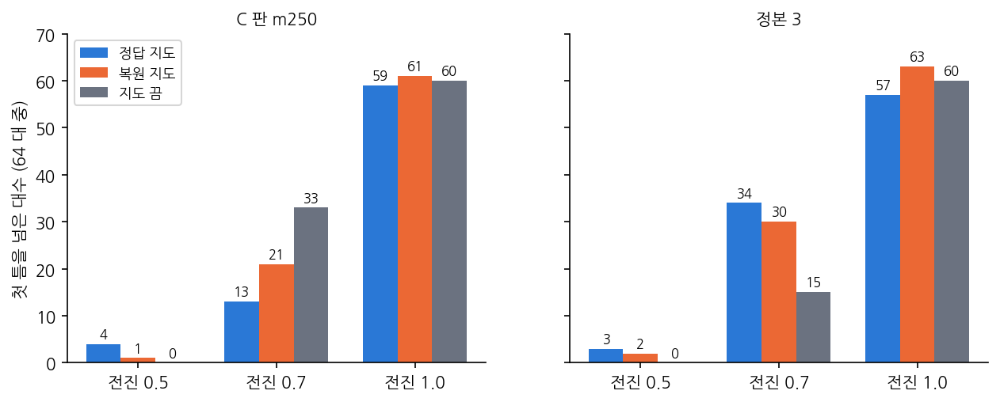

<!-- 승격: 2026-11-19 · 원본 inbox/jay/20261119-lineage/LINEAGE-4-ex42-update-1119.md (planner-lx 초안 v0.1 · PR #889 · 4fba72b3d) · SOURCES.md · 그림 make_lineage_1119.py · 승격 lead-lx (오흥재 지시) · 이슈 #555 -->
# [계보 7] EX-42 지형 학습 · 정본 3 뒤부터 11/19 새 설계까지

> 분류: 리서치
> 작성: Claude 세션 (오흥재 지시, lead-lx) · 2026-11-19 23:40
> 근거: 실측 (11/19 E2 네 실행의 `startup_receipt.json` · `manifest.json` · 경계 점수 `eval/scores/m250 · m500/ex42_score.json` 을 직접 읽음 · 50 회 탐침과 지도 끔 측정 원자료를 표 도구로 다시 뽑음) · 원장 `decisions.tsv` 11/17 ~ 11/19 17:42 줄 · 이슈 #555 planner 인계 댓글 둘 · `KINDS-L0-ORDER-1118.md` · `START-MAP-USE-1119.md` · planner-lx 초안 (PR #889)
> 요지: 정본 3 에서 지형 학습 (E2) 을 시작했지만 11/17 ~ 11/18 의 판들은 징검돌 열이 들어가면 느린 전진이 무너지거나 징검돌이 늘지 않았다. 11/18 밤 지형을 「행동 묶음」 으로 다시 짰고 (E2 틈과 넓은 문 → E3 → E4 → E5 섞기) 11/19 02:05 에 새 E2 를 띄웠다. 하루 동안 원인 셋을 차례로 고쳤다: 빔 메시의 턱, 건넘을 뜻하지 않던 레벨 올림 규칙, 너무 높던 듬성 지형 레벨. 넓은 빔은 건너게 됐고 느린 전진은 18:00 까지 지켰다 (그 뒤 C 판 m1000 무렵 무너짐 · 맨 아래 「18:00 뒤」). 틈과 평균대는 아직 판정 줄에 못 미친다. 틈은 지도가 아니라 보폭으로 넘고 있다는 측정이 나와 그 처방을 건 상태다
> 상태: 검토중 (진행 중인 실험의 기록 · C 판은 11/19 18:00 현재 m500 경계 평가까지 · 그 뒤는 이 문서 범위 밖)
> 판: v1.0
> 입구: result
> 연재: 11/17 → 11/19
> 연재 제목: EX-42 지형 학습 새 설계
> 연재 설명: 행동 묶음 · 11/19 E2 네 실행 (진행 중)

[계보 4](20261108-lineage-4-ex42-stage0.md) 는 0 단계 (m13000) 에서 끝난다. 그 뒤 E0 · E1 · E1F 는 [계보 5](20261119-lineage-5-ex42-m12000-to-m15500.md) 가, 정본 3 자체는 [계보 6](20261119-lineage-6-canon3-m15500.md) 이 다룬다. 이 글은 정본 3 에서 지형 학습을 시작한 11/17 부터 11/19 18:00 까지다.

## 한눈에

| 무엇 | 값 | 출처 |
|---|---|---|
| 출발 | 정본 3 (m15500 · sha `13caeb4a…`) | 새 E2 실행의 `startup_receipt.json` (부모 sha · 누적 15500) |
| 11/17 ~ 11/18 | 징검돌을 넣은 E2 판 여럿. 느린 전진이 m300 언저리에서 꺾이거나, 꺾임을 막아도 징검돌 생존이 늘지 않음 | 1 절 |
| 새 설계 승인 | 11/18 21:37 (바꾸는 안) · 11/19 00:31 (E2 ~ E5 몫과 단계) · 00:51 (목표 다섯 가지로 다시 고정) | 원장 11/18 21:37 · 11/19 00:51 |
| 새 E2 | 틈 셋 + 넓은 빔 + 평균대 · 각 몫 0.088 · 11/19 02:05 기동 | 원장 11/19 00:29 · 02:10 · `manifest.json` `run.started_at` |
| 11/19 의 네 실행 | 옛 새 E2 (`…_020447`) → 빔 메시 고친 판 (`…_075909`) → B 판 (`…_095647`) → C 판 (`…_135646`) | 3 절 표 |
| 18:00 기준 누적 | C 판 m500 = 17,100 (부모 누적 16,600 + 500) | C 판 `startup_receipt.json` · 저장본 `model_500.pt` (17:36) |
| 된 것 | 넓은 빔: 0 / 32 → 32 / 32 (L2) · 18:00 기준 L4 에서 26 ~ 28 / 32. 느린 전진 0.1: C 판 m500 까지 0.089 ~ 0.106 m/s 로 지키는 줄 0.080 위 | 4 절 · 5 절 |
| 안 된 것 | 틈 셋 · 평균대는 L1 에서도 판정 줄 (성공 26 · 생존 30 / 32) 아래. 묶음 졸업 0 | 5 절 표 |

낱말 풀이.

- **듬성 지형**: 발 디딜 곳이 띄엄띄엄한 지형이다. 여기서는 틈 (A · B · C 세 종류) · 넓은 빔 (B) · 평균대 (A) 를 묶어 부른다. A · B · C 는 지형을 만든 방식 (가족) 의 이름이다.
- **레벨 (L0 ~ L9) · 상한**: 같은 종류 안의 난이도 단계다. 틈이면 폭이 넓어진다. 상한은 학습 중 로봇이 올라갈 수 있는 가장 높은 레벨이다.
- **경계 · 창**: 250 회마다 학습을 세우고 GPU 로 재는 공식 평가다. 한 번이 한 창이다. 묶음 졸업은 같은 레벨을 두 창 연속 통과해야 한다.
- **판정 줄**: 듬성 종류 칸은 32 대 가운데 성공 26 · 생존 30 이상이다 (점수 파일 `success_min` 26 · `survival_min` 30). 64 대로 치면 52 · 60 이다.
- **50 회 탐침 · 지키는 줄**: 50 회마다 CPU 에서 32 대로 느린 전진 0.1 m/s 를 6 초 걸려 본다. 실제 속도가 0.080 아래로 두 점 연속 내려가면 「기본 걸음이 무너진다」 는 경보다 (원장 11/19 02:11).
- **GT | PRED | 끔**: 정답 지도 · 복원 지도 · 지도 끔 순서로 나란히 적은 값이다.

그래서 이 문서는 「새 지형을 넣자 무엇이 막혔고, 하루 동안 무엇을 고쳤고, 지금 어디까지 왔나」 에 답한다.

## 1. 11/17 ~ 11/18 · 징검돌에서 막히다

원래 계획의 E2 는 첫 새 지형으로 낮은 징검돌을 넣는 단계였다 ([계보 4] 9 절). 정본 3 에서 그렇게 띄운 판들은 아래처럼 끝났다. 숫자는 50 회 탐침의 「전진 0.1 m/s 명령에 대한 실제 속도」 (GT) 이고 lead 가 원장에 적은 값이다.

| 때 | 판 | 무엇이 달랐나 | 결과 | 원장 |
|---|---|---|---|---|
| 11/17 새벽 ~ 오전 | ① ~ ④ (KL 0.01 판 · 징검돌 몫 반 · 깃발 먼저 돌기 끔 등) | 한 칸씩 바꿔 원인을 가름 | 네 판 모두 m300 에서 0.072 ~ 0.079 로 꺾임 (정본 3 은 0.094) | 11/17 07:22 · 12:21 · 14:39 |
| 11/17 12:20 ~ | k (대조 판) | E2 가 더한 것 셋 (메시 깃발 자리 · 징검돌 열 · 깃발 먼저 돌기) 을 뺌 | m300 0.092 · m400 0.098 로 버팀 → 「새 프로세스로 넘기는 것」 은 원인이 아님 | 11/17 14:39 · 15:05 · 17:54 (이 「확정」 을 거둠. 한 점 판정 잣대가 판 사이 흔들림보다 가늘었고 같은 설정 k 도 m300 에서 0.077) |
| 11/17 오후 | l (메시 깃발 자리만 넣음) | | 가르지 못한 판으로 정정 (l 과 k 가 쓰는 열에는 메시 깃발이 없었음) | 11/17 17:54 |
| 11/18 02:00 | (분석) | 노출 영수증으로 다시 가름 | 징검돌 열이 「있고 없음」 이 가름: 없음 0.092 · 0.098 / 있음 0.069 ~ 0.079 | 11/18 02:00 |
| 11/18 03:59 ~ | o2 | 징검돌 열에서 느린 전진 명령 (0.3 아래) 을 뺌 | 느린 전진은 0.083 ~ 0.091 띠로 지킴 (m250 ~ m700). 그러나 징검돌 L5 생존 13 ~ 16 / 32 에서 늘지 않고, 징검돌 env 는 L1 ~ 2 에서 멈춤 | 11/18 07:19 · 10:19 · 10:21 |
| 11/18 16:12 ~ 11/19 00:22 | o3e | 깃발 먼저 돌기 · 징검돌 몫 0.20 · 가장자리 벌점 (foot_edge) | 징검돌 넘어짐 비 74.4 % → 83.0 % (m1 ~ 250 → m251 ~ 500). 노출이 없던 A 틈 L2 생존 25 \| 24 → 10 \| 8 로 잃음. m1284 에서 멈춤 | 11/18 16:15 · 21:39 · 11/19 00:25 · 이슈 #555 인계 댓글 11/19 01:1x |

- 징검돌 낮은 것의 L0 는 「가장 쉬운 단」 이라는 이름과 달리 쉽지 않았다. 돌 0.554 × 0.4425 m · 틈 0.194 m · 높이 흔들림 ±5 cm 이고 정본 3 의 생존은 13 \| 11 / 32 다 (이슈 #555 인계 댓글 11/19 01:1x · 4 번 · `KINDS-L0-ORDER-1118.md`).
- o3e 에서 넘어짐의 약 9 할은 발 빠짐이었다 (같은 댓글 2 번).
- 복원 지도를 징검돌에 맞춰 다시 맞춘 지각만 바꿔 끼워도 징검돌 생존은 13 → 12 (L0) · 7 → 7 (L2) 로 그대로였다. 지금은 지도보다 걷기가 먼저 막는다는 뜻이다 (같은 댓글 3 번).

그래서 「징검돌부터」 는 정본 3 에게 너무 큰 계단이었다. 쉬운 것부터 다시 짜야 한다는 것이 11/18 밤의 결론이다.

## 2. 새 설계 · 행동 묶음으로 쉬운 것부터 (11/18 21:37 ~ 11/19 01:03)

팀장은 11/18 21:37 에 「바꾸는 안」 을 승인하면서 m15500 에서 다시 시작해야 하지 않느냐고 물었고, lead 는 새 E2 를 정본 3 에서 새로 띄우기로 했다 (원장 11/18 21:37 · 21:39 · 요지). 순서 규칙은 측정 결과를 보기 전에 고정했다.

| 규칙 | 값 | 원장 |
|---|---|---|
| 묶음 | 행동으로 넷: ① 이어진 지형 ② 오르내리기 ③ 틈 넘기 ④ 좁은 곳 딛기. 순서 ① → ② → ③ → ④ | 11/18 21:39 |
| 묶음 안 순서 | 정답 · 복원 지도 중 낮은 쪽 생존이 높은 종류부터 | 11/18 21:39 |
| 몫 | 묶음 단위로. 지금 배우는 묶음의 듬성 몫 합 0.44 · 묶음 안 종류는 같은 몫 | 11/18 21:49 |
| 졸업한 종류 | 유지 하한 3 % (0 으로 두면 무너지는 것을 o3e 에서 봄) | 11/18 21:49 |
| 졸업 줄 | 묶음 안 모든 종류가 대표 레벨에서 성공 52 · 생존 60 (64 대 기준) 을 두 창 + 앞 묶음 유지 + 느린 전진 0.080 위 | 11/19 00:51 (11/18 21:49 원문은 「생존 52/64 두 창」 이라 다름) |

그 규칙으로 정본 3 을 지형 종류 전부에 걸려 본 표 (`KINDS-L0-ORDER-1118.md` · 요약은 [계보 6] 4 절) 에서 단계가 나왔다.

| 단계 | 새로 여는 종류 | 몫 | 최대 회차 | 출처 |
|---|---|---|---|---|
| E2 | 틈 셋 (A · B · C) + 넓은 빔 (B) + 평균대 (A) | 다섯 종 각 0.088 (합 0.44) · 상한 2 로 열고, 경계에서 첫 창을 통과한 종류만 상한 +1 · 졸업 L5 | 1,500 | 원장 11/19 00:29 · 01:00 · 01:03 |
| E3 | 팔레트 · 디딤 빔 · 쉬운 징검돌 사다리 | 앞 다섯 종 하한 합 0.15 + 새 셋 각 0.0967 | 4,000 | 같은 줄 |
| E4 | B 돌 · 높은 징검돌 | 앞 여덟 종 하한 합 0.24 + 새 둘 각 0.10 | 3,000 | 같은 줄 |
| E5 | 섞기 | 열 종 각 0.044 + ② 의 약한 넷 각 0.03 (상한 6) | 1,500 | 같은 줄 |

- 팀장은 11/19 00:31 에 이 몫과 단계를 승인했고 00:51 에 목표를 다섯 가지로 다시 걸었다: 정본 3 능력 유지 · 행동 묶음 단계 · 첫 깃발에 먼저 돌기 · 복원 지도 모서리와 실제 카메라 장착 · HiPAN 원인 (원장 11/19 00:51 · 요지).
- 지금 계획의 뒤 단계가 얼마나 얇았는지도 근거였다. 옛 E4 는 종류당 몫 0.015 = GPU 한 장에 46 env 로, START 논문이 징검돌 한 종류에 쓴 양의 약 1.6 % 다. 이 1.6 % 는 손계산이고 START 의 종류 몫 0.14 는 우리 가정이다 (원장 11/18 21:49 · 이슈 #555 인계 댓글 11/19 01:1x · 7 번).
- 정본 문서 쪽 초안은 가지 `feature/planner-e2-bundles-1118` 의 커밋 a662be6aa 에 있다 (`CURRICULUM-GATES.md` v0.18 초안 · `ex42-prep.yaml` 의 E2 ~ E5 노출). 11/19 18:00 현재 main 에 병합되지 않았다 (`git merge-base --is-ancestor` 로 확인). 새 E2 는 sonnet 이 딸린 자리 (판정기 · 승인 칸 · 메시 프로파일) 를 고친 뒤 만든 실행용 plan (sha `9e6dc5eb…`) 으로 띄웠다 (원장 11/19 01:12 · 01:57). 그 plan 이 초안 a662be6aa 와 글자까지 같은지는 대조하지 않았다 (`미확인`).

그래서 새 설계는 「징검돌을 맨 뒤로, 정본 3 이 이미 절반쯤 하는 틈과 넓은 빔을 맨 앞으로」 옮긴 것이다.

## 3. 11/19 하루의 네 실행

| 실행 | 기동 | 부모 (누적) | 무엇을 바꿨나 | 돈 회차 | 코드 git |
|---|---|---|---|---|---|
| 옛 새 E2 `…_020447` | 02:05 | 정본 3 (15500) | 새 설계 그대로 | 700 | `1783fd14` |
| 빔 메시 고친 판 `…_075909` | 07:59 | 옛 새 E2 m550 (16050) | 넓은 빔 메시 | 250 | `9360a762` |
| B 판 `…_095647` | 09:57 | 빔 메시 고친 판 m50 (16100) | + 레벨 올림 규칙 | 500 | `cb8e5c35` |
| C 판 `…_135646` | 13:57 | B 판 m500 (16600) | + 듬성 넷 상한 1 과 내림 조건 | 500 (17:36 저장) | `8b466177` |

- 출처: 각 실행의 `startup_receipt.json` (`parent.checkpoint_path` · `cumulative_update`) 과 `manifest.json` (`run.started_at` · `git.head` · `progress.completed_updates`). 11/19 18:0x 에 직접 읽었다.
- 부모가 한 줄로 이어지지 않는다. 빔 메시 고친 판은 옛 판의 m550 에서, B 판은 빔 메시 고친 판의 m250 이 아니라 m50 에서 갈라졌다. B 판의 m50 은 느린 전진이 내리기 전 저장본을 고른 것이다 (원장 11/19 09:39). 빔 메시 고친 판은 07:11 계획에서 부모가 m750 이었는데 실제는 m550 이고, 바뀐 까닭은 찾지 않았다 (`미확인`).

경계 평가의 듬성 다섯 종 (32 대 · 성공/생존 · GT | PRED). 점수 파일에서 직접 읽은 값이고 원장 줄과 같다.

| 경계 | 평균대 | A 틈 | 넓은 빔 | B 틈 | C 틈 |
|---|---|---|---|---|---|
| 옛 판 m250 (L2) | 13/5 \| 15/9 | 2/5 \| 3/3 | 0/30 \| 0/0 | 1/1 \| 6/7 | 0/20 \| 0/0 |
| 옛 판 m500 (L2) | 9/6 \| 10/7 | 0/1 \| 1/0 | 0/27 \| 0/15 | 3/3 \| 2/2 | 0/0 \| 0/0 |
| 빔 메시 고친 판 m250 (L2) | 10/7 \| 11/5 | 0/0 \| 0/0 | **32/32 \| 32/32** | 3/3 \| 4/4 | 0/0 \| 0/0 |
| B 판 m250 (L2) | 7/6 \| 6/6 | 2/1 \| 1/0 | 31/31 \| 31/31 | 3/3 \| 3/4 | 0/1 \| 0/0 |
| B 판 m500 (빔 L3 · 나머지 L2) | 6/5 \| 6/6 | 0/0 \| 2/0 | 29/29 \| 30/30 | 4/4 \| 2/2 | 0/0 \| 0/0 |
| C 판 m250 (빔 L3 · 나머지 L1) | 7/4 \| 5/4 | 18/6 \| 25/5 | 32/32 \| 32/32 | 9/9 \| 10/10 | 0/1 \| 0/2 |
| C 판 m500 (빔 L4 · 나머지 L1) | 10/3 \| 8/0 | 19/4 \| 16/4 | 26/26 \| 28/28 | 13/13 \| 13/13 | 0/0 \| 0/1 |

- 일곱 경계 모두 전체 판정은 FAIL 이고 (졸업 아님), 유지 항목 (생존 · 속도 추종 · 회전 생존) 은 일곱 번 모두 PASS 다.
- C 판 m500 줄은 17:58 에 쓰인 점수 파일에서 읽었다. 초안을 쓴 시점의 원장 (17:42 까지) 에는 아직 이 경계의 판독 줄이 없다.
- B 틈 칸의 수는 믿기 어렵다. 그 칸은 출발 방향이 흩어져 절반 넘게 뒤로 가서, 틈 넘기를 재지 못한다 (원장 11/19 13:18 · 15:57). 고정 출발로 고친 판정은 m500 이어 가기부터 걸렸다 (원장 11/19 16:38).

그래서 하루 동안 눈에 띄게 바뀐 칸은 넓은 빔 (메시 고친 뒤 통과) 과 A 틈 (레벨을 내린 뒤 성공 0 ~ 2 → 16 ~ 25) 둘이다. 생존까지 판정 줄을 넘은 듬성 칸은 넓은 빔뿐이다.

## 4. 고친 것 하나 · 넓은 빔 메시의 턱

옛 판에서 넓은 빔은 두 경계 연속 성공 0 이었다. 폭 (0.91 · 0.83 · 0.75 m) 이 원인처럼 보였지만 아니었다.

| 무엇 | 값 | 출처 |
|---|---|---|
| 들머리 턱 높이 (옛 메시) | L0 +15.2 cm · L1 +23.6 cm · L2 +37 ~ 39 cm | 원장 11/19 06:27 (planner · 메시 광선 단면 실측) |
| 턱이 생긴 까닭 | 8 m 길이 빔 판을 가운데 축으로 ±0.1 rad 무작위로 기울임. 레벨과 무관 | 같은 줄 (`ame2_preset.py` 212 ~ 219) |
| 원문 대조 | 기울기 ±0.1 rad 는 논문 글귀와 같음. 다른 것은 빔 길이 (우리 8 m · 공개 코드 2 m) 와 기울기를 레벨로 줄이지 않는 것 | 원장 11/19 06:30 |
| 고친 메시 | 빔 2 m · 기울기 0.1 × 레벨 / 9 · 턱 L0 0.0 · L1 0.9 · L2 0.4 cm (L0 ~ L9 모두 6.4 cm 이하) | 원장 11/19 07:11 (sonnet 보고) |
| 결과 | 넓은 빔 L2: 0/27 \| 0/15 → 32/32 \| 32/32 | 3 절 표 (직접 읽음) |

- 턱 높이는 처음에 손계산으로 ±4 · ±9 cm 라고 적었다가 메시 실측으로 고친 값이다 (이슈 #555 인계 댓글 11/19 17:5x 「정정」). 이 문서는 실측 값만 싣는다.
- 옛 판 m250 에서 「넓은 빔 · C 틈은 정답 지도로는 서 있는데 복원 지도로는 생존 0」 을 보고 복원 지도 탓이라는 가설이 한 번 적혔다 (원장 11/19 04:06 · 미확인 가설로 표시). 넓은 빔에 대해서는 턱이 원인이었고 고친 메시에서는 두 지도가 같다.
- 메시를 고쳐도 느린 전진의 내림은 멎지 않았다. 부모에서 같은 거리로 견주면 약 100 회 늦춰졌을 뿐이다 (옛 판 +100 회 0.078 · 성공 15 \| 8 대 고친 판 +200 회 0.079 \| 0.082 · 성공 7 \| 13 · 원장 11/19 07:39 · 08:59 · 09:39 · 그림 1).

그래서 넓은 빔은 「로봇이 못 걷는 지형」 이 아니라 「만든 쪽의 메시가 틀린 지형」 이었다. 다만 그것만으로 기본 걸음의 내림은 설명되지 않았다.

## 5. 고친 것 둘과 셋 · 레벨 올림 규칙과 듬성 상한

### 5-1. 올림 규칙 (B 판)

학습 중 로봇을 더 어려운 레벨로 올리는 규칙은 「출발점에서 타일 반 넘게 멀어지면 올림」 이었고 방향을 따지지 않았다. 옆이나 뒤로 가도 올라가므로 「건넜다」 를 뜻하지 않았다 (원장 11/19 06:30 · `curriculum/rules.py` · 이슈 #555 인계 댓글 11/19 17:5x · 2 번). B 판은 듬성 열의 올림 조건을 「진행 방향 x 로 타일 0.5 넘게 · 앞쪽 명령일 때만」 으로 바꿨다 (원장 11/19 07:11 · 09:58).

결과는 두 갈래다.

- 느린 전진은 지켰다. B 판 탐침은 m50 ~ m250 0.084 ~ 0.089, m300 ~ m500 0.095 ~ 0.107 이다 (탐침 원자료를 `line50.py` 로 다시 뽑음 · 그림 1).
- 듬성 넷 (틈 셋 · 평균대) 은 그대로였다. m250 · m500 두 경계에서 L2 성공 0 ~ 7 / 32 다 (3 절 표).

### 5-2. 듬성 넷이 안 느는 까닭 (11/19 13:18)

| 본 것 | 값 | 출처 |
|---|---|---|
| L1 에서도 못 건넘 (B 판 m250 · CPU 64 대) | A 틈 셋 다 넘음 20 \| 49 · 생존 5 \| 2 · C 틈 둘째 넘음 3 \| 11 · 평균대 둘째 구간 3 \| 11 | 원장 11/19 13:18 (planner 측정) |
| L0 는 건넘 | 옛 판에서 A 틈 L0 32 / 32 | 같은 줄 |
| 정답 지도와 복원 지도가 같은 자리에서 짐 | 틈 넘는 걸음 직후 · 틈 가장자리 · 빔 위 1.5 ~ 2.5 m | 같은 줄 |
| 학습 env 의 레벨 분포 (L0 : L1 : L2 · 종류당 540) | A 틈 5 : 112 : 423 · 평균대 27 : 121 : 392 · B 틈 83 : 172 : 285 · C 틈 69 : 306 : 165. 400 회 동안 그대로 | 같은 줄 |

읽는 법. 로봇 대부분이 못 건너는 L2 에 얼어 있었다 (A 틈은 78 %). 옛 올림 규칙이 건너지도 않은 로봇을 L2 로 올려 두었고, 내림 규칙은 2 ~ 4 m 걷다 넘어지는 로봇을 내리지 못했다. 지도 종류와 상관없이 같은 자리에서 지므로 복원 지도 오차 탓은 아니라고 봤다.

### 5-3. 처방과 C 판

lead 가 정한 처방 (원장 11/19 13:18 · 13:24 · 13:30).

- 듬성 넷의 종류 상한을 1 로. L2 에 있던 env 를 L0 ~ L1 로 다시 나눔.
- 내림 조건을 더함: 진행 방향으로 타일 반을 못 가고 넘어지면 한 단 내림.
- 종류 상한은 같은 실행 안에서 내릴 수 없어서 (plan sha 에 묶임) B 판 m500 에서 새 실행으로 갈아탔다. 이것이 C 판이다 (13:57 기동).

C 판에서 본 것.

| 칸 | 값 | 출처 |
|---|---|---|
| 느린 전진 0.1 (탐침 · 실제 속도 GT) | m50 ~ m500 열 점이 0.089 ~ 0.106 · 성공 28 ~ 32 / 32 | 탐침 원자료 다시 뽑음 (그림 1) |
| 평균대 L1 · 전진 0.5 (생존 /64 · GT\|PRED) | B 판 m500 17 \| 15 → C 판 m100 49 \| 51 → m200 63 \| 59 → m250 59 \| 56 | 원장 11/19 14:59 · 15:19 · 15:55 · 16:00 |
| 평균대에서 바뀐 것 | B 판은 빔 위에서 오른쪽으로 초당 약 2 cm 씩 계속 쏠림 (떨어진 47 대 중 43 대가 오른쪽). C 판은 옆 치우침이 2 cm 근처에서 멈춤. 걸음 꼴 (폭 · 디딤 횟수) 은 같음 | 원장 11/19 14:41 · 15:20 |
| A 틈 경계 칸 | L2 성공 0 ~ 2 → L1 성공 18 \| 25 (m250) · 19 \| 16 (m500). 생존은 4 ~ 6 으로 낮음 | 3 절 표 |
| 복원 지도 모서리 오차 (평균대 L1) | 정본 3 19.9 cm → B 판 m500 11.1 → C 판 m250 9.2 | 원장 11/19 14:39 · 15:55 |
| 복원 지도 모서리 오차 (A 틈 L1) | 24.4 cm → 19.0 → 16.3 | 같은 줄 |
| 13 명령 유지 (정본 3 대비) | 생존은 후진 1.0 한 칸만 63, 나머지 64. 오차 52 지표 가운데 B 28 · C 24 개가 정본 3 보다 나쁘지만 한계 안 | 원장 11/19 16:11 (sonnet 능력 표) |

- 평균대의 쏠림을 직진 방향 벌점으로 고치려던 처방은 15:04 에 실시간 파일로 걸었다가, C 판 m100 에서 쏠림이 이미 사라진 것을 보고 m255 에 적용되기 전에 되돌렸다 (원장 11/19 15:03 · 15:19).
- 평균대는 속도에 따라 엇갈린다. 전진 0.5 에서는 m200 에 올랐지만 전진 1.0 으로 재면 둘째 구간을 넘는 대수가 m100 51 \| 45 → m200 10 \| 7 로 내렸다 (원장 11/19 16:00). 경계 칸 (성공 5 ~ 10 / 32) 이 낮은 것과 맞는다.
- 모서리 오차가 줄었다고 해서 「지도를 써서 건넌다」 는 뜻은 아니다. 6 절의 측정이 그 물음을 따로 잰다.

그래서 레벨을 내려 「건널 수 있는 곳에서 연습하게」 하자 평균대의 쏠림이 사라지고 A 틈 성공이 생겼다. 그러나 두 창을 채운 종류는 아직 없고, 넓은 빔도 L4 에서 생존 26 ~ 28 로 줄 (30) 아래다.

## 6. 지도 끔 측정 · 틈을 무엇으로 넘나

C 판 m250 경계 뒤 「A 틈을 넘는 대수가 속도에 달렸다」 는 것이 보였다. 그래서 같은 장면을 지도 셋 (정답 · 복원 · 끔) 으로 나란히 쟀다 (CPU · 64 대 · L1 · 300 스텝 · 시드 42).

| 장면 · 전진 명령 | C 판 m250 넘음 (GT\|PRED\|끔) | 정본 3 넘음 (GT\|PRED\|끔) |
|---|---|---|
| A 틈 L1 · 0.5 | 4 \| 1 \| 0 | 3 \| 2 \| 0 |
| A 틈 L1 · 0.7 | 13 \| 21 \| 33 | 34 \| 30 \| 15 |
| A 틈 L1 · 1.0 | 59 \| 61 \| 60 | 57 \| 63 \| 60 |
| C 틈 L1 (0.26 m) · 0.5 | 0 \| 1 \| 0 | 0 \| 0 \| 0 |
| C 틈 L1 · 0.7 | 1 \| 1 \| 8 | 6 \| 0 \| 0 |
| C 틈 L1 · 1.0 | 22 \| 42 \| 13 | 16 \| 19 \| 13 |

- 출처: 지도 끔 측정 폴더 `axes_boundary/mapuse/` (저장소 밖) 를 표 도구 `mapuse_table.py cm250 c3` 로 11/19 17:5x 에 다시 뽑았다. A 틈 줄은 원장 11/19 17:42 의 값과 같다. C 틈 줄은 원장에 아직 없다.
- A 틈: 전진 1.0 이면 지도를 꺼도 60 대가 넘고, 틈 앞 속도와 마지막 디딤 자리도 지도 모드와 무관했다 (원장 11/19 17:42). 듬성 지형을 배운 적 없는 정본 3 도 같은 수다. 즉 지금 정책은 A 틈을 지도로 보고 넘는 것이 아니라 그 속도의 보폭이 틈보다 길어서 넘는다.
- A 틈 전진 0.7 은 두 저장본의 방향이 반대다. C 판 m250 은 지도를 끈 쪽이 가장 많이 넘고 (13 · 21 · 33), 정본 3 은 지도를 켠 쪽이 더 많이 넘는다 (34 · 30 · 15). 한 시드 · 한 번이라 까닭은 읽지 않는다 (`미확인`).
- C 틈 전진 1.0 은 지도 모드마다 수가 다르다 (22 · 42 · 13). 한 시드 · 한 번이라 이것만으로 「C 틈에서는 지도를 쓴다」 고 읽지 않는다 (`미확인`).
- 평균대와 B 판 m500 칸은 18:00 에는 측정이 끝나지 않아 값이 없었다. 그 뒤 18:02 · 18:09 · 18:39 에 파일이 써졌고 이 문서에는 옮기지 않았다.
- 전진 명령의 속도 분포: 듬성 열에서 전진 성분 명령의 56 % 가 0.6 m/s 아래다 (손계산 · 원장 11/19 16:09 · 이슈 #555 인계 댓글 11/19 17:5x · 7 번).

이 측정 앞뒤로 처방이 두 번 바뀌었다.

| 때 | 처방 | 어떻게 됐나 | 원장 |
|---|---|---|---|
| 16:13 | 틈 열의 전진 명령 하한을 0.7 로 (느린 명령으로는 못 넘으니 빼자) | 철회. 팀장 16:35 요지: 지도를 받는 정책인데 속도로 풀게 하는 것이 맞느냐, START 는 지도와 기억으로 푼다 | 11/19 16:13 · 16:38 |
| 17:42 | 발 자리로 풀게 하는 스위치 둘을 m500 이어 가기에 같이: (1) 틈에 빠지면 에피소드 종료 (출발 발판 평면보다 0.25 m 아래 발 · A · B · C 틈) (2) 가장자리 벌점 마스크를 B 틈 · B 빔 · C 틈 열까지 | 걸어 둠. 18:00 기준 결과 없음 (첫 신호는 아래 「18:00 뒤」) | 11/19 17:42 |
| 17:42 | 과속을 벌하지 않는 추종 식 | 버림. 속도로 푸는 길을 여는 쪽이라서 | 같은 줄 |

- 두 스위치의 근거는 START 논문 원문과 우리 설정을 칸마다 견준 표다 (`START-MAP-USE-1119.md`). 같은 것: 지도 종류 · 기억 (GRU) 자리 · 가장자리 벌점 식. 다른 것: 틈에 빠졌을 때의 종료 기준 · 가장자리 벌점이 걸리는 열 (우리는 A 가족 25 열에만) · 속도 추종 식 · 0.3 m/s 아래 전진 명령의 유무 · 지형 진행 방식.
- 그 표가 스스로 적은 단서: 「넓은 틈에 빠져도 종료가 안 걸린다」 는 코드 읽기에서 나온 추정이고 실행 로그의 종료 사유로 확인하지 않았다. START 원문은 속도별 결과를 보고하지 않았다 (같은 문서 2 · 4 절).
- 처방 뒤 확인할 것으로 lead 가 적은 줄: 첫 update 영수증의 스위치 두 칸 · 종료 항목 비율 · m550 탐침 · m750 에서 지도 끔 측정을 다시 (넘음이 지도 켬 > 끔 이 되는지) (원장 11/19 17:42).

그래서 지금 물음은 「틈을 넘느냐」 에서 「틈을 지도로 보고 넘느냐」 로 바뀌었다. 속도로 넘게 두면 판정 수는 오르겠지만, 느린 명령이나 더 넓은 틈에서는 통하지 않는다.

## 7. 돌리는 동안 생긴 일과 정정

| 때 | 무엇 | 원장 |
|---|---|---|
| 02:43 | 새 E2 가 경계에서 멈추지 않는 설정으로 떠 있었음 (1,500 회 끝까지 가면 경계 평가와 상한 올림이 한 번도 안 돎). 예행에서 발견해 무인 경계 사슬을 검 | 11/19 02:43 · 02:53 |
| 04:04 ~ 04:17 | m250 이어 받기가 두 번 거절됨 (부모 저장본 이름 `model_250.pt` 가 자기 실행의 것과 겹침 · 두 rank 이어 받기 대조 결함) | 11/19 04:06 · 04:17 |
| 06:21 | m500 경계에서 넣을 처방이 준비돼 있지 않았음 (lead 가 「잘못」 으로 적음) | 11/19 06:21 |
| 07:41 ~ 07:59 | 빔 메시 판으로 갈아타며 기동 실패 넷 | 11/19 07:57 |
| 09:37 | 경계 사슬이 옛 실행의 종료 표식을 보고 학습을 세우지 않음 | 11/19 09:37 |
| 12:05 | m500 경계 사슬이 걸려 있지 않던 것을 뒤늦게 발견 | 11/19 12:05 |
| 16:09 ~ 16:59 | 지도 끔 측정이 21 분 멈춤. 나중에 더한 탐침이 같은 이름으로 돌아 우선 감시가 측정을 세워 둠 | 11/19 17:00 |

이 문서에 틀린 쪽을 옮기지 않으려고 따로 확인한 정정 (출처는 이슈 #555 인계 댓글 둘의 「정정」 목록과 원장).

- 「평지 직진에도 오른쪽으로 도는 버릇이 있다 (wz −0.04 rad/s)」 는 철회됐다. 읽은 칸이 yaw 속도가 아니라 몸 기준 vz 였다. 평지 yaw 흐름은 재지 않았다 (원장 11/19 16:25). 평균대 분석은 발 자리 기록에서 낸 것이라 영향이 없다.
- 넓은 빔 턱 「±4 · ±9 cm」 는 손계산이었고 실측은 +15.2 · +23.6 · +37 ~ 39 cm 다 (4 절).
- 「모서리 오차 사본이 CPU 평가에서 멈춘다」 는 철회됐다. 탐침 우선 감시가 세워 둔 구간이었다 (원장 11/19 04:48). 진짜 정체는 B 틈 L0 · 계단 64 대 칸 등에 따로 있고 메시를 잘라 재면 대부분 풀린다.
- 「② 묶음 13 종이 L6 까지 32 | 32」 는 12 종이 맞다.
- 11/17 의 「원인은 메시 깃발 자리 (잠정)」 는 같은 날 가르지 못한 판으로 정정됐다 (원장 11/17 17:54).

그래서 11/19 의 진행은 학습 처방 셋과 함께 기동 · 경계 장치의 결함 여러 개를 고치며 간 것이다. 정본 기록은 `inbox/jay/20261019-design/FAILURE-LOG.md` 다.

## 8. 이 문서가 「미확인」 으로 남기는 것

- `미확인` 17:42 에 건 스위치 둘의 효과. C 판 m500 뒤 구간의 값은 이 문서에 없다.
- `미확인` C 틈 · 평균대 · B 판 m500 의 지도 사용 여부. C 틈 값은 한 번 잰 것이고 평균대 칸은 값이 없다.
- `미확인` 「틈에 빠져도 종료가 안 걸린다」 의 실측 (종료 사유 분포).
- `미확인` B 틈 칸의 실제 능력. 출발 방향 결함 때문에 3 절 표의 B 틈 수는 틈 넘기를 재지 못한다.
- `미확인` 반복 시드 폭. 경계 평가 · 탐침 · 측정 모두 시드 42 한 번이고 32 ~ 64 대다. L1 측정 (CPU · 64 대) 과 L2 경계 (GPU · 32 대) 는 조건이 다르다.
- `미확인` 11/17 의 E2 판 각각의 폴더와 판 이름 (① ~ ④ · j · k · l · n · n2 · o1 · o2) 의 대응. 실행 폴더 15 개가 있는 것까지만 확인했다.
- `미확인` E3 ~ E5 는 설계만 있고 돈 적이 없다. 2 절 표의 몫과 회차는 계획 값이다.
- 1 절과 5 절의 탐침 · 측정 값 가운데 「원장」 으로 출처를 단 것은 planner 나 sonnet 이 재고 lead 가 원장에 옮긴 값이다. 초안을 쓴 세션이 다시 뽑은 것은 3 절 표 전부 · 그림 1 의 탐침 값 · 6 절 표다.

## 18:00 뒤 (이 문서 범위 밖 · 승격 전 대조 때 원장에서 본 줄)

이 문서는 11/19 18:00 까지를 다룬다. 승격하며 원장을 다시 읽었을 때 그 뒤에 아래 줄이 있었다. 값은 원장에 적힌 그대로이고 이 문서에서 다시 재거나 해석하지 않았다. 자세한 것은 다음 편에서 다룬다.

| 원장 | 적힌 것 |
|---|---|
| 11/19 19:14 | 17:42 스위치 뒤 첫 신호. cm600 A 틈 전진 0.7 넘음 42 \| 42 \| 34 |
| 11/19 20:06 | C 판 m750 경계는 「내림」 (B 빔 L4 16/16 \| 22/22) |
| 11/19 21:57 · 23:02 | 「목표 1 느린 전진 무너짐」. m1000 0.121 · 성공 10 \| 14, m1100 0.127 · 성공 1 \| 3 (넘침 31 \| 29) |
| 11/19 23:35 | m1250 에서 갈아타기로 결정 |

그래서 이 문서 요지의 「느린 전진은 지켰다」 는 18:00 까지의 말이다. 그 뒤에는 느린 명령에서 속도가 넘치는 쪽으로 무너졌다.

## 원자료

- 실행 폴더: `s2_lab/ex42_main_20261119_013854/main/EX-42-B-E2_20261119_{020447,075909,095647,135646}/` (`startup_receipt.json` · `manifest.json` · `eval/scores/m250` · `m500` 의 `ex42_score.json` · 저장소 밖 학습 기기)
- 탐침: planner 작업 폴더의 `noise_probe/out_est/{od,of,eb,ec}<회차>` · 표 도구 `line50.py` (저장소 밖)
- 지도 끔 측정: `axes_boundary/mapuse/` · 표 도구 `mapuse_table.py` (저장소 밖)
- 지형 표 · 원문 대조: planner 작업 폴더의 `KINDS-L0-ORDER-1118.md` · `START-MAP-USE-1119.md` (저장소 밖)
- 묶음 초안: 가지 `feature/planner-e2-bundles-1118` 커밋 a662be6aa
- 원장: 가지 `feature/verify-v2-mvp-jay` 의 `inbox/jay/20261104-ex41-restart/decisions.tsv` (초안은 11/19 17:42 줄까지 읽음)
- 이슈 #555 planner 인계 댓글 (issuecomment-6984258973 · issuecomment-7004363324)
- 초안과 원자료 목록: PR #889 의 `inbox/jay/20261119-lineage/` (`LINEAGE-4-ex42-update-1119.md` · `SOURCES.md` · `make_lineage_1119.py`)

## 판 이력

- v1.0 (2026-11-19): planner-lx 초안 v0.1 (PR #889 · 4fba72b3d) 을 lead-lx 가 [계보 7] 로 승격. 기존 [계보 4] 를 고치지 않고 그 뒤를 잇는 편으로 따로 세웠다 · 저장소 밖 절대 경로를 폴더 이름으로 줄였다. 승격 전 대조에서 표 값 어긋남은 없었다 (3 절 70 쌍 · 6 절 18 칸 다시 읽음). 출처 줄 다섯 곳 (1 절 k 줄 · 2 절 졸업 줄 · 3 절 부모 · 4 절 탐침 줄 · 5-3 절 철회 줄) 을 원장대로 고치고, 18:00 기준인 문장 넷을 시점을 밝혀 고치고, 「18:00 뒤」 절을 더했다.
