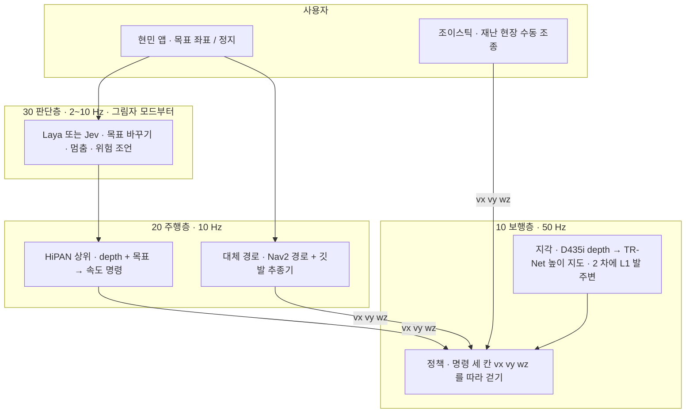

> 분류: A/정책학습 · 설계 (2 단계 문서 묶음의 입구)
> 작성: 오흥재 (lead 세션 작성 · 팀장과 10/19 채팅 합의분)
> 근거: 이 폴더 `evidence/` · `inbox/jay/20261018-next-arch/` 의 검토 문서 · 논문 원문 `C:/Users/AI-WS01/s2_lab/_papers/` · #555 댓글 6265199264
> 요지: Go2 가 처음 보는 험지에서 명령이 열린 채로 걷고, 목표를 주면 스스로 길을 찾게 한다. 세 층(보행 · 주행 · 판단)으로 나누고, 층마다 문서를 따로 둔다
> 상태: 초안 · 팀장 검토 전 · 동결 아님

# 2 단계 설계 개요

## 1. 목표 (팀장 원문 요지)

「어떤 환경, 험지에서도 일반화해서 잘 걷고, 목표를 설정해 주면 경로 탐색을 잘해서 임무를 수행하는 Go2 모델」. v2 의 한계(옆 방향 명령 잠금)를 넘는 것이 기본 기조다.

시점별 목표 셋(팀장: 「셋 모두 성공이 목표」):

| 시점 | 목표 |
|---|---|
| 11/7 | 시뮬에서 이어진 지형 명령 열림 + 계단 조이스틱 |
| 11/25 | 시뮬에서 START 지각으로 듬성한 발판 지형을 바라보고 건넘 |
| 11/30 | 실기에서 앱 목표 → 듬성한 지형까지 |

## 2. 큰 그림

**한 문장**: 보행층은 늘 「속도 세 칸」 만 받는다. 그 세 칸을 조이스틱이 채우면 수동 조종, 주행층이 목표에서 계산해 채우면 자율 주행이다.

## 3. 문서 지도 (번호는 층을 뜻한다)

| 묶음 | 문서 | 담는 것 | 상태 |
|---|---|---|---|
| 00 | 이 문서 · 용어집(아래 6 절) | 목표 · 큰 그림 · 지도 | 초안 |
| 10 보행층 | `11-SENSORS` · `12-PERCEPTION` · `13-POLICY` · **`14-COMMAND-GENERATOR`** · **`15-TERRAIN-CURRICULUM`** · `16-REWARDS` · `17-GO2-MODEL` · `18-TRAINING-BUDGET` | 부품마다 입출력 · 수치 · 출처 · 「우리 추가」 표시 · 구현 방법 | 14 초안, 나머지 예정 |
| 20 주행층 | `21-HIPAN-HIGH` · `22-NAV-ENV` · `23-NAV2-FALLBACK` | | 예정 |
| 30 판단층 | `31-JUDGE-SHADOW` (Laya / Jev 1.14 이미지 · Box) | | 예정 |
| 40 평가 | `41-AXES` (축 1 험지 · 축 2 명령 · 축 3 지형군 × 방향) · `42-REAL-ROBOT` | 학습 전 등록할 판정 규칙 | 예정 |
| 50 실험 단계 | 단계마다 한 장(`51-S0` …) | 입력 · 바꾸는 것 하나 · 관문 · 갈래 | 예정 |
| 60 · 70 · 80 · 90 | 갈래 시나리오 · 자원과 일정 · 위험 등록부 · 결정 기록 | | 예정 |

모든 문서는 머리 다섯 줄로 시작하고, 수치마다 출처 등급을 붙인다.

| 출처 등급 | 뜻 | 예 |
|---|---|---|
| **논문** | 그 방법의 원문에 적힌 값 | START 2512.13153v1 본문 행 |
| **선행** | 같은 저자 · 같은 방법의 다른 판에 적힌 값 | 2409.15692v2 부록 D |
| **코드** | 공개 코드에 실제로 있는 값 (커밋 고정) | JEPLO `command_curriculum.py` @460e227 |
| **실측** | 우리가 잰 값 | L1 bag · 석헌 S3 tfevents |
| **가정** | 우리가 고른 값. 출처가 되는 참고값을 같이 적는다 | PPO = legged_gym 기본 |

## 4. 지금까지 합의한 것 (팀장 채팅 10/19, 동결 아님)

1. 세 층 구조. 조이스틱은 보행층에 직접 들어간다.
2. 보행층 인터페이스는 속도 세 칸. 학습 때 명령 생성기는 지형군마다 다르게 채운다(자유 속도 / 깃발에서 만든 속도 / 정지 · 제자리 회전). 근거: JEPLO 표 III · `go2_loco_env.py` 1047~1083 (evidence/maicode-jeplo-deep), v2b `rel_standing_envs` (`docs/research/20260928-v2-mvp-report.md` 6-9).
3. 명령 범위 확장은 Margolis 식 격자 커리큘럼을 지형군별로.
4. 지형군별 명령 정책: 1 차(D435i)에서 듬성한 발판 지형은 바라보고 건너기만, 옆 · 뒤는 L1 이 들어가는 2 차.
5. 평가에 축 3(지형군 × 방향) 추가.
6. 주행층 학습 환경에 보행층 지형 전부.
7. 시드 하나로 진행, 다중 시드 일반화는 맨 마지막.
8. 지각은 START 방법(TR-Net · I-E · AdaSmpl · 발 가장자리 보상). START 는 선행 논문 2409.15692 와 방법 · 보상 · 명령이 같다(evidence/maicode-trcr-deep `diff_vs_start`). 선행 논문 부록 D 수치를 「선행」 등급으로 쓴다.

## 5. 아직 정하지 않은 것

- L1 을 1 차부터 넣을지(현재 안: 2 차).
- 주행층 계단 · 듬성한 지형 포함의 범위와 A* 비용 정의.
- 각 단계의 성공 판정 수치(40 묶음에서 학습 전 등록).
- Linux 이전 날짜와 다중 GPU 검증 결과(vfxpedia/mai-os#34).

## 6. 용어집

| 용어 | 뜻 |
|---|---|
| 이어진 지형 | 어디를 디뎌도 바닥이 있는 지형. 험지 · 경사 · 계단 · 박스 |
| 듬성한 발판 지형 (sparse footholds) | 디딜 곳이 띄엄띄엄 있는 지형. 징검다리 · 틈 · 평균대 · 외나무 |
| 명령 생성기 | 학습 때 정책의 명령 세 칸을 채우는 코드. 배포 때는 조이스틱 · 주행층이 같은 자리를 채운다 |
| 깃발 (경유점) | 듬성한 지형 건너편에 둔 목표점. 생성기가 그 방향으로 속도 · 회전 명령을 만든다 |
| 승급 · 강등 | 지형 난이도 레벨을 올리고 내리는 규칙 |
| 축 1 · 2 · 3 | 평가의 세 자. 험지 주행 · 평지 명령 응답 · 지형군 × 방향 |
| 그림자 모드 | 판단층이 조언만 기록하고 실제 행동은 바꾸지 않는 시험 방식 |
