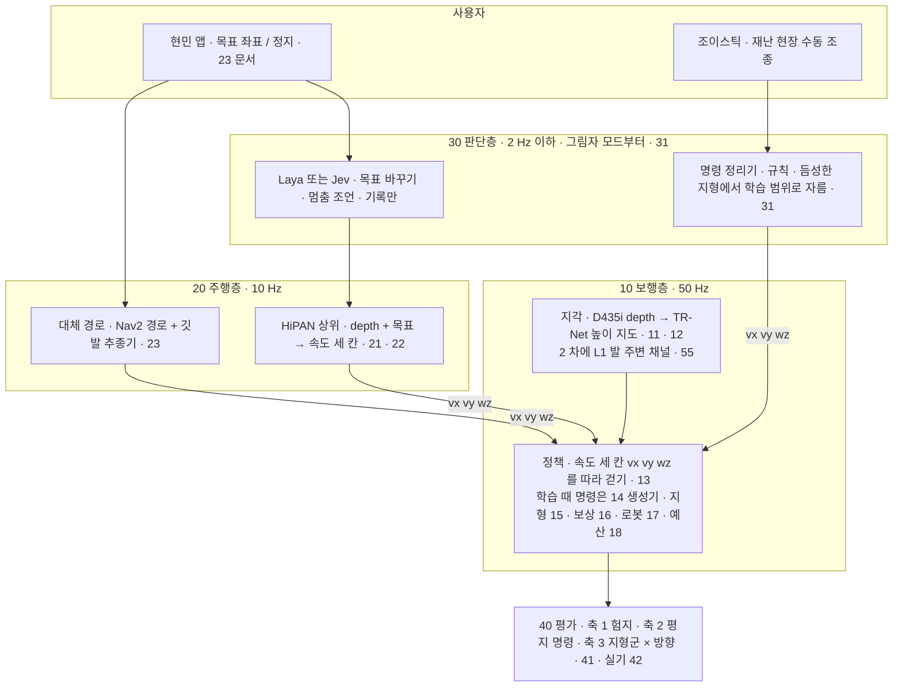
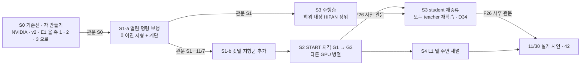

> 분류: A/정책학습 · 설계 (2 단계 문서 묶음의 입구)
> 작성: 오흥재 (lead 세션 초안 · 팀장과 10/19 채팅 합의분 · fable 20f 가 v1 으로 고쳐 씀)
> 근거: 이 폴더 `evidence/` · `APPROVED-DIRECTION.md`(A~G) · `VERIFY-fable-20f.md` · `inbox/jay/20261018-next-arch/` 의 검토 문서 · 논문 원문 `C:/Users/AI-WS01/s2_lab/_papers/` · #555 댓글 6265199264
> 요지: Go2 가 처음 보는 험지에서 명령이 열린 채로 걷고, 목표를 주면 스스로 길을 찾게 한다. 세 층(보행 · 주행 · 판단)으로 나누고, 층마다 문서를 따로 둔다. 실험은 다섯 단계(S0~S4)로 가고 단계마다 관문을 학습 전에 숫자로 등록한다
> 상태: v1 · 팀장 검토 전 · 동결 아님 · 팀장 결정 대기 항목은 90 문서 「열린 결정」

# 2 단계 설계 개요

## 0. 쉬운 요약

우리는 네 발 로봇 Go2 가 **징검다리처럼 발 디딜 곳이 띄엄띄엄 있는 땅**(이 묶음에서는 「듬성한 발판 지형」 이라 부른다)도 건너고, 앱에서 「저기로 가」 라고 찍으면 **스스로 길을 찾아** 가게 만들려 한다. 로봇의 머리는 세 층으로 나눈다. 맨 아래 **보행층**은 「앞으로 0.5 m/s, 옆으로 0, 돌기 0.3 rad/s」 같은 속도 세 칸을 받아 다리 12 관절을 움직인다(50 Hz, 1 초에 50 번). 가운데 **주행층**은 카메라와 목표를 보고 그 세 칸을 채운다(10 Hz). 맨 위 **판단층**은 「위험하니 멈춰」 같은 조언을 하는데, 처음에는 기록만 하고 행동은 바꾸지 않는다(「그림자 모드」). 지난 판(v2)에서는 로봇이 옆으로 걷는 명령을 한 번도 배우지 못했다. 이번에는 명령을 전부 열고, 그 대신 지형마다 명령을 다르게 만들어 주는 **명령 생성기**를 둔다. 학습은 S0(자 만들기) → S1(명령 열기) → S3(길 찾기) → S2(눈 달기, 다른 GPU 에서 동시에) → S4(발밑 센서) 순서로 가고, 단계마다 「이 숫자를 넘어야 다음」 이라는 **관문**을 학습 전에 적어 둔다.

## 1. 목표 (팀장 원문 요지)

「어떤 환경, 험지에서도 일반화해서 잘 걷고, 목표를 설정해 주면 경로 탐색을 잘해서 임무를 수행하는 Go2 모델」. v2 의 한계(옆 방향 명령 잠금)를 넘는 것이 기본 기조다.

시점별 목표 셋(팀장: 「셋 모두 성공이 목표」, APPROVED A):

| 시점 | 목표 | 이 설계에서 그것을 내는 단계 |
|---|---|---|
| 11/7 | 시뮬에서 이어진 지형 전체(계단 포함) 명령 열림 + 조이스틱 조종 | S1-a(52) + S0 하네스(51) |
| 11/25 | 시뮬에서 START 지각으로 듬성한 발판 지형을 바라보고 건넘 | S2(53), 선행 S1-b |
| 11/30 | 실기에서 앱 목표 → 듬성한 지형까지 | S3(54) + S2 하위 + 42 실기. 필요한 고리 둘(S2 하위 위 S3 teacher · Go2 도착일)은 D34 · D37 · D38 로 승인됨(11/10 하위 선택 관문 · Go2 기본 10/26 주 · 최악 11/7) |

## 2. 큰 그림

**한 문장**: 보행층은 늘 「속도 세 칸」 만 받는다. 그 세 칸을 조이스틱이 채우면 수동 조종, 주행층이 목표에서 계산해 채우면 자율 주행이다.

단계 흐름(실행 순서 · 자세한 것은 50):

## 3. 문서 지도 (번호는 층을 뜻한다)

| 묶음 | 문서 | 담는 것 | 상태 |
|---|---|---|---|
| 00 | 이 문서 · 용어집(아래 6 절) | 목표 · 큰 그림 · 지도 | v1 |
| 10 보행층 | `11-SENSORS` · `12-PERCEPTION` · `13-POLICY` · **`14-COMMAND-GENERATOR`** · **`15-TERRAIN-CURRICULUM`** · `16-REWARDS` · `17-GO2-MODEL` · `18-TRAINING-BUDGET` | 부품마다 입출력 · 수치 · 출처 · 「우리 추가」 표시 · 구현 방법 · 검증 사다리 · 장면 예 | v1 |
| 20 주행층 | `21-HIPAN-HIGH` · `22-NAV-ENV` · `23-NAV2-FALLBACK` | 상위 정책 · 학습 환경 · 대체 경로 · 앱 연결 | v1 |
| 30 판단층 | `31-JUDGE-SHADOW` (Laya / Jev · 명령 정리기) | 그림자 모드 · 규칙 대조군 | v1 |
| 40 평가 | `41-EVAL-AXES` (축 1 험지 · 축 2 명령 · 축 3 지형군 × 방향 · START 시험지 · 무대 계단) · `42-REAL-ROBOT` | 학습 전 등록할 판정 규칙 · 실기 첫 주 | v1 |
| 50 실험 단계 | `50-STAGES` · `51-S0` · `52-S1` · `53-S2` · `54-S3` · `55-S4` | 단계마다 그림 · 입력 · 바꾸는 것 하나 · 관문 숫자 · 결과별 갈래 · 검증 사다리 | v1 |
| 60 · 70 · 80 · 90 | 갈래 시나리오 · 자원과 일정 · 위험 등록부 · 결정 기록 | 신호 숫자 · 날짜 · 구현 주체 · 동결 규칙 · 열린 결정 | v1 |
| 기준 | `APPROVED-DIRECTION.md` · `HANDOFF.md` · `VERIFY-fable-20f.md` | 승인 사항 체크리스트 · 인계 · 검증 결과 | lead 관리 |

모든 문서는 머리 다섯 줄로 시작하고, 수치마다 출처 등급을 붙인다.

| 출처 등급 | 뜻 | 예 |
|---|---|---|
| **논문** | 그 방법의 원문에 적힌 값. 행 번호는 `s2_lab/_papers/*.txt` 기준 | START 2512.13153v1 225 행 |
| **선행** | 같은 저자 · 같은 방법의 다른 판에 적힌 값. START 가 미기재한 것을 채울 때만 쓰고 「선행(START 미기재)」 라고 적는다 | 2409.15692v2 Table V (305~353 행) |
| **코드** | 공개 코드에 실제로 있는 값 (커밋 · 파일 · 행 고정) | JEPLO @460e227 `command_curriculum.py` 32~46 · Isaac Lab 2.3.2 `rough.py` 13 |
| **실측** | 우리가 잰 값 (스크립트 · 명령 · 출력 파일을 같이 적음) | L1 bag `l1_go2_floor_v2.py` · E1 `evidence/E1-vs-v2-axis1.csv` |
| **가정** | 우리가 고른 값. 참고 출처와 「왜 이 값인가」 를 같이 적는다 | PPO = Isaac Lab Go2 cfg 값 |
| **URDF** | Go2 URDF 에서 읽은 로봇 고유값. 실측이 오면 실측이 이긴다(APPROVED C) | 종아리 속도 15.70 rad/s |

## 4. 지금까지 합의한 것 (팀장 채팅 10/19, 동결 아님)

1. 세 층 구조. 조이스틱은 보행층에 직접 들어간다.
2. 보행층 인터페이스는 속도 세 칸. 학습 때 명령 생성기는 지형군마다 다르게 채운다(자유 속도 / 깃발에서 만든 속도 / 정지 · 제자리 회전). 근거: JEPLO 표 III · `go2_loco_env.py` 1047~1083 (evidence/maicode-jeplo-deep), v2b `rel_standing_envs` (`docs/research/20260928-v2-mvp-report.md` 6-9).
3. 명령 범위 확장은 Margolis 식 격자 커리큘럼을 지형군별로.
4. 지형군별 명령 정책: 1 차(D435i)에서 듬성한 발판 지형은 바라보고 건너기만, 옆 · 뒤는 L1 이 들어가는 2 차.
5. 평가에 축 3(지형군 × 방향) 추가.
6. 주행층 학습 환경에 보행층 지형 전부.
7. 시드 하나로 진행, 다중 시드 일반화는 맨 마지막.
8. 지각은 START 방법(TR-Net · I-E · AdaSmpl · 발 가장자리 보상). START 는 선행 논문 2409.15692 와 방법 · 보상 · 명령이 같다(evidence/maicode-trcr-deep `diff_vs_start`). 선행 논문 부록 D 수치를 「선행」 등급으로 쓴다.

## 5. 아직 정하지 않은 것 (90 「열린 결정」 과 같다)

- 구현 담당(O5) · 비교 갈래 수(O6) · 41 §9 기준 수치 확정(O7) · 저자 문의(O8).
- Linux 이전 실제 완료일과 다중 GPU 검증 결과(vfxpedia/mai-os#34). 이전 날짜는 설계 동결 시점(D32). Go2 실제 도착일(기본 10/26 주 · 최악 11/7, D38).

닫힌 것(10/19 팀장 승인, 90 D18~D38): 충돌 넷(짐 무게 PIE −1~2 kg · 종아리 URDF 15.70 · 45.43 · S2 env 3072 · 24 와 다중 GPU 1 순위 · 정확 추종), L1 은 2 차 확정, 판단층 shadow 확정, 평가 도구는 새로, 2 단계 학습 승인은 Linux 학습 시작 때 팀장 직접, STOP = 모든 것 멈춤, S3 하위 선택은 11/10 관문(D34), S1 두 판(D35), S1-a 11/7 · S1-b 11/14 분리(D36), 실기 선행 조건은 70 에 날짜로(D37), Go2 도착 기본 10/26 주 · 최악 11/7(D38), 명령 정리기 1 차 규칙(이어진 지형은 막지 않음 · 듬성한 지형은 옆 학습 범위 · 뒤 −0.3 물러나기 · 회전 ±1.0, D39). 좁은 발판 위 제자리 회전은 연구 후보(90 R1).

## 6. 용어집

| 용어 | 뜻 |
|---|---|
| 이어진 지형 | 어디를 디뎌도 바닥이 있는 지형. 험지 · 경사 · 계단 · 박스 |
| 듬성한 발판 지형 (sparse footholds) | 디딜 곳이 띄엄띄엄 있는 지형. 징검다리 · 틈 · 평균대 · 외나무(디딤 빔). 잘못 디디면 발이 빠진다 |
| 명령 생성기 | 학습 때 정책의 명령 세 칸을 채우는 코드. 배포 때는 조이스틱 · 주행층이 같은 자리를 채운다 |
| 깃발 (경유점) | 듬성한 지형 건너편에 둔 목표점. 생성기가 그 방향으로 속도 · 회전 명령을 만든다. 로봇은 깃발을 바라보며 건넌다 |
| 물러나기 | 듬성한 지형에서 「왔던 길로」 천천히(−0.3 m/s 까지) 뒤로 가는 명령. 지나온 발판은 지각의 기억에 남아 있어 1 차에 허용한다 |
| 승급 · 강등 | 지형 난이도 레벨(0~9)을 올리고 내리는 규칙 |
| 축 1 · 2 · 3 | 평가의 세 자. 험지 주행 · 평지 명령 응답 · 지형군 × 방향 |
| 건넘 R · S · J | R 기준선 도달(정한 거리를 시간 안에 지남) · S 끝까지 생존(시간 끝까지 넘어지지 않음) · J 둘 다. 성공률은 늘 셋을 따로 적는다 |
| 관문 | 단계를 넘어가기 위해 학습 전에 적어 둔 숫자 기준. 결과를 보고 바꾸지 않는다 |
| 동결 | 설계 · 설정 · 하네스를 해시 · 태그 · manifest 로 고정하는 일. 그 뒤의 수정은 새 판 번호로 |
| 검증 사다리 | CPU 답 아는 시험 → 실제 짧은 실행(첫 10 update · 예행 8 판) → 첫 update 확인 → 본 학습 → 평가. 가짜 설정 시험만으로는 통과가 아니다 |
| 그림자 모드 | 판단층이 조언만 기록하고 실제 행동은 바꾸지 않는 시험 방식 |
| teacher / student | teacher 는 시뮬에서만 얻는 특권 정보로 먼저 배운 정책, student 는 실기 센서만으로 teacher 를 따라 배운 정책 |
| G0 · G1 · G3 | 비교 갈래. G0 눈 없음 · G1 재구성 지도만 · G3 지도 + 발 가장자리 보상 |
