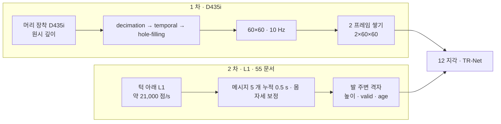

> 분류: A/정책학습 · 설계 (10 보행층 · 센서)
> 작성: 오흥재 (lead 세션 초안 · fable 20f 가 v1 으로 고쳐 씀)
> 근거: START 2512.13153v1 127 · 221 · 379 · 580 행 · PIE 2408.13740v3 표 II(START 가 DR 을 위임한 [31], ASTRA 19g 4 절) · SPEC-start-go2.md 2.2~2.4 절(187~214 행) · 155 · 157 행 · Go2 URDF `go2.urdf` 748~749 행 · L1 공식 bag 실측(`s2_lab/_external/l1_analyze.py` · `l1_go2_floor_v2.py`, fable 20f 재실행) · JEPLO 2609.15770v1 29 · 239~241 · 254 행 · @460e227 `spherical_depth_generator.py` · cfg 249~251 · env 593~596 (evidence/maicode-jeplo-deep) · REPORT-astra-10.md 63~77 · 130~133 행 · Isaac Lab 2.3.2 `ray_caster_camera_cfg.py` 19 · `patterns_cfg.py` 73 · APPROVED H(Orin NX) · VERIFY-fable-20f P8 · P18 · P19 · VERIFY-astra-r1 §3~§6(20t · fable 재측: 공식 USD sha256 · usd-core 질량 합 · FK · 카메라 기하)
> 요지: 1 차는 D435i 하나를 START 식(머리 · 60×60 · 10 Hz · 2 프레임)으로 쓰고 학습 때 가림막 증강을 넣는다(우리 추가). 2 차에 L1 을 발 주변 채널로 더한다. L1 의 뒷발 가시성은 메시지 5 개(0.5 s) 누적에서 100 % 인 상한만 쟀고 몸 가림은 실기에서 잰다
> 상태: v1 · 팀장 검토 전 · 수치는 출처 등급(논문 · 선행 · 코드 · 실측 · 가정) · 20k ASTRA 마지막 검증(VERIFY-astra-final) 계약 반영 · **20t ASTRA-R1 셋 반영(fable 10/20)**

# 11 · 센서 (D435i · L1)

## 0. 쉬운 요약

로봇의 눈은 둘이다. 머리의 **D435i** 는 앞을 보는 깊이 카메라(거리를 재는 카메라)다. START 처럼 60×60 작은 영상으로 줄여 1 초에 10 장을 정책에 준다. 카메라는 실제로 자주 가려지거나(다리 · 먼지 · 역광) 구멍이 나므로, 학습 때 일부러 가림과 구멍을 넣어 익숙하게 만든다(JEPLO 가 그렇게 해서 효과를 봤다). 턱 아래의 **L1** 은 작은 회전 라이다인데 거꾸로 달려 있어 바닥 쪽 반구를 본다. 공식 녹화를 돌려 보니 가만히 서 있을 때 0.5 초만 모아도 네 발 주변 바닥을 다 본다(몸에 가리는 것은 아직 안 넣었으니 상한). 이것은 2 차(S4)에 「발 주변 채널」 로 넣는다. 로봇 몸이 자기 다리를 얼마나 가리는지는 진짜 로봇으로 재야 한다.

## 1. 한눈에

## 2. D435i (1 차)

| 항목 | 값 | 등급 · 위치 |
|---|---|---|
| 장착 | 머리. 원시 깊이 10 Hz | **논문** START 379 행 |
| 영상 크기 | 60×60 | **논문** START 221 행(시뮬 Warp) · 379 행(실기) |
| 역사 | H2 = 2 프레임 | **논문** START 127 행 |
| 실기 필터 | librealsense decimation → temporal → hole-filling | **논문** START 379 행 (옵션 값은 없음) |
| 필터 계수 | decimation 8 · temporal α 0.4 · δ 20 · persistency 3 · hole-filling mode 1 | **가정** SPEC-start-go2 2.3 절(문서 기본값을 기억으로 적음 → 실기 코드 전 재확인) |
| 60×60 만드는 법 | 848×480 → decimation 8 → 106×60 → 가운데 60 열 crop → 60×60. FOV 약 56.5° × 58° | **가정** SPEC 2.2 절. 참고: Extreme Parkour 는 106×60 → 87×58 |
| 내부 파라미터 | fx ≈ 55.9 · fy ≈ 54.1 · cx = cy = 30 | **가정** (Intel 사양 H 87° · V 58° 에서 유도, SPEC 2.2 절. 20f 재계산 일치). 실기 `rs-enumerate-devices -c` 로 대조 |
| 장착 위치 (base 기준) | (0.25, 0.0, 0.12) m | **가정** SPEC 2.4 절: RPL Go2 (0.24, −0.0175, 0.12) · HiPAN Go1 (0.25, 0, 0.12)(**논문** 2604.26504 630 행) 합의값. 브래킷 단 뒤 실측으로 교체 |
| pitch | 아래로 35° · **D435i 는 한 대, 자세는 이것 하나**. S2 보행 지각과 S3 상위 student 가 같은 자세로 학습한다(HiPAN 은 tilt 0°, 630 행 → **우리 변경**, 팀장 승인 10/20 J-C). 높은 장애물(매달린 상자 · 탁자 상판)이 덜 보이는 손실은 21 H21-5 가설로 등록 | **가정** SPEC 2.4 절. 35° 와 (0.25, 0, 0.12) 는 START 가 준 값이 아니다(START 가 준 것은 머리 D435i · 60×60 · 지도 범위뿐, 379 행 · ASTRA R1-3). 기하(7 절 L0 의 시험 상태 h 0.45 · x 0.25 · roll · pitch 0): 지면 교점 아래 끝 0.47 · 광축 0.89 m, far 3.0 절단 뒤 유효 지면 한계 3.60 m(위 끝 광선의 무한 평면 교점 4.53 m 는 절단 전 값). RPL 21~25° · HiPAN 0° · MGDP 활성 Warp 경로는 (0.34, 0, 0.07) · 30°(ASTRA R1 §6 · 채택 안 함 · 기록). 실기 브래킷은 하나(42) |
| 깊이 범위 · 정규화 | near 0.2 · far 3.0 m, (d − 0.2)/2.8 → [0,1], 미검출 = 1.0 | **가정** SPEC 155 행. ASTRA 19g: 「0.2~3.0 m 는 START 본문에 없음」. 참고: Extreme Parkour clip 0~2 m, HiPAN 4 m clip(630 행) |
| 카메라 무작위화 | 위치 ±10 mm · pitch ±1° · 수평 FOV 86~88° · 시스템 지연 0~15 ms | **논문(위임)** PIE 표 II. START 221 행 「domain randomization following [31]」, [31] = PIE (START 580 행) |
| 탑재 계산기 | Orin NX (START 379 행의 Lite3 도 Orin NX) | **팀장 확인**(APPROVED H). 우리 지각망 50 Hz 추론 시간은 **미측정** → 42 T7 |

### 2.1 가림막 · 잡음 증강 (START 에 없음, 우리 추가)

START 는 깊이 잡음을 적지 않았고(**논문 미기재**, 221 행은 DR 을 PIE 에 위임만), 위임받은 PIE 표 II 에도 깊이 잡음 항목이 없다(ASTRA 19g 4 절 · SPEC 157 행). 그래서 「넣지 않았다」 고 **추정**한다. 우리는 JEPLO 의 증강을 D435i 판으로 넣는다(APPROVED B 「가림막 증강은 1 차에 빌림」). 근거: JEPLO 에서 가림막 증강을 뺀 판(No-Occ)이 모든 가림 조건에서 크게 무너짐(**논문** 2609.15770v1 표 II · 254 행).

| 증강 | 값 | 등급 · 위치 |
|---|---|---|
| 무작위 가림 도형 | 프레임마다 0~2 개(원 · 사각 · 정사각 · 사다리꼴), 먼 값으로 채움, 시간 독립 | **논문** JEPLO 239~241 행(원 · 사각) · **코드** `spherical_depth_generator.py` 235~289(도형 넷) |
| 구멍 | Perlin 구멍 수준 U[0, 0.4], 구멍은 U[0.9, 1.0] 으로 채움 | **코드** 같은 파일 148~177 · env 209 · 946~947 |
| 거리 잡음 | 가우시안 N(0, 0.005) (정규화 전) | **코드** 같은 파일 301~302 (σ 는 D435i 실측으로 바꿈 → **가정**) |
| D435i 고유 | 0.3 m 미만 무효, 가장자리 구멍, 어두운 · 반사면 무작위 탈락 | **가정** (ETH 2505.11164 2.4 절 가장자리 잡음 · 왼쪽 1~5 열 제거 · 흐림을 참고, evidence/deep-research-start-missing-values (5)) |
| 갱신 · 지연 | 정책 50 Hz 중 깊이 10 Hz, 2 프레임, 1 프레임(0.1 s) 지연 버퍼 | **코드** JEPLO cfg 249~251 · env 593~596 · 220~226 |

## 3. L1 (2 차 · 발 주변 채널 · 55 문서)

| 항목 | 값 | 등급 · 위치 |
|---|---|---|
| 장착 | `radar_joint` xyz (0.28945, 0, −0.046825), rpy (0, 2.8782, 0). 센서 +z 축이 (0.259, 0, −0.966), 즉 수직 아래에서 앞으로 약 15° | **URDF** go2.urdf 748~749 행 (fable 20e 계산) |
| 점 속도 | 10 Hz · 초당 21,131 점 · 센서 위쪽 반구만(고도 2~89°) | **실측** 공식 bag `unilidar-2023-09-22-12-42-04.bag`, `l1_analyze.py`(lead). fable 20e 재측정 9.89 Hz · 20,792 점/s(표본 창 차이 2 %) · 센서 틀 z < 0 인 점 0/628,326 |
| 바닥 5 cm 칸 채움 (서 있는 Go2 h = 0.32, 평평한 바닥, 몸 가림 없음 = 상한) | 메시지 2 개(첫 · 끝 간격 0.1 s): 앞발 좌 · 우 100 · 100 %, 뒷발 75 · 94 %, 앞 바닥 81 · 88 %. 메시지 3 개(0.2 s): 뒷발 88 · 94 %. 메시지 4 개(0.3 s): 뒷발 100 · 94 %. **메시지 5 개(0.4 s 간격 = 10 Hz 에서 0.5 s 창): 뒷발 100 · 100 %**, 앞 바닥 96 · 98 %. 뒷발 쪽 점 수는 앞발 쪽의 약 1/8 | **실측** `l1_go2_floor_v2.py`(좌우 따로 · 메시지 시각 누적. 옛 `l1_go2_floor.py` 는 좌우를 접어 세는 결함이 있어 폐기, ASTRA 19f 90~99 행). fable 20f 가 원본 + 창 0.2 · 0.4 s 사본으로 재실행해 일치. 초안의 「0.4 s 누적」 은 이 「메시지 5 개」 를 뜻한다(VERIFY 20f P19) |
| 몸 · 다리 가림 | 미측정. 센서에서 뒷발 바닥점으로 가는 광선이 앞다리를 스친다 | **미확인** (fable 20e Q3). 실기 녹화로 잰다(42 T5) |
| 로봇 쪽 칸 지도 | Go2 펌웨어가 128×128×30 비트 칸 지도(`rt/utlidar/voxel_map_compressed`)를 낸다. 해상도는 메시지의 `resolution` 필드가 정하고 앱 worker 의 fallback 은 0.1(실측 센서 해상도 아님) | **코드** REPORT-astra-10.md 63~77 행. 실제 해상도 · 누적 시간은 **미확인**. 실기 기록은 센서 토픽 bag 이 우선이고 칸 지도 기록은 후순위 · 선택(D29, 42 T4) |

### 3.1 정책 입력 정의 (2 차)

- 격자: 12 지각의 높이 지도와 같은 틀(중력 정렬 yaw 틀), 발 주변 범위만. 칸마다 세 값: **높이**, **valid**(이번 누적 창에서 점이 있었나 0/1), **age**(마지막 관측 뒤 지난 시간, 0~1 로 정규화).
- **보지 않은 칸을 평지로 채우지 않는다.** valid = 0 이면 높이는 0, age = 1 (ASTRA 19f Q3).
- 누적 창 메시지 5 개(0.5 s, 위 실측에서 뒷발 칸이 다 차는 최소), 몸 자세로 점 위치를 보정한 뒤 누적 → **가정**(fable 20e F20 의 0.5 s 와 같음).
- 시뮬: L1 광선 패턴은 실측 bag 의 광선 방향 표본을 그대로 쓴다(`l1_go2_floor_v2.py` 와 같은 방향 집합) → 광선 수는 메시지당 약 2,100.

## 4. 시간 동기 · 지연

| 신호 | 주기 | 지연 처리 |
|---|---|---|
| 정책 | 50 Hz | 기준 |
| D435i | 10 Hz | 1 프레임(0.1 s) 지연 버퍼 + PIE 시스템 지연 0~15 ms 무작위 |
| L1 (2 차) | 10 Hz 메시지, 5 개 누적 | 누적 창 끝 시각을 age 기준으로. 카메라와 같은 IMU 시계로 맞춤 → **가정** |
| 고유수용 | 50 Hz | 없음 |

## 5. 장면 예

| 장면 | 센서가 주는 것 · 정책이 겪는 것 |
|---|---|
| 징검돌 2 m 앞, 햇빛이 강하다 | D435i 에 구멍이 난다. 학습 때 Perlin 구멍 U[0, 0.4] 을 겪었으므로 지도는 기억 + 남은 화소로 버틴다. 실기 구멍 비율이 0.4 를 넘으면 범위 밖(42 T3 로 잰다) |
| 앞다리가 카메라 아래를 가렸다 | 가림 도형 증강과 같은 모양. 그 프레임은 먼 값. 다음 프레임에서 회복 |
| 로봇이 뒤로 걷는다(이어진 지형) | 뒤는 카메라 밖. 1 차에는 GRU 기억(지나온 땅)뿐이라 처음 보는 뒤쪽 땅은 모른다. 이어진 지형이라 바닥이 있어 괜찮고, 듬성한 지형에서는 「왔던 길로」 −0.3 m/s 까지만 준다(14 §3 물러나기, D39) |
| S3 student 가 탁자 아래 통로 앞 | 카메라가 35° 아래를 보므로 탁자 상판 · 매달린 상자가 HiPAN(tilt 0°)보다 늦게 · 덜 보인다. 1 차는 자세 명령이 없어 어차피 돌아가지만(22 §3), Room 벤치마크 SR 하락 폭을 H21-5 로 잰다 |
| S4 에서 징검돌 위 옆걸음 | L1 이 0.5 s 안에 네 발 주변 5 cm 칸을 채운다(상한). 앞다리에 가려진 칸은 valid 0 · age 1 로 넘어간다 |

## 6. 구현 방법 (Isaac Lab 2.3.2)

| 부품 | 클래스 · 파일 | 텐서 모양 |
|---|---|---|
| D435i 시뮬 | `foothold_s2/sensors/depth_cam_cfg.py`: `RayCasterCameraCfg` (`ray_caster_camera_cfg.py` 19), `pattern_cfg=PinholeCameraPatternCfg.from_intrinsic_matrix([55.9,0,30,0,54.1,30,0,0,1], 60, 60)` (`patterns_cfg.py` 73), `data_types=["distance_to_image_plane"]`, `mesh_prim_paths=["/World/ground"]`(**단일 결합 Mesh 하나만**: 설치 `RayCaster` 는 mesh_prim_path 를 하나만 받고(`ray_caster.py` 164~166 행), 그 아래에 Plane 이 있으면 Plane 을 먼저 읽고(177 행) 아니면 **첫 Mesh 자식만** 읽는다(183 행). 지형 생성기는 500 패치를 하나의 메시로 합치므로(`terrain_generator.py` 166 행 concatenate) S2 는 이 하나를 정확히 가리키고 `/World/ground` 아래 ground plane · 별도 Mesh 를 두지 않는다. 주행층(22)처럼 방 장애물 메시가 따로 있으면 설치 `MultiMeshRayCasterCameraCfg`(`multi_mesh_ray_caster_camera.py` 25 행)로 분기, VERIFY-astra-final 1), `update_period=0.1`, offset (0.25, 0, 0.12) · quat (0.9537, 0, 0.3007, 0) convention world(pitch +35° = +y 축 회전, 부호는 L0 시험으로 확정) | 출력 `(N, 60, 60, 1)` → 정규화 · 증강 → 2 프레임 링버퍼 `(N, 2, 60, 60)` |
| 증강 | `foothold_s2/sensors/depth_aug.py` (JEPLO 식을 우리 코드로 재작성, 복사 금지: GPLv3) | 입력 · 출력 `(N, 2, 60, 60)` |
| 카메라 DR | `isaaclab.envs.mdp.events` 의 자세 무작위 + `set_intrinsic_matrices` 로 FOV (SPEC 142~143 행) | |
| L1 시뮬 (2 차) | `foothold_s2/sensors/l1_raycaster.py`: `RayCasterCfg` + 사용자 패턴(실측 방향 표본 약 2,100 개) · `mesh_prim_paths` 지면, offset 은 URDF 값 | 원점 `(N, 2100, 3)` → 누적 · 격자화 `(N, 3, Hf, Wf)` (높이 · valid · age) |

광선 카메라는 지면 메시만 맞힌다. 로봇 자기 몸 가림은 시뮬에 나오지 않으므로, L1 의 몸 가림은 실기 녹화로 잰 가림 마스크를 시뮬에 덧씌우는 방식으로 넣는다 → **가정**.

## 7. 검증 사다리

| 단 | 무엇 | 통과 |
|---|---|---|
| L0 CPU | 내부 파라미터: 60×60 · fx 55.9 에서 가장자리 화소 광선 각이 ±28.25° | 계산 |
| L0 AST | `mesh_prim_paths` 가 길이 1 이고 그 prim 아래에 Plane · 둘째 Mesh 가 없음(지형 import cfg 에 ground plane 생성 없음). negative control: 경로 둘을 넣으면 설치 코드가 NotImplementedError(`ray_caster.py` 164 행) | 검사 |
| L1 Kit | **3072 env 전체 갱신 시간**: 60×60 × 3072 = 11,059,200 광선/갱신 · 10 Hz 갱신의 벽시계 시간과 장당 메모리를 첫 10 update 에서 잰다(ASTRA: 처리량 계산일 뿐 FPS 실측이 아님 · START 의 Warp 는 Isaac Gym · A6000 조건) | 로그 |
| L0 CPU | 증강: 가림 0 개 설정이면 입력 = 출력, 2 개면 가린 화소 = 1.0 이고 나머지 동일. Perlin 0.4 에서 구멍 비율 0.2~0.5 | 기대값 |
| L0 CPU | **기하 시험 상태(한 계약 · ASTRA R1-3 · 20t)**: base 를 z = **0.33** 에 roll · pitch 0 으로 고정(카메라 오프셋 z 0.12 → 지상 카메라 높이 h = 0.45. 17 §3 스폰 z 0.4 나 기본 자세 접촉 높이 0.31~0.32 m 에서 저절로 얻어지는 상태가 아니다 · 17 §2) · 광학축 +z 가 아래로 35°(+y 회전) · `distance_to_image_plane` · far 3.0 · x 0.25. 쿼터니언 부호 기대값: 광축이 바닥에 base 앞 **0.89 m**(0.45 / tan 35° + 0.25 = 0.893) · 아래 끝 광선(64°) 0.47 m · 위 끝 광선(6°)의 무한 평면 교점 4.53 m(VERIFY-lead-final2 22) · far 3.0 절단 뒤 중앙 단면 유효 지면 한계 **3.60 m**(0.25 + (3 − 0.45 sin 35°) / cos 35° = 3.597. 「4.53 m 까지 유효 깊이」 라 쓰면 틀림) · 지도 앞끝 x 1.1 의 하향각 27.9°(세로 시야 [6°, 64°] 안). base 높이를 다르게 놓은 시험은 기대 교점을 그 높이로 다시 계산한다. negative control: 부호를 뒤집으면 광축이 바닥에 안 닿음 | 기하 · 1 cm |
| L1 Kit | 4096(또는 3072) env 60×60 광선 카메라 첫 10 update: 메모리 · steps/s · 깊이 영상 한 장 저장(눈으로 확인) | 로그 · 그림 |
| L2 | 깊이 영상 시간열에서 10 Hz 갱신 · 0.1 s 지연이 맞음 | 프레임 번호 |

## 8. 검증할 가설

| # | 가설 | 어떻게 보나 |
|---|---|---|
| H11-1 | 60×60 광선 카메라 3072(또는 4096) env 가 16 GB 안에 든다 | 첫 10 회 GPU 메모리 실측. 안 되면 18 §5 순서 |
| H11-2 | 가림막 증강이 재구성 오차를 크게 늘리지 않는다 | 12 H12-5 |
| H11-3 | 시뮬 깊이와 실기 깊이의 차이가 정책을 깨지 않는다 | 같은 계단에서 실기 깊이 녹화 · 시뮬 깊이 나란히, 화소 차 분포 (SPEC 4.5 절, 42 T3) |
| H11-4 | L1 메시지 5 개 누적이 걷는 중에도 뒷발 칸을 채운다 | 실기 녹화(서 있기 · 걷기)에서 좌우 · 앞뒤별 valid 비율과 몸 가림률(42 T5) |

## 9. 열린 항목

- 실제 브래킷 장착 위치 · pitch (Go2 도착 후 실측).
- librealsense 필터 계수 문서 재확인.
- D435i 거리 잡음 σ 실측.
- L1 가림률 · 누적 창 확정은 실기 녹화 뒤. 펌웨어 칸 지도 해상도 · 누적 시간(42 T4).
- Orin NX 에서 TR-Net + I-E + actor 의 50 Hz 추론 시간(42 T7).
