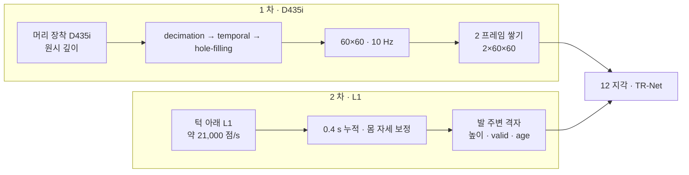

> 분류: A/정책학습 · 설계 (10 보행층 · 센서)
> 작성: 오흥재 (lead 세션 작성)
> 근거: START 2512.13153v1 221 · 379 행 · PIE 2408.13740v3 표 II (START 가 DR 을 위임한 [31], START 580 행) · SPEC-start-go2.md 2 절 · Go2 URDF `C:/isaac/ext/go2_rl_robotlab/resources/go2/urdf/go2.urdf` 748~749 · L1 공식 bag 실측(`s2_lab/_external/l1_analyze.py` · `l1_go2_floor_v2.py`) · JEPLO@460e227 (evidence/maicode-jeplo-deep) · Extreme Parkour · ETH 2505.11164 (evidence/deep-research-start-missing-values.json)
> 요지: 1 차는 D435i 하나를 START 식(머리 · 60×60 · 10 Hz · 2 프레임)으로 쓰고 학습 때 가림막 증강을 넣는다. 2 차에 L1 을 발 주변 채널로 더한다. L1 의 뒷발 가시성은 상한만 쟀고 몸 가림은 실기에서 잰다
> 상태: 초안 · 팀장 검토 전 · 수치는 출처 등급(논문 · 선행 · 코드 · 실측 · 가정)

# 11 · 센서 (D435i · L1)

## 1. 한눈에

## 2. D435i (1 차)

| 항목 | 값 | 등급 · 위치 |
|---|---|---|
| 장착 | 머리. 원시 깊이 10 Hz | **논문** START 379 행 |
| 영상 크기 | 60×60 | **논문** START 221 행(시뮬 Warp) · 379 행(실기) |
| 역사 | H2 = 2 프레임 | **논문** START 127 행 |
| 실기 필터 | librealsense decimation → temporal → hole-filling | **논문** START 379 행 (옵션 값은 없음) |
| 필터 계수 | decimation 8 · temporal α 0.4 · δ 20 · persistency 3 · hole-filling mode 1 | **가정** SPEC-start-go2.md 2.3 (문서 기본값을 기억으로 적음 → 실기 코드 전 재확인) |
| 60×60 만드는 법 | 848×480 → decimation 8 → 106×60 → 가운데 60 열 crop → 60×60. FOV 약 56.5° × 58° | **가정** SPEC-start-go2.md 191 행. 참고: Extreme Parkour 는 106×60 → 87×58 (코드, main 브랜치 `legged_gym_config.py` 89~110) |
| 내부 파라미터 | fx ≈ 55.9 · fy ≈ 54.1 · cx = cy = 30 | **가정** (Intel 사양 H 87° · V 58° 에서 유도, SPEC 192 행). 실기 `rs-enumerate-devices -c` 로 대조 |
| 장착 위치 (base 기준) | (0.25, 0.0, 0.12) m | **가정** SPEC 2.4: RPL Go2 (0.24, −0.0175, 0.12) · HiPAN Go1 (0.25, 0, 0.12) 합의값. 브래킷 단 뒤 실측으로 교체 |
| pitch | 아래로 35° | **가정** SPEC 2.4 (지면 가시 0.47 ~ 4.6 m 계산). RPL 21~25° · HiPAN 0° |
| 깊이 범위 · 정규화 | near 0.2 · far 3.0 m, (d − 0.2)/2.8 → [0,1], 미검출 = 1.0 | **가정** SPEC 155 행. 참고: Extreme Parkour clip 0~2 m, ETH clip 2 m · 0.15 m 미만 = 2 m |
| 카메라 무작위화 | 위치 ±10 mm · pitch ±1° · 수평 FOV 86~88° · 시스템 지연 0~15 ms | **논문(위임)** PIE 표 II. START 221 행 「domain randomization following [31]」, [31] = PIE (START 580 행) |

### 2.1 가림막 · 잡음 증강 (START 에 없음, 우리 추가)

START 는 학습 때 깊이 잡음을 넣지 않았다(SPEC 157 행). 우리는 JEPLO 의 증강을 D435i 판으로 넣는다. 근거: JEPLO 에서 가림막 증강을 뺀 판(No-Occ)이 모든 가림 조건에서 크게 무너짐(2609.15770v1 표 II · 254 행).

| 증강 | 값 | 등급 · 위치 |
|---|---|---|
| 무작위 가림 도형 | 프레임마다 0~2 개(원 · 사각), 먼 값으로 채움, 시간 독립 | **코드** JEPLO `spherical_depth_generator.py` (evidence/maicode-jeplo-deep `what_we_can_reuse`) |
| 구멍 | Perlin 구멍 수준 U[0, 0.4] | **코드** 같은 곳 |
| 거리 잡음 | 가우시안 | **코드** 같은 곳 (σ 는 D435i 실측으로 정함 → **가정**) |
| D435i 고유 | 0.3 m 미만 무효, 가장자리 구멍, 어두운 · 반사면 무작위 탈락 | **가정** (ETH 2505.11164 2.4 절 가장자리 잡음 · 왼쪽 1~5 열 제거 · 흐림을 참고) |
| 갱신 · 지연 | 정책 50 Hz 중 깊이 10 Hz, 2 프레임, 1 프레임(0.1 s) 지연 버퍼 | **코드** JEPLO cfg 249~251 · env 593~596 |

## 3. L1 (2 차 · 발 주변 채널)

| 항목 | 값 | 등급 · 위치 |
|---|---|---|
| 장착 | `radar_joint` xyz (0.28945, 0, −0.046825), rpy (0, 2.8782, 0). 센서 +z 가 거의 수직 아래에서 앞으로 약 15° | **코드** go2.urdf 748~749 |
| 점 속도 | 10 Hz · 초당 21,131 점 · 센서 위쪽 반구만(고도 2~89°) | **실측** 공식 bag `unilidar-2023-09-22-12-42-04.bag`, `l1_analyze.py`. fable 20e 재측정 20,792 점/s (표본 창 차이 2 %) |
| 바닥 5 cm 칸 채움 (서 있는 Go2, 평평한 바닥, 몸 가림 없음 = 상한) | 앞발 좌우: 0.1 s 에 100 %. 뒷발 좌 · 우: 0.1 s 75 · 94 %, 0.2 s 88 · 94 %, 0.4 s 100 · 100 %. 뒷발 쪽 점 수는 앞발 쪽의 약 1/8 | **실측** `l1_go2_floor_v2.py` (좌우를 따로 세고 메시지 시각으로 누적. 옛 `l1_go2_floor.py` 는 좌우를 접어 세는 결함이 있어 폐기, ASTRA 19f Q3) |
| 몸 · 다리 가림 | 미측정. 센서에서 뒷발 바닥점으로 가는 광선이 앞다리를 스친다 | **미확인** (fable 20e Q3). 실기 녹화로 잰다 |
| 로봇 쪽 칸 지도 | Go2 펌웨어가 128×128×Z 비트 칸 지도(`rt/utlidar/voxel_map_compressed`)를 낸다. 해상도 예제 기본 0.05 m | **코드** REPORT-astra-10.md 65~77 · 공개 예제 기본값(실기 미측정) |

### 3.1 정책 입력 정의 (2 차)

- 격자: 12 지각의 높이 지도와 같은 틀(중력 정렬 yaw 틀), 발 주변 범위만. 칸마다 세 값: **높이**, **valid**(이번 누적 창에서 점이 있었나 0/1), **age**(마지막 관측 뒤 지난 시간, 0~1 로 정규화).
- **보지 않은 칸을 평지로 채우지 않는다.** valid = 0 이면 높이는 0, age = 1 (ASTRA 19f Q3).
- 누적 창 0.4 s(위 실측에서 뒷발 칸이 다 차는 최소), 몸 자세로 점 위치를 보정한 뒤 누적 → **가정**.
- 시뮬: L1 광선 패턴은 실측 bag 의 광선 방향 표본을 그대로 쓴다(`l1_go2_floor_v2.py` 와 같은 방향 집합) → 광선 수는 메시지당 약 2,100.

## 4. 시간 동기 · 지연

| 신호 | 주기 | 지연 처리 |
|---|---|---|
| 정책 | 50 Hz | 기준 |
| D435i | 10 Hz | 1 프레임(0.1 s) 지연 버퍼 + PIE 시스템 지연 0~15 ms 무작위 |
| L1 (2 차) | 10 Hz 메시지, 0.4 s 누적 | 누적 창 끝 시각을 age 기준으로. 카메라와 같은 IMU 시계로 맞춤 → **가정** |
| 고유수용 | 50 Hz | 없음 |

## 5. 구현 방법 (Isaac Lab 2.3.2)

| 부품 | 클래스 · 파일 | 텐서 모양 |
|---|---|---|
| D435i 시뮬 | `isaaclab.sensors.RayCasterCameraCfg` (`ray_caster/ray_caster_camera_cfg.py:19`), `pattern_cfg=PinholeCameraPatternCfg.from_intrinsic_matrix([55.9,0,30,0,54.1,30,0,0,1], 60, 60)` (`patterns_cfg.py:73`), `data_types=["distance_to_image_plane"]`, `mesh_prim_paths=["/World/ground"]`, `update_period=0.1`, offset (0.25, 0, 0.12) · quat (0.9537, 0, 0.3007, 0) convention world | 출력 `(N, 60, 60, 1)` → 정규화 · 증강 → 2 프레임 링버퍼 `(N, 2, 60, 60)` |
| 증강 | 새 모듈 `depth_aug.py` (JEPLO 식을 우리 코드로 재작성, 복사 금지: GPLv3) | 입력 · 출력 `(N, 2, 60, 60)` |
| 카메라 DR | `isaaclab.envs.mdp.events` 의 자세 무작위 + `set_intrinsic_matrices` 로 FOV (SPEC 142~143 행) | |
| L1 시뮬 (2 차) | `RayCasterCfg` + 사용자 패턴(실측 방향 표본 약 2,100 개) · `mesh_prim_paths` 지면, offset 은 URDF 값 | 원점 `(N, 2100, 3)` → 누적 · 격자화 `(N, 3, Hf, Wf)` (높이 · valid · age) |

광선 카메라는 지면 메시만 맞힌다. 로봇 자기 몸 가림은 시뮬에 나오지 않으므로, L1 의 몸 가림은 실기 녹화로 잰 가림 마스크를 시뮬에 덧씌우는 방식으로 넣는다 → **가정**.

## 6. 검증할 가설

| # | 가설 | 어떻게 보나 |
|---|---|---|
| H11-1 | 60×60 광선 카메라 4096(또는 3072) env 가 16 GB 안에 든다 | 첫 10 회 GPU 메모리 실측. 안 되면 env 를 줄이고 steps/env 를 늘림 (18 문서) · Linux 다중 GPU (mai-os#34) |
| H11-2 | 가림막 증강이 재구성 오차를 크게 늘리지 않는다 | 12 문서의 재구성 MAE 를 증강 있음 · 없음 짧은 판으로 비교 |
| H11-3 | 시뮬 깊이와 실기 깊이의 차이가 정책을 깨지 않는다 | 같은 계단에서 실기 깊이 녹화 · 시뮬 깊이 나란히, 화소 차 분포 (SPEC 4.5 절) |
| H11-4 | L1 0.4 s 누적이 걷는 중에도 뒷발 칸을 채운다 | 실기 녹화(서 있기 · 걷기)에서 좌우 · 앞뒤별 valid 비율과 몸 가림률 |

## 7. 열린 항목

- 실제 브래킷 장착 위치 · pitch (Go2 도착 후 실측).
- librealsense 필터 계수 문서 재확인.
- D435i 거리 잡음 σ 실측.
- L1 가림률 · 누적 창 확정은 실기 녹화 뒤.
