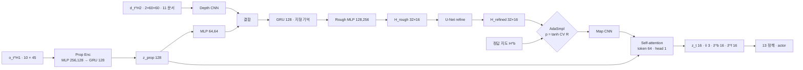
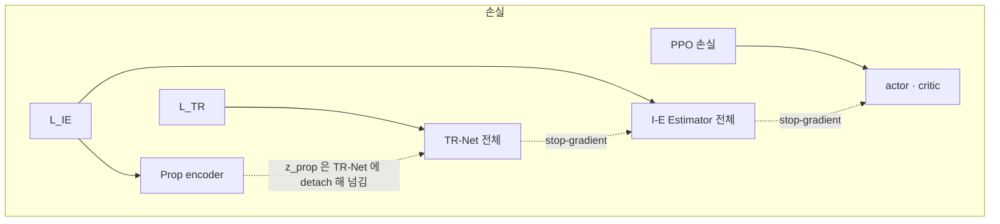

> 분류: A/정책학습 · 설계 (10 보행층 · 지각: TR-Net · I-E Estimator · AdaSmpl)
> 작성: 오흥재 (lead 세션 초안 · fable 20f 가 v1 으로 고쳐 씀)
> 근거: START 2512.13153v1 42 · 116 · 126~127 · 134 · 136~139 · 169 · 185~217 · 193 · 347 · 360 행 · 선행 2409.15692v2 35 · 95 · 305 · 311 · 323 · 331 · 339 · 347 · 353 행(Table V) · Fig. 8 · evidence/maicode-trcr-deep `diff_vs_start` · maicode-start-deep · RESEARCH-astra-19g-start-reimpl.md 3 · 8 절 · evidence/deep-research-start-*.json · fable 20e F16 · R1 · R2 · Isaac Lab 2.3.2 `rl_cfg.py` 54 · APPROVED B(JEPLO 잠재 예측은 2 차 갈래) · VERIFY-fable-20f P3
> 요지: START 의 지각을 그대로 짓는다. 층 크기는 같은 저자 선행 논문 부록 수치를 「선행(START 미기재)」 로 쓰고, 원문 불일치(CNN 표)와 인쇄 오류(커리큘럼 식)는 우리 선택 · 정정으로 표시한다. 지도는 중력 정렬 yaw 틀, 기억은 에피소드마다 0, PPO gradient 는 지각으로 흘리지 않는다
> 상태: v1 · 팀장 검토 전 · 수치는 출처 등급(논문 · 선행 · 코드 · 실측 · 가정)

# 12 · 지각 (TR-Net · I-E Estimator · AdaSmpl)

## 0. 쉬운 요약

로봇 머리의 깊이 카메라(D435i)는 앞만 보고, 발밑과 뒤는 못 본다. START 는 **TR-Net** 이라는 신경망으로 「지금 보이는 깊이 영상 + 몸이 어떻게 움직였나」 를 합쳐 발밑과 뒤까지 포함한 **작은 높이 지도**(뒤 0.5 m 부터 앞 1.1 m, 폭 0.8 m, 5 cm 칸)를 그린다. 뒤는 「아까 지나오며 본 것」 을 기억(GRU)으로 메운다. **I-E Estimator** 는 그 지도와 몸 감각을 합쳐 정책에 넘길 요약(속도 추정, 발 주변 지도 요약 등)을 만든다. 학습 초반에는 지도가 엉터리라 로봇이 아무것도 못 배우므로, **AdaSmpl** 이 학습이 불안정할수록 시뮬이 아는 정답 지도를 섞어 준다. 배포 때는 정답이 없으니 TR-Net 지도만 쓴다. 층 크기 같은 세부 숫자는 START 에 없고 같은 저자의 앞선 논문에 있어 그것을 빌린다.

## 1. START 와 선행 논문의 관계

START 는 선행 논문 「Walking with Terrain Reconstruction」(2409.15692) 을 다듬은 판이다. 보상 14 항 · 발 가장자리 보상 · 지도 범위 · H2 · AdaSmpl 식 · 커리큘럼 식(인쇄 오류까지) · 명령 분포 · 실기 장비가 같다(evidence/maicode-trcr-deep `diff_vs_start`: identical 항목 11, changed 는 지형 깊이 0.3 → 0.2 m 와 돌 무작위 0.48 → 0.5/0.45 둘). 그래서 선행 논문 부록 D 의 층 크기를 **선행(START 미기재)** 등급으로 쓴다. START 가 그 값을 바꿨을 가능성은 남으므로 「선행」 값은 전부 shape 시험(9 절)으로만 고정하고 성능 재현 목표로 삼지 않는다.

## 2. 데이터 흐름

## 3. TR-Net

| 부품 | 값 | 등급 · 위치 |
|---|---|---|
| 입력 | z_prop 와 depth 2 프레임(H2 = 2) | **논문** START 126~127 행 |
| Depth CNN | 원문 {[32,64,64],[7,7,3,3],[4,4,2,2],[3,3,1,1]} 는 **채널 3 개 대 커널 4 개 불일치** | **선행** 2409.15692v2 Table V 305 행. 불일치는 원문 자체(ASTRA 19g 3 절, deep-research (6)) |
| ↳ 우리 선택 | 3 층: (32, k7, s4, p3) · (64, k3, s2, p1) · (64, k3, s2, p1). 60×60 → 15×15 → 8×8 → 4×4, 평탄화 1024 | **가정**. 이유: 원문 채널 3 개를 지키고, 4 번째 stride 를 빼야 4×4 공간 정보가 남는다(4 층이면 1×1 로 사라짐). 다른 해석과는 shape 시험으로만 비교 |
| prop MLP | [64, 64] ELU | **선행** 305 행 |
| 지형 기억 GRU | 1 층 · hidden 128 | **선행** 305 행 (SPEC-start-go2 의 512 는 폐기) |
| Rough decoder | MLP [128, 256] ELU → 32×16 | **선행** 311 행 · 출력 크기는 아래 지도 규격 |
| Refine decoder | U-Net: 16,16 / 32,32 / 64,64 / concat 64→32,32 / concat 32→16,16 → 1. conv 3×3 s1 p1 + ReLU, max pool 2, transpose conv 2 | **선행** Fig. 8 (ASTRA 19g 3 절이 원본 그림으로 확인). 마지막 활성화 없음 → **가정** |
| 손실 | L_TR = MSE(H_rough, H^b) + L1(H_refined, H^b), 계수 1 | **논문** START 169 행(식 4) |
| 지도 규격 | 뒤 0.5 ~ 앞 1.1 m, 폭 0.8 m, 5 cm | **논문** START 127 행 |
| ↳ 셀 | 32 × 16, 셀 중심 x −0.475…1.075, y −0.375…0.375. 높이 h = z_hit − z_base, clip ±1 m | **가정** SPEC-start-go2 53 행 (ASTRA 19g: 「32×16 은 합리적이나 논문에 shape 가 직접 적힌 것은 아님」) |
| 지도 틀 | **중력 정렬 yaw 틀**(몸 yaw 만 따라 돌고 roll · pitch 는 무시) | **가정** fable 20e F16 · R2 (START 는 「robot's local frame」 만 적음, 127 행) |
| 기억의 한계 | GRU 는 「지금 가려진 발밑과 뒤」 를 기억으로 복원한다. 본 적 없는 땅(옆으로 걸을 때 들어오는 띠)은 못 메운다 | **논문** 136~138 행 · 360 행(w/o GRU 는 현재 시야만) |

## 4. I-E Estimator

| 부품 | 값 | 등급 · 위치 |
|---|---|---|
| 몸 감각 이력 | H1 = 10 | **선행** 2409.15692v2 95 행 (START 는 값 없음) |
| Prop encoder | MLP [256, 128] ELU → GRU 1 층 128 | **선행** 323 행 |
| Map encoder (CNN) | 원문 {[32,64],[7,3,3],[2,1,2],[3,1,1]} 는 **채널 2 개 대 커널 3 개 불일치** | **선행** 331 행 |
| ↳ 우리 선택 | 2 층: (32, k7, s2, p3) · (64, k3, s1, p1). 32×16 → 16×8. 셀 하나 = 토큰 하나(128 토큰 × 64 차원) | **가정**. 이유: 원문 채널 둘을 지키고, 토큰 차원을 Table V 의 token 64 와 맞춘다 |
| 융합 | Self-attention {hidden [256,256], token 64, head 1} → Linear | **선행** 339 행. 층 수 해석(2 층 · FF 256)은 **가정** (ASTRA 19g 「대응 근거 부족」) |
| 출력 | z_t 16(VAE, reparameterization) · v̂ 3 · ẑ^b 16 · ẑ^f 16 | **선행** 2409.15692v1 Observations 절(deep-research (7)) · v2 35 행(ẑ^f · ẑ^b ∈ R16) |
| 디코더 | MLP [64, 128] ELU: ẑ^b → H^b, ẑ^f → 발 4 개 지도, [z, v̂, ẑ^f, ẑ^b] → ô_{t+1} | **선행** 347 행 |
| 발 지도 | 발마다 0.1 m 범위 | **논문** START 134 행(「within 0.1m」). 모양 · 해상도 없음 → 발마다 5×5 · 5 cm **가정** |
| 손실 | L_IE = KL + MSE(ô_{t+1}) + MSE(v̂) + MSE(Ĥ^f) + MSE(Ĥ^b), 계수 1 | **논문** START 116 행(식 3) |

## 5. AdaSmpl

| 항목 | 값 | 등급 · 위치 |
|---|---|---|
| 식 | p_smpl = tanh(CV(R)), R 은 에피소드 보상 | **논문** START 193 행(식 5) · 195~199 행 |
| 하는 일 | p_smpl 확률로 정책 입력 지도를 재구성 대신 정답으로 바꿈. 배포는 재구성만 | **논문** START 185~217 행 |
| 통계 창 | 지난 1 회 업데이트 동안 끝난 에피소드 보상 전체 | **가정** (원문 · 선행 · 중국어 자료 모두 없음, evidence/deep-research-* (2)) |
| CV 계산 | std / (\|mean\| + 1e-6) | **가정** |
| 표본 단위 | env 마다, 에피소드 시작 때 한 번 뽑아 끝까지 유지 | **가정** |
| 기록 | 매 업데이트 p_smpl · 정답 사용 비율 · 재구성만 쓴 env 의 성적 따로 | **가정** (ASTRA 19g 8 절: 정답 의존이 오래가는지 봐야 함). 60 A 의 신호 「2,000 회에 p_smpl > 0.7」 |

**AdaSmpl 확률과 지형 전환 확률은 다른 것이다**(ASTRA 19g 1 절 4). 지형 전환 식 p_advance 와 그 정정 · 가정값은 15 문서 5 절이 맡는다.

## 6. 기억 · 리셋 · gradient 경계

| 규칙 | 내용 | 근거 |
|---|---|---|
| PPO → 지각 차단 | actor 는 I-E 출력을 detach 해서 받는다. PPO gradient 는 I-E · TR-Net 으로 가지 않는다 | **논문** START 42 행 「I-E Estimator, trained via supervised learning」 · fable 20e R1 |
| TR-Net ↔ I-E | I-E 는 TR-Net 지도를 detach 해서 받는다. z_prop 은 TR-Net 에 detach 해서 준다 | **가정** (ASTRA 19f Q3 「gradient 소유권을 그림과 코드로 고정」) |
| 리셋 | 두 GRU(Prop · 지형 기억) 상태는 env 리셋 때 0 | **가정** |
| 기억 진행 | 지형 기억 GRU 는 새 depth 프레임(10 Hz)이 올 때만 한 칸 진행, Prop GRU 는 50 Hz | **가정** SPEC-start-go2 55 행 |
| 순환 학습 | rsl_rl 의 순환 정책 경로(hidden state 를 rollout 버퍼에 저장, minibatch 는 env 단위로 자름) | **코드** Isaac Lab `RslRlPpoActorCriticRecurrentCfg` (`rl_cfg.py` 54 행) |
| 최적화 | 지각 손실과 PPO 손실은 optimizer 를 따로 둔다 | **가정** (공유 encoder gradient 경쟁 방지, ASTRA 19f Q3) |

## 7. 장면 예

| 장면 | 지각이 하는 일 |
|---|---|
| 징검돌 앞 1 m 에 섰다 | 깊이 영상에 돌 두세 줄이 보인다. TR-Net 이 앞 1.1 m 까지 돌 위치를 5 cm 칸으로 그린다. I-E 는 앞발이 디딜 돌 주변 0.1 m 지도를 요약해 actor 에 준다 |
| 돌 위를 지나는 중, 발밑 돌은 카메라 밖 | GRU 기억이 「0.5 s 전에 본 돌」 을 지도 뒤쪽(−0.5~0 m) 에 남긴다. 그래서 뒷발이 디딜 곳을 안다(START 136~138 행) |
| 옆으로 0.5 m/s 명령(S4 전에는 없음) | 옆에서 들어오는 띠는 어느 프레임에도 없었다. GRU 가 메울 수 없다. 1 차에 듬성한 지형에서 옆 명령을 안 주는 이유이고, S4 에서 L1 이 채운다(11 · 55) |
| D435i 가 가려졌다(11 §2.1 증강) | 그 프레임은 먼 값으로 채워진다. 지도는 기억으로 버티고 다음 프레임에서 갱신된다. 가려짐이 길면 재구성 오차가 오른다(H12-5) |
| 학습 1,000 회, 보상 분산이 크다 | CV 가 커서 p_smpl 이 높다. 많은 env 가 정답 지도로 걷는다. 안정되면 p_smpl 이 내려가 재구성 지도로 옮겨 간다 |

## 8. 구현 방법 (Isaac Lab 2.3.2 · rsl_rl)

| 무엇 | 어디에 | 텐서 모양 |
|---|---|---|
| 정답 지도 H^b · H^f | `RayCasterCfg` 격자 패턴(32×16, 5 cm, yaw 정렬)으로 정답 높이 · 발마다 작은 격자 4 개 | `(N, 32, 16)` · `(N, 4, 5, 5)` |
| TR-Net · I-E | `foothold_s2/models/start_perception.py` (PyTorch 기본 Conv2d · GRU · MultiheadAttention 으로 새로 구현). 공개 코드 복사 없음(START 코드 없음, MGDP 라이선스 없음) | 위 표 |
| 정책 묶기 | 13 문서 `start_policy.py` · `start_runner.py` | actor 입력 96 |
| AdaSmpl | runner 의 rollout 수집 전 단계에서 env 마다 플래그 | `(N,)` bool |

## 9. 검증 사다리

| 단 | 무엇 | 통과 |
|---|---|---|
| L0 CPU | shape: 임의 입력 (2, 2, 60, 60) → CNN 1024, 지도 32×16, I-E 토큰 128×64, 출력 16 · 3 · 16 · 16. negative control: 61×61 입력은 오류 | 모양 |
| L0 CPU | 손실: H_rough = H^b 면 L_TR = 0, 한 칸 0.1 m 차이면 MSE 0.01/512 + L1 0.1/512 | 기대값 |
| L0 CPU | AdaSmpl: R = [1, 1, 1] → CV 0 → p 0, R = [0, 2] → CV 1 → p 0.76 | 기대값 |
| L0 CPU | gradient 경계: actor 손실을 역전파했을 때 TR-Net · I-E 파라미터의 grad 가 None | 검사 |
| L1 Kit | 첫 10 update 에서 재구성 MAE · p_smpl · 정답 사용 비율 로그 · 메모리 | 로그 |
| L2 | 첫 500 회 재구성 MAE 가 감소 | 곡선 |

## 10. 검증할 가설

| # | 가설 | 어떻게 보나 |
|---|---|---|
| H12-1 | 우리 CNN 선택이 재구성 오차를 START 수준으로 낸다 | 최고 난이도 재구성 MAE 를 START Fig. 5 눈금(돌 약 3.6 · 평균대 약 1.8 · 빔 약 4.8 · gap 약 1.5 cm, SPEC-start-go2 60 행 읽음) 과 선행 Table II(5.21 · 4.09 · 8.29 · 2.39 cm, 2409 213 행)에 나란히. 재현 목표가 아니라 보고 항목 |
| H12-2 | GRU 128 이 옆 · 뒤가 아니라 「지나온 땅」 은 기억한다 | 전진 뒤 후진 시나리오에서 몸 아래 · 뒤 재구성 MAE |
| H12-3 | AdaSmpl 이 학습 후반에 정답 의존을 낮춘다 | p_smpl 곡선(2,000 회에 ≤ 0.7, 60 A) 과 재구성만 쓴 env 의 성적 |
| H12-4 | 중력 정렬 yaw 틀이 경사 · 계단에서 지도를 깨지 않는다 | 경사 지형에서 재구성 MAE |
| H12-5 | 가림막 증강(11) 아래서도 재구성 MAE 가 2 배를 넘지 않는다 | 증강 있음 · 없음 짧은 판 |

## 11. 열린 항목

- Self-attention 층 수 · FF 크기의 근거(현재 가정).
- 발 지도 모양 · 해상도(현재 5×5 · 5 cm 가정).
- 저자 문의 여부(90 O8): 받을 질문은 두 CNN 정의 · latent 세부 · AdaSmpl 창 (ASTRA 19g 8 절).
- **2 차 갈래(APPROVED B)**: JEPLO 식 depth 잠재 예측(PE-JEPA) 을 TR-Net 대신 또는 옆에 두는 안. 1 차에는 START 재구성만. 코드는 lejepa 라이선스(CC BY-NC 추정, 미확인) 때문에 재구현이어야 한다(evidence/maicode-jeplo-deep `license`).
