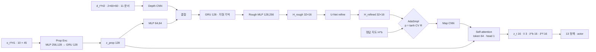
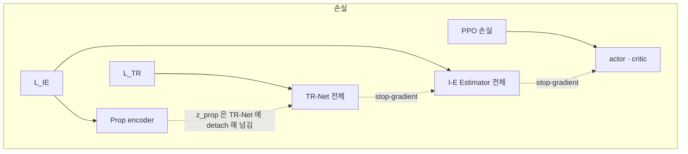

> 분류: A/정책학습 · 설계 (10 보행층 · 지각: TR-Net · I-E Estimator · AdaSmpl)
> 작성: 오흥재 (lead 세션 초안 · fable 20f 가 v1 으로 고쳐 씀)
> 근거: START 2512.13153v1 42 · 116 · 126~127 · 134 · 136~139 · 169 · 185~217 · 193 · 347 · 360 행 · 선행 2409.15692v2 35 · 95 · 305 · 311 · 323 · 331 · 339 · 347 · 353 행(Table V) · Fig. 8 · evidence/maicode-trcr-deep `diff_vs_start` · maicode-start-deep · RESEARCH-astra-19g-start-reimpl.md 3 · 8 절 · evidence/deep-research-start-*.json · fable 20e F16 · R1 · R2 · Isaac Lab 2.3.2 `rl_cfg.py` 54 · APPROVED B(JEPLO 잠재 예측은 2 차 갈래) · VERIFY-fable-20f P3 · VERIFY-astra-r1 §3~§6(20t · fable 재측: 공식 USD sha256 · usd-core 질량 합 · FK · 카메라 기하)
> 요지: START 의 지각을 그대로 짓는다. 층 크기는 같은 저자 선행 논문 부록 수치를 「선행(START 미기재)」 로 쓰고, 원문 불일치(CNN 표)와 인쇄 오류(커리큘럼 식)는 우리 선택 · 정정으로 표시한다. 지도는 중력 정렬 yaw 틀, 기억은 에피소드마다 0, PPO gradient 는 지각으로 흘리지 않는다
> 상태: v1 · 팀장 검토 전 · 수치는 출처 등급(논문 · 선행 · 코드 · 실측 · 가정) · 20k ASTRA 마지막 검증(VERIFY-astra-final) 계약 반영 · **20n rl 가정 13 대조 반영(fable 10/20)** · **20s lead 답 8 항 반영(fable 10/20)** · **20t ASTRA-R1 셋 반영(fable 10/20)**

# 12 · 지각 (TR-Net · I-E Estimator · AdaSmpl)

## 0. 쉬운 요약

로봇 머리의 깊이 카메라(D435i)는 앞만 보고, 발밑과 뒤는 못 본다. START 는 **TR-Net** 이라는 신경망으로 「지금 보이는 깊이 영상 + 몸이 어떻게 움직였나」 를 합쳐 발밑과 뒤까지 포함한 **작은 높이 지도**(뒤 0.5 m 부터 앞 1.1 m, 폭 0.8 m, 5 cm 칸)를 그린다. 뒤는 「아까 지나오며 본 것」 을 기억(GRU)으로 메운다. **I-E Estimator** 는 그 지도와 몸 감각을 합쳐 정책에 넘길 요약(속도 추정, 발 주변 지도 요약 등)을 만든다. 학습 초반에는 지도가 엉터리라 로봇이 아무것도 못 배우므로, **AdaSmpl** 이 학습이 불안정할수록 시뮬이 아는 정답 지도를 섞어 준다. 배포 때는 정답이 없으니 TR-Net 지도만 쓴다. 층 크기 같은 세부 숫자는 START 에 없고 같은 저자의 앞선 논문에 있어 그것을 빌린다.

## 1. START 와 선행 논문의 관계

START 는 선행 논문 「Walking with Terrain Reconstruction」(2409.15692) 을 다듬은 판이다. 보상 14 항 · 발 가장자리 보상 · 지도 범위 · H2 · AdaSmpl 식 · 커리큘럼 식(인쇄 오류까지) · 명령 분포 · 실기 장비가 같다(evidence/maicode-trcr-deep `diff_vs_start`: identical 항목 11, changed 는 지형 깊이 0.3 → 0.2 m 와 돌 무작위 0.48 → 0.5/0.45 둘). 그래서 선행 논문 부록 D 의 층 크기를 **선행(START 미기재)** 등급으로 쓴다. START 가 그 값을 바꿨을 가능성은 남으므로 「선행」 값은 전부 shape 시험(9 절)으로만 고정하고 성능 재현 목표로 삼지 않는다.

## 2. 데이터 흐름

## 3. TR-Net

| 부품 | 값 | 등급 · 위치 |
|---|---|---|
| 입력 | z_prop 와 depth 2 프레임(H2 = 2) | **논문** START 126~127 행 |
| Depth CNN | 원문 {[32,64,64],[7,7,3,3],[4,4,2,2],[3,3,1,1]} 는 **채널 3 개 대 커널 4 개 불일치** | **선행** 2409.15692v2 Table V 305 행. 불일치는 원문 자체(ASTRA 19g 3 절, deep-research (6)) |
| ↳ 우리 선택 | 3 층: (32, k7, s4, p3) · (64, k3, s2, p1) · (64, k3, s2, p1). 60×60 → 15×15 → 8×8 → 4×4, 평탄화 1024 | **가정**. 이유: 원문 채널 3 개를 지키고, 4 번째 stride 를 빼야 4×4 공간 정보가 남는다(4 층이면 1×1 로 사라짐). 다른 해석과는 shape 시험으로만 비교 |
| prop MLP | [64, 64] ELU | **선행** 305 행 |
| 지형 기억 GRU | 1 층 · hidden 128 | **선행** 305 행 (SPEC-start-go2 의 512 는 폐기) |
| Rough decoder | MLP [128, 256] ELU → 32×16 | **선행** 311 행 · 출력 크기는 아래 지도 규격 |
| Refine decoder | U-Net: 16,16 / 32,32 / 64,64 / concat 64→32,32 / concat 32→16,16 → 1. conv 3×3 s1 p1 + ReLU, max pool 2, transpose conv 2 | **선행** Fig. 8 (ASTRA 19g 3 절이 원본 그림으로 확인). 마지막 활성화 없음 → **가정**. **채택(lead 20s)**: 마지막 층도 3×3 s1 p1(그림대로) · 활성화 없음(가정). rl 코드 `models/start_perception.py` 101 행의 1×1 은 3×3 으로 수정 대기(rl · 20n ②) |
| 손실 | L_TR = MSE(H_rough, H^b) + L1(H_refined, H^b), 계수 1 | **논문** START 169 행(식 4) |
| 지도 규격 | 뒤 0.5 ~ 앞 1.1 m, 폭 0.8 m, 5 cm. **지도 범위는 관측 범위가 아니다(ASTRA R1-3 · 20t)**: 11 §7 기하 시험 상태(h 0.45 · 35°)에서 지면이 처음 보이는 곳은 x ≈ 0.47 m 부터라 기본 자세 앞발(x ≈ 0.18)도 즉시 보이지 않고, 앞끝 x 1.1 은 시야 안(하향각 27.9°)이며, 뒤 0.5 m 와 발밑은 GRU 시간 기억이다. 앞끝 가시성과 14 §3 의 처음 보는 뒤 · 옆 지형 관측은 별개다 | **논문** START 127 행 · ASTRA R1 §6 |
| ↳ 셀 | 32 × 16, 셀 중심 x −0.475…1.075, y −0.375…0.375. 높이 h = z_hit − z_base, clip ±1 m | **가정** SPEC-start-go2 53 행 (ASTRA 19g: 「32×16 은 합리적이나 논문에 shape 가 직접 적힌 것은 아님」) |
| 지도 틀 | **중력 정렬 yaw 틀**(몸 yaw 만 따라 돌고 roll · pitch 는 무시) | **가정** fable 20e F16 · R2 (START 는 「robot's local frame」 만 적음, 127 행) |
| 기억의 한계 | GRU 는 「지금 가려진 발밑과 뒤」 를 기억으로 복원한다. 본 적 없는 땅(옆으로 걸을 때 들어오는 띠)은 못 메운다. 후방 지도 MAE 나 발 위치가 지도 안에 든다는 것을 새 땅 가시성의 증거로 쓰지 않는다(20t) | **논문** 136~138 행 · 360 행(w/o GRU 는 현재 시야만) · ASTRA R1 §6 |

## 4. I-E Estimator

| 부품 | 값 | 등급 · 위치 |
|---|---|---|
| 몸 감각 이력 | H1 = 10 | **선행** 2409.15692v2 95 행 (START 는 값 없음) |
| Prop encoder | MLP [256, 128] ELU → GRU 1 층 128 | **선행** 323 행 |
| Map encoder (CNN) | 원문 {[32,64],[7,3,3],[2,1,2],[3,1,1]} 는 **채널 2 개 대 커널 3 개 불일치** | **선행** 331 행 |
| ↳ 우리 선택 | 2 층: (32, k7, s2, p3) · (64, k3, s1, p1). 32×16 → 16×8. 셀 하나 = 토큰 하나(128 토큰 × 64 차원) | **가정**. 이유: 원문 채널 둘을 지키고, 토큰 차원을 Table V 의 token 64 와 맞춘다 |
| 융합 | Self-attention {hidden [256,256], token 64, head 1} → Linear | **선행** 339 행. 층 수 해석(2 층 · FF 256)은 **가정** (ASTRA 19g 「대응 근거 부족」) |
| 출력 | z_t 16(VAE, reparameterization) · v̂ 3 · ẑ^b 16 · ẑ^f 16 | **선행** 2409.15692v1 Observations 절(deep-research (7)) · v2 35 행(ẑ^f · ẑ^b ∈ R16) |
| 디코더 | MLP [64, 128] ELU: ẑ^b → H^b, ẑ^f → 발 4 개 지도, [z, v̂, ẑ^f, ẑ^b] → ô_{t+1} | **선행** 347 행 |
| 발 지도 | 발마다 0.1 m 범위 | **논문** START 134 행(「within 0.1m」). 모양 · 해상도 없음 → 발마다 5×5 · 5 cm **가정** |
| 손실 | L_IE = KL + MSE(ô_{t+1}) + MSE(v̂) + MSE(Ĥ^f) + MSE(Ĥ^b), 계수 1 | **논문** START 116 행(식 3) |

## 5. AdaSmpl

| 항목 | 값 | 등급 · 위치 |
|---|---|---|
| 식 | p_smpl = tanh(CV(R)), R 은 에피소드 보상 | **논문** START 193 행(식 5) · 195~199 행 |
| 하는 일 | p_smpl 확률로 정책 입력 지도를 재구성 대신 정답으로 바꿈. 배포는 재구성만 | **논문** START 185~217 행 |
| 통계 창 | 지난 1 회 업데이트 동안 끝난 에피소드 보상 전체 | **가정** (원문 · 선행 · 중국어 자료 모두 없음, evidence/deep-research-* (2)) |
| CV 계산 | std / (\|mean\| + 1e-6) | **가정** |
| 표본 단위 | env 마다, 에피소드 시작 때 한 번 뽑아 끝까지 유지 | **가정** |
| 기록 | 매 업데이트 p_smpl · 정답 사용 비율 · 재구성만 쓴 env 의 성적 따로 | **가정** (ASTRA 19g 8 절: 정답 의존이 오래가는지 봐야 함). 60 A 의 신호 「2,000 회에 p_smpl > 0.7」 |

**AdaSmpl 확률과 지형 전환 확률은 다른 것이다**(ASTRA 19g 1 절 4). 지형 전환 식 p_advance 와 그 정정 · 가정값은 15 문서 5 절이 맡는다.

## 6. 기억 · 리셋 · gradient 경계

| 규칙 | 내용 | 근거 |
|---|---|---|
| PPO → 지각 차단 | actor 는 I-E 출력을 detach 해서 받는다. PPO gradient 는 I-E · TR-Net 으로 가지 않는다 | **논문** START 42 행 「I-E Estimator, trained via supervised learning」 · fable 20e R1 |
| TR-Net ↔ I-E | I-E 는 TR-Net 지도를 detach 해서 받는다. z_prop 은 TR-Net 에 detach 해서 준다 | **가정** (ASTRA 19f Q3 「gradient 소유권을 그림과 코드로 고정」) |
| 리셋 | 두 GRU(Prop · 지형 기억) 상태는 env 리셋 때 0 | **가정** |
| 기억 진행 | 지형 기억 GRU 는 새 depth 프레임(10 Hz)이 올 때만 한 칸 진행, Prop GRU 는 50 Hz | **가정** SPEC-start-go2 55 행 |
| 순환 학습 | 설치 rsl_rl 3.1.2 의 `ActorCriticRecurrent`(`actor_critic_recurrent.py` 57 · 67 행)는 **1 차원 관측만 받고 actor · critic 각각에 GRU 를 붙이므로 쓰지 않는다**(ASTRA 가 (2, 2, 60, 60) 입력으로 AssertionError 확인). 우리 정책 클래스는 `ActorCritic`(MLP) 인터페이스를 지키고 두 GRU 는 지각 모듈 안에 둔다. hidden state · 시퀀스 시작 상태는 PPO rollout 버퍼가 아니라 §6.1 의 **지각 재생 버퍼**에 보관한다 | **코드** rsl_rl 3.1.2 · VERIFY-astra-final 5 |
| 최적화 | 지각 손실과 PPO 손실은 optimizer 를 따로 둔다 | **가정** (공유 encoder gradient 경쟁 방지, ASTRA 19f Q3) |

### 6.1 START 전용 학습 계약 (동결 명세 · 20k · VERIFY-astra-final 5 · 2 · 6)

stock GRU 를 쓸 수 있다는 것과 START 가 rsl_rl 에 연결된다는 것은 다르다. 아래를 하나의 계약으로 둔다. 수치 가운데 START · 선행 원문에 없는 것은 전부 **가정** 등급이고, 10/27 통합 관문(70 §1 · 13 §7)을 지나기 전에는 바꿀 수 있으나 그 뒤에는 2 단계 동결 대상이다.

| 항목 | 계약 | 등급 · 근거 |
|---|---|---|
| 두 GRU 의 시간축 | Prop GRU 는 50 Hz 매 제어 스텝 한 칸 진행. 지형 기억 GRU 는 10 Hz depth 갱신 틱(5 스텝마다, 11 §4)에만 한 칸 진행하고 그 사이 스텝은 **step mask 0**(상태 유지). 두 GRU 의 시퀀스 시작 상태는 rollout 시작 시점 값을 각각 따로 저장한다 | **가정** SPEC-start-go2 55 행 · 11 §4 |
| 리셋 · terminal 마스크 | env 리셋 때 두 GRU 상태 0. 재생에서 done 인 전이는 **terminal 마스크**로 끊어 새 에피소드 첫 관측을 이전 에피소드의 ô_{t+1} 정답으로 쓰지 않는다. 시퀀스는 done 에서 자르고 hidden 을 0 으로 다시 시작 | **가정** · 설치 `rollout_storage.py` 223~225 행의 `split_and_pad_trajectories` 와 같은 꼴 |
| PPO 입력 고정 | PPO 는 **수집 때 실제로 쓴 96 차원 actor 입력**(13 §2: o_t 45 + z 16 + v̂ 3 + ẑ^f 16 + ẑ^b 16)과 그때의 log probability 를 rollout 버퍼에 그대로 보관하고 재평가(epoch 5 × minibatch 4)에서 그 입력으로만 ratio 를 계산한다. 재평가 때 VAE latent z 를 다시 추출하거나 지각을 먼저 갱신해 다른 입력으로 ratio 를 내는 경로를 막는다(epoch 0 첫 minibatch 의 ratio = 1 이 L0 시험) | **가정**(ASTRA 권고) · rsl_rl 3.1.2 는 관측을 float32 로 매 스텝 저장(`rollout_storage.py` 49 · 84 행) |
| 지각 재생 버퍼(별도) | 보관 목록: 원시 depth 2 프레임(float16, 11 §2 정규화 뒤) · 몸 관측 o_t · 정답 지도 H^b · H^f · 속도 v · 다음 관측 o_{t+1} · done · depth 갱신 마스크(10 Hz 틱) · 두 GRU 시작 상태 · AdaSmpl 선택 플래그. 길이 = PPO rollout 과 같은 24 스텝 × env. 기본 수집은 `torch.inference_mode()` 안이라(`on_policy_runner.py` 101 행) **수집 때 만든 손실을 들고 와 backward 할 수 없다** → 지각 손실은 gradient 를 켠 별도 순환 재생으로 다시 계산한다 | **코드** rsl_rl 3.1.2 · **가정**(float16 저장: 3072 × 24 × 2 × 60 × 60 이 float32 1.978 GiB → 0.989 GiB, ASTRA 산술) |
| 지각 optimizer 수치 | Adam · lr 5e-4 · weight decay 0 · epoch 5 · minibatch 4(env 단위 768 env) · **microbatch 256 env × 24 스텝 + gradient accumulation 3**(minibatch 당 1 step) · BPTT 길이 24 스텝(한 rollout, 시작 hidden 은 버퍼 값, done 에서 절단) · gradient clip 1.0 | 전부 **가정**(START · 선행 · 중국어 자료에 지각 optimizer 수치 없음, evidence/deep-research-*). 18 §1 의 PPO 5 epoch · 4 minibatch 를 지각에 「자동 적용」 하는 명세는 없으므로 여기 따로 적는다(ASTRA) |
| 손실 순서(한 iteration) | ① rollout 수집(inference_mode) → ② PPO update(고정 입력 · log prob) → ③ 지각 재생 · L_TR + L_IE 를 한 번의 backward(계수 1 · 1, §6 그림의 stop-gradient 유지) → ④ AdaSmpl 통계 갱신 → ⑤ 커리큘럼 · 저장. ②③ 순서를 바꾸면 ratio 입력이 수집 때와 달라지므로 금지 | **가정** |
| checkpoint 에 넣을 상태 | 정책 state_dict · PPO optimizer · 지각 모듈(TR-Net · I-E · 디코더) state_dict · **지각 optimizer** · AdaSmpl 통계(count · sum · sumsq · p_smpl) · 관측 정규화 통계 · 커리큘럼 상태(terrain_levels · terrain_types · p_advance 의 T) · 명령 생성기 상태(방식 플래그 · 깃발 인덱스) · iteration · RNG 상태(torch · numpy · env seed). 설치 `save()` 는 정책 · PPO optimizer · RND 만 저장한다(`on_policy_runner.py` 291~303 행) → 사용자 runner 가 덧붙인다. 저장/복원 왕복 뒤 같은 입력에 같은 출력(1e-6)이 L0 시험 | **코드** rsl_rl 3.1.2 · **가정** |
| 분산(1536 × 2) | 18 §5 계약: 초기 broadcast 에 지각 · AdaSmpl 상태 포함, 지각 gradient 도 all_reduce 평균, AdaSmpl count · sum · sumsq 는 전 rank 합산 | VERIFY-astra-final 2 |
| 통합 관문 10/27 | 작은 env(64 env · GPU 한 장)에서 **수집 → PPO · 지각 두 손실 갱신 → reset(terminal 마스크) → 저장 → 복원 → 같은 입력 같은 출력** 한 사이클을 rl 책임으로 통과. **edge 보상 연결 칸: s2_env_cfg 대기**(관문 env 는 Isaac Lab Go2 기본 보상이라 16 발 가장자리 보상 · 14 생성기 · 15 지형이 없다, rl `scripts/start_gate.py` 5~6 · 243 행 `edge_reward_connected = "s2_env_cfg 대기"`. rl 의 첫 실행 기록 ff03e2d5 `start_gate_result_20261020.json` 은 traceback 0 · 두 손실 · reset 2 · 복원 차 0.0 · p_smpl 0.272 이나 **미재측** · 20n). 센서 · 두 GRU · 두 손실 · edge 보상 · checkpoint 왕복이 그때 연결되지 않으면 S2 의 11/3 본 학습 준비를 「미완료」 로 표시하고 11/10 하위는 S1a-blind-v1 경로를 일정 기준으로 삼는다(70 §1 · 60 G). 11/1 에 shape 시험만 통과한 상태는 준비 완료가 아니다 | **가정**(날짜) · VERIFY-astra-final 5 |

## 7. 장면 예

| 장면 | 지각이 하는 일 |
|---|---|
| 징검돌 앞 1 m 에 섰다 | 깊이 영상에 돌 두세 줄이 보인다. TR-Net 이 앞 1.1 m 까지 돌 위치를 5 cm 칸으로 그린다. I-E 는 앞발이 디딜 돌 주변 0.1 m 지도를 요약해 actor 에 준다 |
| 돌 위를 지나는 중, 발밑 돌은 카메라 밖 | GRU 기억이 「0.5 s 전에 본 돌」 을 지도 뒤쪽(−0.5~0 m) 에 남긴다. 그래서 뒷발이 디딜 곳을 안다(START 136~138 행) |
| 옆으로 0.5 m/s 명령(S4 전에는 없음) | 옆에서 들어오는 띠는 어느 프레임에도 없었다. GRU 가 메울 수 없다. 1 차에 듬성한 지형에서 옆 명령을 학습 중 나온 범위(깃발 접근 때의 작은 옆 성분)로만 허용하는 이유이고, S4 에서 L1 이 채운다(11 · 55) |
| 「왔던 길로」 −0.3 m/s(14 §3 물러나기, D39) | 지나온 돌은 GRU 가 지도 뒤쪽(−0.5 ~ 0 m)에 기억하고 있다(136~138 행). 그래서 느린 후진은 1 차에 허용한다. −0.5 m 보다 더 뒤는 지도 밖이라 더 빠른 후진은 범위 밖 |
| D435i 가 가려졌다(11 §2.1 증강) | 그 프레임은 먼 값으로 채워진다. 지도는 기억으로 버티고 다음 프레임에서 갱신된다. 가려짐이 길면 재구성 오차가 오른다(H12-5) |
| 학습 1,000 회, 보상 분산이 크다 | CV 가 커서 p_smpl 이 높다. 많은 env 가 정답 지도로 걷는다. 안정되면 p_smpl 이 내려가 재구성 지도로 옮겨 간다 |

## 8. 구현 방법 (Isaac Lab 2.3.2 · rsl_rl)

| 무엇 | 어디에 | 텐서 모양 |
|---|---|---|
| 정답 지도 H^b · H^f | `RayCasterCfg` 격자 패턴(32×16, 5 cm, yaw 정렬)으로 정답 높이 · 발마다 작은 격자 4 개 | `(N, 32, 16)` · `(N, 4, 5, 5)` |
| TR-Net · I-E | `foothold_s2/models/start_perception.py` (PyTorch 기본 Conv2d · GRU · MultiheadAttention 으로 새로 구현). 공개 코드 복사 없음(START 코드 없음, MGDP 라이선스 없음) | 위 표 |
| 정책 묶기 | 13 문서 `start_policy.py` · `start_runner.py` | actor 입력 96 |
| AdaSmpl | runner 의 rollout 수집 전 단계에서 env 마다 플래그 | `(N,)` bool |
| 지각 재생 버퍼 | `foothold_s2/runners/perception_replay.py`(§6.1 보관 목록 · terminal 마스크 · 두 GRU 시작 상태) | depth `(24, N, 2, 60, 60)` float16 · 나머지 §6.1 |
| 진입점 | `foothold_s2/scripts/train_start.py`: 설치 `train.py` 는 198~203 행에서 사용자 runner 이름을 거부하므로 rank 처리(119 · 137~143 행: per-process `--num_envs` · rank 별 device · seed)를 이식한 START 전용 진입점 | rsl_rl 3.1.2(Isaac Lab `setup.py` 49 행 핀) |

## 9. 검증 사다리

| 단 | 무엇 | 통과 |
|---|---|---|
| L0 CPU | shape: 임의 입력 (2, 2, 60, 60) → CNN 1024, 지도 32×16, I-E 토큰 128×64, 출력 16 · 3 · 16 · 16. negative control: 61×61 입력은 오류 | 모양 |
| L0 CPU | 손실: H_rough = H^b 면 L_TR = 0, 한 칸 0.1 m 차이면 MSE 0.01/512 + L1 0.1/512 | 기대값 |
| L0 CPU | AdaSmpl: R = [1, 1, 1] → CV 0 → p 0, R = [0, 2] → CV 1 → p 0.76 | 기대값 |
| L0 CPU | gradient 경계: actor 손실을 역전파했을 때 TR-Net · I-E 파라미터의 grad 가 None | 검사 |
| L0 CPU | PPO 입력 고정: 수집 때 저장한 96 차원 입력 · log prob 로 epoch 0 첫 minibatch 의 ratio 가 1(1e-6). negative control: 지각을 먼저 한 step 갱신하고 재평가하면 ratio ≠ 1 이 나와야 함 | 기대값 |
| L0 CPU | 재생 버퍼 · terminal 마스크: 길이 24 시퀀스에 done 을 12 에 두면 ô_{t+1} 손실이 12 → 13 전이를 제외하고, 10 Hz 마스크로 지형 GRU 가 24 스텝에 5 칸(또는 4 칸)만 진행 | 기대값 |
| L0 CPU | checkpoint 왕복: §6.1 상태 목록 전부 저장 → 새 프로세스에서 복원 → 같은 입력에 정책 · 지각 출력 · AdaSmpl p · optimizer 상태 동일(1e-6). negative control: 지각 optimizer 를 빼면 복원 뒤 첫 update 가 달라짐 | 검사 |
| **L1 통합 관문 10/27** | 64 env 한 장에서 수집 → PPO update → 지각 update(두 손실) → reset → 저장/복원 한 사이클 Traceback 0 · 위 L0 셋 통과(rl 책임, 70 §1) | 로그 · 검사 |
| L1 Kit | 첫 10 update 에서 재구성 MAE · p_smpl · 정답 사용 비율 로그 · 단계별 메모리(18 §5) | 로그 |
| L2 | 첫 500 회 재구성 MAE 가 감소 | 곡선 |

## 10. 검증할 가설

| # | 가설 | 어떻게 보나 |
|---|---|---|
| H12-1 | 우리 CNN 선택이 재구성 오차를 START 수준으로 낸다 | 최고 난이도 재구성 MAE 를 START Fig. 5 눈금(돌 약 3.6 · 평균대 약 1.8 · 빔 약 4.8 · gap 약 1.5 cm, SPEC-start-go2 60 행 읽음) 과 선행 Table II(5.21 · 4.09 · 8.29 · 2.39 cm, 2409 213 행)에 나란히. 재현 목표가 아니라 보고 항목 |
| H12-2 | GRU 128 이 옆 · 뒤가 아니라 「지나온 땅」 은 기억한다 | 전진 뒤 후진 시나리오에서 몸 아래 · 뒤 재구성 MAE |
| H12-3 | AdaSmpl 이 학습 후반에 정답 의존을 낮춘다 | p_smpl 곡선(2,000 회에 ≤ 0.7, 60 A) 과 재구성만 쓴 env 의 성적 |
| H12-4 | 중력 정렬 yaw 틀이 경사 · 계단에서 지도를 깨지 않는다 | 경사 지형에서 재구성 MAE |
| H12-5 | 가림막 증강(11) 아래서도 재구성 MAE 가 2 배를 넘지 않는다 | 증강 있음 · 없음 짧은 판 |

## 11. 열린 항목

- Self-attention 층 수 · FF 크기의 근거(현재 가정).
- 지각 optimizer 수치(§6.1: lr 5e-4 · epoch 5 · minibatch 4 · microbatch 256 · BPTT 24)의 근거 실험(10/27 통합 관문 뒤 짧은 판).
- 발 지도 모양 · 해상도(현재 5×5 · 5 cm 가정).
- 저자 문의 여부(90 O8): 받을 질문은 두 CNN 정의 · latent 세부 · AdaSmpl 창 (ASTRA 19g 8 절).
- **2 차 갈래(APPROVED B)**: JEPLO 식 depth 잠재 예측(PE-JEPA) 을 TR-Net 대신 또는 옆에 두는 안. 1 차에는 START 재구성만. 코드는 lejepa 라이선스(CC BY-NC 추정, 미확인) 때문에 재구현이어야 한다(evidence/maicode-jeplo-deep `license`).

## 12. 구현이 정한 가정 (rl 코드 · 등급 「가정(rl)」 · 20n)

rl 이 `foothold_s2/`(커밋 7f6b327c · ff03e2d5, 브랜치 feature/s2-perception-rl)에서 설계에 없어 스스로 정한 것을 START 2512.13153v1 · 선행 2409.15692v2 원문과 대조했다(VERIFY-fable-20n). 「원문에 없음」 은 두 논문 본문 · 부록에 그 값이 없다는 뜻이고, 가정은 **가정(rl)** 등급으로 그대로 둔다. 바꾸려면 lead 결정 · 코드 수정 · 이 표 갱신이 함께 가야 한다. 정책 · PPO 쪽 둘(z 표집 · 관측 정규화)은 13 §10.

| # | 가정(rl) | 코드(ff03e2d5) | 원문 대조 | 판정 · 등급 |
|---|---|---|---|---|
| ① | Depth CNN 세 층 활성화 ELU (Map CNN 은 1 층째만 ELU, 2 층째 없음) | `models/start_perception.py` 74~77 · 141 행 | 선행 Table V 305 · 331 행 · 범례 355 행: CNN 은 {channel, kernel, stride, padding} 만 적고 활성화는 MLP 에만 ELU. START 본문엔 층 표 없음 | 원문에 없음 · **가정(rl)** 유지 |
| ② | U-Net 마지막 층 1×1 conv · 활성화 없음 | 101 행 | 선행 PDF 8 쪽 Fig. 8(그림 직접 봄): 마지막 「1」 채널 블록도 녹색 = 범례 「Conv with ReLU (k=3, s=1, p=1)」. 1×1 은 그림에 없음 | **원문(그림)과 다름 · 커널** → **채택(lead 20s)**: 3×3 s1 p1 로 수정(코드 101 행 · rl 수정 대기) · 마지막 활성화 없음은 **가정** 유지(범례대로면 ReLU 이나 §3 의 h = z_hit − z_base(바닥이 음수) 와 양립 불가 · ASTRA 19g 도 「불명확」) |
| ③ | 지도 토큰 128 개에 학습 위치 임베딩(128 × 64) 을 더함 | 142~143 · 160 행 | START 132 행 · 선행 95 행 「각 지형 토큰이 특정 국소 영역에 대응 … self-attention 이 공간 추론」. 위치 임베딩 언급 없음. 융합의 출처 LocoTransformer(선행 Table V 「Tf. Enc. [15]」 · 2107.03996) 본문에도 기재 없음 | 원문에 없음 · **가정(rl)** 유지 |
| ④ | attention 출력 중 prop 토큰 자리(0 번)만 heads 로 보냄 | 155 · 163 행 | 선행 Table V 339 행 z_tf = L(SA(z_prop, z_map)): 토큰을 어떻게 모으는지 없음. 출처 [15] LocoTransformer 는 「같은 모달리티 토큰 평균 → 결합 → MLP(projection head)」(2107.03996 본문) | 원문에 없음 · **가정(rl) · 채택(lead 20s)**: prop 토큰 자리 출력만 heads 로(선행 Table V z_tf = L(SA(z_prop, z_map)) 과 양립 · 코드 그대로). **인용 출처와는 다름(참고 · 대안으로 기록만)**: LocoTransformer 식은 모달리티별 평균 → 결합 → MLP. 지도 정보는 attention(1 head · 2 층)을 거쳐서만 prop 자리에 닿는다 |
| ⑤ | KL 은 z 16 차원 합 · 배치 평균. MSE 네 항은 원소 평균 | 168~170 · 343~352 행 | START 116 행 식 3 D_KL(q(z\|·)‖p(z)): 분포 전체의 발산이라 독립 차원 합이 정의 그대로. 배치 축 · MSE 축은 미기재 | 차원 합: **원문에 있음(116 행)** · 배치 평균 · MSE 축: **가정(rl)** |
| ⑥ | p_smpl 처음 1.0 · 끝난 에피소드 2 개 미만이면 p 유지 · CV 의 분산은 모분산 | 61 · 204 · 208~214 행 | START 193~199 행 식 5 p = tanh(CV(R)): 초기값 · 최소 표본 · 분산 정의 없음. 모분산은 §9 기대값(R = [0, 2] → 0.76 = tanh 1. 표본분산이면 0.89) 과 맞는 쪽 | 원문에 없음 · **가정(rl)**(모분산은 §9 가 이미 정한 값) |
| ⑧ | 리셋 첫 스텝에 이력 10 × 45 · 깊이 프레임을 현재 값으로 모두 채움 | 279~288 행 | START · 선행에 없음(선행 95 행 H1 = 10 만). Isaac Lab 2.3.2 `utils/buffers/circular_buffer.py` 137~139 행이 첫 push 때 전 칸을 채우는 것과 같은 꼴(확인) | 원문에 없음 · **가정(rl)** |
| ⑨ | 이력 10 × 45 를 재생 버퍼에 스텝마다 저장 | `runners/perception_replay.py` 6~7 · 33 행 | 원문에 재생 버퍼 자체가 없음(단일 단계 동시 학습만, START 42 · 221 행). 3072 env × 24 스텝 × 450 × 4 B = 132.7 MB(계산) | 원문에 없음 · **가정(rl)** |
| ⑩ | L_TR 을 모든 50 Hz 스텝에서 계산(틱 아닌 스텝은 같은 h_terr 의 같은 지도를 그 스텝의 H^b 와 비교) | 302~304 · 339~340 · 351 행 | START 169 행 식 4 는 표본 하나의 손실 정의만. 계산 주기(스텝 · 프레임) 미기재. 10 Hz 틱 자체가 §6.1 가정 | 원문에 없음 · **가정(rl)**. 주의: 틱 사이 4 스텝은 표적 H^b 만 로봇과 함께 움직여(1.5 m/s 에서 최대 12 cm ≈ 2.4 칸) 디코더가 「틱 뒤 평균 위치」 쪽으로 치우친다. 틱 스텝만 세는 판과 재구성 MAE 를 L1 Kit 에서 나란히 볼 것 |
| ⑫ | 관문 env 의 H^f 는 base z 기준(z_hit − z_base, clip ±1 m) | `scripts/start_gate.py` 67~77 행 | START 84~86 · 134 행 「발 네 개 주변 heightmap · within 0.1 m」: 기준 높이 미기재. §3 셀 행은 H^b 만 base 기준(가정) | 원문에 없음 · **가정(rl) · 채택(lead 20s)**: H^f 도 **base z 기준**(§3 의 H^b 와 같은 기준 틀 · 두 지도가 한 틀). 본 학습 `s2_env_cfg` 도 같은 값(sonnet). 발 기준이면 발 사이 높이 차가 지도에서 빠지고, base 기준이면 관절각으로 아는 값이 겹친다(기록) |
| ⑬ | 증강 순서(거리 잡음 → 0.3 m 미만 무효 → 정규화 → 구멍 → 도형) · 「Perlin 꼴」 = 균등 난수 6 × 6 격자의 bicubic 확대(정식 Perlin 아님) · 도형 반폭 3~18 화소 | `sensors/depth_aug.py` 6 · 27 · 37~40 · 53 행 | START 에 깊이 증강 없음(221 행 DR 은 PIE 위임, 11 §2.1). 출처는 JEPLO 식(11 §2.1 표)이고 11 §2.1 의 잡음 「정규화 전」 · 구멍 U[0.9, 1] · 도형 「먼 값」 1.0 과 순서 · 채움값이 같다. 격자 · 반폭은 11 에도 없음 | 원문에 없음 · **가정(rl)**(11 §2.1 에 격자 6 · 반폭 3~18 화소를 옮겨 적을 것. 11 은 20n 범위 밖) |

13 개 밖에서 같이 본 것(기록): `runners/start_runner.py` 213 행이 compute_returns 에 actor 추정 51 을 0 으로 넣는데 설치 `algorithms/ppo.py` 187~189 행은 `evaluate` 만 부르고 `modules/actor_critic.py` 162~165 행은 critic 묶음만 읽으므로 무해. Table V 의 z_tf = L(SA) 뒤 L(z_tf) 두 Linear 를 코드는 `heads` 하나로 두었는데(163~164 행) 비선형 없는 두 Linear 는 하나와 같다(z_tf 폭 미기재라 rank 만 다를 수 있음). ff03e2d5 뒤 rl 커밋 9d0d8caa · fdb3974d 는 관문 스크립트 · 진입점 · 결과 json 만 바꿨다(git diff --stat).
