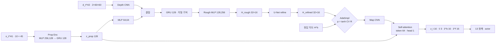
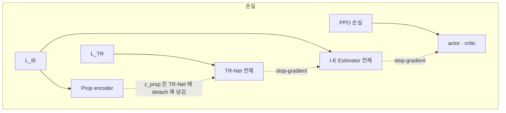

> 분류: A/정책학습 · 설계 (10 보행층 · 지각: TR-Net · I-E Estimator · AdaSmpl)
> 작성: 오흥재 (lead 세션 작성)
> 근거: START 2512.13153v1 (`s2_lab/_papers/2512.13153v1.txt`) · 선행 2409.15692v2 부록 D Table V (같은 폴더 txt 300~355 행) · 2409.15692v1 latent 차원 · evidence/maicode-trcr-deep · maicode-start-deep · RESEARCH-astra-19g-start-reimpl.md · evidence/deep-research-start-*.json · fable 20e F16
> 요지: START 의 지각을 그대로 짓는다. 층 크기는 같은 저자 선행 논문 부록 수치를 쓰고, 원문 불일치(CNN 표)와 인쇄 오류(커리큘럼 식)는 우리 선택 · 정정으로 표시한다. 지도는 중력 정렬 yaw 틀, 기억은 에피소드마다 0, PPO gradient 는 지각으로 흘리지 않는다
> 상태: 초안 · 팀장 검토 전 · 수치는 출처 등급(논문 · 선행 · 코드 · 실측 · 가정)

# 12 · 지각 (TR-Net · I-E Estimator · AdaSmpl)

## 0. START 와 선행 논문의 관계

START 는 선행 논문 「Walking with Terrain Reconstruction」(2409.15692) 을 다듬은 판이다. 보상 14 항 · 발 가장자리 보상 · 지도 범위 · H2 · AdaSmpl 식 · 커리큘럼 식(인쇄 오류까지) · 명령 분포 · 실기 장비가 같다(evidence/maicode-trcr-deep `diff_vs_start`). 그래서 선행 논문 부록 D 의 층 크기를 **선행** 등급으로 쓴다. 다른 점은 지형 깊이(0.3~0.7 m 대 0.2~0.7 m)와 START 에만 있는 예산 · Warp · 필터 · 야외 실험이다.

## 1. 데이터 흐름

## 2. TR-Net

| 부품 | 값 | 등급 · 위치 |
|---|---|---|
| 입력 | z_prop 와 depth 2 프레임 | **논문** START 126~127 행 |
| Depth CNN | 원문 {[32,64,64],[7,7,3,3],[4,4,2,2],[3,3,1,1]} 는 **채널 3 개 대 커널 4 개 불일치** | **선행** 2409.15692v2 Table V (txt 305 행). 불일치는 원문 자체(ASTRA 19g 3 절, deep-research (6)) |
| ↳ 우리 선택 | 3 층: (32, k7, s4, p3) · (64, k3, s2, p1) · (64, k3, s2, p1). 60×60 → 15×15 → 8×8 → 4×4, 평탄화 1024 | **가정**. 이유: 원문 채널 3 개를 지키고, 4 번째 stride 를 빼야 4×4 공간 정보가 남는다(4 층이면 1×1 로 사라짐). 다른 해석과는 shape 시험으로만 비교 |
| prop MLP | [64, 64] ELU | **선행** Table V 305 행 |
| 지형 기억 GRU | 1 층 · hidden 128 | **선행** Table V 305 행 (SPEC-start-go2 의 512 는 폐기) |
| Rough decoder | MLP [128, 256] ELU → 32×16 | **선행** Table V 311 행 · 출력 크기는 아래 지도 규격 |
| Refine decoder | U-Net: 16,16 / 32,32 / 64,64 / concat 64→32,32 / concat 32→16,16 → 1. conv 3×3 s1 p1 + ReLU, max pool 2, transpose conv 2 | **선행** Fig. 8 (ASTRA 19g 3 절이 원본 그림으로 확인). 마지막 활성화 없음 → **가정** |
| 손실 | L_TR = MSE(H_rough, H^b) + L1(H_refined, H^b), 계수 1 | **논문** START 169 행 |
| 지도 규격 | 뒤 0.5 ~ 앞 1.1 m, 폭 0.8 m, 5 cm | **논문** START 127 행 |
| ↳ 셀 | 32 × 16, 셀 중심 x −0.475…1.075, y −0.375…0.375. 높이 h = z_hit − z_base, clip ±1 m | **가정** SPEC-start-go2.md 53 행 |
| 지도 틀 | **중력 정렬 yaw 틀**(몸 yaw 만 따라 돌고 roll · pitch 는 무시) | **가정** fable 20e F16 · R2 (START 는 「robot's local frame」 만 적음, 127 행) |

## 3. I-E Estimator

| 부품 | 값 | 등급 · 위치 |
|---|---|---|
| 몸 감각 이력 | H1 = 10 | **선행** 2409.15692v2 95 행 (START 는 값 없음) |
| Prop encoder | MLP [256, 128] ELU → GRU 1 층 128 | **선행** Table V 323 행 |
| Map encoder (CNN) | 원문 {[32,64],[7,3,3],[2,1,2],[3,1,1]} 는 **채널 2 개 대 커널 3 개 불일치** | **선행** Table V (txt 331 행) |
| ↳ 우리 선택 | 2 층: (32, k7, s2, p3) · (64, k3, s1, p1). 32×16 → 16×8. 셀 하나 = 토큰 하나(128 토큰 × 64 차원) | **가정**. 이유: 원문 채널 둘을 지키고, 토큰 차원을 Table V 의 token 64 와 맞춘다 |
| 융합 | Self-attention {hidden [256,256], token 64, head 1} → Linear | **선행** Table V 339 행. 층 수 해석(2 층 · FF 256)은 **가정** (ASTRA 19g 「대응 근거 부족」) |
| 출력 | z_t 16(VAE, reparameterization) · v̂ 3 · ẑ^b 16 · ẑ^f 16 | **선행** 2409.15692v1 Observations 절 (deep-research (7)) · v2 35 행 |
| 디코더 | MLP [64, 128] ELU: ẑ^b → H^b, ẑ^f → 발 4 개 지도, [z, v̂, ẑ^f, ẑ^b] → ô_{t+1} | **선행** Table V 347 행 |
| 발 지도 | 발마다 0.1 m 범위 | **논문** START 108~110 행 (모양 · 해상도 없음 → 발마다 5×5 · 5 cm **가정**) |
| 손실 | L_IE = KL + MSE(ô_{t+1}) + MSE(v̂) + MSE(Ĥ^f) + MSE(Ĥ^b), 계수 1 | **논문** START 116 행 |

## 4. AdaSmpl

| 항목 | 값 | 등급 · 위치 |
|---|---|---|
| 식 | p_smpl = tanh(CV(R)), R 은 에피소드 보상 | **논문** START 193 · 197 행 |
| 하는 일 | p_smpl 확률로 정책 입력 지도를 재구성 대신 정답으로 바꿈. 배포는 재구성만 | **논문** START 185~217 행 |
| 통계 창 | 지난 1 회 업데이트 동안 끝난 에피소드 보상 전체 | **가정** (원문 · 선행 · 중국어 자료 모두 없음, evidence/deep-research-*) |
| CV 계산 | std / (|mean| + 1e-6) | **가정** |
| 표본 단위 | env 마다, 에피소드 시작 때 한 번 뽑아 끝까지 유지 | **가정** |
| 기록 | 매 업데이트 p_smpl · 정답 사용 비율 · 재구성만 쓴 env 의 성적 따로 | **가정** (ASTRA 19g 8 절: 정답 의존이 오래가는지 봐야 함) |

**AdaSmpl 확률과 지형 전환 확률은 다른 것이다**(ASTRA 19g 1 절 4). 지형 전환 식은 15 문서가 맡는다. 원문 식 `max(min(z, 0), p_max)` 는 항상 p_max 가 되는 인쇄 오류이므로 `min(max(z, 0), p_max)` 로 **정정**해 쓴다(START · 선행 둘 다 같은 오류, ASTRA 19g · deep-research (3)).

## 5. 기억 · 리셋 · gradient 경계

| 규칙 | 내용 | 근거 |
|---|---|---|
| PPO → 지각 차단 | actor 는 I-E 출력을 detach 해서 받는다. PPO gradient 는 I-E · TR-Net 으로 가지 않는다 | **논문** START 42 행 「I-E Estimator, trained via supervised learning」 · fable 20e R1 |
| TR-Net ↔ I-E | I-E 는 TR-Net 지도를 detach 해서 받는다. z_prop 은 TR-Net 에 detach 해서 준다 | **가정** (ASTRA 19f Q3 「gradient 소유권을 그림과 코드로 고정」) |
| 리셋 | 두 GRU(Prop · 지형 기억) 상태는 env 리셋 때 0 | **가정** |
| 기억 진행 | 지형 기억 GRU 는 새 depth 프레임(10 Hz)이 올 때만 한 칸 진행, Prop GRU 는 50 Hz | **가정** SPEC-start-go2.md 55 행 |
| 순환 학습 | rsl_rl 의 순환 정책 경로(hidden state 를 rollout 버퍼에 저장, minibatch 는 env 단위로 자름) | **코드** Isaac Lab `RslRlPpoActorCriticRecurrentCfg` (`isaaclab_rl/rsl_rl/rl_cfg.py:54`) |
| 최적화 | 지각 손실과 PPO 손실은 optimizer 를 따로 둔다 | **가정** (공유 encoder gradient 경쟁 방지, ASTRA 19f Q3) |

## 6. 구현 방법 (Isaac Lab 2.3.2 · rsl_rl)

| 무엇 | 어디에 | 텐서 모양 |
|---|---|---|
| 정답 지도 H^b · H^f | `RayCasterCfg` 격자 패턴(32×16, 5 cm, yaw 정렬)으로 정답 높이 · 발마다 작은 격자 4 개 | `(N, 32, 16)` · `(N, 4, 5, 5)` |
| TR-Net · I-E | 새 모듈 `start_perception.py` (PyTorch 기본 Conv2d · GRU · MultiheadAttention 으로 새로 구현). 공개 코드 복사 없음(START 코드 없음, MGDP 라이선스 없음) | 위 표 |
| 정책 묶기 | rsl_rl `ActorCritic` 를 상속한 사용자 모듈 + 사용자 runner(지각 손실 단계 추가). Isaac Lab 의 `RslRlOnPolicyRunnerCfg` 에 class_name 지정 | actor 입력 45 + 16 + 3 + 16 + 16 = 96 (13 문서) |
| AdaSmpl | runner 의 rollout 수집 전 단계에서 env 마다 플래그 | `(N,)` bool |

## 7. 검증할 가설

| # | 가설 | 어떻게 보나 |
|---|---|---|
| H12-1 | 우리 CNN 선택이 재구성 오차를 START 수준으로 낸다 | 최고 난이도 재구성 MAE 를 START Fig. 5 눈금(돌 약 3.6 · 평균대 약 1.8 · 빔 약 4.8 · gap 약 1.5 cm, SPEC 60 행 읽음)과 나란히. 재현 목표가 아니라 보고 항목 |
| H12-2 | GRU 128 이 옆 · 뒤가 아니라 「지나온 땅」 은 기억한다 | 전진 뒤 후진 시나리오에서 몸 아래 · 뒤 재구성 MAE |
| H12-3 | AdaSmpl 이 학습 후반에 정답 의존을 낮춘다 | p_smpl 곡선과 재구성만 쓴 env 의 성적 |
| H12-4 | 중력 정렬 yaw 틀이 경사 · 계단에서 지도를 깨지 않는다 | 경사 지형에서 재구성 MAE |

## 8. 열린 항목

- Self-attention 층 수 · FF 크기의 근거(현재 가정).
- 발 지도 모양 · 해상도(현재 5×5 · 5 cm 가정).
- 저자 문의 여부(팀장 결정): 받을 질문은 두 CNN 정의 · latent 세부 · AdaSmpl 창 (ASTRA 19g 8 절).
