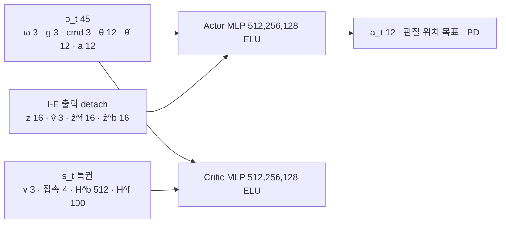

> 분류: A/정책학습 · 설계 (10 보행층 · 정책: actor · critic · 학습 방식 · 비교 갈래)
> 작성: 오흥재 (lead 세션 작성)
> 근거: START 2512.13153v1 52~86 · 221 · 347~353 행 · 2409.15692v2 Table V 353 행 · ASTRA 19f Q3 · fable 20e R1 · R4 · DECISIONS-step2-lead.md (S 행) · evidence/E1-vs-v2-axis1.csv · E1-vs-v2-axis2.csv · legged_gym@8fa29ac
> 요지: START 의 비대칭 actor-critic 단일 단계 학습을 그대로 쓰고, 명령 세 칸은 관측 안에 둔다. 「무엇이 효과였나」 를 가르려고 지도 입력과 가장자리 보상만 바꿔 끼우는 갈래 G0 · G1 · G3 를 같은 코드에서 설정으로 고른다. G0 의 눈 없는 기준선 자료로 E1 평가를 쓴다
> 상태: 초안 · 팀장 검토 전 · 수치는 출처 등급(논문 · 선행 · 코드 · 실측 · 가정)

# 13 · 정책 (actor · critic · 학습 방식 · 비교 갈래)

## 1. 구조

## 2. 관측 · 행동

| 항목 | 차원 | 등급 · 위치 |
|---|---|---|
| o_t | 45 = 몸 각속도 3 · 로봇 틀 중력 3 · **속도 명령 3 (vx, vy, wz)** · 관절각 12 · 관절각속도 12 · 이전 행동 12 | **논문** START 식 1, 60~72 행 |
| 명령 칸 스케일 | lin 2.0 · ang 0.25 | **가정** legged_gym 관행(SPEC-start-go2.md 28 행). JEPLO 도 같은 배율(코드 `go2_loco_env.py` 614~615) |
| actor 입력 | o_t 45 + z 16 + v̂ 3 + ẑ^f 16 + ẑ^b 16 = **96** | **선행** 2409.15692v2 Table V 353 행 · v1 latent 차원 |
| critic 입력 | o_t 45 + s_t = v 3 + 발 접촉 4 + H^b 32×16 = 512 + H^f 4×5×5 = 100 → **664** | **논문** START 식 2, 76~86 행 (H^b · H^f 크기는 12 문서 가정) |
| actor · critic | MLP [512, 256, 128] ELU | **선행** Table V 353 행 · **코드** legged_gym `legged_robot_config.py` 202~234 |
| 행동 | 12 관절 위치 목표, PD 추종 | **논문** START 60 행. scale · kp · kd 는 17 문서(Go2 모델) |

명령 세 칸은 14 문서의 명령 생성기가 채운다. 정책은 그 값이 자유 속도인지 깃발에서 온 것인지 모른다.

## 3. 학습 방식: START 단일 단계 (비대칭 PPO)

| 선택지 | 무엇 | 판단 |
|---|---|---|
| **START 단일 단계** | actor 는 배포 가능한 입력만, critic 만 특권 정보. 지각은 지도 학습 손실, actor 는 PPO. 처음부터 끝까지 한 번 | **채택**. 근거: START 의 방법 그대로(52 행 「asymmetric actor-critic … single-stage」), AdaSmpl 이 이 틀을 전제로 함(185~217 행) |
| teacher → student 증류 | teacher 가 정답 지도로 먼저 배우고 student 가 따라 함 (HiPAN 저수준 방식, 2604.26504 134~168) | 이번 보행층에는 안 씀. 두 틀을 섞으면 DAgger 와 AdaSmpl 이 한 손실에 들어가 어느 논문도 아니게 된다 (fable 20e R1). ASTRA 19f 는 「보상 조건마다 teacher 를 먼저」 를 권했는데, 그것은 HiPAN 저수준에 START 를 붙이는 안의 이야기다. 지금 안은 START 틀 위에 명령만 넓힌다 |

추종 보상은 START 식(min 형태, 초과 속도 무벌점, 1.5 · 0.5) 을 1 차 기본으로 둔다(START Table I 148~154 행). 주행층 결합 때는 정확 추종형(HiPAN r1)이 필요하다는 지적이 있다(fable 20e R4) → 16 보상 문서에서 정한다.

### 3.1 PPO 설정

| 항목 | 값 | 등급 |
|---|---|---|
| env · steps/env | 3072 · 24 | **논문** env 3072 (START 221 행) · steps 24 는 팀장 결정(DECISIONS-step2-lead.md S 행, 「4096 · 48 은 반복당 표본을 바꿈」) |
| epochs · minibatch · lr · γ · λ · clip · entropy · KL · grad norm | 5 · 4 · 1e-3 adaptive · 0.99 · 0.95 · 0.2 · 0.01 · 0.01 · 1.0 | **가정** START · 선행 · 중국어 자료 모두 없음(evidence/deep-research-*). 참고: legged_gym@8fa29ac 202~234 · Deep Robotics `rl_training`@3d05d3b Lite3 설정이 같은 값 |
| 반복 수 · 시간 | 약 10,000 회 · A6000 16.6 h | **논문** START 221 행. 우리 예산은 18 문서 |

## 4. 비교 갈래 (같은 코드, 설정만 다름)

ASTRA 19f Q3 의 갈래를 정책 쪽에서 이렇게 끼운다. 명령 생성기 · 지형 · PPO · 예산은 모두 같게 둔다.

| 갈래 | actor 의 지형 입력 | 가장자리 보상 | 바꾸는 설정 | 알 수 있는 것 |
|---|---|---|---|---|
| **G0-blind** | 없음. I-E 는 prop 토큰만 (map 토큰 0 개) | 없음 | `perception.map_input = none`, `rewards.feet_edge.weight = 0` | 눈 없는 열린 명령 기준선 |
| **G0-gt** (선택) | 정답 지도 항상 (p_smpl = 1) | 없음 | `adasmpl.force_gt = true` | 지각이 완벽할 때 상한 (START 「HMap GT」, 347 행) |
| **G1** | 재구성 지도 (AdaSmpl) | 없음 | `rewards.feet_edge.weight = 0` | 같은 보상에서 지각 추가 효과 |
| **G3** | 재구성 지도 (AdaSmpl) | 있음 (−1.0, dist 2.5 · 5 cm, ω 1 · 0.5) | 기본값 | 결합 효과 · 최종 후보 |
| G2 (예산 남으면) | 없음 | 있음 | `map_input = none` | 보상만의 효과 |

갈래를 줄이면 주장도 줄인다. G0 · G1 · G3 만이면 「지도와 보상의 상호작용」 은 가르지 못했다고 적는다(ASTRA 19f Q3).

### 4.1 G0 기준선 자료: E1 MoE-CTS 평가 (10/19)

E1 은 눈 없는 MoE-CTS 정책이고, 명령은 vx · vy ±1 · wz ±1.5 로 열려 있다. v2 와 같은 자로 처음 쟀다(evidence/E1-vs-v2-axis1.csv · axis2.csv, `s2_lab/eval_e1_v2axes/`).

| 자 | E1 | v2 | 등급 |
|---|---|---|---|
| 축 2 (평지 명령 9 칸) | 9/9 · 회전 추종비 0.84~0.98 · 회전 낙상 0.0 | 8/9 · 0.40~0.76 · 0.109 | **실측** |
| 축 1 48 칸 평균 | 0.4479 | 0.9419 | **실측** |
| 축 1 0.5 · 1.0 · 1.5 m/s | 0.68 · 0.67 · 0.00 | 0.94 · 0.95 · 0.94 | **실측** |
| gap 1.0 m/s (생존) | 0.01 (0.27) | 1.00 | **실측** |
| stepping_stones 1.0 m/s | 0.00 | 0.24 | **실측** |

읽는 법(단서 포함): 1.5 m/s 는 E1 학습 범위 밖이라 속도 추종만 0 이다(생존은 대부분 0.91~1.00). 0.5 m/s 실패의 대부분은 방향 이탈이다. E1 과 v2 는 명령 말고도 신경망 · 학습 지형 · 학습량 · 눈 유무가 다르고, E1 평가에는 마찰 · 게인 무작위가 학습 때처럼 켜져 있었다. 그래서 이 표는 「명령을 연 탓」 을 증명하지 않는다. **G0-blind 가 어디쯤 나올지의 출발 자료**다.

이 자료가 정하는 목표(41 문서에 학습 전 등록 후보): 축 2 는 E1 수준, 축 1 은 v2 수준 이상, gap · stepping_stones 는 v2 이상.

## 5. 구현 방법 (Isaac Lab 2.3.2 · rsl_rl)

| 무엇 | 어디에 | 비고 |
|---|---|---|
| 환경 | 새 task `FootholdS2-Go2-v0` (Isaac Lab manager-based velocity env 를 바탕으로). 관측 그룹 `policy` (o_t 45 + 깊이 2×60×60 + 이력), `critic` (o_t + s_t) | 관측 그룹 이름은 rsl_rl 비대칭 입력 규약을 따름 |
| 정책 모듈 | `foothold_s2/models/start_policy.py`: rsl_rl `ActorCriticRecurrent` 를 상속해 12 문서 지각과 actor · critic 을 묶음 | 지각 출력은 detach 해서 actor 로 |
| runner | `foothold_s2/runners/start_runner.py`: OnPolicyRunner 를 상속, rollout 뒤 지각 손실(L_TR + L_IE) 단계와 AdaSmpl 플래그 갱신 | 지각 optimizer 별도 |
| 갈래 설정 | 위 4 절 표의 설정 키를 Hydra cfg 로. 실행마다 `params/` 에 저장 | 같은 커밋 · 같은 시드에서 키만 다름 |
| 수출 | actor + 지각을 ONNX 로(실기 Orin/RK 계열 추론) | START 실기 TensorRT (379 행) |

## 6. 검증할 가설

| # | 가설 | 어떻게 보나 |
|---|---|---|
| H13-1 | 명령을 연 단일 단계 START 틀이 학습된다(붕괴 없이) | 첫 500 회: 보상 · 에피소드 길이 · KL · NaN, 방향별 노출(14 문서 6 절) |
| H13-2 | G3 가 G0-blind 보다 듬성한 지형에서 높다 | 축 1 · 축 3 듬성한 지형 칸, 같은 시드 · 같은 평가 env |
| H13-3 | G3 가 이어진 지형 · 축 2 에서 G0-blind 보다 떨어지지 않는다 | 축 1 이어진 칸 · 축 2 |
| H13-4 | E1 축 2 수준(9/9)이 새 정책에서도 나온다 | 축 2 |

## 7. 열린 항목

- 추종 보상 형태(START min 형 대 정확 추종형)는 16 문서와 주행층 결합 계획에서 정한다.
- G0-gt · G2 를 돌릴지는 18 문서 예산에서 정한다.
- 이력 관측 길이(H1 = 10)를 actor 에 직접 넣을지, I-E 를 통해서만 줄지(현재: I-E 를 통해서만, START 식 1 · Table V).
