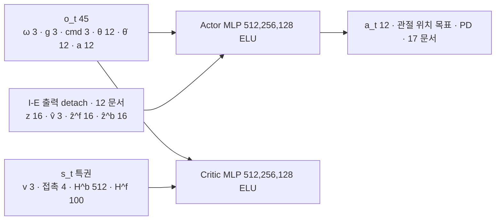

> 분류: A/정책학습 · 설계 (10 보행층 · 정책: actor · critic · 학습 방식 · 비교 갈래)
> 작성: 오흥재 (lead 세션 초안 · fable 20f 가 v1 으로 고쳐 씀)
> 근거: START 2512.13153v1 42 · 52~54 · 60~72 · 76~86 · 185~217 · 221 · 347 행 · 선행 2409.15692v2 35 · 353 행 · HiPAN 2604.26504 134~168 행 · ASTRA 19f Q3 · fable 20e R1 · R4 · DECISIONS-step2-lead.md S 행 · evidence/E1-vs-v2-axis1.csv · axis2.csv · Isaac Lab 2.3.2 `config/go2/agents/rsl_rl_ppo_cfg.py` · `isaaclab_rl/rsl_rl/rl_cfg.py` 54 · APPROVED F-D4(팀장 승인) · VERIFY-fable-20f P23 · P29
> 요지: START 의 비대칭 actor-critic 단일 단계 학습을 그대로 쓰고, 명령 세 칸은 관측 안에 둔다. 「무엇이 효과였나」 를 가르려고 지도 입력과 가장자리 보상만 바꿔 끼우는 갈래 G0 · G1 · G3 를 같은 코드에서 설정으로 고른다. S1 은 높이 스캔 판과 눈 없음 판 둘 다 돌린다(팀장 승인 D35). 추종 보상은 정확 추종(팀장 승인 D21)
> 상태: v1 · 팀장 검토 전 · 수치는 출처 등급(논문 · 선행 · 코드 · 실측 · 가정) · 20k ASTRA 마지막 검증(VERIFY-astra-final) 계약 반영 · **20m 승인 차이 넷 반영(fable 10/20)** · **20n rl 가정 13 대조 반영(fable 10/20)**

# 13 · 정책 (actor · critic · 학습 방식 · 비교 갈래)

## 0. 쉬운 요약

정책은 「지금 몸 상태 + 명령 세 칸 + (있으면) 지형 정보」 를 받아 12 관절의 목표 각도를 내는 신경망(actor)이다. 학습 때는 시뮬이 알고 있는 「진짜 속도 · 진짜 지형」 을 보는 심판 신경망(critic)이 점수를 매겨 actor 를 가르친다. 배포 때 critic 은 버린다. 이 「actor 는 실기에서 얻을 수 있는 것만, critic 은 다 본다」 방식을 비대칭 actor-critic 이라 하고 START 가 쓴 그대로다. 「눈(카메라 지도)이 정말 도움이 됐나」 를 알려면 눈 없는 판(G0), 지도만 있는 판(G1), 지도 + 발 가장자리 벌점 판(G3)을 같은 코드로 돌려 비교한다. 첫 단계 S1 은 아직 카메라 없이 명령만 연다. 그때 시뮬 전용 「정답 높이 스캔」 을 줄지, 아예 눈 없이 갈지는 둘 다 돌리자고 제안한다(둘 다 7 시간).

## 1. 구조

## 2. 관측 · 행동

| 항목 | 차원 | 등급 · 위치 |
|---|---|---|
| o_t | 45 = 몸 각속도 3 · 로봇 틀 중력 3 · **속도 명령 3 (vx, vy, wz)** · 관절각 12 · 관절각속도 12 · 이전 행동 12 | **논문** START 식 1 (64 행, 60~72 행) |
| 관측 스케일 | ang_vel 0.25 · dof_pos 1.0 · dof_vel 0.05 · cmd 2.0 / 0.25 | **가정** legged_gym 관행(SPEC-start-go2 28 행). **코드** JEPLO `go2_loco_env.py` 614~615 도 같은 배율 |
| actor 입력 (S2 이후) | o_t 45 + z 16 + v̂ 3 + ẑ^f 16 + ẑ^b 16 = **96** | **선행(START 미기재)** 2409.15692v2 Table V 353 행 · 35 행(ẑ^f · ẑ^b ∈ R16) · z_t 16 은 v1 본문(deep-research (7)) |
| actor 입력 (S1-scan) | o_t 45 + 정답 높이 스캔 187 (v2 와 같은 격자) = 232 | **실측** v2 보고 7 절(「지금 정책이 보는 것」) · 시뮬 전용 |
| actor 입력 (S1-blind) | o_t 45 + 고유수용 이력 10 × 45 = 495 (GRU 없이 이력 연결, HiPAN student 식 op50 의 축소판) | **가정** · HiPAN 268~272 행 참고 |
| critic 입력 | o_t 45 + s_t = v 3 + 발 접촉 4 + H^b 32×16 = 512 + H^f 4×5×5 = 100 → **664** | **논문** START 식 2 (80 행, 76~86 행). H^b · H^f 크기는 12 문서 가정 |
| critic 입력 (S1 두 판 공통) | o_t 45(잡음 없음) + v 3 + 발 접촉 4 = **52**(지도 항 H^b · H^f 없음) | **가정** · lead 승인 10/20(20m): S1 에는 지도가 없으므로 START 식 2 에서 지도 항만 뺀 것. 코드 `tasks/s1_env_cfg.py` CriticCfg(71d6eac2) |
| actor · critic | MLP [512, 256, 128] ELU | **선행(START 미기재)** Table V 353 행 · **코드** Isaac Lab Go2 cfg 21 행 |
| 행동 | 12 관절 위치 목표, PD 추종 (0.25 배율 · Kp 25 · Kd 0.5) | **논문** START 60~62 행 · **코드** 17 문서 |

명령 세 칸은 14 문서의 명령 생성기가 채운다. 정책은 그 값이 자유 속도인지 깃발에서 온 것인지 모른다.

## 3. 학습 방식: START 단일 단계 (비대칭 PPO)

| 선택지 | 무엇 | 판단 |
|---|---|---|
| **START 단일 단계** | actor 는 배포 가능한 입력만, critic 만 특권 정보. 지각은 지도 학습 손실, actor 는 PPO. 처음부터 끝까지 한 번 | **채택**. 근거: START 의 방법 그대로(**논문** 52~54 행 「asymmetric actor-critic … single-stage」, 42 행 I-E 는 supervised), AdaSmpl 이 이 틀을 전제로 함(185~217 행) |
| teacher → student 증류 | teacher 가 정답 지도로 먼저 배우고 student 가 따라 함 (HiPAN 저수준 방식, **논문** 2604.26504 134~168 행) | 보행층에는 안 씀. 두 틀을 섞으면 DAgger 와 AdaSmpl 이 한 손실에 들어가 어느 논문도 아니게 된다(fable 20e R1). 주행층(21)은 HiPAN 대로 증류를 쓴다 |

추종 보상은 **정확 추종형**(16 문서 3 절 B, **팀장 승인 10/19**) 을 G0 · G1 · G3 전부에 같이 쓴다. START 의 min 형은 기록용 A 안으로만 남긴다.

### 3.1 PPO 설정

18 문서 1 절의 값(Isaac Lab Go2 cfg: 24 · 5 · 4 · 1e-3 adaptive · 0.99 · 0.95 · 0.2 · 0.01 · 1.0, **가정**). env · 반복 수는 18 문서 2 절(S1 4096 · 6,000, S2 3072 · 20,000 **팀장 승인**(env 는 F-D3 · 반복 2 배는 L)).

## 4. 비교 갈래 (같은 코드, 설정만 다름)

ASTRA 19f Q3 의 갈래를 정책 쪽에서 이렇게 끼운다. 명령 생성기 · 지형 · PPO · 예산 · 추종식은 모두 같게 둔다.

| 갈래 | actor 의 지형 입력 | 가장자리 보상 | 바꾸는 설정 | 알 수 있는 것 | 단계 |
|---|---|---|---|---|---|
| **S1-scan** | 정답 높이 스캔 187 점 (시뮬 전용) | 없음 | `perception.map_input = height_scan` | 「눈이 완벽할 때 명령 개방」 의 상한. v2 와 같은 관측이라 v2 기준 관문을 그대로 쓸 수 있다. S3 시뮬 하위 · 11/7 시뮬 시연 | S1 |
| **S1-blind** | 없음 (고유수용 이력만) | 없음 | `perception.map_input = none` | 눈 없는 열린 명령 **실기 하위**. 실기에 올릴 수 있는 유일한 S1 판(42 T6 · 11/10 「아니오」 갈래의 S3 하위, J-D) | S1 |
| **S2-G0 = G0** | 없음 (I-E 는 prop 토큰만 · map 토큰 0) | 없음 | `perception.map_input = none` · S2 틀(3072 · 20,000 · START 14 항 B · 같은 지형군 둘 · 14 생성기) | **눈만 끈 기준선**. G1 과 env · 반복 · 보상 · 지형 · 신경망이 같고 지도 입력만 다르다 → 「눈의 효과」 를 한 변수로 가른다(**팀장 승인 10/20 J-A**, VERIFY-lead-final 1 · 2). S1 대 v2 는 「결합 효과」 로 적는다 | S2(GPU 0 11/3~) |
| G0-gt (선택) | 정답 지도 항상 (p_smpl = 1) | 없음 | `adasmpl.force_gt = true` | 지각이 완벽할 때 상한 (START 「HMap GT」, **논문** 347 행) | S2 예산 남으면 |
| **G1** | 재구성 지도 (AdaSmpl) | 없음 | `rewards.feet_edge.weight = 0` | 같은 보상에서 지각 추가 효과 | S2-a |
| **G3** | 재구성 지도 (AdaSmpl) | 있음 (−1.0, dist 2.5 · 5 cm, ω 1 · 0.5) | 기본값 | 결합 효과 · 최종 후보 | S2-b |
| G2 (예산 남으면) | 없음 | 있음 | `map_input = none` | 보상만의 효과 | 예산 |

S1 두 판은 **팀장 승인 10/19 23:2x**(90 D35) 이다. 둘 다 7 h 라 GPU 부담은 없고, 하나만 고르면 「scan 은 실기 불가」 「blind 는 v2 기준 관문 불가(E1 눈 없음 0.67)」 중 하나를 안게 된다. **S1 대 v2 는 한 변수 비교가 아니다**(VERIFY-lead-final 3): 종아리 한계 · PIE DR · 지형 비율 · 보상 세트 · 처음부터 학습이 함께 바뀐다. 그래서 S1 관문의 「v2 대비 하락 0」 은 「결합 효과가 v2 를 해치지 않았다」 는 뜻이고, 실패하면 원인을 가르지 못한다. 예산이 남으면 종아리 한계만 바꾼 대조판(2,000 회)을 둔다(선택). 갈래를 줄이면 주장도 줄인다. G0 · G1 · G3 만이면 「지도와 보상의 상호작용」 은 가르지 못했다고 적는다(ASTRA 19f Q3).

### 4.1 G0 기준선 자료: E1 MoE-CTS 평가 (10/19)

E1 은 눈 없는 MoE-CTS 정책이고, 명령은 vx · vy ±1 · wz ±1.5 로 열려 있다. v2 와 같은 자로 처음 쟀다(**실측** evidence/E1-vs-v2-axis1.csv · axis2.csv, `s2_lab/eval_e1_v2axes/`, 20f 가 csv 에서 재계산).

| 자 | E1 | v2 | 등급 |
|---|---|---|---|
| 축 2 (평지 명령 9 칸) | 9/9 · 요 추종비 0.84~0.98 · 회전 낙상 0.0 | 8/9 · 0.40~0.76 · 0.109 | **실측** |
| 축 1 48 칸 평균 | 0.4479 | 0.9419 | **실측** |
| 축 1 0.5 · 1.0 · 1.5 m/s | 0.6763 · 0.6675 · 0.0000 | 0.9369 · 0.9525 · 0.9363 | **실측** |
| 축 1 범위 안 32 칸(0.5 · 1.0) | 0.6719 | 0.9447 | **실측** (계산) |
| gap 1.0 m/s (생존) | 0.01 (0.27) | 1.00 | **실측** |
| stepping_stones 1.0 m/s | 0.00 | 0.24 | **실측** |

읽는 법(단서 포함): 1.5 m/s 는 E1 학습 범위 밖이라 속도 추종만 0 이다(생존은 대부분 0.91~1.00). 0.5 m/s 실패의 대부분은 방향 이탈이다(rough6 0.5 에서 생존 1.0 · 진행 ≥ 0.98 · 추종 ≥ 0.97 인데 방향 0.65~0.92). E1 과 v2 는 명령 말고도 신경망 · 학습 지형 · 학습량 · 눈 유무가 다르고, E1 평가에는 마찰 · 게인 무작위가 학습 때처럼 켜져 있었다(evidence 하위 작업 보고). 그래서 이 표는 「명령을 연 탓」 을 증명하지 않는다. **S1-blind 가 어디쯤 나올지의 출발 자료**다.

이 자료가 정하는 목표(41 문서 9 절 등록 후보): 축 2 는 E1 수준(9/9 · 요 추종 ≥ 0.80), 축 1 범위 안 32 칸은 S1-scan 이 v2 이상 · S1-blind 가 E1 이상(평균 ≥ 0.67), gap · stepping_stones 는 S2 에서 v2 이상.

## 5. 장면 예

| 장면 | 정책이 보는 것 · 하는 것 |
|---|---|
| S1-blind 로봇이 징검돌 앞에 섰다(깃발 명령 앞 0.7) | 지형을 모른다. 발이 빠지면 종료. 그래서 S1 에서 듬성한 지형 성적은 낮게 나와야 정상이고(E1 0 %), 그 값이 G1 · G3 의 기준선이 된다 |
| S2 G3 로봇이 같은 자리 | TR-Net 지도(12)에서 돌 위치를 읽고 I-E 가 발 지도를 추정한다. 가장자리 벌점이 중앙 디딤을 고른다 |
| 조이스틱이 「옆으로 0.5」 를 줬다(이어진 지형) | 관측 cmd 칸에 (0, 0.5, 0) 이 들어오고 actor 가 옆걸음을 낸다. v2 는 이 칸이 늘 0 이라 못 했다 |
| 깃발 명령이 갑자기 0 (마지막 깃발 도달) | 정지 env 에서 배운 「세 칸 0 → 서기」 가 나온다 |

## 6. 구현 방법 (Isaac Lab 2.3.2 · rsl_rl)

| 무엇 | 어디에 | 비고 |
|---|---|---|
| 환경 | `foothold_s2/tasks/s1_env_cfg.py` · `s2_env_cfg.py` (Isaac Lab manager-based velocity env 바탕, task 이름 `FootholdS2-Go2-S1-v0` · `-S2-v0`). 관측 그룹 `policy` (o_t 45 + 이력 또는 깊이 2×60×60) · `critic` (o_t + s_t) | 관측 그룹 이름은 rsl_rl 비대칭 입력 규약(`policy` · `critic`) |
| 정책 모듈 | `foothold_s2/models/start_policy.py`: rsl_rl `ActorCritic`(MLP) 인터페이스를 지키는 우리 클래스로 12 문서 지각과 actor · critic 을 묶음. 설치 `ActorCriticRecurrent` 는 1 차원 관측만 받고 actor · critic 에 GRU 를 붙이므로 **쓰지 않는다**(rsl_rl 3.1.2 `actor_critic_recurrent.py` 57 · 67 행, VERIFY-astra-final 5). 두 GRU 는 지각 안(12 §6.1) | 지각 출력은 detach 해서 actor 로. PPO 재평가는 수집 때 저장한 96 차원 입력 · log prob 로만(12 §6.1) |
| runner · 진입점 | `foothold_s2/runners/start_runner.py`: OnPolicyRunner 를 상속, 순서 ① 수집 ② PPO update ③ 지각 재생 · L_TR + L_IE ④ AdaSmpl ⑤ 저장(12 §6.1). 진입점은 `foothold_s2/scripts/train_start.py`(설치 `train.py` 198~203 행이 사용자 runner 를 거부하므로 rank 처리 119 · 137~143 행 이식) | 지각 optimizer 별도(수치 12 §6.1) · checkpoint 상태 목록 12 §6.1 · 분산 계약 18 §5 |
| 갈래 설정 | 위 4 절 표의 설정 키를 Hydra cfg 로. 실행마다 `params/` 에 저장 | 같은 커밋 · 같은 시드에서 키만 다름 |
| 수출 | actor + 지각을 ONNX 로 → Orin NX TensorRT(START 379 행과 같은 급, APPROVED H). 50 Hz 추론 시간은 42 T7 | |

## 7. 검증 사다리

| 단 | 무엇 | 통과 |
|---|---|---|
| L0 CPU | 관측 조립: 고정 입력으로 o_t 45 칸 순서 · 스케일이 식 1 과 같음. negative control: cmd 칸을 바꾸면 그 칸만 바뀜 | 기대값 |
| L0 CPU | 갈래 키: `map_input = none` 이면 I-E 의 map 토큰이 0 개, G1 이면 `feet_edge.weight` 0 | AST · cfg 덤프 |
| L0 CPU | PPO 입력 고정(12 §9): 저장한 96 차원 · log prob 로 epoch 0 ratio = 1 | 기대값 |
| **L1 통합 관문 10/27 (rl 책임)** | S2 틀 64 env 한 장: 수집 → PPO update → 지각 update → reset → 저장/복원 한 사이클(12 §6.1 · 70 §1). 못 넘으면 S2 11/3 준비 「미완료」 · 11/10 하위는 S1a-blind-v1 경로가 일정 기준 | 로그 · 검사 |
| L1 Kit | S1 env 첫 10 update: Traceback 0 · 메모리 · steps/s · 체크포인트 파일 | 로그 |
| L2 | 첫 500 회: 보상 · 에피소드 길이 상승, KL 0.005~0.02, NaN 0, 방향별 노출(14 §6) | 로그 |

## 8. 검증할 가설

| # | 가설 | 어떻게 보나 |
|---|---|---|
| H13-1 | 명령을 연 단일 단계 START 틀이 학습된다(붕괴 없이) | 첫 500 회: 보상 · 에피소드 길이 · KL · NaN, 방향별 노출 |
| H13-2 | G3 가 G0(S2-G0, 눈만 끈 판) 보다 듬성한 지형에서 높다 | 축 1 · 축 3 듬성한 지형 칸 · START 시험지, 같은 시드 · 같은 평가 env |
| H13-3 | G3 가 이어진 지형 · 축 2 에서 G0 보다 떨어지지 않는다 | 축 1 이어진 칸 · 축 2 |
| H13-4 | E1 축 2 수준(9/9)이 새 정책에서도 나온다 | 축 2 |
| H13-5 | S1-scan 과 S1-blind 의 축 1 차이는 「눈의 값」 의 **결합 효과**다(관측만 다르지만 학습 동역학 · 커리큘럼 진행이 같이 달라져 한 변수 비교가 아님. 한 변수 비교는 S2-G0 대 G1, VERIFY-lead-final2 25) | 범위 안 32 칸 차이 · 결합 효과로 적음 |

## 9. 열린 항목

- G0-gt · G2 를 돌릴지는 18 문서 예산에서(90 O6).
- 이력 관측 길이(H1 = 10)를 actor 에 직접 넣을지, I-E 를 통해서만 줄지(현재: S2 는 I-E 를 통해서만, START 식 1 · Table V. S1-blind 는 직접).

## 10. 구현이 정한 가정 (rl 코드 · 등급 「가정(rl)」 · 20n)

12 §12 와 같은 대조(VERIFY-fable-20n). 정책 입력 · PPO 쪽 둘.

| # | 가정(rl) | 코드(ff03e2d5) | 원문 대조 | 판정 · 등급 |
|---|---|---|---|---|
| ⑦ | 수집(rollout) 때 z 를 표집(reparameterization), 배포(act_inference · deterministic) 는 평균 μ | `models/start_perception.py` 65 · 318~322 행 | 표집: START 118~120 행 「VAE 구조」 · 선행 Table V 341 행 z_t = Reparam(L(z_tf)). 배포 때 평균: 원문 없음(START 215~217 행은 지도에 대해서만 「배포는 재구성만」) | 표집 **원문에 있음(118 행 · 341 행)** · 배포 평균 **가정(rl)** |
| ⑪ | 관측 정규화 통계를 이번 스텝의 actor 입력(96)으로 갱신(설치는 다음 관측) | `runners/start_runner.py` 194~195 행 | 원문에 관측 정규화 없음. 설치 rsl_rl `algorithms/ppo.py` 156~160 행은 `process_env_step` 에서 다음 관측으로 `update_normalization`. 한 스텝 어긋난 같은 흐름(rl 주석대로) | 원문에 없음 · **가정(rl)**. 주의: 관문 cfg 는 두 정규화 **꺼짐**(rl `scripts/start_gate.py` 165 행 · Isaac Lab Go2 `rsl_rl_ppo_cfg.py` 19~20 행 False)이라 지금은 효과 없다. 켜면 설치 rsl_rl 자체가 수집 때 통계(`modules/actor_critic.py` 150 행 forward · 178~183 행 update 분리 · `networks/normalization.py` 43~60 행)와 update 때 통계가 달라 12 §6.1 「epoch 0 ratio = 1」 시험이 깨진다 → 켜려면 그 시험 조건을 「정규화 끔」 으로 적어야 한다 |
