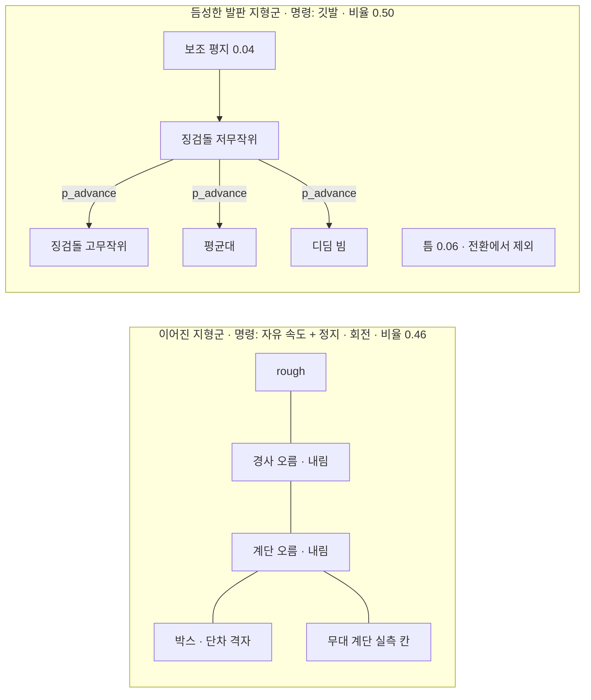

> 분류: A/정책학습 · 설계 (10 보행층 · 지형과 커리큘럼)
> 작성: 오흥재 (lead 세션 초안 · fable 20f 가 v1 으로 고쳐 씀)
> 근거: START 2512.13153v1 259~277 · 283~285 · 295 · 307~325 · 339~341 행 · 선행 2409.15692v2 280 · 284 행(부록 A · B) · Isaac Lab 2.3.2 `terrains/config/rough.py` 12~51 · `config/go2/rough_env_cfg.py` 25~27 · `velocity/mdp/curriculums.py` 47~51 · v2 보고서 6-4~6-8 · 7 절(883 행) · 14 문서 · REPORT-seokheon-ame2.md 4 절(125 행) · evidence/deep-research-start-* · VERIFY-fable-20f P17 · P24 · P34
> 요지: 학습 지형을 「이어진」 · 「듬성한」 두 지형군으로 나누고, 칸은 8 × 8 m 정사각, 듬성한 지형은 START 치수와 10 레벨을 그대로, 이어진 지형은 Isaac Lab Go2 값을 쓴다. 지형 전환 커리큘럼 p_advance 의 값은 가정이고 T 는 반복 수다. 평가에 쓰는 미경험 지형은 학습에서 빼서 「미경험」 주장을 지킨다
> 상태: v1 · 팀장 검토 전 · 수치는 출처 등급(논문 · 선행 · 코드 · 실측 · 가정)

# 15 · 지형과 커리큘럼

## 0. 쉬운 요약

로봇이 연습하는 땅은 가로 세로 8 m 짜리 정사각형 칸 200 개(10 줄 × 20 칸)다. 줄 번호가 난이도(레벨 0~9)다. 칸은 두 종류다. **이어진 지형**(계단 · 경사 · 박스 · 울퉁불퉁)은 Isaac Lab 이 이미 만들어 둔 것을 쓰고, **듬성한 지형**(징검돌 · 평균대 · 디딤 빔 · 틈)은 START 논문의 치수 그대로 우리가 새로 만든다. START 는 처음에 쉬운 징검돌과 평지에서만 연습시키다가, 학습이 진행될수록 일정 확률(p_advance)로 어려운 지형에 배정한다. 그 확률의 숫자는 논문에 없어서 우리가 정했다(가정). 평가용 「처음 보는 지형」 은 학습에 절대 넣지 않는다.

## 1. 그림



## 2. 칸과 격자 (공통)

| 항목 | 값 | 출처 |
|---|---|---|
| 칸 크기 | 8 × 8 m | **코드** `rough.py` 13 `size=(8.0, 8.0)`. START 는 8 × 4 m(**논문** 275 행). 정사각으로 둔 까닭은 14 문서 5 절(옆 방향 승급이 8 × 4 m 에서 기하적으로 불가, `curriculums.py` 49 는 `size[0] / 2` = 4 m) → 듬성한 지형에 대해서는 **가정** |
| 레벨 수 | 10 | **논문** START 259 행 · **코드** `rough.py` 15 `num_rows=10` |
| 열 수 | 20 | **코드** `rough.py` 16 |
| 높이 격자 | horizontal 0.1 m · vertical 0.005 m | **코드** `rough.py` 17~18. 듬성한 지형은 메시로 만든다(8 절) |
| 경계 | 20 m | **코드** `rough.py` 14 |
| 시작 레벨 상한 | `max_init_terrain_level` 2 | **실측** v2 7 절(883 행) |

## 3. 이어진 지형군

| 지형 | 생성기 (Isaac Lab 2.3.2) | 레벨 0 → 9 범위 | 비율 | 출처 |
|---|---|---|---|---|
| 계단 오름 | `MeshPyramidStairsTerrainCfg` | 단 높이 0.05 → 0.23 m · 너비 0.3 m | 0.10 | **코드** `rough.py` 22~29 |
| 계단 내림 | `MeshInvertedPyramidStairsTerrainCfg` | 같음 | 0.10 | **코드** 30~37 |
| 박스 | `MeshRandomGridTerrainCfg` | 격자 0.45 m · 높이 0.025 → 0.1 m | 0.08 | **코드** `rough_env_cfg.py` 25 (Go2 판 축소값) |
| rough | `HfRandomUniformTerrainCfg` | 잡음 0.01 → 0.06 m · step 0.01 | 0.08 | **코드** `rough_env_cfg.py` 26~27 |
| 경사 오름 · 내림 | `HfPyramidSlopedTerrainCfg` · `HfInvertedPyramidSlopedTerrainCfg` | 경사 0 → 0.4 | 0.04 · 0.04 | **코드** `rough.py` 44~49 |
| 무대 계단 | 계단 생성기에 치수 고정 | 실측 치수(가능하면) 또는 대표 칸 단 높이 0.15 m · 너비 0.3 m | 0.02 | **가정** (실측은 필수 아님, D27 · 41 §7. 디지털 트윈 Real2Sim 계단 메시가 있으면 그것을 씀. 평가 한 칸이지 초점이 아님, D22) |

지형군 합 0.46 은 **가정**이다(5 절). Isaac Lab 원본 비율은 계단 0.2 · 0.2 · 박스 0.2 · rough 0.2 · 경사 0.1 · 0.1(`rough.py`).

## 4. 듬성한 발판 지형군 (START 그대로)

| 지형 | 최고 난이도 (논문) | 레벨 0 → 9 범위 (선행) | 출처 |
|---|---|---|---|
| 징검돌 | 희소율 76.3 %, 돌 0.2 m, 틈 x 0.25 m · y 0.175 m | 돌 0.5 → 0.2 m, 틈 x 0.175 → 0.25 m, 틈 y 0.1 → 0.175 m | **논문** 267~269 행(최고값) · **선행(START 미기재)** 284 행(레벨 범위) |
| 징검돌 무작위 | 돌마다 두 축 최대 0.5 × 틈, 열마다 x 최대 0.45 × 틈 | 0.0 → 최대 | **논문** 339~341 행. **선행**은 0.48 · 0.48(284 행, 값이 다름, START 우선) |
| 평균대 | 폭 0.175 m | 엇갈린 돌 두 줄 → 한 줄 | **논문** 269 행 · **선행** 284 행 |
| 디딤 빔 | 희소율 64.7 %, 빔 0.15 m, 틈 0.275 m | 네 줄 돌 → 빔 열 | **논문** 271~273 행 · **선행** 284 행 |
| 틈 | 폭 0.7 m (로봇 길이 2 배) | 0.1 → 0.7 m | **논문** 273~275 행 · **선행** 284 행 |
| 공통 | 지형 깊이 U[0.2, 0.7] m, 돌 · 빔 높이 ±5 cm | | **논문** 275~277 행 (**선행**은 0.3~0.7, START 우선) |

Go2 와 Lite3 몸 크기 차이로 치수를 바꾸지 않는다(타협 원칙 ②는 「논문 규칙으로」 이고 DECISIONS S1 「논문값 그대로」). Go2 hip 간 거리 0.3868 m 와 Lite3 0.349 m(SPEC-start-go2 2.1 절) 차이는 결과를 본 뒤 기록한다.

**물러나기 지원(D39).** 깃발 생성기는 env 마다 「지난 깃발」 을 보관한다(14 §3 물러나기 모드가 직전 깃발 방향을 쓴다). 지형 자체는 바꾸지 않는다. 물러날 때 디딜 곳은 지나온 발판이므로 새 발판이 필요 없다.

**틈 지형의 방향.** START 의 틈은 x 방향 한 줄이다. 깃발 방식이면 로봇이 깃발을 향해 틈을 건너므로 한 줄로 충분하다. v2 의 `omni_gap`(스폰 둘레 고리, 반지름 2.5 m)은 자유 속도 명령의 노출을 위해 만든 것이다(v2 보고서 6-6). 듬성한 지형군은 깃발을 쓰므로 START 한 줄 틈을 쓰고, 이어진 지형군에는 틈을 넣지 않는다 → **가정** (H15-2 로 검증).

## 5. 비율과 지형 전환 커리큘럼

| 지형 | 비율 | 출처 |
|---|---|---|
| 이어진 지형군 합 | 0.46 | **가정** |
| 징검돌(저 · 고무작위) + 평균대 + 디딤 빔 | 0.44 | **가정** |
| 틈 | 0.06 | **가정** |
| 보조 평지 | 0.04 | **논문** 존재만(295 행), 비율 **가정** |

START 지형 전환(**논문** 307~325 행, 인쇄 오류 정정):

```
p_advance(T) = min( max( p_max · (T − T_start) / (T_end − T_start), 0 ), p_max )
```

- 인쇄된 식 `max(min(·, 0), p_max)` 는 늘 `p_max` 가 된다. ASTRA 19g 와 deep-research 가 같은 판단 → 정정은 **논문 오류 정정**으로 기록. 선행 논문도 같은 오류(evidence/maicode-trcr-deep).
- **T 는 PPO 반복 수**(**가정**, 원문에 단위 없음). `p_max = 0.9 · T_start = 500 · T_end = 4,000` 은 **가정**이고, 숫자는 START · 선행 · 중국어 자료 어디에도 없다(evidence/deep-research-*). 왜 이 값인가: 10,000 회 학습의 앞 5 % 는 쉬운 징검돌에서 걸음을 익히고(START 295 행의 뜻), 40 % 지점까지 어려운 지형 배정을 0.9 까지 올리면 뒤 60 % 는 모든 지형에 노출된다. 12 · 53 문서는 이 절을 가리킨다.
- AdaSmpl 의 p_smpl 과는 다른 변수다(12 문서 4 절 · ASTRA 19g 1 절 4).
- 처음에는 듬성한 지형 env 를 저무작위 징검돌 + 보조 평지에 두고, `p_advance` 확률로 고무작위 징검돌 · 평균대 · 디딤 빔에 배정한다. 틈은 이 전환에서 빠진다(**논문** 321~325 행).

## 6. 승급 · 강등

14 문서 5 절을 따른다. 요약: 깃발 지형은 깃발 전부 통과로 승급 · 절반 미만으로 강등(**코드** JEPLO 868~872), 자유 속도 지형은 명령 벡터 합 기준(**코드** JEPLO `command_curriculum.py` 32~46), 정지 · 회전 env 는 판정 제외(**가정**). 석헌 AME-2 의 「gap · beam 은 실패해도 4 m 밖으로 안 나가 강등되지 않음」(**실측** REPORT-seokheon-ame2.md 125 행) 을 막는 것이 깃발 강등 규칙이다.

## 7. 학습 지형과 평가 지형 분리

v2 축 1 은 학습 6 종 + 미경험 10 종이다(evidence/E1-vs-v2-axis1.csv `set` 열). 새 학습에 틈 · 징검돌이 들어가므로 아래처럼 다시 나눈다. v2 가 `rails` 를 학습에 넣으면서 「미경험」 에서 뺀 것과 같은 규칙이다(v2 보고서 6-8).

| v2 미경험 10 종 | 새 분류 |
|---|---|
| gap · stepping_stones · floating_ring | 학습 지형군과 같은 종류 → **학습 지형군 시험**으로 옮김 (미경험 주장에서 뺌) |
| rails | v2 부터 이미 학습 지형 |
| pit · star · wave · discrete_obstacles · repeated_boxes · repeated_cylinders | **미경험 6 종**으로 유지 |

판정 규칙과 칸 수는 41 문서에서 학습 전에 등록한다.

## 8. 구현 방법

- 자리: `foothold_s2/terrains/` 아래 `rough_go2_cfg.py`(3 절, `rough.py` 복제 cfg) · `sparse_terrains.py`(`SubTerrainBaseCfg` 상속 메시 생성기 넷: 징검돌 · 평균대 · 디딤 빔 · 틈, 각 생성기는 깃발 목록을 함께 돌려줌) · `edge_mask.py`(16 문서 마스크) · `progression.py`(5 절 p_advance 배정 term).
- 참고 구현(식만, 복사 금지): JEPLO `parkour_sub_terrains_cfg.py`(GPLv3), 석헌 `custom_terrains.py`(팀 내부, REPORT-seokheon-ame2.md 4 절).
- 가장자리 마스크: 높이장 → 메시 변환 때 「낙하 높이 ≥ 0.2 m 인 세로 모서리」 를 찾아 2.5 · 5 cm 띠로 팽창(**선행** 280 행의 방법 + 문턱은 **가정**). 이렇게 두면 이어진 지형의 계단 모서리(단 높이 ≤ 0.23 m 이지만 계단 아래는 바닥이 있어 「낙하」 가 아님)는 마스크에 들어가지 않아 보상식을 지형군별로 끄지 않아도 된다(VERIFY 20f P34).
- 이 생성기는 S0 START 시험지(41 · 51) · S1-b(52) · S2(53) · 주행층 환경(22) 에 공유된다. 그래서 **S0 에서 가장 먼저 만든다**(70 일정).

## 9. 검증 사다리

| 단 | 무엇 | 통과 |
|---|---|---|
| L0 CPU | 징검돌 생성기: 레벨 9 에서 희소율이 76.3 % ± 2 %p, 돌 0.2 m, 틈 0.25 × 0.175 m. 레벨 0 에서 돌 0.5 m. negative control: 레벨 10 요청은 오류 | 치수 |
| L0 CPU | 마스크: 0.3 m 틈 양쪽 2.5 cm 띠가 1, 계단(낙하 0.23 m) 모서리는 0 | 기대 격자 |
| L0 CPU | p_advance(0) = 0, (500) = 0, (2,250) = 0.45, (4,000) = 0.9, (9,000) = 0.9 | 식 |
| L1 Kit | 200 칸 메시가 뜨고 env 원점 · 깃발 목록 모양 `(N, K, 2)` 가 맞음, 첫 10 update Traceback 0 | 로그 |
| L2 | 첫 500 회 레벨 분포 · 전환 배정 비율이 로그에 찍힘 | 로그 |

## 10. 검증할 가설

| # | 가설 | 어떻게 보나 |
|---|---|---|
| H15-1 | 8 × 8 m 칸이 듬성한 지형 학습을 해치지 않는다 | START 식 8 × 4 m 칸 대조와 레벨 분포 비교(짧은 판) |
| H15-2 | 듬성한 지형의 한 줄 틈 + 깃발로 틈 노출이 유지된다 | 틈 칸 레벨 분포 중앙값 ≥ 5 at 3,000 회, 축 1 gap 칸 ≥ 0.99 |
| H15-3 | `p_advance` 가정값이 학습을 막지 않는다 | 고무작위 · 빔 칸 배정 비율 대 승급 곡선. 60 A 의 신호 「3,000 회에 틈 레벨 중앙값 < 3」 |
| H15-4 | 낙하 높이 0.2 m 마스크 문턱이 계단을 edge 로 잡지 않는다 | 계단 칸 마스크 합 = 0 |

## 11. 열린 항목

- 무대 계단 실측(단 높이 · 디딤폭 · 폭 · 재질) · 트윈 메시 여부.
- `p_max · T_start · T_end` 의 최종값(가정 유지 또는 짧은 시험으로 고름).
- 지형 비율 0.46 / 0.50 / 0.04 의 근거 실험 여부.
- 주행층 학습 환경(22)에 이 생성기를 재사용하는 규칙(패치 크기 · 난이도 상한).
