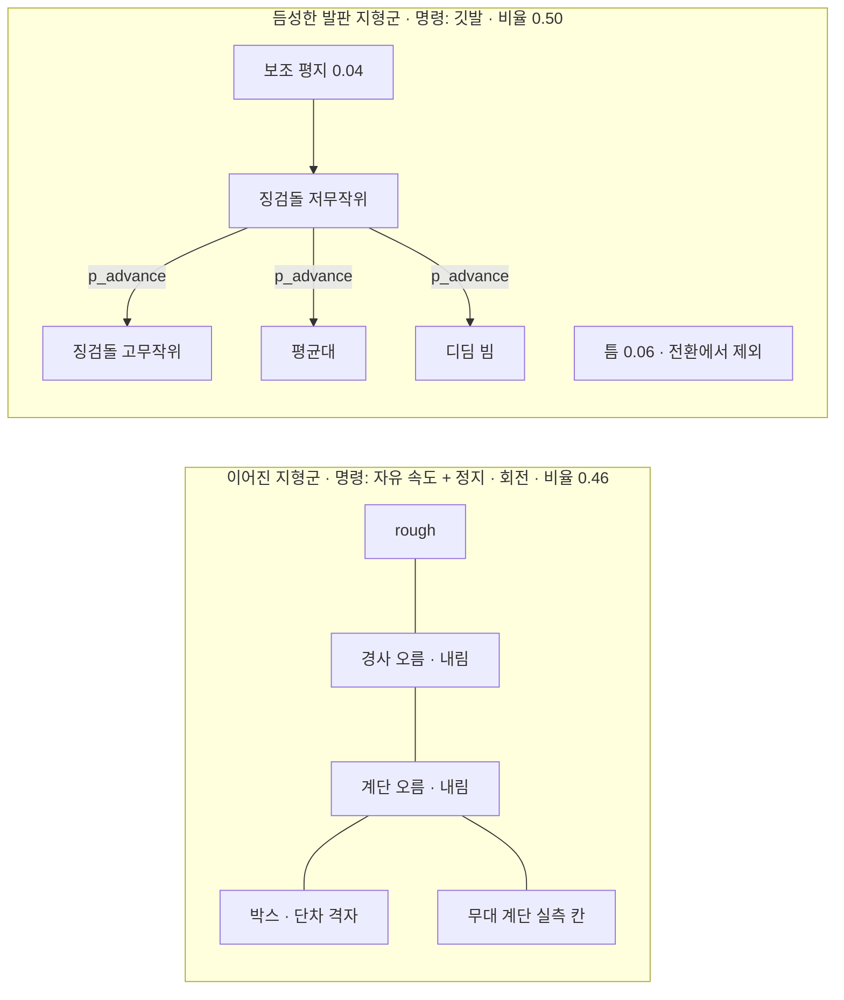

> 분류: A/정책학습 · 설계 (10 보행층 · 지형과 커리큘럼)
> 작성: 오흥재 (lead 세션 초안 · fable 20f 가 v1 으로 고쳐 씀)
> 근거: START 2512.13153v1 259~277 · 283~285 · 295 · 307~325 · 339~341 행 · 선행 2409.15692v2 280 · 284 행(부록 A · B) · Isaac Lab 2.3.2 `terrains/config/rough.py` 12~51 · `config/go2/rough_env_cfg.py` 25~27 · `velocity/mdp/curriculums.py` 47~51 · v2 보고서 6-4~6-8 · 7 절(883 행) · 14 문서 · REPORT-seokheon-ame2.md 4 절(125 행) · evidence/deep-research-start-* · VERIFY-fable-20f P17 · P24 · P34 · VERIFY-lead-final 13 · **APPROVED L(팀장 승인 10/20 00:4x · S2 20,000 회)** · Isaac Lab 2.3.2 `terrains/terrain_generator.py` 244~246 행(열 고정 배치) · **VERIFY-lead-final2 7 · 8(20j)** · **VERIFY-astra-final 4(20k)** · `terrain_generator.py` 335 · 373~388 행 · `terrain_importer.py` 319~329 행 · `manager_based_rl_env.py` 355~380 행 · VERIFY-astra-r1 §3~§6(20t · fable 재측: 공식 USD sha256 · usd-core 질량 합 · FK · 카메라 기하)
> 요지: 학습 지형을 「이어진」 · 「듬성한」 두 지형군으로 나누고, 칸은 8 × 8 m 정사각, 듬성한 지형은 START 치수와 10 레벨을 그대로, 이어진 지형은 Isaac Lab Go2 값을 쓴다. 지형 전환 커리큘럼 p_advance 의 값은 가정이고 T 는 반복 수다(S2 20,000 회에 맞춰 1,000 · 8,000, L). 이어진 지형을 더한 만큼 줄어든 듬성한 지형 노출은 반복 수 2 배로 START 이상으로 맞춘다(L). 평가에 쓰는 미경험 지형은 학습에서 빼서 「미경험」 주장을 지킨다
> 상태: v1.4 · 팀장 검토 전 · L · 20j · 20k(메타데이터 · 캐시 · reset 재배정 계약) · 결정 1(fable 20l) 반영 · 수치는 출처 등급(논문 · 선행 · 코드 · 실측 · 가정) · **20m 승인 차이 넷 반영(fable 10/20)** · **20o sonnet 가정 다섯 반영(fable 10/20)** · **20s lead 답 8 항 반영(fable 10/20)** · **20t ASTRA-R1 셋 반영(fable 10/20)**

# 15 · 지형과 커리큘럼

## 0. 쉬운 요약

로봇이 연습하는 땅은 가로 세로 8 m 짜리 정사각형 칸 500 개(10 줄 × 50 칸)다. 50 칸인 까닭은 Isaac Lab 이 지형 종류를 열마다 비율대로 「고정 배치」 하기 때문이다. 기본값 20 칸이면 4 % 짜리 지형이 한 칸도 못 받는다. 줄 번호가 난이도(레벨 0~9)다. 칸은 두 종류다. **이어진 지형**(계단 · 경사 · 박스 · 울퉁불퉁)은 Isaac Lab 이 이미 만들어 둔 것을 쓰고, **듬성한 지형**(징검돌 · 평균대 · 디딤 빔 · 틈)은 START 논문의 치수 그대로 우리가 새로 만든다. START 는 처음에 쉬운 징검돌과 평지에서만 연습시키다가, 학습이 진행될수록 일정 확률(p_advance)로 어려운 지형에 배정한다. 그 확률의 숫자는 논문에 없어서 우리가 정했다(가정). 평가용 「처음 보는 지형」 은 학습에 절대 넣지 않는다.

## 1. 그림



## 2. 칸과 격자 (공통)

| 항목 | 값 | 출처 |
|---|---|---|
| 칸 크기 | 8 × 8 m | **코드** `rough.py` 13 `size=(8.0, 8.0)`. START 는 8 × 4 m(**논문** 275 행). 정사각으로 둔 까닭은 14 문서 5 절(옆 방향 승급이 8 × 4 m 에서 기하적으로 불가, `curriculums.py` 49 는 `size[0] / 2` = 4 m) → 듬성한 지형에 대해서는 **가정**. **가정(sonnet)** 칸 안 배치(①②): START 시험지 8 × 4 m 무늬를 8 × 8 칸의 가운데 띠(y 2~6 m)에 놓고, 띠 밖 2 m 씩은 그 칸의 구덩이 바닥 높이로 잇는다(출발 · 도착 단은 칸 폭 전체). START 275 행에는 패치 8 × 4 m 만 있고 더 큰 칸 안 배치는 없다(원문에 없음 · 20o). 주의: START 는 패치 전폭이 지형이고 옆 이웃이 다른 패치라, 옆으로 2 m 벗어나면 우리는 구덩이(낙하 → 종료)이고 START 는 이웃 지형이다. 깃발 열이 y = 4 이고 듬성한 지형엔 자유 속도 명령이 없어(14 §3) 닿을 일은 드물다. 무늬를 8 m 전폭으로 까는 안은 lead 선택. 코드 `terrains/sparse_terrains.py` 3~4 · 21~23 · 60~66 · 151~152 행 |
| 레벨 수 | 10 | **논문** START 259 행 · **코드** `rough.py` 15 `num_rows=10`. **가정(sonnet)** 난이도 → 레벨(③): Isaac 이 생성기에 주는 난이도 d = (줄 + U[0, 1)) / 10(`terrain_generator.py` 260~262 행, `difficulty_range` 기본 (0, 1))을 레벨 = floor(10 × d) 로 되돌려 줄 번호와 같게 쓴다(`sparse_terrains.py` 50~51 행 · `bind_all` 215 행이 줄 ≠ 레벨이면 오류). START 259 행 「10 difficulty levels」 와 모순 없음(원문에 없음 · 20o). `difficulty_range` 를 (0, 1) 에서 바꾸면 깨진다 |
| 열 수 | **50** | **우리 변경**(Isaac Lab 기본 20, **코드** `rough.py` 16). Isaac Lab 은 열을 비율의 누적합으로 **고정 배치**한다(**코드** `terrain_generator.py` 244~246 행: `index / num_cols + 0.001 < cumsum(proportions)`). 20 열이면 0.04 · 0.02 비율이 0 열이 되어(경사 오름 0 · 보조 평지 0 · 이어진 합 0.50, fable 계산 10/20) L 결정의 노출 계산이 실제로는 성립하지 않는다(VERIFY-lead-final2 7). 50 열은 모든 비율이 0.02 의 배수라 열 수 = 비율 × 50 이 정수로 떨어진다(9 절 L0). 칸 500 개, env 4096 · 3072 는 열에 고루 배정. **S1-a 는 23 열**(이어진 지형군만 학습하므로 Isaac 이 비율 합 0.46 을 1 로 정규화하는데, 50 열에서는 0.10/0.46 × 50 = 10.87 열처럼 비정수가 되고 23 열이면 5 · 5 · 4 · 4 · 2 · 2 · 1 로 정수, **우리 변경** · lead 승인 10/20 · 20m · 코드 `terrains/columns.py` CONTINUOUS_COLS). 50 열은 S1-b · S2 의 전체 혼합용 |
| 높이 격자 | horizontal 0.1 m · vertical 0.005 m | **코드** `rough.py` 17~18. 듬성한 지형은 메시로 만든다(8 절) |
| 경계 | 20 m | **코드** `rough.py` 14 |
| 시작 레벨 상한 | `max_init_terrain_level` 2 | **실측** v2 7 절(883 행) |

## 3. 이어진 지형군

| 지형 | 생성기 (Isaac Lab 2.3.2) | 레벨 0 → 9 범위 | 비율 | 출처 |
|---|---|---|---|---|
| 계단 오름 | `MeshPyramidStairsTerrainCfg` | 단 높이 0.05 → 0.23 m · 너비 0.3 m | 0.10 | **코드** `rough.py` 22~29 |
| 계단 내림 | `MeshInvertedPyramidStairsTerrainCfg` | 같음 | 0.10 | **코드** 30~37 |
| 박스 | `MeshRandomGridTerrainCfg` | 격자 0.45 m · 높이 0.025 → 0.1 m | 0.08 | **코드** `rough_env_cfg.py` 25 (Go2 판 축소값) |
| rough | `HfRandomUniformTerrainCfg` | 잡음 0.01 → 0.06 m · step 0.01 | 0.08 | **코드** `rough_env_cfg.py` 26~27 |
| 경사 오름 · 내림 | `HfPyramidSlopedTerrainCfg` · `HfInvertedPyramidSlopedTerrainCfg` | 경사 0 → 0.4 | 0.04 · 0.04 | **코드** `rough.py` 44~49 |
| 무대 계단 | 계단 생성기에 치수 고정 | 실측 치수(가능하면) 또는 대표 칸 단 높이 0.15 m · 너비 0.3 m | 0.02 | **가정** (실측은 필수 아님, D27 · 41 §7. 디지털 트윈 Real2Sim 계단 메시가 있으면 그것을 씀. 평가 한 칸이지 초점이 아님, D22) |

지형군 합 0.46 은 **가정**이다(5 절). Isaac Lab 원본 비율은 계단 0.2 · 0.2 · 박스 0.2 · rough 0.2 · 경사 0.1 · 0.1(`rough.py`).

## 4. 듬성한 발판 지형군 (START 절대 치수 재현 시험 · START 그대로)

| 지형 | 최고 난이도 (논문) | 레벨 0 → 9 범위 (선행) | 출처 |
|---|---|---|---|
| 징검돌 | 희소율 76.3 %, 돌 0.2 m, 틈 x 0.25 m · y 0.175 m | 돌 0.5 → 0.2 m, 틈 x 0.175 → 0.25 m, 틈 y 0.1 → 0.175 m | **논문** 267~269 행(최고값) · **선행(START 미기재)** 284 행(레벨 범위) |
| 징검돌 무작위 | 돌마다 두 축 최대 0.5 × 틈, 열마다 x 최대 0.45 × 틈 | 0.0 → 최대 | **논문** 339~341 행. **선행**은 0.48 · 0.48(284 행, 값이 다름, START 우선). **가정(sonnet)** 학습용 두 열(④): 저무작위 징검돌 = 무작위 정도 r 0(돌 · 열 모두 안 흔듦), 고무작위 = r 1(돌 ±0.5 × 틈 · 열 ±0.45 × 틈), 둘 다 전 레벨 같은 r(`eval/start_sheet.py` 117~119 · 129~133 행 · `sparse_terrains.py` 28~30 행). 고무작위 r 1 의 크기와 두 기전은 **원문에 있음**(337~341 행 · Fig. 4(b) 223 행 「two levels of stone position randomization」). 저무작위 0 은 원문에 없음(223 · 285 행 「lower-randomness」 에 값 없음). **선행과 다름(참고)**: 선행 284 행은 무작위 크기를 레벨 따라 0.0 → 0.48 로 올리는데, 코드의 고무작위 열은 레벨 0(돌 0.5 m · 틈 0.175 m)에도 최대이고 저무작위 열은 레벨 9 에도 0 이다. 시험지 기본(`randomness=None`)은 레벨 비례. **채택(lead 20s · 가정)**: 고무작위 열 r = **레벨 비례**(레벨 L 에서 r = L / 9, 레벨 9 가 START 최대값 돌 ±0.5 · 열 ±0.45 × 틈 · 선행 284 행 0.0 → 0.48 의 꼴 · 시험지 기본과 같은 꼴), 저무작위 열 r = 0 유지(START 223 · 285 행 「lower-randomness」 값 없음). sonnet 코드(`sparse_terrains.py` 28~30 · `start_sheet.py` 117~119 · 129~133 행) 수정 대기(sonnet) |
| 평균대 | 폭 0.175 m | 엇갈린 돌 두 줄 → 한 줄 | **논문** 269 행 · **선행** 284 행 |
| 디딤 빔 | 희소율 64.7 %, 빔 0.15 m, 틈 0.275 m | 네 줄 돌 → 빔 열 | **논문** 271~273 행 · **선행** 284 행 |
| 틈 | 폭 0.7 m(START 절대 치수. 「로봇 길이 2 배」 해석은 지움 · 20t) | 0.1 → 0.7 m | **논문** 273~275 행 · **선행** 284 행 |
| 공통 | 지형 깊이 U[0.2, 0.7] m, 돌 · 빔 높이 ±5 cm | | **논문** 275~277 행 (**선행**은 0.3~0.7, START 우선) |

**이 표는 START 절대 치수 재현 시험이다(ASTRA R1-2 · 20t).** Go2 와 Lite3 몸 크기 차이로 치수를 바꾸지 않는다(타협 원칙 ②는 「논문 규칙으로」 이고 DECISIONS S1 「논문값 그대로」). 같은 치수가 두 로봇에 같은 상대 난이도라는 주장은 하지 않는다(**판단 보류** · 축마다 비율이 다르다). 결과를 읽는 기준은 아래 축별 비율이고, 성능을 보고 뒤늦게 치수를 조정하는 기준으로는 쓰지 않는다. 41 §6 도 이 표를 가리킨다.

| 축 | Go2 / Lite3 | 결과 해석에 쓰는 뜻 | 출처 |
|---|---|---|---|
| 앞뒤 hip 축 간격 | 0.3868 / 0.349 = **1.108** | 틈 0.7 m 는 Go2 hip 간격의 1.81 배, Lite3 의 2.01 배 | ASTRA R1 §5 · fable 재측(17 §2) |
| thigh · calf 길이 | 0.213 / 0.200 = **1.065** | 발 도달 범위 | 같음 |
| hip = 0 의 좌우 thigh 축 간격 | 0.284 / 0.321 = **0.885** | 평균대 0.175 m 는 Go2 축 간격의 0.616 배, Lite3 의 0.545 배(Go2 가 상대적으로 넓은 발판이지만 기본 자세 발 간격은 0.345 m · 17 §2) | 같음 |
| 발 충돌 구 지름 | 0.044 / 0.080 = **0.55** | 구 투영을 발판 안에 다 넣는 보수 조건 「폭 − 지름」 은 돌 0.156 / 0.120 · 평균대 0.131 / 0.095 · 빔 0.106 / 0.070 m(Go2 / Lite3). 실제 접촉 패치 · 16 가장자리 띠와 별개 | 같음 |
| URDF 총질량 | 16.142 / 9.038 = **1.79**(MGDP 두 자산 · 학습 자산 USD 는 15.019) | 길이 비율로 토크 · 관성 · 도약 성능까지 맞출 수 없다(effort 비 hip · thigh 0.59 · calf 0.70). Go2 가 네 지형을 다 배울 수 있는지는 **판단 불가** | 같음 |

**물러나기 지원(D39).** 깃발 생성기는 env 마다 「지난 깃발」 을 보관한다(14 §3 물러나기 모드가 직전 깃발 방향을 쓴다). 지형 자체는 바꾸지 않는다. 물러날 때 디딜 곳은 지나온 발판이므로 새 발판이 필요 없다.

**이어진 지형의 깃발 열(14 §3 · 우리 변경).** 이어진 지형 칸에도 깃발 열(칸 가운데에서 +x 로 0.5 · 1.5 · 2.5 · 3.5 m, 1 m 간격 · 칸 경계 0.5 m 안쪽, **코드** sonnet 5a2a7257 `commands/mixed_core.py` 259~269 행 · lead 확정 10/20 · 20m #3)을 두어 env 의 20 % 가 깃발 방식을 쓴다. 생성기 출력은 깃발 목록 `(N, K, 2)` 하나로 같다.

**틈 지형의 방향.** START 의 틈은 x 방향 한 줄이다. 깃발 방식이면 로봇이 깃발을 향해 틈을 건너므로 한 줄로 충분하다. v2 의 `omni_gap`(스폰 둘레 고리, 반지름 2.5 m)은 자유 속도 명령의 노출을 위해 만든 것이다(v2 보고서 6-6). 듬성한 지형군은 깃발을 쓰므로 START 한 줄 틈을 쓰고, 이어진 지형군에는 틈을 넣지 않는다 → **가정** (H15-2 로 검증). 그래서 S1-a 지형에는 틈 · rails 가 없고, S1-scan 관문의 「v2 이상」 판정에서 gap · rails · floating_ring 칸은 빼고 기록만 한다(**팀장 결정 1** 10/20 09:4x · 41 §9). 이 문단의 근거(한 줄 틈 · 깃발)는 그대로다.

## 5. 비율과 지형 전환 커리큘럼

| 지형 | 비율 | 출처 |
|---|---|---|
| 이어진 지형군 합 | 0.46 | **가정** |
| 징검돌(저 · 고무작위) + 평균대 + 디딤 빔 | 0.44 (열 배정용 세부: 징검돌 저무작위 0.14 · 고무작위 0.10 · 평균대 0.10 · 디딤 빔 0.10, 전부 0.02 배수) | **가정**(세부 비율도 가정) |
| 틈 | 0.06 | **가정** |
| 보조 평지 | 0.04 | **논문** 존재만(295 행), 비율 **가정** |

**열 배정(50 열 · Isaac 고정 배치)**: 계단 오름 5 · 내림 5 · 박스 4 · rough 4 · 경사 오름 2 · 내림 2 · 무대 계단 1 · 징검돌 저 7 · 고 5 · 평균대 5 · 디딤 빔 5 · 틈 3 · 보조 평지 2 = 50(fable 계산 10/20, `terrain_generator.py` 244~246 식 그대로). 20 열이면 경사 오름 0 · 보조 평지 0 · 경사 내림 1 · 무대 1 이 되어 비율이 깨진다(9 절 negative control). **S1-a(이어진 7 종만 · 23 열, 20m)**: 계단 오름 5 · 내림 5 · 박스 4 · rough 4 · 경사 오름 2 · 내림 2 · 무대 계단 1 = 23(같은 식, 코드 `columns.column_assignment`).

**p_advance 는 Isaac Lab 에 없는 것이라 직접 구현한다**(`terrains/progression.py`, 18 §6 · **우리 구현**, 논문은 식만): 재추출(에피소드 리셋) 때 듬성한 env 의 원점을 저무작위 징검돌 · 보조 평지 열에서 확률 p_advance 로 고무작위 징검돌 · 평균대 · 디딤 빔 열로 옮기는 env 원점 재배정 term 이다. 틈 열은 전환에서 빠진다(아래). **매 reset 마다 전환 대상 집단 전체를 다시 뽑는다**: 전환 대상(듬성한 env 가운데 틈 열이 아닌 것)은 어느 열에 있었든 reset 때 확률 p_advance(T) 로 어려운 열(고무작위 · 평균대 · 빔), 1 − p_advance(T) 로 쉬운 열(저무작위 징검돌 · 보조 평지)에 배정된다. 쉬운 열의 env 에만 누적 적용하면 어려운 열이 흡수 상태가 되어 T 가 커진 뒤에도 쉬운 열 노출이 0 으로 떨어지므로 그렇게 하지 않는다(**가정** · START 원문은 명시 없음 · VERIFY-astra-final 4). 전환 대상 · 틈 제외 · 이어진 집단의 구분은 env 마다 보관한 집단 태그로 하고 현재 열 이름에서 역산하지 않는다.

START 지형 전환(**논문** 307~325 행, 인쇄 오류 정정):

```
p_advance(T) = min( max( p_max · (T − T_start) / (T_end − T_start), 0 ), p_max )
```

- 인쇄된 식 `max(min(·, 0), p_max)` 는 늘 `p_max` 가 된다. ASTRA 19g 와 deep-research 가 같은 판단 → 정정은 **논문 오류 정정**으로 기록. 선행 논문도 같은 오류(evidence/maicode-trcr-deep).
- **T 는 PPO 반복 수**(**가정**, 원문에 단위 없음). `p_max = 0.9 · T_start = 1,000 · T_end = 8,000` 은 **가정**이고(**우리 변경** · APPROVED L: S2 반복 수 20,000 에 맞춰 10,000 회 기준이던 500 · 4,000 을 같은 비율 5 % · 40 % 로 2 배), 숫자는 START · 선행 · 중국어 자료 어디에도 없다(evidence/deep-research-*). 왜 이 값인가: 20,000 회 학습의 앞 5 % 는 쉬운 징검돌에서 걸음을 익히고(START 295 행의 뜻), 40 % 지점까지 어려운 지형 배정을 0.9 까지 올리면 뒤 60 % 는 모든 지형에 노출된다. 12 · 53 문서는 이 절을 가리킨다.
- AdaSmpl 의 p_smpl 과는 다른 변수다(12 문서 4 절 · ASTRA 19g 1 절 4).
- 처음에는 듬성한 지형 env 를 저무작위 징검돌 + 보조 평지에 두고, `p_advance` 확률로 고무작위 징검돌 · 평균대 · 디딤 빔에 배정한다. 틈은 이 전환에서 빠진다(**논문** 321~325 행).
- **이어 학습판의 T 기준**(VERIFY-lead-final 7): S1-b(S1-a 체크포인트에서 3,000 회 이어 학습)와 S4(S2 에서 5,000 회)는 T 를 그 판의 자체 반복 수(0 부터)로 세고 T_start 0 · T_end 를 그 판 반복 수의 절반(S1-b 1,500 · S4 2,500)으로 따로 등록한다(**가정**). 처음부터 20,000 회인 S2-G0 · G1 · G3 만 1,000 · 8,000 을 쓴다(L).
- **START 대비 우리 변경 · 노출은 START 이상(VERIFY-lead-final 13 → 팀장 결정 APPROVED L, 10/20 00:4x)**: START 의 학습 지형은 듬성한 4 종 + 초기 보조 평지뿐이다(**논문** 259~263 · 293~295 행). 우리는 이어진 지형군 0.46 을 더했으므로 같은 10,000 회에서 듬성한 지형 노출은 START 의 약 0.5 배가 된다. 팀장 지적: 절반이면 G3 가 실패했을 때 「방법 탓인지 연습 부족인지」 를 가를 수 없다. **결정: S2 반복 수 10,000 → 20,000(S2-G0 · G1 · G3 모두 같은 조건), 위 표의 지형 비율 0.46 / 0.50 / 0.04 는 그대로(바꾸는 것 하나).** 듬성한 지형 노출 = 0.50 × 20,000 = 10,000 회분 ≈ START 10,000 회의 1.0 배(**가정**: START 의 초기 보조 평지 몫은 작다고 봄). 노출량(듬성한 지형 env · 스텝 수)은 그래도 로그로 기록해 결과에 적는다. 시간은 18 §4(판당 36~60 h · G0 18~28 h), 날짜는 70 §1.2. 90 Q2 는 이것으로 닫힘(D51).

## 6. 승급 · 강등

14 문서 5 절을 따른다. 요약: 깃발 지형은 깃발 전부 통과로 승급 · 절반 미만으로 강등(**코드** JEPLO 868~872), 자유 속도 지형은 명령 벡터 합 기준(**코드** JEPLO `command_curriculum.py` 32~46), 정지 · 회전 env 는 판정 제외(**가정**). 석헌 AME-2 의 「gap · beam 은 실패해도 4 m 밖으로 안 나가 강등되지 않음」(**실측** REPORT-seokheon-ame2.md 125 행) 을 막는 것이 깃발 강등 규칙이다.

## 7. 학습 지형과 평가 지형 분리

v2 축 1 은 학습 6 종 + 미경험 10 종이다(evidence/E1-vs-v2-axis1.csv `set` 열). 새 학습에 틈 · 징검돌이 들어가므로 아래처럼 다시 나눈다. v2 가 `rails` 를 학습에 넣으면서 「미경험」 에서 뺀 것과 같은 규칙이다(v2 보고서 6-8).

| v2 미경험 10 종 | 새 분류 |
|---|---|
| gap · stepping_stones · floating_ring | 학습 지형군과 같은 종류 → **학습 지형군 시험**으로 옮김 (미경험 주장에서 뺌). S1-scan 관문(S1-a 는 이 지형을 안 배움)에서는 gap · floating_ring(+ rails) 칸을 판정에서 빼고 기록만(결정 1 · 41 §9) |
| rails | v2 부터 이미 학습 지형 |
| pit · star · wave · discrete_obstacles · repeated_boxes · repeated_cylinders | **미경험 6 종**으로 유지 |

판정 규칙과 칸 수는 41 문서에서 학습 전에 등록한다.

## 8. 구현 방법

- 자리: `foothold_s2/terrains/` 아래 `rough_go2_cfg.py`(3 절, `rough.py` 복제 cfg) · `sparse_terrains.py`(`SubTerrainBaseCfg` 상속 메시 생성기 넷: 징검돌 · 평균대 · 디딤 빔 · 틈, 각 생성기는 깃발 목록을 함께 돌려줌) · `edge_mask.py`(16 문서 마스크) · `progression.py`(5 절 p_advance 배정 term).
- 참고 구현(식만, 복사 금지): JEPLO `parkour_sub_terrains_cfg.py`(GPLv3), 석헌 `custom_terrains.py`(팀 내부, REPORT-seokheon-ame2.md 4 절).
- 가장자리 마스크: 높이장 → 메시 변환 때 「낙하 높이 ≥ 0.2 m 인 세로 모서리」 를 찾아 2.5 · 5 cm 띠로 팽창(**선행** 280 행의 방법 + 문턱은 **가정**). 이렇게 두면 이어진 지형의 계단 모서리(단 높이 ≤ 0.23 m 이지만 계단 아래는 바닥이 있어 「낙하」 가 아님)는 마스크에 들어가지 않아 보상식을 지형군별로 끄지 않아도 된다(VERIFY 20f P34).
- 이 생성기는 S0 START 시험지(41 · 51) · S1-b(52) · S2(53) · 주행층 환경(22) 에 공유된다. 그래서 **S0 에서 가장 먼저 만든다**(70 일정).

### 8.1 메시 · 깃발 · 마스크의 좌표 · 캐시 계약과 reset 재배정 순서 (20k · VERIFY-astra-final 4)

설치 Isaac Lab 2.3.2 의 생성기 호출은 **정확히 `(meshes, origin)` 두 값**만 받는다(`terrain_generator.py` 381 행 `meshes, origin = cfg.function(difficulty, cfg)`). 깃발을 세 번째 반환값으로 더하면 즉시 실패하고, 캐시도 `mesh.obj` · `origin.csv` 만 복원한다(373~378 행). 원점만 옮기고 깃발 · 마스크를 옛 칸에 두면 다른 지형의 목표를 추종한다. 계약:

| 항목 | 계약 | 근거 |
|---|---|---|
| 반환 규약 | `sparse_terrains.py` 의 생성기 함수는 Isaac 규약대로 `(meshes, origin)` 만 돌려준다. 깃발 열 `flags (K, 2)` · 가장자리 마스크 `mask (H, W)` · 집단 태그 `kind` 는 **side table** `TerrainMeta[(row, col)]` 에 둔다(생성기 함수가 호출 때 모듈 전역 레지스트리에 (difficulty, cfg 해시) 키로 적고, 어댑터가 (row, col) 로 옮겨 담음) | **코드** 381 행 |
| 좌표 변환 | Isaac 은 패치 메시를 중심으로 −size/2 만큼 옮긴 뒤(383~388 행) `(row + 0.5) · size[0], (col + 0.5) · size[1]` 만큼 세계 좌표로 옮긴다(335 행). flags · mask 좌표에도 **같은 두 변환을 같은 순서로** 적용한다. mask 는 전역 격자(500 칸 × 8 m / 0.05 m)에 세계 좌표로 심는다(구현 3b056d41 은 전역 격자 대신 **칸별 2.5 cm 격자**를 (줄, 열)로 색인하고 발 좌표에서 칸 모서리 (줄 × 8, 열 × 8) 을 빼 조회한다, `rewards/core.py` 118~135 행 · 16 §2 가정(sonnet) · 20o. 효과는 같다) | **코드** 335 · 383~388 행 |
| 캐시 | Isaac 캐시 디렉터리(패치 cfg 해시)와 **같은 키**로 `flags.npy` · `mask.npy` · `meta.yaml` 을 함께 저장 · 복원한다. 캐시 적중 때 Isaac 이 mesh · origin 을 복원하는 그 순간 side table 도 복원한다. 키에 생성기 코드 버전 해시를 넣어 코드가 바뀌면 캐시가 무효 | **가정**(구현) |
| reset 재배정 순서 | 설치 `_reset_idx`(`manager_based_rl_env.py` 355~380 행) 순서 그대로: ① `curriculum_manager.compute` 에서 지난 에피소드 승급 · 강등(14 §5) 과 **p_advance 재표집**(5 절)을 먼저 계산해 `terrain_levels` · `terrain_types`(열 인덱스)를 갱신하고 `env_origins = terrain_origins[level, type]`(`terrain_importer.py` 319~329 행 `update_env_origins` 는 level 만 바꾸므로 type 까지 바꾸는 우리 term 으로 대체) ② `scene.reset` ③ event reset(root pose 는 새 origin) ④ observation · action · reward · curriculum reset ⑤ **command reset: 새 (level, type) 의 flags 를 side table 에서 읽어 깃발 목록 `(N, K, 2)` 를 바꾸고 「지난 깃발」 을 비움**(14 §8) ⑥ event reset 마무리. 보상의 가장자리 마스크는 env 별 복사가 아니라 전역 격자를 발 세계 좌표로 조회하므로 원점이 바뀌어도 자동으로 새 칸을 본다 | **코드** 355~380 행 · **가정**(term 구현) |
| 시험(§9) | 캐시 없음 · 캐시 재사용 두 번 모두 flags 의 세계 좌표가 같고(1e-6), env 를 다른 열로 옮긴 뒤 깃발이 **새 칸의 발판 위**(마스크 밖 · 높이 격자에서 바닥 있음)에 놓이며, 틈 열 env 는 전환되지 않고, 이어진 집단 태그가 유지된다 | |

## 9. 검증 사다리

| 단 | 무엇 | 통과 |
|---|---|---|
| L0 CPU | 징검돌 생성기: 레벨 9 에서 희소율이 76.3 % ± 2 %p, 돌 0.2 m, 틈 0.25 × 0.175 m. 레벨 0 에서 돌 0.5 m. negative control: 레벨 10 요청은 오류 | 치수 |
| L0 CPU | 마스크: 0.3 m 틈 양쪽 2.5 cm 띠가 1, 계단(낙하 0.23 m) 모서리는 0 | 기대 격자 |
| L0 CPU | p_advance(0) = 0 · (1,000) = 0 · (2,250) = 0.161 · (4,500) = 0.45 · (8,000) = 0.9 · (9,000) = 0.9 (T_start 1,000 · T_end 8,000 · p_max 0.9, L. 옛 500 · 4,000 기준값은 지움, VERIFY-lead-final2 8) | 식 · 1e-3 |
| L0 CPU | 열 배정: `terrain_generator.py` 244~246 식으로 50 열이면 각 지형 열 수 = 비율 × 50(계단 5 · 5 · 박스 4 · rough 4 · 경사 2 · 2 · 무대 1 · 징검돌 7 · 5 · 평균대 5 · 빔 5 · 틈 3 · 평지 2, 합 50). S1-a 23 열(이어진 7 종만)이면 5 · 5 · 4 · 4 · 2 · 2 · 1(합 23, 20m). negative control: 20 열이면 경사 오름 0 · 보조 평지 0 이 나와야 함 | 정수 일치 |
| L0 CPU | p_advance 재배정: 듬성한 env 1,000 개를 T = 8,000 에서 재추출하면 고무작위 · 평균대 · 빔 열로 옮겨진 비율 0.9 ± 0.03, T = 1,000 에서는 0. 틈 열 env 는 옮겨지지 않음. **어려운 열에 있던 env 도 매 reset 때 다시 뽑혀** 쉬운 열로 돌아오는 비율이 1 − p_advance ± 0.03 | 통계 |
| L0 CPU | 메타데이터 좌표(8.1): 같은 cfg 로 캐시 없음 · 캐시 재사용 두 번 생성한 flags 세계 좌표가 1e-6 안에서 같고, (row 3, col 7) 의 깃발이 그 칸 경계 안이며 마스크 밖 · 높이 격자 바닥 위. negative control: side table 을 비우고 reset 하면 command reset 이 오류 | 기대값 |
| L0 CPU | reset 재배정 순서(8.1): env 하나를 (level 2, 저무작위 열) → (level 2, 평균대 열) 로 옮기는 reset 뒤 env_origin · 깃발 목록 · 지난 깃발 · 집단 태그가 모두 새 칸 기준이고, 옛 칸 깃발이 남아 있지 않음 | 검사 |
| L1 Kit | 500 칸 메시가 뜨고 env 원점 · 깃발 목록 모양 `(N, K, 2)` 가 맞음, 첫 10 update Traceback 0 | 로그 |
| L2 | 첫 500 회 레벨 분포 · 전환 배정 비율이 로그에 찍힘 | 로그 |

## 10. 검증할 가설

| # | 가설 | 어떻게 보나 |
|---|---|---|
| H15-1 | 8 × 8 m 칸이 듬성한 지형 학습을 해치지 않는다 | START 식 8 × 4 m 칸 대조와 레벨 분포 비교(짧은 판) |
| H15-2 | 듬성한 지형의 한 줄 틈 + 깃발로 틈 노출이 유지된다 | 틈 칸 레벨 분포 중앙값 ≥ 5 at S1-b 3,000 회 · S2 6,000 회(20,000 회 기준, L), 축 1 gap 칸 ≥ 0.99 |
| H15-3 | `p_advance` 가정값(1,000 · 8,000)이 학습을 막지 않는다 | 고무작위 · 빔 칸 배정 비율 대 승급 곡선. 60 A 의 신호 「6,000 회에 틈 레벨 중앙값 < 3」(S2 20,000 회 기준, L · 53 §6) |
| H15-4 | 낙하 높이 0.2 m 마스크 문턱이 계단을 edge 로 잡지 않는다 | 계단 칸 마스크 합 = 0 |

## 11. 열린 항목

- 무대 계단 실측(단 높이 · 디딤폭 · 폭 · 재질) · 트윈 메시 여부.
- `p_max · T_start · T_end` 의 최종값(가정 유지 또는 짧은 시험으로 고름).
- 지형 비율 0.46 / 0.50 / 0.04 의 근거 실험 여부.
- 주행층 학습 환경(22)에 이 생성기를 재사용하는 규칙(패치 크기 · 난이도 상한).
