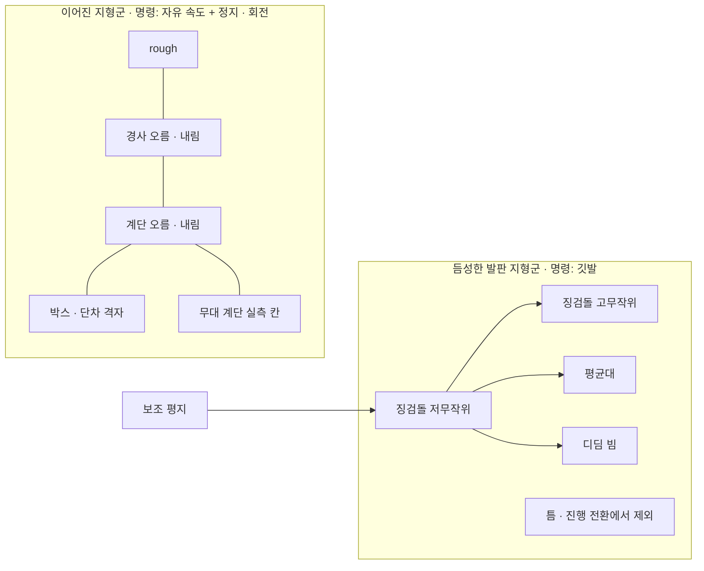

> 분류: A/정책학습 · 설계 (10 보행층 · 지형과 커리큘럼)
> 작성: 오흥재 (lead 세션 작성)
> 근거: START 2512.13153v1.txt 259~277 · 295~341 행 · 2409.15692v2.txt 284 행(부록 B) · Isaac Lab 2.3.2 `terrains/config/rough.py` · `config/go2/rough_env_cfg.py` 24~27 · v2 보고서 6-4~6-8 · 7 절 · 14-COMMAND-GENERATOR.md · REPORT-seokheon-ame2.md 4 절
> 요지: 학습 지형을 「이어진」 · 「듬성한」 두 지형군으로 나누고, 칸은 8 × 8 m 정사각, 듬성한 지형은 START 치수와 10 레벨을 그대로, 이어진 지형은 Isaac Lab Go2 값을 쓴다. 평가에 쓰는 미경험 지형은 학습에서 빼서 「미경험」 주장을 지킨다
> 상태: 초안 · 팀장 검토 전 · 수치는 출처 등급(논문 · 선행 · 코드 · 실측 · 가정)을 붙임

# 15 · 지형과 커리큘럼

## 1. 그림



## 2. 칸과 격자 (공통)

| 항목 | 값 | 출처 |
|---|---|---|
| 칸 크기 | 8 × 8 m | **코드** Isaac Lab `rough.py` `size=(8.0, 8.0)`. START 는 8 × 4 m (**논문** 275 행). 정사각으로 둔 까닭은 14 문서 5 절(옆 방향 승급이 8 × 4 m 에서 기하적으로 불가) → 듬성한 지형에 대해서는 **가정** |
| 레벨 수 | 10 | **논문** START 259 행 · **코드** `rough.py` `num_rows=10` |
| 열 수 | 20 | **코드** `rough.py` `num_cols=20` |
| 높이 격자 | horizontal 0.1 m · vertical 0.005 m | **코드** `rough.py`. 듬성한 지형은 메시로 만든다(5 절) |
| 경계 | 20 m | **코드** `rough.py` `border_width=20.0` |

## 3. 이어진 지형군

| 지형 | 생성기 (Isaac Lab 2.3.2) | 레벨 0 → 9 범위 | 비율 | 출처 |
|---|---|---|---|---|
| 계단 오름 | `MeshPyramidStairsTerrainCfg` | 단 높이 0.05 → 0.23 m · 너비 0.3 m | 0.10 | **코드** `rough.py` |
| 계단 내림 | `MeshInvertedPyramidStairsTerrainCfg` | 같음 | 0.10 | **코드** |
| 박스 | `MeshRandomGridTerrainCfg` | 격자 0.45 m · 높이 0.025 → 0.1 m | 0.08 | **코드** Go2 판 `rough_env_cfg.py` 25 |
| rough | `HfRandomUniformTerrainCfg` | 잡음 0.01 → 0.06 m | 0.08 | **코드** Go2 판 26~27 |
| 경사 오름 · 내림 | `HfPyramidSlopedTerrainCfg` · `HfInvertedPyramidSlopedTerrainCfg` | 경사 0 → 0.4 | 0.04 · 0.04 | **코드** `rough.py` |
| 무대 계단 | 계단 생성기에 실측 치수 고정 | 실측 후 | 0.02 | **가정** (무대 단 높이 · 디딤폭 · 폭 · 마찰 실측 전까지 비워 둠, 42 문서) |

지형군 합 0.46 은 **가정**이다(5 절 비율 근거).

## 4. 듬성한 발판 지형군 (START 그대로)

| 지형 | 최고 난이도 | 레벨 0 → 9 범위 | 출처 |
|---|---|---|---|
| 징검돌 | 희소율 76.3 %, 돌 0.2 m, 틈 x 0.25 m · y 0.175 m | 돌 0.5 → 0.2 m, 틈 x 0.175 → 0.25 m, 틈 y 0.1 → 0.175 m | **논문** 267~269 · **선행** 부록 B |
| 징검돌 무작위 | 돌마다 두 축 최대 0.5 × 틈, 열마다 x 최대 0.45 × 틈 | 0.0 → 최대 | **논문** 337~341. **선행** 은 0.48 · 0.48 (값이 다름, START 우선) |
| 평균대 | 폭 0.175 m | 엇갈린 돌 두 줄 → 한 줄 | **논문** 269 · **선행** 부록 B |
| 디딤 빔 | 희소율 64.7 %, 빔 0.15 m, 틈 0.275 m | 네 줄 돌 → 빔 열 | **논문** 271~273 · **선행** 부록 B |
| 틈 | 폭 0.7 m (로봇 길이 2 배) | 0.1 → 0.7 m | **논문** 273~275 · **선행** 부록 B |
| 공통 | 지형 깊이 U[0.2, 0.7] m, 돌 · 빔 높이 ±5 cm | | **논문** 275~277 (**선행** 은 0.3~0.7, START 우선) |

Go2 와 Lite3 몸 크기 차이로 치수를 바꾸지 않는다(타협 원칙 ①, DECISIONS S1 「논문값 그대로」).

**틈 지형의 방향.** START 의 틈은 x 방향 한 줄이다. 깃발 방식이면 로봇이 깃발을 향해 틈을 건너므로 한 줄로 충분하다. v2 의 `omni_gap`(스폰 둘레 고리, 반지름 2.5 m)은 자유 속도 명령의 노출을 위해 만든 것이다(v2 보고서 6-6). 듬성한 지형군은 깃발을 쓰므로 START 한 줄 틈을 쓰고, 이어진 지형군에는 틈을 넣지 않는다 → **가정** (H15-2 로 검증).

## 5. 비율과 지형 전환 커리큘럼

| 지형 | 비율 | 출처 |
|---|---|---|
| 이어진 지형군 합 | 0.46 | **가정** |
| 징검돌(저 · 고무작위) + 평균대 + 디딤 빔 | 0.44 | **가정** |
| 틈 | 0.06 | **가정** |
| 보조 평지 | 0.04 | **논문** 존재만(295 행), 비율 **가정** |

START 지형 전환(논문 307~325 행, 인쇄 오류 정정):

```
p_advance(T) = min( max( p_max · (T - T_start) / (T_end - T_start), 0 ), p_max )
```

- 인쇄된 식 `max(min(·, 0), p_max)` 는 늘 `p_max` 가 된다. ASTRA 19g 와 deep-research 가 같은 판단 → 정정은 **논문 오류 정정**으로 기록.
- `p_max · T_start · T_end` 숫자는 START · 선행 · 중국어 자료 어디에도 없음(evidence/deep-research-*). 1 차 값 `p_max = 0.9 · T_start = 500 · T_end = 4000` 은 **가정**이고, ASTRA 19g 지적대로 AdaSmpl 의 확률과 다른 변수다.
- 처음에는 듬성한 지형 env 를 저무작위 징검돌 + 보조 평지에 두고, `p_advance` 확률로 고무작위 징검돌 · 평균대 · 디딤 빔에 배정한다. 틈은 이 전환에서 빠진다(**논문** 325 행).

## 6. 승급 · 강등

14 문서 5 절을 따른다. 요약: 깃발 지형은 깃발 전부 통과로 승급 · 절반 미만으로 강등(**코드** JEPLO), 자유 속도 지형은 명령 벡터 합 기준(**코드** JEPLO `command_curriculum.py`), 정지 · 회전 env 는 판정 제외(**가정**). 시작 레벨 상한 `max_init_terrain_level` 은 v2 값 2(**실측** v2 7 절)로 두고, 석헌 AME-2 의 「gap · beam 은 실패해도 4 m 밖으로 안 나가 강등되지 않음」(REPORT-seokheon-ame2.md 4 절) 을 막는 것이 깃발 강등 규칙이다.

## 7. 학습 지형과 평가 지형 분리

v2 축 1 은 학습 6 종 + 미경험 10 종이다(evidence/E1-vs-v2-axis1.csv). 새 학습에 틈 · 징검돌이 들어가므로 아래처럼 다시 나눈다. v2 가 `rails` 를 학습에 넣으면서 「미경험」 에서 뺀 것과 같은 규칙이다(v2 보고서 6-8).

| v2 미경험 10 종 | 새 분류 |
|---|---|
| gap · stepping_stones · floating_ring | 학습 지형군과 같은 종류 → **학습 지형군 시험**으로 옮김 (미경험 주장에서 뺌) |
| rails | v2 부터 이미 학습 지형 |
| pit · star · wave · discrete_obstacles · repeated_boxes · repeated_cylinders | **미경험 6 종**으로 유지 |

판정 규칙과 칸 수는 41 문서에서 학습 전에 등록한다.

## 8. 구현 방법

- 이어진 지형: Isaac Lab `TerrainGeneratorCfg` 에 위 3 절 하위 지형을 그대로 등록(`isaaclab/terrains/config/rough.py` 를 복제한 우리 cfg).
- 듬성한 지형: `SubTerrainBaseCfg` 를 상속한 메시 생성기 넷(징검돌 · 평균대 · 디딤 빔 · 틈). 각 생성기는 깃발 목록(건너편 지점 열)을 함께 돌려준다. 참고 구현: JEPLO `parkour_sub_terrains_cfg.py`(GPLv3, 식만 참고), 석헌 `custom_terrains.py`(팀 내부, `REPORT-seokheon-ame2.md` 4 절).
- 가장자리 마스크(16 문서): 높이장 → 메시 변환 때 경사 문턱으로 세로 모서리를 찾아 팽창(**선행** 부록 A). 같은 생성기에서 만든다.
- 지형 전환: 듬성한 지형 env 의 칸 배정 함수에 `p_advance(T)` 를 넣는다(커리큘럼 term).

## 9. 검증할 가설

| # | 가설 | 어떻게 보나 |
|---|---|---|
| H15-1 | 8 × 8 m 칸이 듬성한 지형 학습을 해치지 않는다 | START 식 8 × 4 m 칸 대조와 레벨 분포 비교(짧은 판) |
| H15-2 | 듬성한 지형의 한 줄 틈 + 깃발로 틈 노출이 유지된다 | 틈 칸 레벨 분포, 축 1 gap 칸 |
| H15-3 | `p_advance` 가정값이 학습을 막지 않는다 | 고무작위 · 빔 칸 배정 비율 대 승급 곡선 |

## 10. 열린 항목

- 무대 계단 실측(단 높이 · 디딤폭 · 폭 · 재질).
- `p_max · T_start · T_end` 의 최종값과 근거(가정 유지 또는 짧은 시험으로 고름).
- 지형 비율 0.46 / 0.50 / 0.04 의 근거 실험 여부.
- 주행층 학습 환경(22 문서)에 이 생성기를 재사용하는 규칙.
