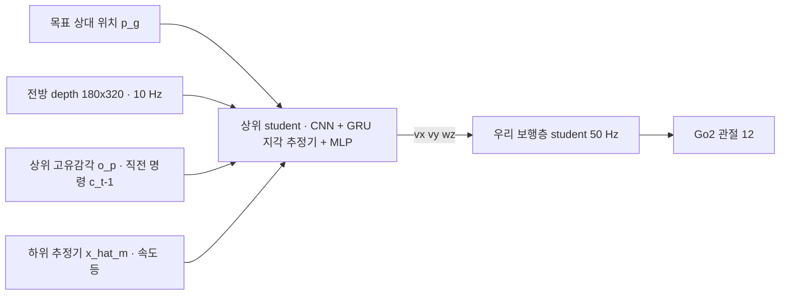
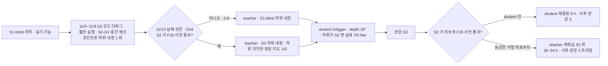

> 분류: A/정책학습 · B/항법 · 설계 (20 주행층 · HiPAN 상위 정책)
> 작성: 오흥재 (lead 세션 초안 · fable 20f 가 v1 으로 고쳐 씀)
> 근거: HiPAN 2604.26504.txt 42 · 279~291 · 322~336 · 338~368 · 478~496 · 526~535 · 538~585 · 630 · 632 · 645~700 · 728 · 754~756 · 876~882 행 · HiPAN PDF 5 쪽(depth 증강 문장 · r2 의 √) · evidence/maicode-hipan-deep.analysis.json · `inbox/jay/20261018-next-arch/SPEC-hipan-go2.md` 79 · 149 · 151~161 행 · fable 20e F21 · F26 · 18 §4 · 41 §9 · APPROVED H(판단층 shadow 확정) · VERIFY-fable-20f P6 · P7 · P28 · P30
> 요지: 상위 정책은 HiPAN 그대로 depth 를 보고 10 Hz 로 명령을 낸다. 다만 출력은 우리 보행층 명령 세 칸(vx · vy · wz)만 쓰고, 학습 중 환경 안에 실제 우리 하위 student 를 넣는다. 하위가 바뀌면 F26 사전 관문 뒤 student 를 재증류하고, 듬성한 지형 목표를 위해서는 teacher 를 S2 하위 위에서 학습해야 하므로 11/10 날짜 관문으로 하위를 고른다(팀장 승인 D34)
> 상태: v1 · 팀장 검토 전 · 동결 아님

# 21 · HiPAN 상위 정책 (주행층)

## 0. 쉬운 요약

주행층은 「목표가 저기 있고 앞에 이런 것이 보이니 이쪽으로 이 속도로 가자」 를 1 초에 10 번 정한다(상위 정책). 출력은 보행층이 받는 속도 세 칸이다. 학습은 두 번이다. 먼저 시뮬이 다 아는 3D 지도를 보는 **teacher** 가 강화학습으로 길 찾기를 배운다. 막다른 골목에서 되돌아 나오는 법은 「가 본 곳은 보상이 줄고」(IR), 「처음엔 1 m 마다 중간 목표를 주다가 점점 멀리 두는」(PGCL) 방식으로 배운다. 그 다음 카메라 깊이 영상만 보는 **student** 가 teacher 를 흉내 낸다(DAgger). 학습하는 동안 밑에서 실제로 걷는 것은 우리 보행층 student 이므로, 보행층이 못 건너는 곳은 teacher 가 「길이 아니다」 로 배운다. 그래서 어느 보행층 위에서 배우느냐가 중요하다.

## 1. 무엇을 하나

목표 좌표를 받아 「어느 방향으로 얼마나 빨리 갈지」 를 10 Hz 로 정해 보행층 명령 세 칸을 채운다. 막다른 길에서 되돌아 나오고(비탐욕적 탐색), 낮은 통로 · 장애물을 피한다(**논문** 40~42 행).

## 2. 논문 그대로 가져오는 것

| 항목 | 값 | 등급 · 위치 |
|---|---|---|
| 주기 | 상위 10 Hz, 하위 50 Hz | **논문** 535 행 (상위) · 632 행 (하위) |
| 학습 틀 | teacher PPO(특권 지도) → student DAgger | **논문** 279~285 행 |
| 하위를 전이에 넣기 | 학습된 하위 student 를 상위 MDP 전이 P 안에 넣어 추종 오차 · 지연을 겪게 함 | **논문** 288~291 행 |
| teacher 관측 | 3D 점유 14×11×11 + 2.5D 고도 31×21, 둘 다 0.1 m / 상위 고유감각 o_p(하위 o_p + 직전 명령) / 특권 운동 상태 x_m / 부목표 상대 위치 | **논문** 478~491 행 |
| teacher 지도 설계 | 두 지도(3D + 2.5D)가 단일 31×21×11 3D 대비 비슷한 성능에 학습 시간 약 절반 | **논문** 491~496 행 |
| 지각 latent | z_s ∈ R^32 | **논문** 496 행 |
| student 관측 | 전방 depth 180×320 / o_p / 하위 추정 x̂_m / 최종 목표 상대 위치 | **논문** 526~531 행 |
| student 지각 | depth → 내부 기억(recurrent)으로 ẑ_s 추정 | **논문** 531 행 · maicode-hipan-deep (CNN + GRU) |
| 증류 손실 | ‖c − ĉ‖² + ‖z_s − ẑ_s‖² | **논문** 식 (6), 322~336 행 |
| 예산 | teacher 1,024 로봇 · 18 h, student 128 로봇 · 6 h, RTX 4090 1 장 | **논문** 534~535 행 |
| 학습 환경 | 20 × 20 m 여섯 개(WFC 타일) | **논문** 535 행 · 42 행 (22 문서) |
| 부목표 | GVD 위 A*, PGCL(22 · 4 절) | **논문** 535 행 · 338~368 행 |
| depth 증강 | random erasing · Gaussian blur · 가산 잡음, 카메라 자세 섭동(공칭 [0.25, 0, 0.12] m · **tilt 0** · 위치 ±0.05 m · pitch ±2.5°), 4 m clip · [0, 1] 정규화 | **논문** PDF 5 쪽(txt 535 행 끝에서 잘림) · 630 행. 공칭 tilt 0 은 아래 3 절에서 우리가 35° 로 바꾼다 |
| 실기 depth 처리 | clip · 정규화 · hole-filling | **논문** 882 행 |

### 보상 (Table II, 가중치 그대로)

| 항 | 식 | 가중치 |
|---|---|---|
| r1 도착 | 1(‖p_gs − p_B‖ < 0.1 m) | +5.0 |
| r2 방문 수(IR) | 1 / √η(p_B,xy) | +0.5 |
| r3 원하는 속도 | exp(−\|v_des − ‖v_xy‖\| / 0.3), v_des ~ U[0.3, 1.2] | +0.25 |
| r4 명령 변화율 | ‖c_t − c_{t−1}‖² | −0.1 |
| r5 명령 부드러움 | ‖c_t − 2c_{t−1} + c_{t−2}‖² | −0.1 |
| r6 추종 오차 | ‖c − 실제 상태‖² | −0.2 |
| r7 몸 속도 | v_z² + ‖ω_xy‖² | −0.1 |
| r8 기본 자세 | ‖q − q0‖² | −0.04 |
| r9 명령 한계 | 1(한계 초과) | −2.5 |
| r10 충돌 | 1(충돌) | −2.5 |

출처: **논문** Table II (538~585 행). r2 의 √ 는 PDF 5 쪽에서 1/√η 로 확인(VERIFY 20f P7). η 격자 해상도 · 리셋 규칙 · v_des 재표본 시점 · 충돌 판정 몸체는 **논문 미기재** → **가정**으로 고정한다(SPEC-hipan-go2 149 행): η 0.5 m 격자 · 에피소드마다 리셋 · v_des 는 에피소드 시작에 한 번 · 충돌은 base · 허벅지 · 머리.

## 3. 우리가 바꾸는 것 (「우리 추가」 로 기록)

| 바꾸는 것 | 이유 | 등급 |
|---|---|---|
| 출력 5 칸 → **3 칸 (vx, vy, wz)** | 1 차 보행층에 자세 명령이 없다(14 §2). 논문에 자세 명령을 뺀 판 「HiPAN w/o Pos. Adjustment」 가 있다(**논문** 754~756 행). 그 판의 SR: Corridor 98.4 · Room 94.5 · Complex-1 74.2 · Complex-2 73.1 (본판 98.5 · 98.4 · 94.4 · 94.7) | **논문** Table IV (645~700 행) · 주장은 「자세 없는 HiPAN」 으로 한정 |
| r6 추종 오차 대상 | 5 칸 → 3 칸 [v_x, v_y, ω_z] | **가정** (r6 식에서 h · roll 항 제거) |
| r8 기본 자세 | 그대로 둔다(하위가 자세 명령을 안 받아도 관절 자세는 관측 가능) | **가정** |
| 하위 정책 | HiPAN 하위 대신 우리 보행층(S2 하위 또는 11/10 「아니오」 면 **S1-blind**, 실기 가능 · J-D) | **가정** · fable 20e · **팀장 승인 J-D** |
| **하위의 지각(S2 하위일 때)** | **teacher 단계: S2 하위의 TR-Net 입력을 정답 높이 지도(RayCaster 격자, 12 §8)로 대신한다**. 하위 신경망 가중치는 S2 그대로, 지도 입력만 정답. depth 렌더 · GRU 상태가 teacher env 에 없어 비용은 S1 하위와 같다. **student 단계에서 실제 depth(60×60) + TR-Net 으로 바꿔** 그 차이를 확인한다 | **우리 변경 · 팀장 승인 J-E**(VERIFY-lead-final 5). HiPAN 하위는 blind 라(268~272 행) 논문 18 h 에 하위 depth 가 없다 |
| **로봇 · 카메라** | Go1 → Go2. **D435i 는 한 대, 자세는 아래로 35° 하나**(11 §2). S3 student 도 그 자세로 학습하고 HiPAN 의 tilt 0 을 쓰지 않는다. 높은 장애물(매달린 상자 · 탁자 상판)이 덜 보이는 손실은 H21-5 | **우리 변경 · 팀장 승인 J-C**(VERIFY-lead-final 10). 장착 위치 · pitch 는 실측으로 교체(42) |
| 학습 환경 | 보행층 지형 전부를 방 안에 추가 | 22 문서 · APPROVED B |

자세 명령을 뺀 판은 Room · Complex 에서 SPL · SR 이 떨어졌다(Table IV). 이 하락은 「낮은 통로 아래로 기어 지나가기」 를 못 해서이고(**논문** 876~878 행), 우리 1 차 목표 지형(계단 · 듬성한 발판)과는 다른 축이다. 2 차에 몸 높이 명령을 추가할지는 열린 항목.

## 4. 학습 순서와 하위 교체 관문

- **왜 하위가 중요한가.** teacher 는 하위를 전이에 넣고 「지나갈 수 있는 곳」 을 겪으며 배운다(**논문** 288~291 행). S1 하위는 징검다리를 못 건너므로(E1 0 %) 그 위에서 배운 teacher 는 듬성한 패치를 **우회**하는 정책이 된다. 하위를 S2 로 바꾼 뒤 student 만 재증류하면 teacher 의 경로 선택은 그대로다. 논문도 미리 고정된 다른 하위(RPL)를 붙였을 때 분포 이동으로 충돌이 늘었다고 적었다(**논문** 876~880 행). 그래서 「논문대로 한 벌」 과 「듬성한 지형 목표」 는 하위 선택이 다르다(D34, VERIFY 20f P30).
- **11/10 「아니오」 의 하위는 S1-blind** 다(**팀장 승인 J-D**, VERIFY-lead-final 4). S1-scan 은 시뮬 전용 관측이라 그 위의 teacher · student 는 실기에 못 올린다. S1-blind 위 S3 는 듬성한 패치를 우회하지만 실기 앱 목표(평지 · 장애물 · 계단)에는 쓸 수 있다.
- **S2 하위 내장 방식**(**팀장 승인 J-E**): teacher 단계에서는 S2 하위의 TR-Net 지도 입력을 정답 높이 지도로 대신한다(우리 변경). student 단계에서 실제 depth + TR-Net 으로 바꾸고, teacher 때와 student 때의 하위 추종 오차 차이를 기록한다. 이 경로는 본 학습 전에 반드시 한 번 돈다: 11/5~11/9 디버그 창에서 S2-G1 중간 체크포인트(예: 3,000 회)를 넣어 첫 10 update · 예행 8 판 · 메모리를 잰다(VERIFY-lead-final 5).
- **교체 관문 F26**(fable 20e 7 절, 사전 · 사후로 나눔): 사전 (1) 축 1 이어진 지형 16 칸 S 생존이 칸별 Wilson 규칙으로 **S1a-blind-v1** 이상(41 §9 F26 사전 행 · 칸 목록 · 규칙 하나, VERIFY-lead-final2 15), (2) START 시험지 R 평균 ≥ **S2-G0 + 10 %p** → 재증류(또는 재학습) 실행. 사후 (3) **재증류판**: Corridor · Room SR 하락 ≤ 2 %p(재증류 전 student 대비) → 채택. 사후 (3′) **teacher 재학습판**: 관문 S3 전체(Corridor ≥ 88.6 · Room ≥ 85.1 · 우리 지형 방 ≥ 70 · 진입각 ≤ 15° · 충돌 ≤ 5 %)를 다시 통과 → 채택(VERIFY-lead-final 6). 수치는 **가정**(41 §9).
- 재증류는 student 만(teacher 재학습 없음)으로 시작한다. teacher 의 특권 지도는 하위와 무관하지만, 전이에 하위가 들어 있으므로 student 데이터는 새 하위로 다시 모은다 → **가정**.

## 5. 장면 예

| 장면 | 상위가 하는 일 |
|---|---|
| 앱 목표가 0.6 m 틈 건너편 3 m 에 있다 | teacher 가 S2 하위 위에서 배웠다면 등급 지도에서 「통과 가능 · 비용 3」 인 틈을 길로 보고, 진입 방향 부목표(22 §4)를 거쳐 틈 앞에서 전진 명령 0.5~1.0 을 낸다. S1 하위 위에서 배웠다면 틈을 돌아가는 길을 찾거나 없으면 멈춘다 |
| 막다른 복도 | IR(r2)이 가 본 곳의 보상을 줄이고 PGCL 로 배운 장거리 습관이 되돌아 나오게 한다(Scenario 2, **논문** 870 행) |
| 탁자 아래 낮은 통로 | 1 차는 자세 명령이 없어 통과 불가 등급 → 돌아간다(22 §3). 논문 본판은 자세를 낮춰 지나간다 |
| 하위가 명령을 못 따라와 추종 오차가 크다 | r6 이 벌점. 상위가 더 느린 명령을 배운다. 추종 오차 히스토그램을 기록한다 |
| 판단층(31)이 「멈춤 요청」 을 냈다 | 그림자 모드라 기록만. 상위는 그대로 간다. STOP 은 앱 · 끊김 감시 · 제조사 정지가 맡는다(23 §4) |

## 6. 구현 방법

1. **환경**: Isaac Lab 2.3.2 direct 또는 manager-based 환경 하나에 22 문서의 방을 만든다(`foothold_s2/tasks/nav_env_cfg.py` · `nav/room_generator.py`). 정책 주기 10 Hz = 하위 50 Hz 의 5 스텝마다 상위 한 번.
2. **하위 내장**: 우리 하위 student 를 TorchScript 로 고정해 환경 step 안에서 호출한다. 하위 관측(o_p 이력 등)은 환경이 만든다. 하위 gradient 는 막는다. 상위 출력은 하위 학습 범위(vx ±1.5 · vy ±1.0 · wz ±2.0, 듬성한 지형에서는 14 §3 의 범위)로 clip 하고 r9 로 벌점. **하위가 S2 일 때**: teacher 환경은 하위의 지도 입력에 정답 높이 지도(RayCaster 32×16 격자, 12 §8)를 넣고 depth 렌더 · TR-Net · GRU 를 돌리지 않는다(J-E). student 환경은 하위용 60×60 RayCasterCamera(35°) + TR-Net 을 실제로 돌리고, `mesh_prim_paths` 에 방의 벽 · 탁자 · 상자 메시를 포함한다(바닥만 보면 장애물이 지도에 안 나온다, VERIFY-lead-final 5). 메모리 · 시간은 18 §4 표의 미측정 칸.
3. **teacher 지도**: 지형 메시에서 로봇 주변 3D 점유(14×11×11 @0.1 m)와 2.5D 고도(31×21 @0.1 m)를 레이캐스트로 만든다. 지도 중심 · yaw 정렬은 **논문 미기재** → 몸 yaw 정렬 · 중심 기준(DECISIONS H2 「중심 기준」)으로 **가정**.
4. **student depth**: TiledCamera 또는 RayCasterCamera 180×320, 128 env(`nav/hl_student.py`), 자세는 11 §2 의 35°(J-C). 메모리 미측정 → 11/5~11/9 디버그 창에서 잰다.
5. **PGCL · A***: 22 문서(`nav/gvd_astar.py` · `nav/pgcl.py`).
6. **DAgger**: Isaac Lab `RslRlDistillationRunnerCfg`(`distillation_cfg.py` 106) 바탕. 상위 student 를 rollout 하며 teacher 가 (c, z_s) 를 라벨로 붙이고 집합을 키운다. 데이터셋 크기 · 혼합 일정 **논문 미기재** → **가정**(runner 기본값 기록).
7. **기록**: 상위 명령 히스토그램(방향별), 추종 오차, 충돌 수, PGCL 레벨, SR · SPL(0.2 m 문턱, **논문** 728 행).

## 7. 검증 사다리

| 단 | 무엇 | 통과 |
|---|---|---|
| L0 CPU | 하위 내장 어댑터: 상위 명령이 5 스텝 유지 · clip · r9. 보상 10 항을 고정 상태로 수계산과 대조(r1 거리 0.05 → 5.0, 0.2 → 0) | 기대값 |
| L0 CPU | 지도 레이캐스트: 평지 + 상자 하나에서 3D 점유 셀 수가 상자 부피 / 0.001 과 ±10 % | 기하 |
| L1 Kit | 128 env depth 180×320 + 하위 TorchScript 첫 10 update: 메모리 · steps/s · 예행 8 판 SR 계산기 끝까지 | 로그 |
| L2 | teacher 첫 500 회 부목표 도달률 상승 | 곡선 |
| L3 · L4 | 54 §5 | |

## 8. 평가 (41 로 넘김)

- 논문 지표: SR(0.2 m 안 도착) · SPL (**논문** 728 행). 벤치마크 Corridor · Room · Complex-1 · Complex-2 를 우리 환경 생성기로 재현하고, 보행 지형이 들어간 방을 추가 시험지로 둔다.
- 비교군: 자세 없는 HiPAN 논문 값(Table IV)은 Go1 · Isaac Gym 값이라 직접 비교가 아니라 「참고 축」 이다. 관문 후보는 41 §9(Corridor ≥ 88.6 · Room ≥ 85.1 · 우리 지형 방 ≥ 70 · 진입각 ≤ 15° · 충돌 ≤ 5 %).

## 9. 검증할 가설

| # | 가설 | 어떻게 보나 |
|---|---|---|
| H21-1 | 3 칸 출력 HiPAN 이 Go2 + 우리 하위에서 논문 「자세 없는 판」 수준(Corridor ≥ 88.6 %, 41 §9)에 닿는다 | Corridor · Room SR |
| H21-2 | 하위를 내장해 학습한 상위가 듬성한 지형이 있는 방에서 접근 방향을 맞춘다 | 22 문서 방, 외나무 진입 각 오차 |
| H21-3 | 하위 교체 뒤 student 재증류만으로 SR 하락 ≤ 2 %p | F26 사후 |
| H21-4 | S1 하위 위 teacher 는 듬성한 패치를 우회한다(위험 9 의 확인) | 패치 우회율 · 우리 지형 방 도달률 |
| H21-5 | 카메라 35° (HiPAN tilt 0 대신) 로 학습한 student 가 Room(머리 위 장애물) 에서 잃는 SR 이 5 %p 이하다 | Room SR · 매달린 상자 충돌률(J-C) |
| H21-6 | teacher 단계 정답 지도 하위와 student 단계 실제 TR-Net 하위의 추종 오차 차이가 작다(95 분위 차 < 20 %) | 디버그 창 · student 단계 로그(J-E) |

## 10. 열린 항목

- 2 차에 몸 높이 명령(h)을 되살릴지. 되살리면 보행층도 4 칸이 된다.
- η 격자 해상도 · PGCL 「꾸준히 성공」 횟수 · DAgger 일정: 가정값 확정.
- 상위 출력의 정지(명령 0) 처리: 목표 도착 뒤 0 을 내는지, 하위 정지 env 학습(14)과 맞는지. STOP(D33)은 상위가 아니라 안전 층이 맡는다.
