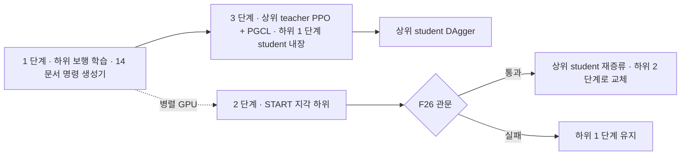

> 분류: A/정책학습 · B/항법 · 설계 (20 주행층 · HiPAN 상위 정책)
> 작성: 오흥재 (lead 세션 작성)
> 근거: HiPAN 2604.26504.txt (`C:/Users/AI-WS01/s2_lab/_papers/`) 42 · 279~291 · 476~535 · 540~585 · 645~700 · 750~760 · 873~882 행 직접 확인 · evidence/maicode-hipan-deep.analysis.json · `inbox/jay/20261018-next-arch/SPEC-hipan-go2.md` · fable 20e (F21 · F26 · 순서 1 → 3 → 2)
> 요지: 상위 정책은 HiPAN 그대로 depth 를 보고 10 Hz 로 명령을 낸다. 다만 출력은 우리 보행층 명령 세 칸(vx · vy · wz)만 쓰고, 학습 중 환경 안에 실제 우리 하위 student 를 넣는다. 하위가 바뀌면 관문을 넘을 때만 다시 증류한다
> 상태: 초안 · 팀장 검토 전 · 동결 아님

# 21 · HiPAN 상위 정책 (주행층)

## 1. 무엇을 하나

목표 좌표를 받아 「어느 방향으로 얼마나 빨리 갈지」 를 10 Hz 로 정해 보행층 명령 세 칸을 채운다. 막다른 길에서 되돌아 나오고(비탐욕적 탐색), 낮은 통로 · 장애물을 피한다(논문 7 · 42 행).

## 2. 논문 그대로 가져오는 것

| 항목 | 값 | 등급 · 위치 |
|---|---|---|
| 주기 | 상위 10 Hz, 하위 50 Hz | **논문** 535 행 (상위) · 632 행 (하위) |
| 학습 틀 | teacher PPO(특권 지도) → student DAgger | **논문** 279~285 행 |
| 하위를 전이에 넣기 | 학습된 하위 student 를 상위 MDP 전이 P 안에 넣어 추종 오차 · 지연을 겪게 함 | **논문** 290~291 행 |
| teacher 관측 | 3D 점유 14×11×11 + 2.5D 고도 31×21, 둘 다 0.1 m / 상위 고유감각 o_p(하위 o_p + 직전 명령) / 특권 운동 상태 x_m / 부목표 상대 위치 | **논문** 486~491 행 |
| teacher 지도 설계 | 두 지도(3D + 2.5D)가 단일 31×21×11 3D 대비 비슷한 성능에 학습 시간 약 절반 | **논문** 491~496 행 |
| 지각 latent | z_s ∈ R^32 | **논문** 496 행 |
| student 관측 | 전방 depth 180×320 / o_p / 하위 추정 x_hat_m / 최종 목표 상대 위치 | **논문** 526~531 행 |
| student 지각 | depth → 내부 기억(recurrent)으로 z_hat_s 추정 | **논문** 531 행 · maicode-hipan-deep (CNN + GRU) |
| 증류 손실 | 명령 예측 L2 + z_s 예측 L2 | **논문** 식 (6) · maicode-hipan-deep |
| 예산 | teacher 1,024 로봇 · 18 h, student 128 로봇 · 6 h, RTX 4090 1 장 | **논문** 535 행 |
| 학습 환경 | 20 × 20 m 여섯 개(WFC 타일) | **논문** 535 행 · 42 행 (22 문서) |
| 부목표 | GVD 위 A*, PGCL(22 · 4 절) | **논문** 535 행 · 340~368 행 |
| depth 증강 | random erasing · Gaussian blur · 가산 잡음, 카메라 자세 섭동 | **논문** 535 행 (문장 끝 잘림, SPEC-hipan-go2.md 79 행: 기준 [0.25, 0, 0.12] m · tilt 0 · 위치 ±0.05 m · pitch ±2.5°) |
| 실기 depth 처리 | clip · 정규화 · hole-filling | **논문** 882 행 |

### 보상 (Table II, 가중치 그대로)

| 항 | 식 | 가중치 |
|---|---|---|
| r1 도착 | 1(‖p_gs − p_B‖ < 0.1 m) | +5.0 |
| r2 방문 수(IR) | 1 / √η(p_B,xy) | +0.5 |
| r3 원하는 속도 | exp(−\|v_des − ‖v_xy‖\| / 0.3), v_des ~ U[0.3, 1.2] | +0.25 |
| r4 명령 변화율 | ‖c_t − c_{t−1}‖² | −0.1 |
| r5 명령 부드러움 | ‖c_t − 2c_{t−1} + c_{t−2}‖² | −0.1 |
| r6 추종 오차 | ‖c − 실제 상태‖² | −0.2 |
| r7 몸 속도 | v_z² + ‖ω_xy‖² | −0.1 |
| r8 기본 자세 | ‖q − q0‖² | −0.04 |
| r9 명령 한계 | 1(한계 초과) | −2.5 |
| r10 충돌 | 1(충돌) | −2.5 |

출처: **논문** Table II (540~585 행). r2 의 √ 기호는 txt 추출에서 흐려서 PDF 대조가 필요하다(maicode-hipan-deep 지적). η 격자 해상도 · 리셋 규칙은 **논문 미기재** → **가정**으로 고정한다(SPEC-hipan-go2.md 149 행).

## 3. 우리가 바꾸는 것 (「우리 추가」 로 기록)

| 바꾸는 것 | 이유 | 등급 |
|---|---|---|
| 출력 5 칸 → **3 칸 (vx, vy, wz)** | 1 차 보행층에 자세 명령이 없다(14 문서 2 절). 논문에 자세 명령을 뺀 판 「HiPAN w/o Pos. Adjustment」 가 있다(754 행). 그 판의 SR: Corridor 98.4 · Room 94.5 · Complex-1 74.2 · Complex-2 73.1 (본판 98.5 · 98.4 · 94.4 · 94.7) | **논문** Table IV (645~700 행) · 주장은 「자세 없는 HiPAN」 으로 한정 |
| r6 추종 오차 대상 | 5 칸 → 3 칸 [v_x, v_y, ω_z] | **가정** (r6 식에서 h · roll 항 제거) |
| r8 기본 자세 | 그대로 둔다(하위가 자세 명령을 안 받아도 관절 자세는 관측 가능) | **가정** |
| 하위 정책 | HiPAN 하위 대신 우리 보행층 student(14 · 12 · 13 문서) | **가정** · fable 20e |
| 로봇 · 카메라 | Go1 → Go2, D435i 장착 자세는 실측으로 교체 | **실측 예정** (17 · 11 문서) |
| 학습 환경 | 보행층 지형 전부를 방 안에 추가 | 22 문서 |

자세 명령을 뺀 판은 Room · Complex 에서 SPL · SR 이 떨어졌다(Table IV). 이 하락은 「낮은 통로 아래로 기어 지나가기」 를 못 해서이고, 우리 1 차 목표 지형(계단 · 듬성한 발판)과는 다른 축이다. 2 차에 몸 높이 명령을 추가할지는 열린 항목.

## 4. 학습 순서와 하위 교체 관문 (fable 20e 반영)

- 순서: **1 → 3 → 2(병렬)**. 상위를 하위 1 단계 위에서 먼저 끝내 「HiPAN 한 벌」 을 확보한다(fable 20e 9 절).
- 하위를 바꾸면 상위가 배운 「명령 → 결과」 관계가 달라진다. 논문도 미리 고정된 다른 하위(RPL)를 붙였을 때 분포 이동으로 충돌이 늘었다고 적었다(876~880 행).
- **교체 관문 F26**(fable 20e 7 절): 새 하위가 공통 시험지의 분포 안 칸에서 (1) 끝까지 생존 ≥ 기존, (2) 듬성한 지형 기준선 도달 +10 %p 이상, (3) 상위 재증류 뒤 SR 하락 ≤ 2 %p. 하나라도 어기면 교체 안 함. 수치는 **가정**(학습 전 41 문서에 등록).
- 재증류는 student 만(teacher 재학습 없음)으로 시작한다. teacher 의 특권 지도는 하위와 무관하지만, 전이에 하위가 들어 있으므로 student 데이터는 새 하위로 다시 모은다 → **가정**.

## 5. 구현 방법

1. **환경**: Isaac Lab 2.3.2 direct 또는 manager-based 환경 하나에 22 문서의 방을 만든다. 정책 주기 10 Hz = 하위 50 Hz 의 5 스텝마다 상위 한 번.
2. **하위 내장**: 우리 하위 student 를 TorchScript 로 고정해 환경 step 안에서 호출한다. 하위 관측(o_p 50 이력 등)은 환경이 만든다. 하위 gradient 는 막는다.
3. **teacher 지도**: 지형 메시에서 로봇 주변 3D 점유(14×11×11 @0.1 m)와 2.5D 고도(31×21 @0.1 m)를 레이캐스트로 만든다. 지도 중심 · yaw 정렬은 **논문 미기재** → 몸 yaw 정렬 · 중심 기준(DECISIONS H2 「중심 기준」)으로 **가정**.
4. **student depth**: TiledCamera 또는 RayCasterCamera 180×320, 128 env. 메모리 미측정 → Linux 다중 GPU 검증(mai-os#34) 뒤 결정.
5. **PGCL · A***: 22 문서.
6. **DAgger**: 상위 student 를 rollout 하며 teacher 가 (c, z_s) 를 라벨로 붙이고 집합을 키운다. 데이터셋 크기 · 혼합 일정 **논문 미기재** → **가정** (rsl_rl distillation runner 기본값 기록).
7. **명령 한계**: 상위 출력은 하위 학습 범위로 clip 하고 r9 로 벌점. 하위 범위는 14 문서와 같은 값.
8. **기록**: 상위 명령 히스토그램(방향별), 추종 오차, 충돌 수, PGCL 레벨, SR · SPL(0.2 m 문턱, 728 행).

## 6. 평가 (41 문서로 넘김)

- 논문 지표: SR(0.2 m 안 도착) · SPL (728 행). 벤치마크 Corridor · Room · Complex-1 · Complex-2 를 우리 환경 생성기로 재현하고, 듬성한 지형이 들어간 방을 추가 시험지로 둔다.
- 비교군: 자세 없는 HiPAN 논문 값(Table IV)은 Go1 · Isaac Gym 값이라 직접 비교가 아니라 「참고 축」 이다.

## 7. 검증할 가설

| # | 가설 | 어떻게 보나 |
|---|---|---|
| H21-1 | 3 칸 출력 HiPAN 이 Go2 + 우리 하위에서 논문 「자세 없는 판」 수준(Corridor ≥ 90 %)에 닿는다 | Corridor · Room SR |
| H21-2 | 하위 1 단계를 내장해 학습한 상위가 듬성한 지형이 있는 방에서 접근 방향을 맞춘다 | 22 문서 방, 외나무 진입 각 오차 |
| H21-3 | 하위 교체 뒤 student 재증류만으로 SR 하락 ≤ 2 %p | F26 관문 (3) |

## 8. 열린 항목

- 2 차에 몸 높이 명령(h)을 되살릴지. 되살리면 보행층도 4 칸이 된다.
- η 격자 해상도, PGCL 「꾸준히 성공」 횟수, DAgger 일정: 모두 **가정**으로 고정할 값.
- 180×320 depth 128 env 의 메모리 · 속도: 미측정.
- 상위 출력의 정지(명령 0) 처리: 목표 도착 뒤 0 을 내는지, 하위 정지 env 학습(14 문서)과 맞는지.
