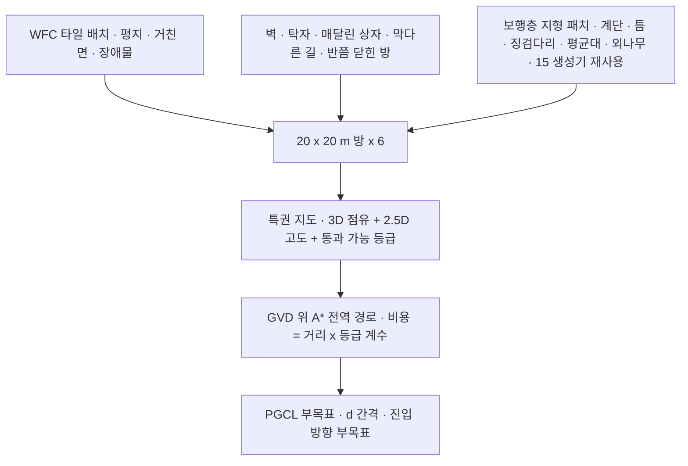

> 분류: B/항법 · 설계 (20 주행층 · 상위 학습 환경과 부목표)
> 작성: 오흥재 (lead 세션 초안 · fable 20f 가 v1 으로 고쳐 씀)
> 근거: HiPAN 2604.26504.txt 42 · 288~291 · 338~372 · 535 · 585 · 728 행 · `inbox/jay/20261018-next-arch/SPEC-hipan-go2.md` 151~161 행 · fable 20e Q2 · F21 · 팀장 10/19 「상위 환경에도 틈 · 외나무 · 디딤돌이 들어가야」(APPROVED B · D14) · 14 · 15 문서 · APPROVED H(무대 계단 실측 선택) · VERIFY-fable-20f P5
> 요지: HiPAN 의 방(20 × 20 m, WFC 타일, 벽 · 탁자 · 매달린 상자)에 보행층이 넘는 지형 전부를 깐다. 부목표 경로(GVD 위 A*)에 「우리 하위로 지나갈 수 있는가」 를 등급 비용으로 넣고, 외나무처럼 접근 방향이 중요한 지형은 진입 방향까지 부목표로 준다. 등급표는 하위의 S1 · S2 결과로 채운다
> 상태: v1.1 · 팀장 검토 전 · 동결 아님 · 결정 3 반영(fable 20l)

# 22 · 주행층 학습 환경

## 0. 쉬운 요약

길 찾기를 가르칠 연습장이다. HiPAN 논문의 방(가로 세로 20 m, 벽 · 탁자 · 공중에 매달린 상자가 무작위로 놓인 방 여섯 개)을 그대로 만들고, 거기에 우리 보행층이 연습한 땅(계단 · 틈 · 징검다리 · 평균대 · 외나무)을 군데군데 깐다. teacher 에게 주는 「정답 길」 은 장애물에서 먼 길(GVD 위 A*)인데, 그대로 쓰면 징검다리 위를 「빈 공간」 으로 잘못 본다. 그래서 땅마다 「우리 로봇이 지나갈 수 있나」 등급을 붙여 길 찾기 비용에 곱한다. 외나무처럼 비스듬히 들어가면 떨어지는 땅은 입구 앞에 「여기서 똑바로 서라」 는 중간 목표를 하나 더 둔다.

## 1. 왜 바꾸나

HiPAN 상위 학습 환경은 평지 · 거친 면 · 장애물 타일과 벽 · 탁자 · 매달린 상자뿐이다(**논문** 42 행). 계단도 듬성한 발판도 없다. 상위는 학습 중 실제 하위를 돌려 「지나갈 수 있는 곳」 을 겪으며 배우므로(**논문** 288~291 행), 환경에 없는 지형은 배포 때 벽처럼 보고 돌아가거나 엉뚱한 방향에서 다가갈 수 있다(fable 20e Q2). 팀장 지적대로 계단만이 아니라 보행층 지형군 전부가 들어가야 한다(D14 · D22 「계단에만 초점 두지 않음」).

## 2. 환경 구성

| 요소 | 값 | 등급 · 위치 |
|---|---|---|
| 방 크기 · 개수 | 20 × 20 m · 여섯 개 | **논문** 535 행 |
| 바탕 타일 | WFC 로 평지 · 거친 면 · 장애물 배치 | **논문** 42 행 |
| 장애물 | 벽 · 탁자 · 매달린 상자(막다른 길 · 반쯤 닫힌 방 · 머리 위 장애물) | **논문** 42 행 |
| 보행층 지형 패치 | 계단(오름 · 내림), 틈, 징검다리, 평균대, 외나무. 크기 · 난이도는 보행층 학습 지형 생성기를 그대로 다시 씀(15 §8) | **우리 추가** |
| 패치 비율 | 방 면적의 30 % 안팎, 난이도는 보행층에서 하위가 통과한 레벨까지만(S1 · S2 레벨표) | **가정** |
| 무대 계단 | 실측 치수(가능하면) 또는 대표 칸 0.15 m 를 일부 방에 넣음 | **가정** (41 §7 · D27) |

## 3. 통과 가능 등급과 A* 비용

GVD 위 A* 는 장애물에서 먼 길을 고른다(**논문** 535 행, SPEC 153 행). 그대로 쓰면 틈 위 · 징검다리 위를 「빈 공간」 이나 「장애물」 로 잘못 읽는다. 지형 셀마다 등급을 붙이고 A* 비용에 곱한다.

| 등급 | 예 | A* 처리 | 등급 근거 |
|---|---|---|---|
| 자유 | 평지 · 거친 면 · 경사 | 비용 1 | 하위 축 1 이어진 지형 성공 |
| 이어진 험지 | 계단 · 박스 · 단차 | 비용 1.5 | **가정** |
| 듬성한 통과 가능 | 징검다리 · 평균대 · 외나무 · 하위가 넘는 폭의 틈 | 비용 3, 통과 셀 띠를 좁게(발판 폭) | **가정** · 하위 레벨표(S2 START 시험지 R ≥ 0.7 인 레벨까지, **가정**) |
| 통과 불가 | 하위 학습 최대 폭을 넘는 틈 · 벽 · 낭떠러지 | 막음 | 하위 레벨표 |
| 머리 위 장애물 | 매달린 상자 · 탁자 | 몸 높이 이하면 막음(1 차는 자세 명령 없음) | 전역 경로가 낮은 통로를 허용하는지는 **논문 미기재**(SPEC-hipan-go2.md 161 행) → **가정** |

- 등급은 「하위가 그 레벨에서 통과율 ≥ 문턱」 일 때 통과 가능으로 둔다. 문턱은 41 §9 와 같이 등록 → **가정**. S1 하위 위에서 S3 를 돌릴 때는 듬성한 지형이 전부 「통과 불가」 가 되므로 그 teacher 는 우회만 배운다(21 §4 · D34 11/10 관문). 그래서 S3 관문도 S1-blind 하위판은 듬성한 방을 빼고 「계단 방 ≥ 70 %」 벌을 쓴다(팀장 결정 3 · 54 §2).
- 비용 계수 1 · 1.5 · 3 은 **가정**. 상위는 이 경로를 부목표로만 받고(PGCL), 최종 수준에서는 경로 없이 목표만 본다(**논문** 368 행). 그래서 비용 계수가 정책에 그대로 박히지는 않는다.

## 4. PGCL 과 접근 방향

| 항목 | 값 | 등급 · 위치 |
|---|---|---|
| 부목표 간격 | d = 1 m 에서 시작, 수준마다 1 m 씩 늘림 | **논문** 368 행 |
| 수준 올림 | 수준 k 의 부목표를 차례로 모두 도달 | **논문** 368 행 |
| 최종 수준 | d 가 경로 길이를 넘으면 목표만 남음. 그 수준에서 「꾸준히 성공」 하면 새 시작 · 목표 | **논문** 368 행 · 횟수 **미기재** → **가정** 연속 5 회 |
| 부목표 도달 | 0.1 m (r1) | **논문** Table II · 585 행 |
| teacher 만 사용 | 지도 · 부목표는 teacher 학습에만, student 는 최종 목표만 | **논문** 368 행 |
| **진입 방향 부목표** | 외나무 · 평균대 · 징검다리 열 입구 앞 0.5 m 와 입구에 부목표 둘을 두어 축 방향으로 정렬해 들어가게 함 | **우리 추가** · **가정** |

진입 방향 부목표의 이유: 외나무는 폭이 좁아 비스듬히 들어가면 첫 발부터 떨어진다. 보행층은 깃발 방식으로 「바라보고 건너기」 를 배우지만(14), 깃발이 축과 어긋나 있으면 그 습관이 쓸모없다. 주행층이 입구 정렬을 맡는다. 최종 수준에서 부목표가 사라진 뒤에도 정렬을 유지하는지가 가설 H22-2.

## 5. 장면 예

| 장면 | 환경 · 경로가 하는 일 |
|---|---|
| 목표가 외나무(폭 0.15 m · 길이 4 m) 건너편 | 등급 지도에서 외나무 셀은 「듬성한 통과 가능 · 비용 3 · 띠 폭 0.15 m」. A* 가 돌아가는 길(비용 1 × 12 m)과 외나무(3 × 4 m) 를 비교해 외나무를 고른다. 입구 앞 0.5 m 와 입구에 부목표 둘 → 로봇이 축을 맞춘다 |
| 목표가 0.9 m 틈 건너편, 하위 최대 0.7 m | 「통과 불가」 → A* 가 우회. 우회로가 없으면 「경로 없음」 → 목표를 바꾸지 않고 에피소드 실패로 기록 |
| 매달린 상자 아래 0.35 m 통로 | 1 차는 「막음」(자세 명령 없음). 2 차에 h 명령이 생기면 다시 정한다 |
| PGCL 수준 3(d = 3 m)에서 부목표 둘 중 하나를 못 가면 | 수준 유지. 연속 5 회 성공해야 다음 수준(가정) |

## 6. 구현 방법

1. **지형 생성**: Isaac Lab TerrainGenerator 로 WFC 바탕 타일 메시를 만들고, 15 문서의 지형 패치 생성기를 같은 메시에 붙인다(`foothold_s2/nav/room_generator.py`). WFC 인접 규칙에 「지형 패치 앞뒤에는 평지 타일」 규칙을 더한다 → **가정**.
2. **장애물**: 벽 · 탁자 · 매달린 상자는 정적 강체 메시. 배치 확률 **논문 미기재** → **가정**(타일당 0.2 · 0.1 · 0.1).
3. **등급 지도**: 생성 시점에 셀마다 등급을 기록(생성기가 아는 정보라 추정 불필요). 0.1 m 격자.
4. **GVD + A***: 등급 지도에서 통과 불가 셀을 장애물로 GVD 를 만들고(scikit-image medial axis 등 공개 구현, 라이선스 확인), 그 위에서 등급 비용 A*(`nav/gvd_astar.py`). 방마다 학습 시작 전에 캐시.
5. **부목표**: 경로를 d 간격으로 표본, 진입 방향 부목표 삽입(`nav/pgcl.py`).
6. **시작 · 목표**: 무충돌 위치에서 균등 표본(**논문** 291 행). 목표가 듬성한 지형 너머에 있는 비율을 기록(30 % 이상이 되게 표본을 조정, **가정**).

## 7. 검증 사다리

| 단 | 무엇 | 통과 |
|---|---|---|
| L0 CPU | 답을 아는 방 셋(벽 하나 · 틈 0.5 m 하나 · 틈 0.9 m 하나)에서 A* 가 우회 · 통과 · 「경로 없음」 을 냄. 부목표 d 표본 수 = ⌈경로 길이 / d⌉ | 기대 경로 |
| L0 CPU | 등급 지도: 생성기 출력과 셀 등급이 1:1(징검돌 위 셀 = 듬성한 통과 가능, 사이 = 통과 불가) | 격자 |
| L1 Kit | 방 6 개 메시가 뜨고 128 env 리셋이 무충돌 위치에 놓임(충돌 센서 0) · 예행 8 판 | 로그 |

## 8. 검증할 가설

| # | 가설 | 어떻게 보나 |
|---|---|---|
| H22-1 | 보행층 지형을 넣어도 원래 HiPAN 벤치마크 방(Corridor · Room) SR 이 떨어지지 않는다 | 지형 없는 방 대조 |
| H22-2 | 진입 방향 부목표로 배운 정렬이 최종 수준(부목표 없음)에서도 남는다 | 외나무 진입 각 오차 ≤ 15° · 낙하율 |
| H22-3 | 등급 비용이 「돌아가는 편이 안전한」 경로를 고르게 한다 | 통과 불가 틈 앞에서 우회율 |

## 9. 열린 항목

- 지형 패치 비율 · 난이도 상한(하위 레벨표가 나와야 정함).
- 머리 위 장애물: 2 차 자세 명령과 같이 다시 정함.
- 방 여섯 개를 늘릴지(지형 종류가 늘었으므로).
- GVD 공개 구현의 라이선스 확인.
