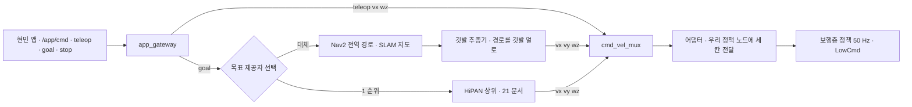

> 분류: B/항법 · 설계 (20 주행층 · 대체 경로)
> 작성: 오흥재 (lead 세션 작성)
> 근거: `inbox/jay/20261018-next-arch/ANALYSIS-app-prd-553.md` (현민 앱 PRD #553 분석) 21~88 행 · `inbox/jay/20261013-go2-app-study/REPORT-astra-10.md` 63~132 행 · 00 개요 · 14 문서 2 절 · 팀장 일정(11/30 SLAM · Nav2 트랙 종료)
> 요지: HiPAN 상위가 늦거나 실패해도 시연이 끊기지 않게, Nav2 경로를 「깃발 추종기」 가 보행층 명령 세 칸으로 바꾸는 대체 경로를 둔다. 같은 속도 인터페이스라 보행층은 바꿀 것이 없다. 현민 앱의 목표 · 정지 · 손 조종을 그대로 받는다
> 상태: 초안 · 팀장 검토 전 · 동결 아님

# 23 · Nav2 대체 경로

## 1. 위치

- 앱이 보내는 것은 몸 기준 속도(vx, wz)와 Nav2 목표 둘뿐이다. 자세 · 옆걸음 · 자연어는 없다(ANALYSIS-app-prd-553 31 행). 손 조종은 지금 앞 0.6 · 회전 ±0.5 만 열려 있고 후진 · 옆걸음은 서버가 0 으로 막는다(39 행).
- 앱의 Go2 어댑터는 순정 보행 `SportClient.Move/StopMove` 를 가정한다(41 · 47 행). 우리 정책은 50 Hz LowCmd 라 둘을 같이 못 쓴다. 꽂는 자리는 `/cmd_vel` 뒤 어댑터 백엔드다(54 행).

## 2. 깃발 추종기 (보행층 학습과 같은 식)

Nav2 전역 경로를 일정 간격 깃발 열로 바꾸고, 14 문서 깃발 방식과 같은 식으로 세 칸을 만든다.

| 항목 | 값 | 등급 · 위치 |
|---|---|---|
| 깃발 간격 | 경로를 1 m 간격 표본 | **가정** (HiPAN PGCL 시작 d = 1 m 와 맞춤, 22 문서) |
| 다음 깃발로 | 0.5 m 안에 들면 | **코드** JEPLO `go2_loco_env.py` 427~432 (14 문서와 같음) |
| 속도 | 깃발 방향 단위 벡터 × v, v 는 지형 등급별 상한(이어진 1.0, 듬성한 0.6) | **가정** |
| 회전 | wz = clip(깃발 방향 각, −1, 1) | **코드** JEPLO 444~447 |
| 정지 | 마지막 깃발 0.5 m 안 → 세 칸 0 | **코드** JEPLO 456~459 |

학습 때와 같은 식을 쓰므로 보행층이 학습 분포 안의 명령을 받는다. 이것이 대체 경로가 보행층을 다시 학습하지 않아도 되는 이유다.

## 3. 11/30 SLAM · Nav2 트랙과의 연결

- SLAM · Nav2 트랙(11/30 종료)이 지도 · 위치 추정 · 전역 경로를 만든다. 이 문서는 그 출력(경로)만 소비한다.
- **L1 은 Unitree 펌웨어 지도와 별개다.** 공식 앱의 블록 지도는 로봇 펌웨어가 만든 `rt/utlidar/voxel_map_compressed`(128 × 128 × Z 비트 칸)를 그리기만 한다(REPORT-astra-10 63~67 행). 펌웨어의 누적 · 정제 방식은 APK 로 확인할 수 없다(132 행). 우리 SLAM 은 L1 원 점군(`utlidar/cloud`)과 IMU 로 따로 만든다. 펌웨어 복셀 지도는 표시 참고용이다.
- Nav2 costmap 의 듬성한 지형 처리: 2D costmap 은 징검다리를 장애물이나 빈 땅 중 하나로만 본다. 그래서 대체 경로는 **듬성한 지형을 지나는 목표에는 쓰지 않는다**(이어진 지형 · 계단까지만). 듬성한 지형 자율 통과는 HiPAN 상위 몫 → **가정**.

## 4. 안전 · 정지 (앱 규칙 그대로)

| 규칙 | 값 | 출처 |
|---|---|---|
| deadman | 0.3 s 명령 끊김 → 0 | ANALYSIS-app-prd-553 36 행 |
| heartbeat | 1.0 s 끊김 → 정지 래치 | 36 행 |
| STOP | 명령 0 + 잠금 + Nav2 취소, 자동 재개 없음 | 30 · 43 행 |
| 정지 세 겹 | 앱 STOP · 로봇 끊김 감시 · 제조사 정지 | 43 행 |
| **미정** | 우리 정책일 때 STOP 의 뜻(정책 0 명령 / sport mode 복귀 / Damp), 정책 프로세스가 죽을 때 몸을 세우는 법 | 55 · 88 행 |

## 5. 구현 방법

1. `go2_adapter` 백엔드에 「정책 노드」 모드 추가: `/cmd_vel`(Twist vx, vy, wz)를 정책 명령 세 칸으로 넘긴다. 앱 쪽 Twist 형식은 그대로.
2. 목표 제공자 노드: 앱 목표(지도 틀 x, y, yaw + map_ver)를 받아 HiPAN 이 살아 있으면 HiPAN 에, 아니면 Nav2 에 넘긴다(ANALYSIS-app-prd-553 68 행). 선택은 설정값.
3. 깃발 추종기 노드: Nav2 `/plan` 구독 → 깃발 열 → 20~50 Hz 로 Twist 발행. 2 절 식.
4. 손 조종 범위: 앱 서버가 막아 둔 후진 · 옆걸음을 열지는 현민과 협의(31 문서 「명령 정리기」 와 같이).
5. 시뮬 검증: Isaac 에서 Nav2 를 붙이기 전, 이미 만든 경로를 깃발 추종기에 넣어 보행층이 따라가는지 먼저 본다.

## 6. 검증할 가설

| # | 가설 | 어떻게 보나 |
|---|---|---|
| H23-1 | 깃발 추종기 명령이 보행층 학습 분포 안이라 추종 오차가 학습 때와 비슷하다 | 시뮬에서 깃발 방식 env 와 추종 오차 비교 |
| H23-2 | Nav2 + 깃발 추종기만으로 이어진 지형 · 계단 목표 주행이 된다 | 실기 · 시뮬 SR |

## 7. 열린 항목

- STOP 의 뜻과 정책 프로세스 죽음 대응(현민 · 팀장 결정).
- 앱 손 조종에서 후진 · 옆걸음을 열지.
- SLAM 트랙의 지도 형식 · 주기 · 좌표 틀과의 계약(map → odom → base_link, REPORT-astra-10 234 행).
- 행사장 Wi-Fi 지연과 1 s 정지 래치 위험(ANALYSIS-app-prd-553 80 행, 미측정).
