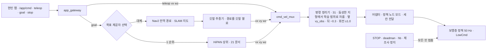

> 분류: B/항법 · 설계 (20 주행층 · 대체 경로 · 앱 연결)
> 작성: 오흥재 (lead 세션 초안 · fable 20f 가 v1 으로 고쳐 씀)
> 근거: `inbox/jay/20261018-next-arch/ANALYSIS-app-prd-553.md` 31 · 36 · 39 · 41 · 47 · 54 · 55 · 68 · 72 · 80 · 88 행 · `inbox/jay/20261013-go2-app-study/REPORT-astra-10.md` 63~77 · 130~133 · 234 행 · 00 개요 · 14 §3 · JEPLO @460e227 `go2_loco_env.py` 427~459 (evidence/maicode-jeplo-deep) · 팀장 일정(11/30 SLAM · Nav2 트랙 종료) · APPROVED G-1 · H(앱은 시뮬 연결 먼저 · STOP = 모든 것 멈춤 · 자세 유지 설계) · **K-I(11/7 Isaac Sim · 앱 시뮬 연결은 S1-x 위, 팀장 승인 10/20 00:1x)** · VERIFY-fable-20f P15
> 요지: HiPAN 상위가 늦거나 실패해도 시연이 끊기지 않게, Nav2 경로를 「깃발 추종기」 가 보행층 명령 세 칸으로 바꾸는 대체 경로를 둔다. 같은 속도 인터페이스라 보행층은 바꿀 것이 없다. 현민 앱은 먼저 시뮬에 연결하고, 앱 관문(vy 0 · 후진 금지 · SportClient 가정)과 우리 LowCmd 정책의 어긋남을 현민과 맞출 항목으로 올린다. STOP 은 모든 것을 멈추고 자동 재개 없음
> 상태: v1 · 팀장 검토 전 · 동결 아님

# 23 · Nav2 대체 경로와 앱 연결

## 0. 쉬운 요약

길 찾기 층(HiPAN 상위)이 제때 안 되거나 실기에서 말을 안 들으면, 기존 로봇 항법 도구 **Nav2** 가 지도 위에 그어 준 길을 쓰는 비상 경로를 둔다. 길을 1 m 간격 깃발 열로 바꾸고, 학습 때 쓴 것과 똑같은 식(14 의 깃발 방식)으로 「다음 깃발 쪽으로 0.5 m/s, 각도는 이만큼」 세 칸을 만든다. 보행층은 학습 때 받던 것과 같은 명령을 받으므로 고칠 것이 없다. 현민의 앱은 지금 「앞으로 0.6, 돌기 ±0.5」 만 보내고 옆 · 뒤는 서버가 0 으로 막으며, 실기는 Unitree 순정 보행을 전제로 짜여 있다. 우리 정책은 관절을 직접 움직이므로 이 둘을 같이 못 쓴다. 그래서 앱은 먼저 시뮬에 붙여 보여 주고, 실기 연결은 현민과 맞춘 뒤다. **STOP 버튼은 무엇이든 즉시 멈추고 저절로 다시 가지 않는다.**

## 1. 위치

- 앱이 보내는 것은 몸 기준 속도(vx, wz)와 Nav2 목표 둘뿐이다. 자세 · 옆걸음 · 자연어는 없다(ANALYSIS-app-prd-553 31 행). 손 조종은 지금 앞 0.6 · 회전 ±0.5 만 열려 있고 후진 · 옆걸음은 서버가 0 으로 막는다(39 행). gateway 한계는 max_vx 0.5 · max_wz 1.0 · 후진 금지(37 행).
- 앱의 Go2 어댑터는 순정 보행 `SportClient.Move/StopMove` 를 가정한다(41 · 47 행). 우리 정책은 50 Hz `LowCmd` 라 둘을 같이 못 쓴다. 꽂는 자리는 `/cmd_vel` 뒤 어댑터 백엔드(54 행) = 「정책 노드 모드」.

## 2. 깃발 추종기 (보행층 학습과 같은 식)

Nav2 전역 경로를 일정 간격 깃발 열로 바꾸고, 14 §3 깃발 방식과 같은 식으로 세 칸을 만든다.

| 항목 | 값 | 등급 · 위치 |
|---|---|---|
| 깃발 간격 | 경로를 1 m 간격 표본 | **가정** (HiPAN PGCL 시작 d = 1 m 와 맞춤, 22 §4) |
| 다음 깃발로 | 0.5 m 안에 들면 | **코드** JEPLO `go2_loco_env.py` 427~432 (14 §3 과 같음) |
| 속도 | 깃발 방향 단위 벡터 × v, **v = 0.5 m/s**(학습 분포 U[0, 1.0](J-F) 안의 값으로 1 차 고정) | **가정** (14 §3 과 한 값. 초안의 「이어진 1.0 · 듬성한 0.6」 은 지움, VERIFY 20f P15) |
| 회전 | wz = clip(깃발 방향 각, −1, 1) | **코드** JEPLO 444~447 |
| 정지 | 마지막 깃발 0.5 m 안 → 세 칸 0 | **코드** JEPLO 456~459 |

학습 때와 같은 식을 쓰므로 보행층이 학습 분포 안의 명령을 받는다. 이것이 성립하려면 **이어진 지형에서도 깃발 방식이 학습되어 있어야** 한다. 그래서 14 §3 은 이어진 지형 env 의 20 % 에 깃발 방식을 섞는다(JEPLO 의 Boxes · Steps 깃발 배정과 같은 생각, VERIFY-lead-final 11). 추종기 명령이 학습 분포 안인지는 H23-1 로 재고, 어긋나면 「분포 밖 · 검증 대상」 으로 적는다.

## 3. 11/30 SLAM · Nav2 트랙과의 연결

- SLAM · Nav2 트랙(11/30 종료)이 지도 · 위치 추정 · 전역 경로를 만든다. 이 문서는 그 출력(경로)만 소비한다. 좌표 틀 계약은 `map → odom → base_link`(REPORT-astra-10 234 행) 로 맞춘다.
- **L1 은 Unitree 펌웨어 지도와 별개다.** 공식 앱의 블록 지도는 로봇 펌웨어가 만든 `rt/utlidar/voxel_map_compressed`(128 × 128 × 30 비트 칸)를 그리기만 한다(REPORT-astra-10 63~77 행). 펌웨어의 누적 · 정제 방식은 APK 로 확인할 수 없다(130~133 행). 우리 SLAM 은 L1 원 점군(`utlidar/cloud`)과 IMU 로 따로 만든다. 펌웨어 복셀 지도는 표시 참고용이고 기록도 후순위 · 선택이다(D29).
- Nav2 costmap 의 듬성한 지형 처리: 2D costmap 은 징검다리를 장애물이나 빈 땅 중 하나로만 본다. 그래서 대체 경로는 **듬성한 지형을 지나는 목표에는 쓰지 않는다**(이어진 지형 · 계단까지만). 듬성한 지형 자율 통과는 HiPAN 상위 몫 → **가정**.

## 4. 안전 · 정지 (앱 규칙 + 팀장 결정 D33)

| 규칙 | 값 | 출처 |
|---|---|---|
| deadman | 0.3 s 명령 끊김 → 0 | ANALYSIS-app-prd-553 36 행 |
| heartbeat | 1.0 s 끊김 → 정지 래치 | 36 행 |
| **STOP** | **위험 시 모든 것을 멈춘다. 명령 0 + 잠금 + Nav2 취소 + HiPAN 목표 취소 + 판단층 조언 무시. 자동 재개 없음**, 사람이 해제 | 30 · 43 행 · **팀장 결정 D33** |
| 정지 세 겹 | 앱 STOP · 로봇 끊김 감시 · 제조사 정지 | 43 행 |
| **멈춘 뒤 자세 유지(설계 필요, D33)** | 후보 ① 정책에 세 칸 0 을 계속 주어 「서기」 유지(정지 env 에서 학습, 14 §3) ② 정책을 끊고 sport mode 복귀(StandUp) ③ Damp(힘 빼고 주저앉기). 1 차 안(42 §2 와 같은 순서 하나): **① 제자리 유지 → ② 정책을 끊고 sport mode(StandUp) → ③ Damp**. ③ 은 **평지에서만**(APPROVED H 「계단 위에서 바로 힘을 빼면 넘어짐」 → 계단 · 듬성한 지형 위 ③ 금지, 듬성한 지형은 발이 빠짐). 평지: ① 이 1 s 안에 안정(몸 각속도 < 0.3 rad/s) 못 하면 ②, ② 도 안 되면 ③. 계단 · 듬성한 지형: ① → ②, 그래도 안 되면 ③ 으로 넘어가지 않고 서기 명령(또는 sport mode)을 유지한 채 안전 줄 · 사람이 개입하며 사례를 기록한다(VERIFY-lead-final 18 · final2 12) → **가정**, 42 §2 에서 실기로 확인. 듬성한 지형 위 ① 이 성립하려면 세 칸 0 이 그 지형에서 학습돼야 한다 → 14 §3 깃발(듬성한) 행의 마지막 깃발 정지 2 s 유지 · H23-3 징검돌 칸 | 55 · 88 행 · D33 |
| **실기 전 시험(T0, 42 §1)** | policy_node · STOP 래치 · deadman · 리모컨 우선권을 시뮬 어댑터와 「순정 모드로 서 있는 실기」 에서 먼저 확인한 뒤에야 우리 정책(T6)을 올린다 | VERIFY-lead-final 18 |
| 정책 프로세스 죽음 | 어댑터가 0.3 s 안에 감지 → ③ Damp 가 아니라 제조사 정지(모터 유지) 우선 → **가정**, 현민과 협의 | 55 행 |
| 리모컨 우선권 | LowCmd 모드에서 리모컨 입력이 들어오면 정책을 끊고 리모컨 → **미확인**(SDK 동작), 42 첫 주 확인 | APPROVED G-1 |

## 5. 앱 연결 순서 (APPROVED H)

1. **시뮬 먼저**: 11/7 시연 자체는 Isaac Sim 이다(K-I · D50). 앱 연결은 **S1-x**(50 · 52 §2: S1-a 정책을 MuJoCo `unitree_mujoco` · Gazebo 에서 같은 명령 열로 돌려 Isaac 값과 비교)에서 숫자가 맞은 시뮬 위에서 손 조종 · 목표 · STOP 을 보여 준다. S1-x 가 어긋나면 Isaac 으로 한다. 어댑터의 「정책 노드 모드」 를 그 시뮬 어댑터로 먼저 만든다(11/7 시작, 70 §4). Gazebo 쪽은 ROS 2 Go2 패키지(70 §4 후보)가 앱 어댑터(ROS 2)와 바로 붙는다는 점에서 유리하고, MuJoCo 쪽은 Unitree 공식 저장소라 모델이 확실하다 → 선택은 열린 항목.
2. **실기 SDK 연결은 그 뒤**: 42 첫 주 시험 뒤, 현민과 아래 7 절 항목을 맞춘 다음.
3. 앱이 우리 설계에서 필요로 하는 것은 #555 에 기록한다.

## 6. 장면 예

| 장면 | 동작 |
|---|---|
| HiPAN student 가 11/18 에 없다(60 D) | 목표 제공자가 Nav2 로 바뀐다. 앱 목표 → Nav2 경로 → 깃발 추종기 → 세 칸 0.5 m/s. 평지 · 장애물 · 계단까지. 징검다리 목표는 「할 수 없음」 으로 앱에 표시 |
| HiPAN 이 돌다가 응답이 1 s 끊겼다 | hb 규칙으로 정지 래치. 사람이 해제하고 목표 제공자를 Nav2 로 바꿔 재개 |
| 조이스틱으로 징검다리 위에서 옆 명령 0.5 | 명령 정리기(31)가 학습 중 나온 범위 vy_obs(임시 0.2)로 자르고 앱에 경고. 뒤 명령은 −0.3 까지 통과(D39). STOP 이 아니다 |
| 무대에서 STOP | 모든 명령 0 · 잠금 · 목표 취소. 로봇은 「서기」 유지(①). 사람이 해제할 때까지 아무것도 재개하지 않는다 |
| 앱이 후진 명령을 보낸다(지금은 서버가 0) | 7 절 협의 전까지는 앱 규칙대로 0. 열면 이어진 지형에서만 통과 |

## 7. 현민과 맞출 항목 (APPROVED G-1 · ANALYSIS 5 절의 18 개 질문 중 우리 설계에 직접 닿는 것)

1. 어댑터 백엔드에 「정책 노드 모드」(`/cmd_vel` Twist → 우리 정책 노드 세 칸) 추가. SportClient 와 동시 사용 불가.
2. STOP 의 뜻 = 모든 것 멈춤 · 자동 재개 없음(D33). 멈춘 뒤 자세 유지 후보 ①②③ 중 실기에서 무엇을 쓸지(42).
3. 정책 프로세스가 죽을 때 몸을 세우는 법(제조사 정지 우선).
4. 리모컨 우선권(LowCmd 모드).
5. 손 조종에서 후진 · 옆걸음을 열지. 우리 쪽 규칙은 D39(이어진 지형은 학습 범위 전부, 듬성한 지형은 옆 vy_obs · 뒤 −0.3 · 회전 ±1.0)이므로 앱 서버의 「후진 금지 · vy 0」 을 명령 정리기 뒤로 옮기는 것이 맞다.
6. gateway 한계 max_vx 0.5 를 학습 분포(0~1.0, J-F)와 맞출지.
7. 「지금 정책 이름 · 판」 표시와 NVIDIA · v2 · 최종을 바꾸는 절차.
8. 시뮬 연결 일정(11/7 시작) 과 실기 SDK 연결 시점.

## 8. 구현 방법 · 검증 사다리

1. `foothold_s2/ros/policy_node.py`: 50 Hz 루프, 세 칸 입력 → ONNX/TensorRT actor → LowCmd. STOP 래치 · deadman 내장.
2. `ros/goal_provider.py`: 앱 목표(지도 틀 x, y, yaw + map_ver)를 HiPAN 이 살아 있으면 HiPAN 에, 아니면 Nav2 에(68 행). 선택은 설정값.
3. `ros/flag_follower.py`: Nav2 `/plan` 구독 → 깃발 열 → 20~50 Hz 로 Twist 발행. 2 절 식.
4. 시뮬 검증: Isaac 에서 Nav2 를 붙이기 전, 미리 만든 경로를 깃발 추종기에 넣어 보행층이 따라가는지 먼저 본다(**11/10 전에**, 60 D 의 선행 조건).
5. 사다리: L0 CPU 추종기(경로 (0,0)→(3,0)→(3,3) 에서 깃발 4 개 · 명령 열이 14 §9 와 같은 값) → L1 시뮬 어댑터로 정책이 경로를 따라감(예행 8 판, S1-x 시뮬 또는 Isaac) → L2 앱 시뮬 연결(S1-x 시뮬 위) → 실기(42).

## 9. 검증할 가설

| # | 가설 | 어떻게 보나 |
|---|---|---|
| H23-1 | 깃발 추종기 명령이 보행층 학습 분포 안이라 추종 오차가 학습 때와 비슷하다 | 시뮬에서 깃발 방식 env 와 추종 오차 비교(95 분위 차 < 20 %) |
| H23-2 | Nav2 + 깃발 추종기만으로 이어진 지형 · 계단 목표 주행이 된다 | 시뮬 SR ≥ 0.8 · 실기 10 회 중 8 회 |
| H23-3 | STOP 뒤 「서기」 유지(①)가 평지 · 계단 · **징검돌 칸(듬성한 지형)** 에서 1 s 안에 안정된다 | 시뮬 100 판(지형군마다) · 실기 10 회(평지 · 계단 · 징검돌 모형) |

## 10. 열린 항목

- 7 절 항목(현민 · 팀장).
- SLAM 트랙의 지도 형식 · 주기 · 좌표 틀 계약.
- 앱 시뮬 연결에 쓸 시뮬(MuJoCo 대 Gazebo) 선택(S1-x 결과 · 현민 어댑터 ROS 2 여부).
- 행사장 Wi-Fi 지연과 1 s 정지 래치 위험(ANALYSIS-app-prd-553 80 행, 미측정).
