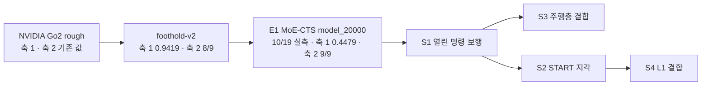

> 분류: A/정책학습 · 설계 (40 평가 · 시뮬 평가 축과 판정 규칙)
> 작성: 오흥재 (lead 세션 작성)
> 근거: `docs/research/20260928-v2-mvp-report.md` 6-7 · 9 절 · `sim/eval/eval_generalization.py` · `sim/eval/eval_command_response.py` · evidence/E1-vs-v2-axis1.csv · evidence/E1-vs-v2-axis2.csv · ASTRA 19f Q5 · fable 20e Q5 · START 2512.13153v1 263~277 · 354 행
> 요지: v2 의 두 자(험지 · 평지 명령)를 그대로 두고, 「명령이 험지에서도 열렸나」 를 재는 축 3 과 START 시험지 · 무대 계단 칸을 더한다. 기준은 학습 전에 등록한다
> 상태: 초안 · 팀장 검토 전 · 기준 수치는 등록 후보(동결 아님)

# 41 · 시뮬 평가 축

## 1. 비교 흐름

| 판 | 축 1 (48 칸 평균) | 축 2 (9 칸) | 출처 등급 · 경로 |
|---|---|---|---|
| NVIDIA | v2 보고서 2 절 값 | v2 보고서 9-2 | 실측 · `docs/research/20260928-v2-mvp-report.md` |
| v2 | 0.9419 | 8/9 (`turn` 낙상 0.109 미달) | 실측 · `sim/eval/results/20260928-v2-sweep/sweep_long.csv` |
| E1 MoE-CTS | 0.4479 (0.5 m/s 0.6763 · 1.0 0.6675 · 1.5 0.0000) | 9/9 (요 추종 0.84~0.98) | 실측 · evidence/E1-vs-v2-axis*.csv · 출력 `C:/Users/AI-WS01/s2_lab/eval_e1_v2axes/` |

E1 비교의 단서(evidence 하위 작업 보고): E1 쪽은 학습 무작위화 일부(마찰 0~2 · 게인 ±10 % · 모터 영점)를 켠 채 쟀고, 리셋 분포가 E1 학습 리셋이다. 신경망 · 학습 지형 · 학습량 · 눈 유무가 모두 다르므로 차이를 「명령 개방」 하나로 돌리지 않는다.

## 2. 축 1 · 험지 주행 (v2 그대로)

- 지형 16 종: 학습 계열 `rough6` (pyramid_stairs · pyramid_stairs_inv · boxes · random_rough · hf_pyramid_slope · hf_pyramid_slope_inv) + 미경험 `unseen10` (discrete_obstacles · wave · stepping_stones · gap · pit · rails · star · floating_ring · repeated_boxes · repeated_cylinders).
- 속도 0.5 · 1.0 · 1.5 m/s, 평가 시간 12 · 6 · 4 s, 칸당 100 판, 난이도 0.5, 시드 42, `--envs_per_terrain 10 --min_progress_m 3.0 --max_lateral_drift 0.75`.
- 하네스: `sim/eval/eval_generalization.py`. 새 정책마다 로더만 바꾼 사본을 실행 폴더에 둔다(E1 선례: `s2_lab/eval_e1_v2axes/harness/`).
- 성공 = 생존 AND 전진 AND 속도 추종 AND 방향(v2 정의). 성분 넷을 모두 열로 남긴다(실패 원인이 속도마다 다르다는 E1 결과).
- **주의**: 1.5 m/s 는 학습 범위가 ±1.0 인 정책에는 「범위 밖」 이다. 종합 점수와 따로 「범위 안 32 칸」 평균을 같이 적는다.

## 3. 축 2 · 평지 명령 응답 (v2 9 절 그대로)

| 칸 | 지표 | 문턱 |
|---|---|---|
| `stop` | 낙상 비율 | ≤ 0.03 |
| `hold` | 낙상 비율 · 잔류 속도 · 끝 1 초 관절 목표 변화 | ≤ 0.03 · ≤ 0.005 m/s · ≤ 0.01 |
| `turn` | 낙상 비율 | ≤ 0.10 |
| `turn` | 요 추종비 −1.0 · −0.5 · +0.5 · +1.0 | 각 ≥ 0.40 |

하네스: `sim/eval/eval_command_response.py --scenario all --num_envs 64 --seed 42`. 판정은 네 시나리오를 이어 돈 값(v2 6-9 의 주의: `turn` 만 따로 돌리면 난수 소비가 달라 값이 바뀐다).

## 4. 축 3 · 지형군 × 방향 (신규)

v2 는 험지에서 옆 · 뒤 · 회전을 한 번도 재지 않았다(v2 보고서 9-2 「험지 회전 · 횡보 · 장거리 없음」). 축 3 은 「명령이 열렸다」 를 험지에서 증명하는 자다.

| 지형군 \ 방향 | 앞 0.5 | 뒤 0.5 | 좌 0.5 | 우 0.5 | 대각 (0.4, 0.4) | 앞 + 회전 (0.5, 0.5 rad/s) | 제자리 회전 ±1.0 |
|---|---|---|---|---|---|---|---|
| 이어진 지형 (rough6 + wave · discrete_obstacles) | 측정 | 측정 | 측정 | 측정 | 측정 | 측정 | 측정 |
| 계단 (pyramid_stairs · _inv) | 측정 | 측정 | 측정 | 측정 | 측정 | 측정 | 측정 |
| 듬성한 발판 (gap · stepping_stones · floating_ring · START 4 종) | 측정 | **1 차 범위 밖** | **1 차 범위 밖** | **1 차 범위 밖** | **1 차 범위 밖** | 측정 | **1 차 범위 밖** |

- 「1 차 범위 밖」 칸은 S1 · S2(D435i 만) 결과에서 따로 표시하고 종합 점수에 넣지 않는다. S4(L1) 에서 처음 판정 대상이 된다(14 문서 4 절 · 00 개요 4 절 합의 4).
- 지표: 명령 방향 진행(몸 기준 명령 벡터에 투영한 이동) · 벡터 추종 오차 · 생존 · 방향 이탈. 옆 명령을 몸을 돌려 전진으로 대신하면 성공이 아니다(ASTRA 19f Q5).
- 하네스: `eval_generalization.py` 의 `--command_vx` 를 `vx vy wz` 세 값으로 넓힌 판(S0 에서 만든다, 51 문서). **가정**: 칸당 100 판 · 시드 42 · 난이도 0.5 · 평가 시간은 3 m 기준 거리 ÷ 명령 속도 × 2.

## 5. 「건넘」 셋 (ASTRA 19f Q5)

- **R 기준선 도달**: 시간 T 안에 몸통 통과 + 네 발이 유효 지지면 위.
- **S 끝까지 생존**: T 까지 낙하 · 전복 · 위험 접촉 없이.
- **J 둘 다**: R AND S. J ≤ R, J ≤ S 가 늘 맞아야 한다(집계 검사).
- 성공 즉시 끝내면 S 를 못 잰다 → 도달 뒤 정지 명령을 주고 T 까지 관측한다.
- 정지 · 제자리 회전 칸에는 R 을 쓰지 않는다.

## 6. START 시험지 (논문 치수)

| 지형 | 원문 치수 | 출처 |
|---|---|---|
| stepping stones | 희소도 76.3 % · 무작위 0.48× | 논문 267 행 근처 · 영상 1:24 |
| balance beams | 폭 0.2 m | 영상 1:40 |
| stepping beams | 희소도 58.8 % · 0.48× | 영상 1:50 |
| gaps | 폭 0.7 m (로봇 길이 2 배) | 영상 2:04 |

- 레벨 10 단, 8 × 4 m 칸, 깊이 0.2~0.7 m(START 275 행). 평가는 START 방식 「6 m 통과 · 500 판 · 무작위 지형 10」 을 따른다(354 행) → 축 1 과 별도 표.
- 선행 논문 깊이는 0.3~0.7 m 로 다르다(evidence/maicode-trcr-deep `diff_vs_start`). 시험지는 START 값.

## 7. 무대 계단 칸

- 발표 무대 계단의 단 높이 · 디딤 폭 · 단 수 · 재질을 실측해(42 문서) 시뮬 계단 하나로 만든다. **미확인**: 치수.
- 축 1 · 축 3 계단 행에 한 칸으로 넣고, 조이스틱 시연 경로(앞 0.5 · 정지 · 회전)를 그대로 시나리오로 돈다.

## 8. 판정 규칙

- 칸마다 성공률 + Wilson 95 % 구간. 판 사이 차이는 구간이 겹치지 않을 때만 「다르다」.
- 시드 하나: 구간은 「그 학습 시드 정책」 에 대한 것이다. 방법의 우월성이나 재현성을 말하지 않는다(70 문서 시드 정책).
- 체크포인트 선택은 검증용 지형 시드에서, 최종 시험지는 한 번만.
- 이전 CMD-R 의 「세 칸 하한 > 0, 평균 + 10 %p」 는 자동 승계하지 않는다(ASTRA 19f).

## 9. 학습 전 등록 후보 기준 (팀장 확정 전)

| 기준 | 값 | 근거 |
|---|---|---|
| 축 2 | E1 수준: 9/9, 요 추종 각 ≥ 0.80 | E1 0.84~0.98 (evidence/E1-vs-v2-axis2.csv) |
| 축 1 (범위 안 32 칸) | v2 이상: 칸별 Wilson 하한이 v2 칸 값 − 0.05 이상, 진짜 하락 0 칸 | v2 0.9369 · 0.9525 |
| 틈 · 징검다리 | v2 이상: gap ≥ 0.99 · floating_ring ≥ 0.99 · stepping_stones 1.0 m/s ≥ 0.24 | v2 축 1 값 |
| 축 3 이어진 지형 · 계단 | 방향별 명령 방향 진행 ≥ 0.8 × 명령 거리 · 생존 ≥ 0.95 | **가정** |
| START 시험지 | 단계별 51~55 문서에서 정한다 | |

## 10. 산출물 형식

- 칸별 CSV(성분 넷 · R/S/J · Wilson) + 판 비교 CSV(E1 선례 `summarize.py`).
- 명령 원문 · 실행 시각 · PID · 체크포인트 sha256 · 하네스 커밋을 `command.txt` 와 manifest 에.
