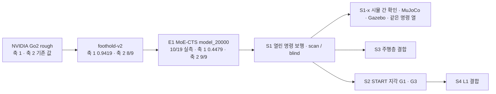

> 분류: A/정책학습 · 설계 (40 평가 · 시뮬 평가 축과 판정 규칙)
> 작성: 오흥재 (lead 세션 초안 · fable 20f 가 v1 으로 고쳐 씀)
> 근거: `docs/research/20260928-v2-mvp-report.md` 6-7 · 9 절 · `docs/research/20260911-eval-protocol-v2.md` · `sim/eval/eval_generalization.py` · `sim/eval/eval_command_response.py` · `s2_lab/eval_e1_v2axes/run_axis1.sh` · `run_axis2.sh` · evidence/E1-vs-v2-axis1.csv · axis2.csv · ASTRA 19f Q5 · fable 20e Q5 · START 2512.13153v1 267~275 · 339~341 · 354 · 389 행 · HiPAN 2604.26504 728 행 · APPROVED B · H(계단은 평가 한 칸 · 무대 계단 실측은 선택) · **K-G · K-I(팀장 승인 10/20 00:1x) · L(S2 20,000 회 · 11/10 대비책, 00:4x)** · Isaac Lab 2.3.2 `velocity_env_cfg.py` 98~100 행 · v2 보고 556 · 569 · 574 · 577~578 행 · JEPLO 2609.15770v1 246 · 249 행 · VERIFY-fable-20f P4 · P25 · P26 · P27 · **VERIFY-lead-final2 2 · 5 · 11 · 14 · 15 · 16 · 17(20j)** · 평가 도구 `foothold_s2/eval/judge.py` · `cells.py`(sonnet-code 커밋 70f70b47) · HiPAN 661 행 · **APPROVED M(팀장 결정 1~8 · 10/20 09:4x)** · evidence/baselines/README.md · axis1_cells.csv · axis2_cells.csv · axis3_cells.csv · S0 원자료 run_manifest.json(`C:/Users/AI-WS01/s2_lab/eval_new/s0/`, 체크포인트 sha256) · Newcombe 1998 Stat Med 17:873 방법 10(**인용 · 미열람**, 식은 수계산) · VERIFY-astra-r1 §3~§6(20t · fable 재측: 공식 USD sha256 · usd-core 질량 합 · FK · 카메라 기하)
> 요지: v2 의 두 자(험지 · 평지 명령)를 그대로 두고, 「명령이 험지에서도 열렸나」 를 재는 축 3 과 START 시험지 · 무대 계단 칸을 더한다. 기준은 학습 전에 등록하고 해시를 남긴다. 단계별 관문 후보 수치를 S1~S4 모두 여기에 모은다. K-G heading 판정(방향 이탈 > 0.1 → 0.75 새 판)과 K-I 시뮬 간 확인 S1-x(MuJoCo · Gazebo, Isaac 값 대비 차) 관문을 가정으로 등록한다
> 상태: v1.4 · 팀장 검토 전 · 기준 수치는 등록 후보(동결 아님) · K-G · K-I · L · 최종 점검 2(20j) · **팀장 결정 1~8(APPROVED M · 10/20 09:4x · fable 20l) 반영** · §8 판정식의 성질(n 100 · 허용폭 0.05 는 우월 판정이 됨)은 열린 항목 · **20q N 절 반영(fable 10/20)** · **20s lead 답 8 항 반영(fable 10/20)** · **20t ASTRA-R1 셋 반영(fable 10/20)** · 10/21 N1d/e 시작점·PD 잠정 범위와 R_body 구현 차이 기록 · 등록 관문 불변

# 41 · 시뮬 평가 축

## 0. 쉬운 요약

「나아졌다」 를 말하려면 자가 필요하다. 자는 셋이다. 도구는 이 문서대로 새로 만들고, v2 때 쓴 도구는 「옛 값이 그대로 나오나」 를 맞춰 보는 대조용으로만 쓴다. **축 1** 은 열여섯 가지 험지를 세 속도로 건너게 해서 성공률을 재고(v2 와 같은 칸), **축 2** 는 평지에서 「멈춰 · 가만히 · 돌아」 명령에 제대로 반응하는지 아홉 칸으로 재고, **축 3** 은 새로 만드는 자로 「험지에서도 옆 · 뒤 · 회전 명령이 되나」 를 지형 종류 × 방향으로 잰다. 여기에 START 논문의 시험지(징검돌 · 평균대 · 디딤 빔 · 틈, 논문 치수) 와 무대 계단 한 칸을 더한다. 성공은 「도달했나(R)」 「끝까지 안 넘어졌나(S)」 「둘 다(J)」 로 늘 셋을 따로 적는다. 몇 점을 넘어야 다음 단계로 가는지(관문)는 학습 **전에** 적고 해시로 고정한다. 무대 계단은 시연용 한 칸일 뿐 평가의 초점이 아니다.

## 1. 비교 흐름

| 판 | 축 1 (48 칸 평균) | 축 2 (9 칸) | 출처 등급 · 경로 |
|---|---|---|---|
| NVIDIA | v2 보고서 2 절 값 | v2 보고서 9-2 | **실측** · `docs/research/20260928-v2-mvp-report.md`. 체크포인트 `C:/isaac/IsaacLab/logs/rsl_rl/unitree_go2_gap_nvidia/nvidia_pretrained_source/nvidia_pretrained.pt` · sha256 `1891ab2bd6e7ccae1c6ef62bbc952f5e311e75361e53d4ab3314bf361def96f3`(S0 원자료 run_manifest.json 32 개 모두 같은 값, fable 20l 확인). S0 새 도구 값: 48 칸 0.4140 · 범위 안 32 칸 0.5663(evidence/baselines/axis1_cells.csv) |
| v2 | 0.9419 (0.5 · 1.0 · 1.5 m/s: 0.9369 · 0.9525 · 0.9363) | 8/9 (`turn` 낙상 0.109 미달) | **실측** · `sim/eval/results/20260928-v2-sweep/sweep_long.csv`. 체크포인트 `C:/isaac/IsaacLab/logs/rsl_rl/unitree_go2_gap_nvidia/2026-09-25_17-29-36_20260925_v2g2-feetair01_seed42_iter3000/model_3000.pt` · sha256 `e5c213219b4529464b7d3f3cce8f7a61c78fa4f2f7df7c64cfe12944c5ab2fee`(S0 run_manifest.json 32 개 동일). S0 새 도구 값: 48 칸 0.9419 · 32 칸 0.9447(1.0 · 1.5 m/s 32 칸은 옛 sweep 과 같고 0.5 m/s 3 칸이 최대 0.06 차, README) |
| E1 MoE-CTS | 0.4479 (0.6763 · 0.6675 · 0.0000) | 9/9 (요 추종 0.84~0.98) | **실측** · evidence/E1-vs-v2-axis*.csv · 출력 `C:/Users/AI-WS01/s2_lab/eval_e1_v2axes/` · 체크포인트 `C:/Users/AI-WS01/s2_lab/step1_run_b2/fixtures/model_20000.pt` · sha256 `c8951b797dbe41570009e9de35589d56b7ea1d10092728af17761d46a2df47e8`(S0 run_manifest.json 26 개 동일). S0 새 도구 값: 48 칸 0.4479 · 32 칸 0.6719(옛 하네스와 48/48 같음) |

E1 비교의 단서(evidence 하위 작업 보고): E1 쪽은 학습 무작위화 일부(마찰 0~2 · 게인 ±10 % · 모터 영점)를 켠 채 쟀고, 리셋 분포가 E1 학습 리셋이다. 신경망 · 학습 지형 · 학습량 · 눈 유무가 모두 다르므로 차이를 「명령 개방」 하나로 돌리지 않는다.

## 2. 축 1 · 험지 주행 (v2 그대로)

- 지형 16 종: 학습 계열 `rough6` (pyramid_stairs · pyramid_stairs_inv · boxes · random_rough · hf_pyramid_slope · hf_pyramid_slope_inv) + 미경험 `unseen10` (discrete_obstacles · wave · stepping_stones · gap · pit · rails · star · floating_ring · repeated_boxes · repeated_cylinders). 15 문서 7 절대로 S2 부터는 gap · stepping_stones · floating_ring 을 「학습 지형군 시험」 으로 옮겨 적는다(칸은 그대로 잰다).
- 속도 0.5 · 1.0 · 1.5 m/s, 평가 시간 12 · 6 · 4 s, 칸당 100 판(S0 기록 · 기준선 표), **관문 판정에 드는 칸은 칸당 200 판**(§8 · fable 20s · 기준 판도 200 판), 난이도 0.5, 시드 42, `--envs_per_terrain 10 --min_progress_m 3.0 --max_lateral_drift 0.75` (**실측** E1 `run_axis1.sh` 와 같은 인자. 하네스 기본값은 10.0 · 0.05 라 반드시 명시).
- 하네스: **이 문서 설계대로 새로 만든다**(`foothold_s2/eval/`, 축 1 · 2 · 3 · START 시험지 · R/S/J 를 한 틀에). v2 `sim/eval/eval_generalization.py` 와 E1 판(`s2_lab/eval_e1_v2axes/harness/`)은 **참고 · 비교 대조용**으로만 쓴다: 새 하네스가 v2 · E1 체크포인트에서 옛 값(0.9419 · 0.4479 · 9/9)을 ±0.02 안에서 다시 내는지가 새 하네스의 첫 시험이다(**팀장 정정 10/19 22:5x**, APPROVED G-5 · H).
- 성공 = 생존 AND 전진 AND 속도 추종 AND 방향(v2 정의). 성분 넷을 모두 열로 남긴다(실패 원인이 속도마다 다르다는 E1 결과: 0.5 m/s 는 방향, 1.5 m/s 는 추종). **성분 넷 가운데 「방향」 이 최저인 칸 수**가 heading 판정(K-G · 14 §3.2)의 두 번째 신호다: E1 0.5 m/s 16 칸 중 15 칸이 방향 최저(평균 생존 0.906 · 방향 0.679, **실측** evidence/E1-vs-v2-axis1.csv · fable 재계산 10/20).
- **주의**: 1.5 m/s 는 학습 범위가 ±1.0 인 정책에는 「범위 밖」 이다. 종합 점수와 따로 「범위 안 32 칸」 평균을 같이 적는다(v2 0.9447 · E1 0.6719).

## 3. 축 2 · 평지 명령 응답 (v2 9 절 그대로)

| 칸 | 지표 | 문턱 |
|---|---|---|
| `stop` | 낙상 비율 | ≤ 0.03 |
| `hold` | 낙상 비율 · 잔류 속도 · 끝 1 초 관절 목표 변화 | ≤ 0.03 · ≤ 0.005 m/s · ≤ 0.01. **읽는 법(팀장 결정 7 · 10/20 09:4x)**: 시드 42 · 43 · 44 세 번 재어 세 지표 각각 **셋 중 둘 이상 문턱 안이면 통과**(reset 난수만으로 관절 목표 변화가 0.00185~0.01117 로 움직여 문턱 0.01 을 넘나듦, VERIFY-lead-final2 27). 다른 칸(`stop` · `turn`)은 시드 42 값 하나로 판정 |
| `turn` | 낙상 비율 | ≤ 0.10 |
| `turn` | 요 추종비 −1.0 · −0.5 · +0.5 · +1.0 | 각 ≥ 0.40 |

하네스: 새 하네스에 같은 아홉 칸을 넣고(`--scenario all --num_envs 64 --seed 42`, `hold` 판정용으로 `--seed 43` · `44` 두 번 더. S0 표 `evidence/baselines/axis2_cells.csv` 의 `value_s42 · value_s43 · value_s44 · seeds_failed` 열이 그 값이고 `hold` 칸은 `seeds_failed ≤ 1` 이 통과다), v2 `sim/eval/eval_command_response.py`(E1 `run_axis2.sh`) 값과 대조한다. 판정은 네 시나리오를 이어 돈 값(v2 6-9 의 주의: `turn` 만 따로 돌리면 난수 소비가 달라 값이 바뀐다).

## 4. 축 3 · 지형군 × 방향 (신규)

v2 는 험지에서 옆 · 뒤 · 회전을 한 번도 재지 않았다(v2 보고서 9-2). 축 3 은 「명령이 열렸다」 를 험지에서 증명하는 자다.

| 지형군 \ 방향 | 앞 0.5 | 뒤 0.5 | 좌 0.5 | 우 0.5 | 대각 (0.4, 0.4) | 앞 + 회전 (0.5, 0.5 rad/s) | 제자리 회전 ±1.0 |
|---|---|---|---|---|---|---|---|
| 이어진 지형 (rough6 중 계단 둘을 뺀 boxes · random_rough · hf_pyramid_slope · _inv + wave · discrete_obstacles. 계단 행과 **서로소**, 평가 도구 `cells.py` 83~84 와 같음) | 측정 | 측정 | 측정 | 측정 | 측정 | 측정 | 측정 |
| 계단 (pyramid_stairs · _inv · 무대 계단 칸) | 측정 | 측정 | 측정 | 측정 | 측정 | 측정 | 측정 |
| 듬성한 발판 (gap · stepping_stones · floating_ring · START 4 종. **8 × 8 m 학습 칸**(15 §2)에서 잰다, 8 × 4 m 시험지는 옆 · 뒤 · 회전을 못 잼) | 측정 | **뒤 0.3 측정**(물러나기 범위, D39 · **명령 2 s · 기준 거리 0.6 m**, 팀장 결정 2) · 0.5 는 1 차 범위 밖 | **두 칸: 좌 0.2(가정 칸 · S0 부터 고정 · 학습 전 등록) + 좌 vy_obs(학습 뒤 값, 14 §6 규칙)**(둘 다 **명령 2 s · 기준 거리 = 명령 속도 × 2 s**, 결정 2 에 맞춤) · 0.5 는 범위 밖 | 두 칸: 우 0.2(가정 칸) + 우 vy_obs · 0.5 는 범위 밖 | **1 차 범위 밖** | 측정 | **측정**(START 식 제자리 회전 ±1.2 학습 범위, J-B. 평균대 · 디딤 빔은 지형별로 따로 집계) |

- 이어진 지형 · 계단 행의 대각 (0.4, 0.4) 는 저속 학습(J-F, 14 §3 U[0, 1.0])으로 학습 범위 안이다(VERIFY-lead-final 12). 듬성한 발판 행의 뒤 · 좌 · 우 · 제자리 회전 칸은 **학습 범위 값**(뒤 0.3 · 옆 vy_obs · 회전 ±1.2)으로 잰다(D39 · J-B). 「1 차 범위 밖」 칸(뒤 0.5 · 옆 0.5 · 대각)은 S1 · S2(D435i 만) 결과에서 따로 표시하고 종합 점수에 넣지 않는다. S4(L1) 에서 처음 판정 대상이 된다(14 문서 · 00 §4 합의 4). NVIDIA · v2 는 옆 명령을 학습하지 않았으므로 옆 칸은 「학습 범위 밖」 표시로 잰다(51).
- **듬성한 행 뒤 · 옆 칸의 기준 거리 · 평가 시간(팀장 결정 2 · 10/20 09:4x · fable 20l)**: 뒤 0.3 칸은 명령 2 s · 기준 거리 0.6 m(= 0.3 m/s × 2 s, 물러나기 상한과 같은 값) · 진행 비율 분모 0.6 m, 2 s 뒤 명령 0 으로 2 s 더 관측(T = 4 s, S 는 T 끝까지, **가정**). 옆 0.2 가정 칸 · 옆 vy_obs 칸도 같은 꼴: 명령 2 s · 기준 거리 = 명령 속도 × 2 s(0.2 면 0.4 m) · T = 4 s. 까닭: 학습 노출이 2 s 모드(물러나기 D39 · S4 옆 걸음 모드, 14 §3)라 평가 거리 · 시간을 같게 둔다. 옛 규칙(3 m ÷ 속도 × 2 = 20 s, 진행 ≥ 0.6 은 3.6 m 후진 요구)으로 잰 S0 는 세 판 모두 그 칸 J 0~0.29(evidence/baselines/axis3_cells.csv: 뒤 E1 0.29 · v2 0.00 · NVIDIA 0.00, 좌 · 우 E1 0.063 · 0.133 · v2 0 · 0 · NVIDIA 0 · 0) → 새 규칙 값은 재측정 전까지 **없음**(기록용 · 관문은 S0 의 이 칸 값을 쓰지 않는다).
- **「범위 안 32 칸」 목록은 모든 단계에서 고정**: 축 1 의 16 종 지형 × {0.5, 1.0} m/s (VERIFY-lead-final 19). 잰 칸은 늘 32 이고 **판정에 넣는 칸**만 단계에 따라 다르다: S1-scan 은 판정 26 칸 + 기록 6 칸(gap · rails · floating_ring × {0.5, 1.0}, 팀장 결정 1 · §9), 나머지 관문은 32 칸 전부. 15 §7 의 학습 · 미경험 재분류는 표기(「학습 지형군 시험」 라벨)만 바꾸고 칸 목록은 바꾸지 않는다.
- 지표: 명령 방향 진행(몸 기준 명령 벡터에 투영한 이동 ÷ 명령 거리) · 벡터 추종 오차 · 생존 · 방향 이탈. 옆 명령을 몸을 돌려 전진으로 대신하면 성공이 아니다(ASTRA 19f Q5). **방향 이탈의 정의(평가 도구 `foothold_s2/eval/judge.py` 와 같은 말, 커밋 70f70b47 177 · 233 · 260 행)**: yaw_dev_deg = |실제 요각 변화 − 명령이 만든 요각 변화(∫ wz_cmd dt)| 이고 30° 를 넘으면 「이탈」 표시. 선속도 명령이 있는 칸에서만 뜻이 있다(앞 + 회전 칸은 ∫ wz_cmd dt 를 빼므로 명령대로 돈 것은 이탈이 아니다). **제자리 회전 칸은 이탈 · 진행을 쓰지 않고** 요 추종비(명령 wz 대비 실제 wz 평균, 뒤 절반 구간) · 생존으로 따로 본다(§5 · VERIFY-lead-final2 2). 방향 이탈률 = 그 칸에서 이탈 표시가 난 판의 비율(Wilson 구간 포함, `rsj.py` yaw_dev_rate).
- 하네스: 새 하네스의 축 3 모듈(S0 에서 만든다, 51 · `foothold_s2/eval/axis3.py`). 옛 `eval_generalization.py` 는 `--command_vx` 하나만 받고 `verify_commands` 도 vx 만 본다(375~390 행)는 점을 참고만 한다. **가정**: 칸당 100 판 · 시드 42 · 난이도 0.5 · 평가 시간은 3 m 기준 거리 ÷ 명령 속도 × 2(0.5 m/s 면 12 s, 축 1 과 같음). **예외**: 듬성한 행 뒤 · 옆 칸은 위 결정 2 규칙(명령 2 s · 기준 거리 = 속도 × 2 s · T 4 s).

### 시작점 N1d/e 계약과 10/21 판독 범위

**코드 · 가정**: 듬성한 뒤·옆 시작점은 네 발 지지면 높이 차 ≤ 0.03 m, 발 구 바닥과 지지면 간 최소 여유 0.01 m를 만족해야 한다. root 높이는 각 발 FK z와 지지면 z에서 계산하고, 발 구 반지름 0.022 m에 가장자리 여유 0.05 m를 더해 발 중심 inset 0.072 m를 요구한다. 각 발의 여유와 실패 원인을 기록한다. 유효한 위치·자세가 없으면 `no_start`로 남기고 정책 주행 실패 또는 0점 성공 판으로 바꾸지 않는다. XY만 맞춘 옛 후보를 fallback으로 쓰지 않는다([N1d](https://github.com/foothold-project/foothold-lab/issues/555#issuecomment-6302409827) · [N1e](https://github.com/foothold-project/foothold-lab/issues/555#issuecomment-6302777151)).

**진단 실측 · 잠정**: 난이도 0.5 · seed 42의 뒤·좌·우 시작점에서 15칸은 ready, floating_ring과 balance_beams의 각 뒤·좌·우 6칸은 `no_start`였다. 이후 정책 없는 기본 관절 PD 유지 대조를 거친 9칸 시작점은 접촉·생존 기준에서 잠정 통과로 보고됐다. 대조 gap의 지면 기준 몸 높이는 30·60스텝에서 0.249306·0.266623 m라 등록 높이 ≥ 0.30 m에 대조도 못 닿았다. 이 높이 항목은 **판정 불가**이며 문턱을 낮추거나 9칸을 전체 축 3 합격으로 읽지 않는다. 다른 난이도·시드·정책 동역학은 미확인이다([PD 판독](https://github.com/foothold-project/foothold-lab/issues/555#issuecomment-6303243159) · [밤 기록](NIGHT-REPORT-1021.md)). §8·§9의 등록 관문은 그대로다.

## 5. 「건넘」 셋 (ASTRA 19f Q5)

- **R 기준선 도달**: 설계상 시간 T 안에 몸통(base)이 기준선을 통과하고 그 순간 네 발 접촉점이 지지면 위이며 **가장자리 마스크 밖**이어야 한다(16 §2 · 15 §8: 낙하 높이 ≥ 0.2 m 세로 모서리의 2.5 · 5 cm 띠). 현재 평가 도구의 `R_body`(`judge.py` 70f70b47)는 몸통 기준선 통과만 기록한다. 네 발 지지·마스크 조건까지 검사했다는 뜻으로 읽지 않는다. 이 차이는 구현·판정 연결 미완료로 남기며 §8·§9의 기존 등록값을 여기서 고치지 않는다.
- **S 끝까지 생존**: T 까지 낙하 · 전복 · 위험 접촉 없이.
- **J 둘 다**: R AND S. J ≤ R, J ≤ S 가 늘 맞아야 한다(집계 검사, L0 시험).
- 성공 즉시 끝내면 S 를 못 잰다 → 도달 뒤 정지 명령을 주고 T 까지 관측한다.
- 정지 · 제자리 회전 칸에는 R 을 쓰지 않는다.

## 6. START 시험지 (논문 시뮬 치수 · START 절대 치수 재현 시험)

| 지형 | 최고 난이도 치수 | 출처 |
|---|---|---|
| stepping stones | 희소도 76.3 % · 돌 0.2 m · 틈 0.25 × 0.175 m · 무작위 돌 0.5× · 열 0.45× | **논문** 267~269 · 339~341 행 |
| balance beams | 폭 0.175 m | **논문** 269 행 |
| stepping beams | 희소도 64.7 % · 빔 0.15 m · 틈 0.275 m | **논문** 271~273 행 |
| gaps | 폭 0.7 m(START 절대 치수. 「로봇 길이 2 배」 해석은 지움 · 20t) | **논문** 273~275 행 |

- 레벨 10 단, 8 × 4 m 칸(시험지는 START 칸 그대로, 학습 칸 8 × 8 과 다름), 깊이 0.2~0.7 m(**논문** 275 행). 평가는 START 방식 「6 m 통과 · 500 판 · 무작위 지형 10」 을 따른다(**논문** 354 행) → 축 1 과 별도 표. 지표는 성공률(= R) · 주파율(쓰러지기 전 간 거리 / 전체) · MEV(가장자리 디딤 비율, 최고 난이도).
- 시험지(8 × 4 m)는 전진 R · 주파율 · MEV 만 잰다. 옆 · 뒤 · 회전은 축 3 듬성한 행(8 × 8 m 학습 칸)에서 잰다(VERIFY-lead-final2 17).
- START 실기 표(**논문** 389 행: 평균대 0.2 m · 디딤 빔 58.8 %)는 실기 시험(42) 참고값이고 시뮬 시험지에는 쓰지 않는다. 선행 논문의 0.48× · 깊이 0.3~0.7 도 쓰지 않는다(VERIFY 20f P4).
- **비교의 뜻(ASTRA R1-2 · 20t)**: 이 시험지는 START 절대 치수 재현이다. Go2 와 Lite3 에 같은 상대 난이도라고 읽지 않는다(판단 보류). 결과 해석 기준은 15 §4 의 축별 비율표(hip 간격 1.108 · 다리 1.065 · thigh 축 간격 0.885 · 발 지름 0.55)이고, 원 치수와 성공률을 그대로 보고하며 「더 넓은 발판처럼 느낀다」 는 기하 추정과 실제 통과 성능을 분리한다. 성능을 보고 치수를 조정하는 기준으로 쓰지 않는다.

## 7. 무대 계단 칸

- 발표 무대 계단의 단 높이 · 디딤 폭 · 단 수 · 재질은 **가능하면** 실측해(42) 시뮬 계단 하나로 만든다. 실측이 없으면 Isaac Lab 계단 범위(0.05~0.23 m) 의 가운데 0.15 m · 너비 0.3 m 를 대표 칸으로 쓴다(**가정**, APPROVED H 「무대 계단 실측은 필수 아님」). 디지털 트윈 Real2Sim 계단 메시가 있으면 그것을 쓴다.
- 축 1 · 축 3 계단 행에 한 칸으로 넣고, 조이스틱 시연 경로(앞 0.5 · 정지 · 회전)를 그대로 시나리오로 돈다. 평가의 초점은 이어진 지형 · 듬성한 지형 전체이고 무대 계단은 시연용 한 칸이다.

## 8. 판정 규칙

- 칸마다 성공률 + Wilson 95 % 구간. 판 사이 차이는 구간이 겹치지 않을 때만 「다르다」.
- **「진짜 하락」 판정(팀장 결정 8 · APPROVED N-6 10/20 13:3x 「평균 비열등(−3 %p) + 칸별 큰 하락(−10 %p)」 · 옛 M-8 의 칸별 Newcombe 하한 식을 대체)**: 판정 칸 집합(관문마다 §9 가 정한다)에서 기준 판 · 새 판을 **칸당 n 200** 으로 재고(100 → 200 · fable 20s 몬테카를로 · lead 20s. 기준 판도 같은 200 판으로 다시 잰다 · S0 의 100 판 값은 기록용), 두 조건을 **모두** 넘어야 「하락 아님」 이다. **(A) 평균 비열등**: 범위 안 판정 칸 평균 성공률의 차이 d̄ = p̄₂ − p̄₁ 의 95 % 구간 **하한 ≥ −0.03**. **(B) 칸별 큰 하락 없음**: 어느 칸에서도 차이 d = p₂ − p₁ 의 95 % 구간 **상한이 −0.10 보다 작지 않다**(상한 < −0.10 인 칸이 하나라도 있으면 「진짜 하락」). 구간은 둘 다 Newcombe 식(두 Wilson 구간을 합친 score 구간, 방법 10): 하한 L = d − √((p₂ − l₂)² + (u₁ − p₁)²), 상한 U = d + √((u₂ − p₂)² + (p₁ − l₁)²), l · u 는 각 판의 Wilson 95 % 한계. (A) 의 평균 구간은 판정 칸의 성공 수를 합산한 비율(k = Σ kᵢ · n = 칸 수 × 100, 칸당 판 수가 같으므로 칸 평균 = 합산 비율)에 같은 Newcombe 식을 적용한다(**가정** fable 20q · 식 선택: 칸 사이 성공률이 다르면 합산 구간이 칸별 분산 평균보다 넓어 보수적이다 · lead 확정). 「하락 0 칸」 을 쓰던 모든 관문(§9 S1-scan · S1-b · S2-a · F26 사전 (1) · S4 · 52 · 53 · 55 · 50 · 60 · 21)이 이 (A)(B) 정의를 쓴다. 등록값: (A) 허용폭 0.03 · (B) 허용폭 0.10 · z 1.96 · **칸당 n 200**(기준 · 새 판 모두. gates-v1.json `mean_noninf` · `cell_big_drop` 필드, 옛 `real_drop` 은 없앰). 팀장 N-6 의 「칸당 100 판 유지」 를 200 으로 바꾸는 것이라 **팀장 확인**(lead 20s 지시로 fable 이 고름).
- **판정식 · 칸당 판 수의 근거(fable 20s 몬테카를로 · lead 20s 의뢰 · 10/20 17:1x)**: 모집단 = S0 실측 칸 성공률(evidence/baselines/axis1_cells.csv · NVIDIA · v2 · E1 세 판) × 관문 칸 집합 셋(S1-scan 판정 26 칸 overall · 범위 안 32 칸 overall(S1-b · S2-a · S4) · F26 사전 (1) 이어진 16 칸 S 생존) = 아홉 조합. 기준 판 · 새 판을 같은 n 으로 이항 표집(20,000 회 · 시드 20261020 · 세션 scratchpad `mc20s.py` · `mc20s_results.json`, CPU). 목표(lead): 같은 정책 재측정 통과 ≥ 95 % · 모든 칸 5 %p 하락 검출 ≥ 95 % · 성공률 ≥ 0.8 인 한 칸 25 %p 하락 검출 ≥ 80 %(해당 칸을 하나씩 떨어뜨려 재고 최저값으로 판정). 아홉 조합의 최악값:

| 식 | 칸당 n | 재측정 통과(최악) | 5 %p 검출(최악) | 25 %p 한 칸 검출(최저 / 중앙) | 목표 | 범위 안 32 칸 평가 GPU / 판(가정) |
|---|---|---|---|---|---|---|
| (A) 합산 하한 ≥ −0.03 · (B) 칸별 상한 < −0.10 · z 1.96(N-6 그대로) | 100 | 0.792(NVIDIA 26 칸 · E1 26 칸 0.795 · E1 32 칸 0.803) | 1.000 | 0.804 / 0.877(E1 32 칸) | **미달** | 약 22 분 |
| 같은 식 | **200** | **0.987**(E1 26 칸) | 1.000 | **0.904** / 0.976(NVIDIA 32 칸) | **충족** | **약 44 분** |
| 같은 식 | 300 | 1.000 | 1.000 | 0.979 / 0.998 | 충족 | 약 66 분 |
| 대안: (A) 점 추정 d̄ ≥ −0.025 · (B) 칸별 상한 < −0.10 · z 1.28(한쪽 90 %) | 100 | 0.971 | 0.980 | 0.848 / 0.935 | 충족(여유 작음) | 약 22 분 |

- **고른 것: 식은 N-6 그대로(허용폭 0.03 · 0.10 · z 1.96) · 칸당 n 200 · 기준 판도 200 판.** 격자 243 조합(A 9 꼴 × B 9 꼴 × n 3) 중 n 100 에서 목표를 넘는 것은 (A) 점 추정 · (B) z 1.28 꼴 5 개뿐이고 여유가 작아(0.97 · 0.98 · 0.85) 고르지 않았다. n 300 은 GPU 22 분이 더 들고 n 200 과의 차는 25 %p 한 칸 검출 0.90 → 0.98 뿐이다.
- **왜 n 100 이 안 되나**: 중간 성공률 칸이 많은 판(E1 32 칸 평균 0.67 · 0.2~0.8 칸 9 개, NVIDIA 0.57)에서 (A) 합산 구간의 반폭이 약 0.025 라 허용폭 0.03 과 거의 같다. 그래서 같은 정책을 다시 재도 d̄ 가 −0.005 아래로 내려가는 약 1/3 이 (A) 에서 걸린다(lead 가 본 「66 % 통과」 와 같은 현상 · 원인은 B′ 가 아니라 (A) 의 구간 폭). v2(26 칸 중 23 칸이 1.0)는 어느 n 에서도 통과. (B) 만 떼어 보면 n 100 에서도 재측정 통과 ≥ 0.987 이고, 한 칸 25 %p 검출은 0.8 → 0.55 칸이 가장 어렵다(n 100 에서 0.80 · 200 에서 0.90 · 300 에서 0.98).
- **기준 판을 S0 의 100 판 그대로 두고 새 판만 200 · 300 판으로 재면(비대칭)** E1 분포에서 재측정 통과 0.918 · 0.951, NVIDIA 26 칸 0.948 · 0.977 로 목표에 못 미친다(`mc20s_asym.py`). 그래서 **기준 판도 200 판으로 다시 잰다**: v2 범위 안 32 칸 1 회(S1-scan 기준), S1a-blind-v1 · S2-G0 는 처음부터 200 판. S0 의 100 판 표는 기록 · 대조용으로 남긴다.
- **GPU 시간(가정)**: 51 §2 「축 1 한 판 48 칸 × 100 판 약 27 분(E1 실측 · GPU 0)」 을 에피소드 길이(12 · 6 · 4 s) 비례로 나눈 값. 범위 안 32 칸 100 판 ≈ 22 분 → 200 판 ≈ 44 분 / 판, 이어진 16 칸 200 판 ≈ 22 분. 관문 하나 = 새 판 44 분 + 기준 판 44 분(재측 1 회) ≈ 1.5 h. S1-scan · S1-b · S2-a · F26 · S4 다섯 관문 합계 약 5~6 h(기준 재측은 판마다 1 회).
- 20q 가 적었던 성질 둘은 n 200 으로 닫힌다: (B) 가 걸리는 관측 하락은 n 100 의 18 %p 에서 n 200 의 30/200 = 15 %p(기준 200/200 → 새 ≤ 170, §11) 로 내려오고, 16 칸 합산의 저생존 replicate 불통과는 세 판 모두 통과 1.000 이 된다. 보고는 (A) 의 d̄ · L 과 (B) 의 최저 U 칸을 같이 적는다.
- 시드 하나: 구간은 「그 학습 시드 정책」 에 대한 것이다. 방법의 우월성이나 재현성을 말하지 않는다(70 문서 시드 정책).
- 체크포인트 선택은 검증용 지형 시드에서, 최종 시험지는 한 번만.
- 이전 CMD-R 의 「세 칸 하한 > 0, 평균 + 10 %p」 는 자동 승계하지 않는다(ASTRA 19f).
- 평가기는 학습 전에 끝까지 한 번 돈다(지난번 `raycaster_cache_not_released` 로 멈춘 일, S2-RESULT-PLAN 1 절).

## 9. 학습 전 등록 후보 기준 (팀장 확정 전 · 50~55 가 이 표를 가리킨다)

| 단계 | 기준 | 값 | 근거 |
|---|---|---|---|
| S0 | 새 하네스 · 세 판 | 새 하네스가 v2 · E1 옛 값(0.9419 · 0.4479 · 9/9)을 ±0.02 · 판정 동일로 재현(51 §3-4) · NVIDIA · v2 · E1 세 판이 축 1 · 2 · 3 · START 시험지 숫자를 가짐 · Linux 재현 확인(51 §3-7) | **실측** 옛 값 · **가정**(VERIFY-lead-final2 14) |
| S1 공통 | 축 2 | 9/9(`hold` 세 칸은 시드 42 · 43 · 44 중 둘 이상 문턱 안이면 통과, 팀장 결정 7 · §3), 요 추종 각 ≥ 0.80 | E1 0.84~0.98 (evidence/E1-vs-v2-axis2.csv) |
| S1-scan | 축 1 범위 안 32 칸 가운데 **판정 26 칸 + 기록 6 칸**(팀장 결정 1 · 10/20 09:4x: v2 가 학습한 gap · rails 와 floating_ring × {0.5, 1.0} 6 칸은 S1-a 지형에 없어 「v2 이상」 판정에서 빼고 기록만, 목록은 gates-v1.json) | v2 이상: 판정 26 칸에 §8 결정 8 (A) 평균 차이 하한 ≥ −0.03 · (B) 어느 칸도 차이 상한 < −0.10 아님(N-6 · **칸당 200 판** · 20s). **결합 효과**(종아리 한계 · PIE DR · 지형 비율 · 보상 세트 · 처음부터 학습이 함께 바뀜, VERIFY-lead-final 3)로 읽는다 | v2 0.9369 · 0.9525 (같은 관측) |
| S1-blind | 축 1 범위 안 32 칸 | 평균 ≥ 0.67 · 생존 ≥ 0.95(결합 효과) | E1 0.6719 (눈 없음 기준) |
| S1 공통 | 축 3 이어진 지형 · 계단 | 선속도 칸(앞 · 뒤 · 좌 · 우 · 대각 · 앞 + 회전): 명령 방향 진행 ≥ 0.8 · 생존 ≥ 0.95 · 방향 이탈률 ≤ 0.1(이탈 = yaw_dev_deg > 30°, §4 정의). 제자리 회전 칸: 요 추종비 ≥ 0.80 · 생존 ≥ 0.95(이탈 · 진행 없음) | **가정** |
| S1 공통 (K-G 판정) | 축 3 이어진 지형 · 계단 선속도 칸 방향 이탈률, 축 1 실패 성분 | 방향 이탈률 ≤ 0.1(위 행 · §4 정의). **초과 → 60 C 처방 하나: heading 을 같은 기준(자유 속도 env 전체 대비)으로 30 % → 50 %**(팀장 결정 4 의 75 % 를 APPROVED N-7 10/20 13:3x 가 50 % 로 · S1 결과 검증 뒤 최종 · 플래그 0.694 · 1,000 회 전 0.556 은 14 §3.2 처방 행. v2 E 판 `rel_heading_envs` 0.75 는 Isaac 정의라 같은 값이 아니다) **새 판 S1a-v1.1**. 대조 판(heading 0 %)은 없으므로 「heading 효과」 단독 결론 금지 | **가정**(30 % · 플래그 0.417, 결정 4) · **실측** v2 569 · 574 행(heading 끔이 가장 낮음) · 577~578 행(단일 원인 미확인) |
| **S1-x 시뮬 간 확인 (K-I)** | S1-a blind 정책(ONNX)을 MuJoCo(`unitree_mujoco`) · Gazebo 에서 **같은 명령 열**(축 2 9 칸 + 평지 · 무대 계단 칸 방향 7 칸 = 16 칸, 칸당 50 판 · 시드 42)로. **Isaac 쪽 기준값은 같은 16 칸 · 50 판을 S1-x 직전(10/30 관문 뒤 · 10/31 전) Isaac 에서 따로 잰다**(축 3 본 평가에는 평지 칸이 없고 판 수도 100 이라 섞지 않음 · GPU 약 0.5 h **가정**, VERIFY-lead-final2 11) | Isaac 값 대비 속도 추종비 차 ≤ 0.10 · 생존 차 ≤ 0.05 · 방향 이탈 차 ≤ 0.05 · 축 2 9 칸 판정 동일. 어긋나면 「시뮬 차이」 로 기록하고 앱 시뮬 연결(23 §5)은 Isaac 으로 | **가정** (JEPLO 가 IsaacLab 학습 뒤 별도 MuJoCo 평가 환경을 둠, **논문** 2609.15770v1 246 · 249 행) |
| S1 공통 | 무대 계단 칸 시나리오(앞 0.5 · 정지 · 회전) | J ≥ 0.9 | **가정** |
| S1-b | 깃발 지형군 레벨 | 3,000 회에 틈 · 징검돌 레벨 중앙값 ≥ 5 | **가정** (H14-1) |
| S1-b | 축 1 범위 안 32 칸 | S1a-blind-v1 대비 진짜 하락 아님(32 칸: §8 (A) 평균 차이 하한 ≥ −0.03 · (B) 어느 칸도 상한 < −0.10 아님 · 칸당 200 판, 결정 8 · N-6 · 20s) | **가정**(52 §2 · VERIFY-lead-final2 14) |
| S1-b · S2-b | 축 3 듬성한 지형 뒤 0.3 칸(물러나기, D39) · 제자리 회전 ±1.2 칸(J-B) | 뒤 0.3(명령 2 s · 기준 거리 0.6 m, 결정 2 · §4): 명령 방향 진행 ≥ 0.6 · 생존 ≥ 0.9. 제자리 회전: 징검돌 · 틈 생존 ≥ 0.9(평균대 · 빔은 기록만, 몸 폭 때문에 낙하가 결과로 드러나게 둠). 옆 vy_obs 칸은 기록만. **vy_obs 규칙**: S1-b(S2 는 S2) 마지막 1,000 회 깃발 지형군 \|vy\| 명령 95 분위(14 §6) | **가정** (H14-5 · H14-6) |
| **S2-G0** (눈만 끈 판, J-A · 3072 · **20,000 회**, L) | S2 틀의 기준선 | 관문 없음(기준선). 축 1 범위 안 32 칸 · START 시험지 · 축 3 를 기록해 G1 · F26 의 비교 대상이 된다. G1 · G3 도 같은 20,000 회(18 §2) | **팀장 승인 J-A** · 반복 수 **L** |
| S2-a (G1) | 재구성 · 축 1 · START 시험지 | 재구성 MAE 기록(보고 항목) · 축 1 범위 안 32 칸 **S2-G0 대비** 진짜 하락 아님(§8 (A)(B) · 칸당 200 판 · 결정 8 · N-6) · START 시험지 4 종 R 평균 ≥ **S2-G0 + 10 %p**(눈의 효과, 한 변수) | **가정** |
| S2-b (G3) | 틈 · 징검다리 · START 시험지 | gap ≥ 0.99 · floating_ring ≥ 0.99 · stepping_stones 1.0 m/s ≥ 0.24 (v2 이상) · START 시험지 R 평균 ≥ G1 + 5 %p · MEV < G1 | v2 축 1 값 · **가정** |
| F26 사전 | S2 하위 대 **S1a-blind-v1**(실기 하위 · 11/10 에 존재하는 유일한 blind 판 · sha256 을 gates-v1.json 에 고정, VERIFY-lead-final2 5) · **S2-G0** | (1) **축 1 범위 안 32 칸 가운데 이어진 지형 16 칸**(rough6 6 종 + wave · discrete_obstacles × {0.5, 1.0} m/s, 목록은 gates-v1.json) 의 S 생존: §8 (A) 16 칸 평균 차이 하한 ≥ −0.03 · (B) 어느 칸도 상한 < −0.10 아님 · 칸당 200 판(합산 n 3,200), 곧 S1a-blind-v1 대비 진짜 하락 아님(**정의 하나** · 결정 8 · N-6 · 20s, VERIFY-lead-final2 15. 20s 몬테카를로: 16 칸 S 생존은 세 판 모두 재측정 통과 1.000 · 5 %p 검출 1.000) (2) START 시험지 R 평균 ≥ S2-G0 + 10 %p. 비교 대상 판은 이 둘로 고정(VERIFY-lead-final 19). **11/10 대비책(L · 학습 전 등록)**: G3 평가가 11/10 00:00 까지 안 끝나면 (1)(2) 는 **G1 결과로 판정**하고 G3 는 11/14 까지 계속. G3 가 뒤에 G1 을 넘으면 11/19~11/24 여유 창에 student 재증류 1 회(8 h)를 더한다(70 §1.2) | fable 20e F26 · **가정** · **L** |
| F26 사후 (3) | student 재증류판 | Corridor · Room SR 하락 ≤ 2 %p(재증류 전 student 대비) | **가정** |
| F26 사후 (3′) | teacher 재학습판(D34) | 관문 S3 전체를 다시 통과(아래 S3 행) | **가정** (VERIFY-lead-final 6) |
| S3 · S2 하위판 | HiPAN 방 · 우리 방 | Corridor SR ≥ 88.6 % · Room ≥ 85.1 %(논문 「자세 없는 판」 98.4 · 94.5 의 0.9 배 = 88.56 · 85.05, 2604.26504 661 행, VERIFY-lead-final2 16) · 보행 지형 방(계단 · 틈) 도달 ≥ 70 % · 외나무 진입각 오차 ≤ 15° · 충돌 에피소드 ≤ 5 % | **가정** (VERIFY 20f P26) |
| S3 · S1-blind 하위판 (팀장 결정 3 · 10/20 09:4x · 두 벌 다 학습 전 등록) | HiPAN 방 · 우리 방(듬성한 지형 방 제외) | Corridor SR ≥ 88.6 % · Room ≥ 85.1 % · **계단 방 도달 ≥ 70 %**(듬성한 지형 방(틈 · 징검다리 · 외나무)은 평가에서 뺌 · 외나무 진입각은 해당 없음) · 충돌 에피소드 ≤ 5 % | **가정** · lead 권고 3 |
| S4 | 축 3 듬성한 지형 옆 · 뒤 칸 | 진행 ≥ 0.6 · 생존 ≥ 0.9(옆 · 뒤 칸은 명령 2 s · 기준 거리 = 속도 × 2 s, §4 결정 2 규칙) · 앞 칸 S2 대비 진짜 하락 아님(§8 (A)(B) · 칸당 200 판) · 대조판(L1 만) 앞 칸 진짜 하락 아님(§8 (A)(B) · 200 판) | **가정** |

## 10. 산출물 형식

- 칸별 CSV(성분 넷 · R/S/J · Wilson) + 판 비교 CSV(E1 선례 `summarize.py`).
- 명령 원문 · 실행 시각 · PID · 체크포인트 sha256 · 하네스 커밋을 `command.txt` 와 manifest 에(E1 `run_axis1.sh` 의 방식).
- 등록 파일: `evidence/baselines/gates-v1.json`(9 절 값 + vy_obs 규칙 + 비교 대상 판 이름 · sha256(S1a-blind-v1 · S2-G0) + 범위 안 32 칸 목록 + F26 사전 (1) 의 이어진 16 칸 목록 + heading 플래그 0.417 · 0.333 과 처방 플래그(14 §3.2) + S1-x 차 문턱 + **S1-scan 판정 26 칸 · 기록 6 칸 목록(결정 1) + 비교 규칙 필드 `mean_noninf = newcombe_pooled · margin 0.03 · z 1.96 · n 200/칸` · `cell_big_drop = newcombe_upper · margin 0.10 · z 1.96 · n 200`(§8 · 결정 8 · N-6 · n 200 은 20s) + `hold` 시드 3 중 2 규칙(결정 7) + S3 관문 두 벌(결정 3) + 듬성한 뒤 · 옆 칸 기준 거리 · 시간(결정 2)** + **갈래 신호 숫자 전부**(60 §2 · 52 §3 · 53 §6 · 54 §3 · 51 §2 의 「학습 전 등록」 표 값, VERIFY-lead-final2 14)) 의 sha256 을 50 §4 의 2 단계 동결(각 학습 직전) manifest 에.
- 지표 계산(R/S/J · 성분 넷 · 방향 이탈)은 시뮬에서 분리된 모듈(`foothold_s2/eval/metrics.py`)로 두고 명령 열 재생기(`eval/replay_commands.py`)도 시뮬 무관으로 두어, S1-x 에서 궤적 로그만 바꿔 같은 CSV 틀을 낸다(**가정** · K-I).

## 11. 검증 사다리 · 가설 · 열린 항목

- L0 CPU: R/S/J 집계가 J ≤ min(R, S) 를 지키는지, Wilson 구간 수계산(100 판 · 0.9 → 0.826~0.945)과 일치. negative control: J > R 인 가짜 행을 넣으면 오류.
- L1 Kit: 새 하네스 예행 8 판(이어진 지형 1 종 · 방향 2) 이 끝까지 돌고 CSV 가 남음. START 시험지 생성기 10 레벨이 뜸.
- L1 대조: 새 하네스로 v2 · E1 체크포인트의 축 1 · 축 2 를 다시 재서 옛 값과 ±0.02 안(축 2 는 9 칸 판정 동일). 어긋나면 새 하네스를 고친다(옛 값을 고치지 않는다).
- L1 S1-x: 명령 열 재생기가 MuJoCo 에서 축 2 `stop` 한 칸을 끝까지 돌고 Isaac 과 같은 CSV 틀을 남김(10/31).
- L0 CPU(판정식 · 결정 8 · N-6): 평가 도구 `foothold_s2/eval/compare.py`(70f70b47 에는 `diff_table` 허용 오차 비교(56 행)만 있고 하락 판정 함수가 없음)에 `newcombe_bounds(k_new, n_new, k_base, n_base) → (L, U)` 를 두고 수계산 값과 1e-6 안: (A) 합산 (2600, 2600, 2600, 2600) → L −0.0015(통과) · (2540, 2600, 2600, 2600) → L −0.0296(통과) · (2306, 2600, 2340, 2600) → L −0.0299(통과) · (1415, 1600, 1440, 1600) → L −0.0372(불통과); (B) 칸별 (83, 100, 100, 100) → U −0.0986(통과) · (82, 100, 100, 100) → U −0.1069(큰 하락) · (90, 100, 100, 100) → U −0.0419(통과) · (68, 100, 90, 100) → U −0.1083(큰 하락). Wilson 상한의 부동소수점(100/100 이 0.9999999999999999)은 식 안에서 u₁ − p₁ 에 1e-9 허용 오차. negative control: (A) 허용폭 0 이면 (2600, 2600, 2600, 2600) 도 하락으로 찍혀야 함, (B) 는 (100, 100, 100, 100) 의 U 가 +0.0370 이라 통과여야 함(상한 식과 하한 식이 뒤바뀌면 걸린다). **n 200 예(20s 등록값 · 같은 식)**: (A) 26 칸 합산 (5200, 5200, 5200, 5200) → L −0.0007(통과) · E1 꼴 (4012, 5200, 4012, 5200) → L −0.0161(통과); (B) (k, 200, 200, 200) 은 k ≤ 170 에서 큰 하락(U −0.1032) · k = 171 은 통과(U −0.0989); 기준 180/200 이면 k ≤ 144; (110, 200, 160, 200)(0.8 → 0.55) → U −0.1592(큰 하락) · (160, 200, 180, 200) → U −0.0300(통과).
- H41-1: 축 3 「명령 방향 진행」 이 옆 명령에서 yaw 회전 대체를 걸러낸다(수동 라벨 20 판 대조).
- H41-2: S1-x 의 Isaac 대 MuJoCo · Gazebo 차가 문턱 안이면 앱 시뮬 연결을 그 시뮬에서 해도 보행층 동작이 같다(K-I).
- 열린 항목: 무대 계단 치수(선택) · 축 3 평가 시간 규칙(듬성한 뒤 · 옆 칸은 결정 2 로 닫힘, 나머지 3 m 규칙은 가정) · S3 기준값의 팀장 확정(O7) · S1-x 차 문턱(±0.10 · ±0.05)과 지형(평지 + 무대 계단 칸)의 근거 · **§8 판정식: 칸당 n 100 → 200(20s 몬테카를로 · lead 20s · 팀장 N-6 「100 판 유지」 변경이라 팀장 확인) · (A) 평균 구간의 식 선택(합산 Newcombe, 가정)은 그대로 · 20q 의 (B) −18 %p · 16 칸 저생존 항목은 n 200 으로 닫힘(§8 표)** · 듬성한 뒤 · 옆 칸의 S0 재측정 여부(새 규칙 · 기록용).
