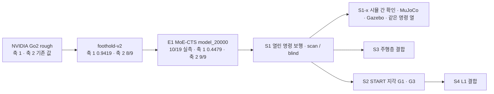

> 분류: A/정책학습 · 설계 (40 평가 · 시뮬 평가 축과 판정 규칙)
> 작성: 오흥재 (lead 세션 초안 · fable 20f 가 v1 으로 고쳐 씀)
> 근거: `docs/research/20260928-v2-mvp-report.md` 6-7 · 9 절 · `docs/research/20260911-eval-protocol-v2.md` · `sim/eval/eval_generalization.py` · `sim/eval/eval_command_response.py` · `s2_lab/eval_e1_v2axes/run_axis1.sh` · `run_axis2.sh` · evidence/E1-vs-v2-axis1.csv · axis2.csv · ASTRA 19f Q5 · fable 20e Q5 · START 2512.13153v1 267~275 · 339~341 · 354 · 389 행 · HiPAN 2604.26504 728 행 · APPROVED B · H(계단은 평가 한 칸 · 무대 계단 실측은 선택) · **K-G · K-I(팀장 승인 10/20 00:1x)** · Isaac Lab 2.3.2 `velocity_env_cfg.py` 98~100 행 · v2 보고 556 · 569 · 574 · 577~578 행 · JEPLO 2609.15770v1 246 · 249 행 · VERIFY-fable-20f P4 · P25 · P26 · P27
> 요지: v2 의 두 자(험지 · 평지 명령)를 그대로 두고, 「명령이 험지에서도 열렸나」 를 재는 축 3 과 START 시험지 · 무대 계단 칸을 더한다. 기준은 학습 전에 등록하고 해시를 남긴다. 단계별 관문 후보 수치를 S1~S4 모두 여기에 모은다. K-G heading 판정(방향 이탈 > 0.1 → 0.75 새 판)과 K-I 시뮬 간 확인 S1-x(MuJoCo · Gazebo, Isaac 값 대비 차) 관문을 가정으로 등록한다
> 상태: v1.1 · 팀장 검토 전 · 기준 수치는 등록 후보(동결 아님) · K-G · K-I 반영

# 41 · 시뮬 평가 축

## 0. 쉬운 요약

「나아졌다」 를 말하려면 자가 필요하다. 자는 셋이다. 도구는 이 문서대로 새로 만들고, v2 때 쓴 도구는 「옛 값이 그대로 나오나」 를 맞춰 보는 대조용으로만 쓴다. **축 1** 은 열여섯 가지 험지를 세 속도로 건너게 해서 성공률을 재고(v2 와 같은 칸), **축 2** 는 평지에서 「멈춰 · 가만히 · 돌아」 명령에 제대로 반응하는지 아홉 칸으로 재고, **축 3** 은 새로 만드는 자로 「험지에서도 옆 · 뒤 · 회전 명령이 되나」 를 지형 종류 × 방향으로 잰다. 여기에 START 논문의 시험지(징검돌 · 평균대 · 디딤 빔 · 틈, 논문 치수) 와 무대 계단 한 칸을 더한다. 성공은 「도달했나(R)」 「끝까지 안 넘어졌나(S)」 「둘 다(J)」 로 늘 셋을 따로 적는다. 몇 점을 넘어야 다음 단계로 가는지(관문)는 학습 **전에** 적고 해시로 고정한다. 무대 계단은 시연용 한 칸일 뿐 평가의 초점이 아니다.

## 1. 비교 흐름

| 판 | 축 1 (48 칸 평균) | 축 2 (9 칸) | 출처 등급 · 경로 |
|---|---|---|---|
| NVIDIA | v2 보고서 2 절 값 | v2 보고서 9-2 | **실측** · `docs/research/20260928-v2-mvp-report.md`. 체크포인트 `nvidia_pretrained.pt` 의 실제 경로 · sha256 은 S0 에서 적는다(**미확인**, VERIFY 20f P32) |
| v2 | 0.9419 (0.5 · 1.0 · 1.5 m/s: 0.9369 · 0.9525 · 0.9363) | 8/9 (`turn` 낙상 0.109 미달) | **실측** · `sim/eval/results/20260928-v2-sweep/sweep_long.csv` |
| E1 MoE-CTS | 0.4479 (0.6763 · 0.6675 · 0.0000) | 9/9 (요 추종 0.84~0.98) | **실측** · evidence/E1-vs-v2-axis*.csv · 출력 `C:/Users/AI-WS01/s2_lab/eval_e1_v2axes/` · 체크포인트 sha256 c8951b79…2df47e8 |

E1 비교의 단서(evidence 하위 작업 보고): E1 쪽은 학습 무작위화 일부(마찰 0~2 · 게인 ±10 % · 모터 영점)를 켠 채 쟀고, 리셋 분포가 E1 학습 리셋이다. 신경망 · 학습 지형 · 학습량 · 눈 유무가 모두 다르므로 차이를 「명령 개방」 하나로 돌리지 않는다.

## 2. 축 1 · 험지 주행 (v2 그대로)

- 지형 16 종: 학습 계열 `rough6` (pyramid_stairs · pyramid_stairs_inv · boxes · random_rough · hf_pyramid_slope · hf_pyramid_slope_inv) + 미경험 `unseen10` (discrete_obstacles · wave · stepping_stones · gap · pit · rails · star · floating_ring · repeated_boxes · repeated_cylinders). 15 문서 7 절대로 S2 부터는 gap · stepping_stones · floating_ring 을 「학습 지형군 시험」 으로 옮겨 적는다(칸은 그대로 잰다).
- 속도 0.5 · 1.0 · 1.5 m/s, 평가 시간 12 · 6 · 4 s, 칸당 100 판, 난이도 0.5, 시드 42, `--envs_per_terrain 10 --min_progress_m 3.0 --max_lateral_drift 0.75` (**실측** E1 `run_axis1.sh` 와 같은 인자. 하네스 기본값은 10.0 · 0.05 라 반드시 명시).
- 하네스: **이 문서 설계대로 새로 만든다**(`foothold_s2/eval/`, 축 1 · 2 · 3 · START 시험지 · R/S/J 를 한 틀에). v2 `sim/eval/eval_generalization.py` 와 E1 판(`s2_lab/eval_e1_v2axes/harness/`)은 **참고 · 비교 대조용**으로만 쓴다: 새 하네스가 v2 · E1 체크포인트에서 옛 값(0.9419 · 0.4479 · 9/9)을 ±0.02 안에서 다시 내는지가 새 하네스의 첫 시험이다(**팀장 정정 10/19 22:5x**, APPROVED G-5 · H).
- 성공 = 생존 AND 전진 AND 속도 추종 AND 방향(v2 정의). 성분 넷을 모두 열로 남긴다(실패 원인이 속도마다 다르다는 E1 결과: 0.5 m/s 는 방향, 1.5 m/s 는 추종). **성분 넷 가운데 「방향」 이 최저인 칸 수**가 heading 판정(K-G · 14 §3.2)의 두 번째 신호다: E1 0.5 m/s 16 칸 중 15 칸이 방향 최저(평균 생존 0.906 · 방향 0.679, **실측** evidence/E1-vs-v2-axis1.csv · fable 재계산 10/20).
- **주의**: 1.5 m/s 는 학습 범위가 ±1.0 인 정책에는 「범위 밖」 이다. 종합 점수와 따로 「범위 안 32 칸」 평균을 같이 적는다(v2 0.9447 · E1 0.6719).

## 3. 축 2 · 평지 명령 응답 (v2 9 절 그대로)

| 칸 | 지표 | 문턱 |
|---|---|---|
| `stop` | 낙상 비율 | ≤ 0.03 |
| `hold` | 낙상 비율 · 잔류 속도 · 끝 1 초 관절 목표 변화 | ≤ 0.03 · ≤ 0.005 m/s · ≤ 0.01 |
| `turn` | 낙상 비율 | ≤ 0.10 |
| `turn` | 요 추종비 −1.0 · −0.5 · +0.5 · +1.0 | 각 ≥ 0.40 |

하네스: 새 하네스에 같은 아홉 칸을 넣고(`--scenario all --num_envs 64 --seed 42`), v2 `sim/eval/eval_command_response.py`(E1 `run_axis2.sh`) 값과 대조한다. 판정은 네 시나리오를 이어 돈 값(v2 6-9 의 주의: `turn` 만 따로 돌리면 난수 소비가 달라 값이 바뀐다).

## 4. 축 3 · 지형군 × 방향 (신규)

v2 는 험지에서 옆 · 뒤 · 회전을 한 번도 재지 않았다(v2 보고서 9-2). 축 3 은 「명령이 열렸다」 를 험지에서 증명하는 자다.

| 지형군 \ 방향 | 앞 0.5 | 뒤 0.5 | 좌 0.5 | 우 0.5 | 대각 (0.4, 0.4) | 앞 + 회전 (0.5, 0.5 rad/s) | 제자리 회전 ±1.0 |
|---|---|---|---|---|---|---|---|
| 이어진 지형 (rough6 + wave · discrete_obstacles) | 측정 | 측정 | 측정 | 측정 | 측정 | 측정 | 측정 |
| 계단 (pyramid_stairs · _inv · 무대 계단 칸) | 측정 | 측정 | 측정 | 측정 | 측정 | 측정 | 측정 |
| 듬성한 발판 (gap · stepping_stones · floating_ring · START 4 종) | 측정 | **뒤 0.3 측정**(물러나기 범위, D39) · 0.5 는 1 차 범위 밖 | **좌 vy_obs 측정**(학습 중 나온 범위, 14 §6 규칙) · 0.5 는 범위 밖 | 우 vy_obs 측정 · 0.5 는 범위 밖 | **1 차 범위 밖** | 측정 | **측정**(START 식 제자리 회전 ±1.2 학습 범위, J-B. 평균대 · 디딤 빔은 지형별로 따로 집계) |

- 이어진 지형 · 계단 행의 대각 (0.4, 0.4) 는 저속 학습(J-F, 14 §3 U[0, 1.0])으로 학습 범위 안이다(VERIFY-lead-final 12). 듬성한 발판 행의 뒤 · 좌 · 우 · 제자리 회전 칸은 **학습 범위 값**(뒤 0.3 · 옆 vy_obs · 회전 ±1.2)으로 잰다(D39 · J-B). 「1 차 범위 밖」 칸(뒤 0.5 · 옆 0.5 · 대각)은 S1 · S2(D435i 만) 결과에서 따로 표시하고 종합 점수에 넣지 않는다. S4(L1) 에서 처음 판정 대상이 된다(14 문서 · 00 §4 합의 4). NVIDIA · v2 는 옆 명령을 학습하지 않았으므로 옆 칸은 「학습 범위 밖」 표시로 잰다(51).
- **「범위 안 32 칸」 목록은 모든 단계에서 고정**: 축 1 의 16 종 지형 × {0.5, 1.0} m/s (VERIFY-lead-final 19). 15 §7 의 학습 · 미경험 재분류는 표기(「학습 지형군 시험」 라벨)만 바꾸고 칸 목록은 바꾸지 않는다.
- 지표: 명령 방향 진행(몸 기준 명령 벡터에 투영한 이동 ÷ 명령 거리) · 벡터 추종 오차 · 생존 · 방향 이탈. 옆 명령을 몸을 돌려 전진으로 대신하면 성공이 아니다(ASTRA 19f Q5): yaw 변화 > 30° 면 「방향 이탈」.
- 하네스: 새 하네스의 축 3 모듈(S0 에서 만든다, 51 · `foothold_s2/eval/axis3.py`). 옛 `eval_generalization.py` 는 `--command_vx` 하나만 받고 `verify_commands` 도 vx 만 본다(375~390 행)는 점을 참고만 한다. **가정**: 칸당 100 판 · 시드 42 · 난이도 0.5 · 평가 시간은 3 m 기준 거리 ÷ 명령 속도 × 2(0.5 m/s 면 12 s, 축 1 과 같음).

## 5. 「건넘」 셋 (ASTRA 19f Q5)

- **R 기준선 도달**: 시간 T 안에 몸통 통과 + 네 발이 유효 지지면 위.
- **S 끝까지 생존**: T 까지 낙하 · 전복 · 위험 접촉 없이.
- **J 둘 다**: R AND S. J ≤ R, J ≤ S 가 늘 맞아야 한다(집계 검사, L0 시험).
- 성공 즉시 끝내면 S 를 못 잰다 → 도달 뒤 정지 명령을 주고 T 까지 관측한다.
- 정지 · 제자리 회전 칸에는 R 을 쓰지 않는다.

## 6. START 시험지 (논문 시뮬 치수)

| 지형 | 최고 난이도 치수 | 출처 |
|---|---|---|
| stepping stones | 희소도 76.3 % · 돌 0.2 m · 틈 0.25 × 0.175 m · 무작위 돌 0.5× · 열 0.45× | **논문** 267~269 · 339~341 행 |
| balance beams | 폭 0.175 m | **논문** 269 행 |
| stepping beams | 희소도 64.7 % · 빔 0.15 m · 틈 0.275 m | **논문** 271~273 행 |
| gaps | 폭 0.7 m (로봇 길이 2 배) | **논문** 273~275 행 |

- 레벨 10 단, 8 × 4 m 칸(시험지는 START 칸 그대로, 학습 칸 8 × 8 과 다름), 깊이 0.2~0.7 m(**논문** 275 행). 평가는 START 방식 「6 m 통과 · 500 판 · 무작위 지형 10」 을 따른다(**논문** 354 행) → 축 1 과 별도 표. 지표는 성공률(= R) · 주파율(쓰러지기 전 간 거리 / 전체) · MEV(가장자리 디딤 비율, 최고 난이도).
- START 실기 표(**논문** 389 행: 평균대 0.2 m · 디딤 빔 58.8 %)는 실기 시험(42) 참고값이고 시뮬 시험지에는 쓰지 않는다. 선행 논문의 0.48× · 깊이 0.3~0.7 도 쓰지 않는다(VERIFY 20f P4).

## 7. 무대 계단 칸

- 발표 무대 계단의 단 높이 · 디딤 폭 · 단 수 · 재질은 **가능하면** 실측해(42) 시뮬 계단 하나로 만든다. 실측이 없으면 Isaac Lab 계단 범위(0.05~0.23 m) 의 가운데 0.15 m · 너비 0.3 m 를 대표 칸으로 쓴다(**가정**, APPROVED H 「무대 계단 실측은 필수 아님」). 디지털 트윈 Real2Sim 계단 메시가 있으면 그것을 쓴다.
- 축 1 · 축 3 계단 행에 한 칸으로 넣고, 조이스틱 시연 경로(앞 0.5 · 정지 · 회전)를 그대로 시나리오로 돈다. 평가의 초점은 이어진 지형 · 듬성한 지형 전체이고 무대 계단은 시연용 한 칸이다.

## 8. 판정 규칙

- 칸마다 성공률 + Wilson 95 % 구간. 판 사이 차이는 구간이 겹치지 않을 때만 「다르다」. 「진짜 하락」 = 새 판 Wilson 상한 < 기준 판 값.
- 시드 하나: 구간은 「그 학습 시드 정책」 에 대한 것이다. 방법의 우월성이나 재현성을 말하지 않는다(70 문서 시드 정책).
- 체크포인트 선택은 검증용 지형 시드에서, 최종 시험지는 한 번만.
- 이전 CMD-R 의 「세 칸 하한 > 0, 평균 + 10 %p」 는 자동 승계하지 않는다(ASTRA 19f).
- 평가기는 학습 전에 끝까지 한 번 돈다(지난번 `raycaster_cache_not_released` 로 멈춘 일, S2-RESULT-PLAN 1 절).

## 9. 학습 전 등록 후보 기준 (팀장 확정 전 · 50~55 가 이 표를 가리킨다)

| 단계 | 기준 | 값 | 근거 |
|---|---|---|---|
| S1 공통 | 축 2 | 9/9, 요 추종 각 ≥ 0.80 | E1 0.84~0.98 (evidence/E1-vs-v2-axis2.csv) |
| S1-scan | 축 1 범위 안 32 칸 | v2 이상: 칸별 Wilson 하한 ≥ v2 칸 값 − 0.05, 진짜 하락 0 칸. **결합 효과**(종아리 한계 · PIE DR · 지형 비율 · 보상 세트 · 처음부터 학습이 함께 바뀜, VERIFY-lead-final 3)로 읽는다 | v2 0.9369 · 0.9525 (같은 관측) |
| S1-blind | 축 1 범위 안 32 칸 | 평균 ≥ 0.67 · 생존 ≥ 0.95(결합 효과) | E1 0.6719 (눈 없음 기준) |
| S1 공통 | 축 3 이어진 지형 · 계단 | 방향별 명령 방향 진행 ≥ 0.8 · 생존 ≥ 0.95 · 방향 이탈 ≤ 0.1 | **가정** |
| S1 공통 (K-G 판정) | 축 3 이어진 지형 · 계단 방향 이탈, 축 1 실패 성분 | 방향 이탈 ≤ 0.1(위 행). **초과 → 60 C 처방 하나: heading 비율 0.30 → 0.75**(v2 E 판 값, **실측** v2 보고 556 행) **새 판 S1a-v1.1**. 대조 판(heading 0 %)은 없으므로 「heading 효과」 단독 결론 금지 | **가정**(30 %) · **실측** v2 569 · 574 행(heading 끔이 가장 낮음) · 577~578 행(단일 원인 미확인) |
| **S1-x 시뮬 간 확인 (K-I)** | S1-a blind 정책(ONNX)을 MuJoCo(`unitree_mujoco`) · Gazebo 에서 **같은 명령 열**(축 2 9 칸 + 축 3 평지 · 무대 계단 칸 방향 7 칸, 칸당 50 판 · 시드 42)로 | Isaac 값 대비 속도 추종비 차 ≤ 0.10 · 생존 차 ≤ 0.05 · 방향 이탈 차 ≤ 0.05 · 축 2 9 칸 판정 동일. 어긋나면 「시뮬 차이」 로 기록하고 앱 시뮬 연결(23 §5)은 Isaac 으로 | **가정** (JEPLO 가 IsaacLab 학습 뒤 별도 MuJoCo 평가 환경을 둠, **논문** 2609.15770v1 246 · 249 행) |
| S1 공통 | 무대 계단 칸 시나리오(앞 0.5 · 정지 · 회전) | J ≥ 0.9 | **가정** |
| S1-b | 깃발 지형군 레벨 | 3,000 회에 틈 · 징검돌 레벨 중앙값 ≥ 5 | **가정** (H14-1) |
| S1-b · S2-b | 축 3 듬성한 지형 뒤 0.3 칸(물러나기, D39) · 제자리 회전 ±1.2 칸(J-B) | 뒤 0.3: 명령 방향 진행 ≥ 0.6 · 생존 ≥ 0.9. 제자리 회전: 징검돌 · 틈 생존 ≥ 0.9(평균대 · 빔은 기록만, 몸 폭 때문에 낙하가 결과로 드러나게 둠). 옆 vy_obs 칸은 기록만. **vy_obs 규칙**: S1-b(S2 는 S2) 마지막 1,000 회 깃발 지형군 \|vy\| 명령 95 분위(14 §6) | **가정** (H14-5 · H14-6) |
| **S2-G0** (눈만 끈 판, J-A) | S2 틀의 기준선 | 관문 없음(기준선). 축 1 범위 안 32 칸 · START 시험지 · 축 3 를 기록해 G1 · F26 의 비교 대상이 된다 | **팀장 승인 J-A** |
| S2-a (G1) | 재구성 · 축 1 · START 시험지 | 재구성 MAE 기록(보고 항목) · 축 1 범위 안 32 칸 **S2-G0 대비** 진짜 하락 0 · START 시험지 4 종 R 평균 ≥ **S2-G0 + 10 %p**(눈의 효과, 한 변수) | **가정** |
| S2-b (G3) | 틈 · 징검다리 · START 시험지 | gap ≥ 0.99 · floating_ring ≥ 0.99 · stepping_stones 1.0 m/s ≥ 0.24 (v2 이상) · START 시험지 R 평균 ≥ G1 + 5 %p · MEV < G1 | v2 축 1 값 · **가정** |
| F26 사전 | S2 하위 대 **S1-blind**(실기 하위) · **S2-G0** | (1) 축 1 이어진 칸 S 생존 ≥ S1-blind (2) START 시험지 R 평균 ≥ S2-G0 + 10 %p. 비교 대상 판은 이 둘로 고정(VERIFY-lead-final 19) | fable 20e F26 · **가정** |
| F26 사후 (3) | student 재증류판 | Corridor · Room SR 하락 ≤ 2 %p(재증류 전 student 대비) | **가정** |
| F26 사후 (3′) | teacher 재학습판(D34) | 관문 S3 전체를 다시 통과(아래 S3 행) | **가정** (VERIFY-lead-final 6) |
| S3 | HiPAN 방 · 우리 방 | Corridor SR ≥ 90 % · Room ≥ 85 %(논문 「자세 없는 판」 98.4 · 94.5 의 0.9 배, 2604.26504 645~700 행) · 보행 지형 방(계단 · 틈) 도달 ≥ 70 % · 외나무 진입각 오차 ≤ 15° · 충돌 에피소드 ≤ 5 % | **가정** (VERIFY 20f P26) |
| S4 | 축 3 듬성한 지형 옆 · 뒤 칸 | 진행 ≥ 0.6 · 생존 ≥ 0.9 · 앞 칸 S2 대비 하락 0 · 대조판(L1 만) 앞 칸 하락 0 | **가정** |

## 10. 산출물 형식

- 칸별 CSV(성분 넷 · R/S/J · Wilson) + 판 비교 CSV(E1 선례 `summarize.py`).
- 명령 원문 · 실행 시각 · PID · 체크포인트 sha256 · 하네스 커밋을 `command.txt` 와 manifest 에(E1 `run_axis1.sh` 의 방식).
- 등록 파일: `evidence/baselines/gates-v1.json`(9 절 값 + vy_obs 규칙 + 비교 대상 판 이름 + 범위 안 32 칸 목록 + heading 처방 0.75 + S1-x 차 문턱) 의 sha256 을 50 §4 의 2 단계 동결(각 학습 직전) manifest 에.
- 지표 계산(R/S/J · 성분 넷 · 방향 이탈)은 시뮬에서 분리된 모듈(`foothold_s2/eval/metrics.py`)로 두고 명령 열 재생기(`eval/replay_commands.py`)도 시뮬 무관으로 두어, S1-x 에서 궤적 로그만 바꿔 같은 CSV 틀을 낸다(**가정** · K-I).

## 11. 검증 사다리 · 가설 · 열린 항목

- L0 CPU: R/S/J 집계가 J ≤ min(R, S) 를 지키는지, Wilson 구간 수계산(100 판 · 0.9 → 0.826~0.945)과 일치. negative control: J > R 인 가짜 행을 넣으면 오류.
- L1 Kit: 새 하네스 예행 8 판(이어진 지형 1 종 · 방향 2) 이 끝까지 돌고 CSV 가 남음. START 시험지 생성기 10 레벨이 뜸.
- L1 대조: 새 하네스로 v2 · E1 체크포인트의 축 1 · 축 2 를 다시 재서 옛 값과 ±0.02 안(축 2 는 9 칸 판정 동일). 어긋나면 새 하네스를 고친다(옛 값을 고치지 않는다).
- L1 S1-x: 명령 열 재생기가 MuJoCo 에서 축 2 `stop` 한 칸을 끝까지 돌고 Isaac 과 같은 CSV 틀을 남김(10/31).
- H41-1: 축 3 「명령 방향 진행」 이 옆 명령에서 yaw 회전 대체를 걸러낸다(수동 라벨 20 판 대조).
- H41-2: S1-x 의 Isaac 대 MuJoCo · Gazebo 차가 문턱 안이면 앱 시뮬 연결을 그 시뮬에서 해도 보행층 동작이 같다(K-I).
- 열린 항목: 무대 계단 치수(선택) · 축 3 평가 시간 규칙 · S3 기준값의 팀장 확정(O7) · S1-x 차 문턱(±0.10 · ±0.05)과 지형(평지 + 무대 계단 칸)의 근거.
