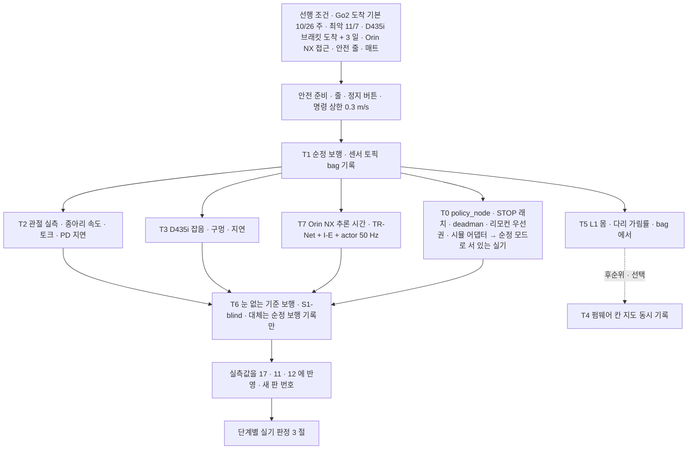

> 분류: A/정책학습 · 설계 (40 평가 · 실기 시험)
> 작성: 오흥재 (lead 세션 초안 · fable 20f 가 v1 으로 고쳐 씀)
> 근거: `C:/Users/AI-WS01/s2_lab/_external/l1_go2_floor_v2.py` (L1 바닥 투영 실측) · `inbox/jay/20261013-go2-app-study/REPORT-astra-10.md` 63~77 · 130~133 행 · Go2 URDF 160 · 748~749 행 · Isaac Lab `unitree.py` 170~177 · ASTRA 19f Q2 · Q5 · fable 20e Q2 · 23 §4 · APPROVED G-1 · G-2 · G-7 · G-8 · H(Orin NX · 실기 녹화는 센서 토픽 bag · 칸 지도 후순위 · 무대 계단 실측 선택 · 앱은 시뮬 먼저 · STOP) · VERIFY-fable-20f P29 · P31
> 요지: Go2 가 오면 첫 주에 「시뮬이 틀린 곳」 부터 잰다. 눈 없는 기준 보행, 관절 한계, D435i 잡음, L1 원 점과 몸 가림, Orin NX 추론 시간. 기록은 센서 토픽 bag 이다. 그 뒤 단계별 실기 판정. 선행 조건(도착일 · 브래킷 · 앱 정책 노드 · SLAM 계약)은 70 의 날짜 행이다
> 상태: v1 · 팀장 검토 전 · Go2 도착 가정 기본 10/26 주 · 최악 11/7(D38, 팀장 23:2x) · **20q N 절 반영(fable 10/20)** · **20r sonnet 정책 노드 조사 반영(fable 10/20)**

# 42 · 실기 시험

## 0. 쉬운 요약

진짜 Go2 가 오면 바로 정책을 올리지 않는다. 먼저 「시뮬이 진짜와 어디가 다른가」 를 잰다. 순정 보행으로 걷게 하면서 모든 센서 값을 **bag 파일**(ROS 녹화)로 남기고, 무릎 모터가 정말 15.70 rad/s 까지만 도는지, 카메라에 구멍이 얼마나 나는지, 턱 밑 라이다가 뒷발을 얼마나 보는지, 탑재 컴퓨터(Orin NX)에서 우리 신경망이 1 초에 50 번 돌아가는지를 잰다. 그 값으로 시뮬 설정을 고친 뒤에야 우리 정책을 올린다. 첫 정책은 눈 없는 S1-blind 다. 실기 성공률은 시뮬 성공률과 다른 숫자이고, 10 회 중 몇 회 · 사람이 몇 번 잡아 줬나로 적는다.

## 1. 첫 주 시험 순서

| # | 시험 | 재는 것 | 왜 | 출처 · 메모 |
|---|---|---|---|---|
| T1 | 순정 보행 bag 기록 | 걷는 동안 D435i depth · L1 `utlidar/cloud` · IMU · 관절 상태 · odom · 발 힘을 같은 시각으로 **센서 토픽 bag** 에(외부 촬영이 아님, D29) | 시뮬 센서 모델의 기준 자료 · T3 · T5 · T7 의 입력 | 순정 보행은 Unitree 기본 제어 |
| T2 | 관절 실측 | 종아리 최고 속도 · 무부하/부하 토크 · PD 응답 지연 · 발 힘 센서 문턱 | 시뮬은 Isaac Lab 기본 30 rad/s, URDF 종아리는 15.70(D19 로 URDF 채택) | **실측** 이 URDF 를 이긴다(17 §1 · §6) |
| T3 | D435i 잡음 | 계단 · 틈 · 징검돌 모형 앞 정지 depth 의 구멍 비율 · 가장자리 잡음 · 지연 · 내부 파라미터(`rs-enumerate-devices -c`) | START 는 필터 이름만 적음(논문 미기재 값) | 11 §2 · evidence/deep-research (5) |
| T4 | 펌웨어 칸 지도 동시 기록 | `voxel_map_compressed` 의 `resolution` · `width` · 누적 시간 | Unitree 가 몇 초를 모아 칸을 만드는지 앱 역분석으로는 알 수 없음(REPORT-astra-10 130~133 행) | **후순위 · 선택**(D29). 우리 SLAM 은 원 점군으로 따로 |
| T5 | 몸 가림 | T1 bag 에서 서 있을 때 · 걸을 때 앞발 · 뒷발 주변 바닥 점 비율 · valid 비율 | 시뮬 투영은 가림을 넣지 않은 상한(메시지 5 개에 뒷발 100 %) | `l1_go2_floor_v2.py` 를 실기 bag 에 그대로 |
| **T0** | **안전 연결 시험(T6 앞에 반드시)** | ① 시뮬 어댑터에서 policy_node 50 Hz 루프 · STOP 래치(명령 0 + 잠금 + 자동 재개 없음) · deadman 0.3 s · hb 1.0 s 를 재현(23 §4). ② 실기 Go2 를 **순정 모드로 세운 채** LowCmd 를 보내지 않고 STOP · deadman · 리모컨 우선권(리모컨 입력이 정책을 끊는지, SDK 동작 **미확인**) · 정책 프로세스 kill 뒤 제조사 정지 전환 0.3 s 를 확인. ③ 그 다음에만 T6. ④ 통신 · 관제 체크리스트(1.1 절, APPROVED N-5 · 내용은 lead 가 따로 보냄) | LowCmd 로 우리 정책을 올리기 전 안전 장치가 실제로 동작해야 한다(VERIFY-lead-final 18) | 23 §4 · §7 · **날짜 관문(70 §1.1)**: ① 시뮬 T0 는 **10/30 까지**(Go2 기본 도착 10/26 주면 T6 가 11/2 전이라 11/5 는 순서가 뒤집힘, VERIFY-lead-final2 3) · ② 실기 T0 는 도착 첫 주 · **T0 ① ② 통과 전 T6 금지** |
| T6 | 눈 없는 기준 보행 | **S1-blind** 의 평지 · 경사 · 낮은 계단 조이스틱 10 회. S1-blind 가 관문을 못 넘었으면 **T6 는 「순정 보행 기록만」** 으로 대신한다(NVIDIA 체크포인트는 높이 스캔 관측이라 실기 불가, VERIFY-lead-final 18) | 실기 차이를 일찍 드러냄 | 80 #6 · 60 E 신호(넘어짐 ≥ 2 · 종아리 15.70 초과 비율 > 5 %) |
| T7 | Orin NX 추론 시간 | ONNX/TensorRT 로 TR-Net + I-E + actor 한 스텝 시간 · 50 Hz 루프 여유 | START 는 Orin NX · TensorRT · 50 Hz(379 · 528 행). 우리 지각망 시간은 **미측정**(D24) | 13 §6 수출 |

### 1.1 T0 ④ 통신 · 관제 체크리스트 (APPROVED N-5 · 팀장 10/20 13:3x · 항목 · 장면은 lead 20r)

통신 · 관제는 체크리스트로 T0 에 넣고 시험한다(N-5). 항목 아홉과 장면 넷은 lead 20r(10/20). **시험 방법 · 통과 기준 칸은 fable 가정**(lead · 현민 확정 전, 설계에 이미 있는 값만 끌어옴). 팀장 보유 장비: 10 m 이상 랜선(N-5).

| # | 항목(lead) | 시험 방법(가정) | 통과 기준(가정 · lead 확정) | 결과 · 날짜 |
|---|---|---|---|---|
| C1 | 유선 지연 | 장면 1 랜선 10 m 에서 앱 → gateway → 정책 노드 왕복 시각(hb 타임스탬프) 1 분 기록 · 95 분위 | 기록값. deadman 0.3 s 보다 충분히 작아야 함(문턱은 lead) | |
| C2 | 무선 지연 | 장면 2 · 3 전용 공유기에서 같은 측정 · 사람 많을 때(장면 3) 한 번 더 | 기록값 · C1 대비 차 | |
| C3 | deadman STOP 동작 | 명령 토픽을 일부러 끊음 → 0.3 s 안 명령 0 · HOLD(2 절 상태기계) | 시뮬 · 실기 모두 ±0.1 s(H42-4). **deadman 0.3 s 자체는 가정** | |
| C4 | STOP 정지 거리 | 0.3 m/s 전진 중 STOP → 멈춘 거리(실기 줄자 · 시뮬 위치 차) 10 회 | 기록값(기준은 lead · 무대 여유 거리와 맞춤) | |
| C5 | 리모컨 우선 | 순정 모드로 세운 채 `wireless_remote` 읽기 → LowCmd 모드에서 리모컨 입력이 정책을 끊는지(T0 ②) | 끊김 확인. **SDK 동작 미확인** | |
| C6 | 공유기 채널(사람 많을 때) | 장면 3 조건에서 채널 고정 · 혼잡 때 C2 재측정 | C2 통과 유지 | |
| C7 | 배터리 시간 | 정책 모드 연속 보행 · 정지에서 잔량 10 % 단위 시각 기록 | 시연 길이 + 여유(기준은 lead) | |
| C8 | 노트북 빠져도 시연 지속 | 장면 3 에서 노트북 랜선 · Wi-Fi 를 뽑고 핸드폰 앱 → 로봇 경로만으로 계속 걷는지 | 끊김 없음(C9 가 「로봇 안」 일 때만 가능) | |
| C9 | 앱 gateway 가 로봇 안인지 노트북인지 | 현민 확인(23 §7) · 실제 배치도 1 장 | 확정 기록(장면 3 의 전제) | |

| 장면(lead) | 구성 | 확인 항목 | 날짜 |
|---|---|---|---|
| 1 실험실 | 랜선 10 m(팀장 보유) · 노트북 ↔ 로봇 | C1 · C3 · C4 · C5 · C7 | T0 실기(Go2 도착 첫 주, 5 절) |
| 2 전용 공유기 | 전용 공유기 · 노트북 · 핸드폰 | C2 · C3 · C4 | 같은 주 |
| 3 무대 | 핸드폰 앱 + 전용 공유기, 노트북은 트윈 · 녹화만, 리모컨 보조 | C2 · C6 · C8 · C9 | lead(무대 예행 일정) |
| 4 끊김 | 통신을 일부러 끊음 → STOP(래치 · 자동 재개 없음) | C3 · C4 | 장면 1 · 2 · 3 각각 1 회 |

- 묶음 규칙: T0 ① ② 와 같이 **④ 통과 전 T6 금지**(가정 · lead 확정). 관련 열린 항목: 23 §10 「행사장 Wi-Fi 지연과 1 s 정지 래치 위험」. 판단층 지연 측정(31 §3 1 단계)도 Go2 도착 첫 주에 같이 잰다(lead 20r).

### 1.2 실기 연결 경로: 공식 unitree_rl_lab 대 우리 정책 노드 (sonnet DESIGN-policy-node 7b5cf869 · lead 20r)

| 항목 | 내용 | 뜻 · 근거 |
|---|---|---|
| 공식 경로 | Isaac Lab 학습 → `unitree_mujoco` sim2sim → `ctrl --network eth0` sim2real(unitree_rl_lab `deploy/robots/go2`) | C++ `unitree_sdk2` 가 Ubuntu 20.04 전제(README) · 이 Windows 는 MSVC 없음 · WSL2 는 미확인 → **sim2sim · sim2real 은 Linux 이전(70 §1 · 10/22~23) 뒤**. S1-x(50 · 10/31~11/2)도 Linux 에서 |
| 공식 배포 관측 | base_ang_vel · projected_gravity · joint_pos_rel · joint_vel_rel · last_action · velocity_commands · gait_phase(history 지원) · **base_lin_vel · 높이 스캔 없음** | 공식 경로로 올릴 수 있는 정책은 눈 없는 정책뿐. NVIDIA · v2 체크포인트(base_lin_vel · 스캔 입력)는 실기 불가 · sim2sim 확인용 |
| 우리 경로 | **실기에는 우리 정책 노드를 올린다**(파이썬 · 50 Hz 정책 스레드 + 500 Hz LowCmd 스레드 · DDS 어댑터 `rt/lowcmd` · `rt/lowstate` 한 겹만 갈아 끼워 MuJoCo 와 실기가 같은 코드): S1-blind(o_t 45 × 11 이력 = 495) · S2(depth) | 공식 `go2_ctrl` 은 **형식만 참고**: `params/deploy.yaml`(joint_ids_map · step_dt · stiffness · damping · default_joint_pos · 명령 범위 · 관측 목록) · `exported/policy.onnx` · 관절 순서 **FR · FL · RR · RL**(hip thigh calf, SDK) ↔ Isaac 순서 변환. 공식 C++ ctrl 이 495 이력 입력을 읽는지 미확인 |
| 상태기계 | PASSIVE → FIXSTAND → POLICY → HOLD(STOP 래치) → SPORT(실기만) → DAMP(평지만). **FIXSTAND 목표는 우리 `default_joint_pos`**(Isaac Lab Go2: hip FL/RL +0.1 · FR/RR −0.1 · thigh 앞 0.8 · 뒤 1.0 · calf −1.5), 공식 FixStand 의 0.0/0.8/−1.5 와 다르다 | 2 절 · 23 §4. **deadman 0.3 s · heartbeat 1.0 s 는 가정**(앱 PRD 값 · 실측 전) |
| 시험(DDS 없이 L0) | 관측 조립 1e-5 · 관절 순열 항등(틀린 순열은 걸림) · a = 0 → 기본 자세 · 정리기 경계 · STOP 래치 · deadman/hb ±0.1 s · ONNX = .pt 1e-5 | sonnet §7 · H42-4 · 23 §8 |

## 2. 안전 · STOP

- 안전 줄(사람이 줄을 잡음) · 무선 정지 · 첫 실행은 명령 상한 0.3 m/s. 정책 실행 전 순정 모드로 일어선 상태 확인. 낙하 높이가 있는 무대 계단은 매트와 보조자 둘.
- **STOP = 위험 시 모든 것을 멈춤, 자동 재개 없음**(D33). T0 에서 래치 · deadman · 리모컨 우선권을 먼저 확인한다. 멈춘 뒤 자세 유지는 23 §4 의 후보 ①(세 칸 0 으로 서기 유지) · ②(sport mode 복귀) · ③(Damp) 을 **T6 에서 순서대로 실기로 확인**한다: 순서는 23 §4 와 같이 **① → ② → (평지만) ③** 하나다: 평지에서 ① 10 회 → 1 s 안 안정(몸 각속도 < 0.3 rad/s) 10/10 이면 ① 채택, 아니면 ②, 그래도 아니면 ③. **계단 모형 위에서는 ① → ②** 까지만(③ Damp 금지, APPROVED H 「계단 위에서 바로 힘을 빼면 넘어짐」). **듬성한 지형 모형 위에서도 ① → ②** 까지만 시험하고 ③ 으로 넘어가지 않는다(발이 빠진다). 서기 명령을 유지한 채 안전 줄 · 사람이 개입하고 사례를 기록한다(VERIFY-lead-final 18).
- 정책 프로세스를 일부러 죽여(kill) 어댑터가 0.3 s 안에 제조사 정지로 넘어가는지 1 회 확인(23 §4).
- **정책 노드 안전 상태기계(sonnet DESIGN-policy-node 7b5cf869 §5 · lead 20r)**: PASSIVE(kp 0 · kd 3 · 힘 빼기) → FIXSTAND(**우리 `default_joint_pos` 로 2 s 보간**, 공식 0.0/0.8/−1.5 아님) → POLICY(50 Hz 정책 · 500 Hz LowCmd · 정리기 통과 명령만) → HOLD(STOP 래치 = 후보 ① 세 칸 0 서기 유지 · 자동 재개 없음 · 사람이 해제) → SPORT(후보 ② sport mode 복귀 · **실기만**) → DAMP(후보 ③ · **평지 판정일 때만**). POLICY → HOLD 조건: STOP · deadman · 관측 이상 · 자세 이상(공식 bad_orientation 1.0 rad). **deadman 0.3 s · heartbeat 1.0 s 는 가정**(1.1 절 C3 에서 동작만 확인, 값은 실측 · 현민 확인 뒤). 위 ① → ② → ③ 순서와 같은 것이다.
- 실기 결과는 성공 · 실패 · 개입 횟수 · bag 으로 남긴다. 시뮬 성공률을 실기 성공률로 쓰지 않는다(ASTRA 19f Q5).

## 3. 단계별 실기 판정 (후보)

**본 경로 · 대체 경로(APPROVED N-1 · 팀장 10/20 13:3x)**: 실기 **본 경로는 우리 정책**이다(50 Hz LowCmd · 정책 노드에 vx · vy · wz 세 칸, 23 §1). 우리 보행에서 문제가 생기면 **대체 경로 = Unitree 순정 보행 + 우리 앱(foothold-app, N-2)의 SDK 연결로 조이스틱 조종과 임무(목표 선정 · 도달)** 로 진행한다. 아래 표의 S1 · S2 행은 본 경로 기준이고, S3 행(앱 목표 → 도착)은 대체 경로로도 시연할 수 있다(그때는 「우리 보행」 결과가 아니라고 적는다). 대체 경로로 넘어가는 기준(어느 신호에서 · 누가)은 열린 항목(lead).

| 단계 | 실기 시험 | 통과 후보 | 등급 |
|---|---|---|---|
| S1 | 평지 정지 · 회전 · 옆 · 뒤, 낮은 계단 조이스틱(S1-blind) | 넘어짐 0 · 개입 0 / 10 회 | **가정** |
| S1 | 무대 계단(또는 대표 계단 0.15 m) 오르기 · 내리기 조이스틱 | 10 회 중 9 회 이상 개입 없이 | **가정** |
| S2 | 실험실 틈 · 징검돌 모형 전진(S2 하위) | 10 회 중 8 회 이상 | **가정** |
| S3 | 앱 목표 → 장애물 우회 → 도착(평지). 앱은 시뮬 연결을 먼저 보인 뒤(D23) | 10 회 중 8 회 이상 | **가정** |
| S3 + S2 | 앱 목표 → 듬성한 지형 건너편(11/30 목표) | 10 회 중 7 회 이상(D34 로 teacher 가 S2 위에서 배운 경우에만 시험. 최악 도착이면 11/24 뒤 한 주에 몰린다) | **가정** |
| S4 | L1 켜고 징검돌 옆 걸음 | 시험 지형 · 기준은 S2 결과 뒤 등록 | 미정 |

## 4. 측정값이 바꾸는 문서

- T2 → 17 Go2 모델(관절 한계 · 액추에이터 · 발 힘 문턱), 16 보상(관절 속도 벌점 여부).
- T3 → 11 센서 · 12 지각(depth 잡음 모델 · clip · 내부 파라미터).
- T5 → 11 센서 · 55 S4(L1 가림 마스크 · 누적 창 · 「모름」 비율).
- T7 → 13 수출 · 12 층 크기(50 Hz 에 안 들어가면 TR-Net 10 Hz 분리 실행).
- 무대 계단 치수(가능하면) 또는 트윈 Real2Sim 계단 메시 → 41 §7 · 15 §3 · 22 §2(D27).
- 실측 반영은 **새 판 번호**로(50 §4), 이어 학습(60 E). 돌고 있는 S2 · S3 판의 cfg 에는 넣지 않는다(VERIFY-lead-final 21).
- T0 결과 → 23 §4(STOP · 자세 유지 후보 확정) · 31 §6. T0 ④ 지연 · 정지 거리 → 23 §4 deadman · hb 값(가정 → 실측) · 31 §3 1 단계 지연.

## 5. 선행 조건 (팀장 승인 D37 · Go2 가정 D38 · 날짜는 70 §1.1 과 같다)

| 항목 | 기본 (Go2 10/26 주) | 최악 (Go2 11/7) | 메모 |
|---|---|---|---|
| Go2 도착 | 10/26 주 | 11/7 | 운영진 회신 기준. 그보다 늦으면 60 F |
| 첫 주 시험 T0~T7 | 10/27~11/2 | 11/8~11/14 | 1 절. **어느 경우든 S2 cfg 는 URDF 값으로 고정**하고 실측값은 별도 이어 학습판(S2-G3-v1.1-real 등, 60 E)에만 넣는다. 그래야 S1 · S2-G0 · G1 비교에 변수가 더해지지 않는다(VERIFY-lead-final 21) |
| D435i 브래킷(위치 · pitch 35°) | 도착 + 3 일 | 도착 + 3 일 | 11 §2 공칭값으로 제작 |
| Orin NX 접근 · ROS 2 · TensorRT | 도착 시 확인(D24) | 도착 시 확인 | T7 전 |
| sim2sim(`unitree_mujoco`) · sim2real(`eth0`) 실행 환경 | Linux 이전 뒤(10/23~) | 같음 | `unitree_sdk2` Ubuntu 전제 · Windows 네이티브 불가 · WSL2 미확인(sonnet 7b5cf869 §1 · 1.2 절). S1-x 10/31~11/2 는 Linux 에서 |
| 현민 어댑터 정책 노드 모드 · 시뮬 연결 | 시뮬 11/7 · 실기 11/14 | 시뮬 11/7 · 실기 11/20 | 23 §7 |
| SLAM 트랙 지도 틀 계약 | 11/20 | 11/20 | S3 실기 전 |
| 실기 창 | 약 5 주 | 약 3 주 | 최악이면 3 절의 S3 + S2 판정이 11/24 뒤 한 주에 몰린다 |
| 무대 계단 치수 | 선택(D27) | 선택 | 없으면 대표 칸 |

## 6. 검증 사다리 · 가설

- L0: `l1_go2_floor_v2.py` 를 실기 bag 형식(토픽 이름 · 필드)에 맞게 고친 판이 공식 bag 에서 같은 표(55 §2)를 냄.
- L1: T1 bag 10 초를 재생해 시뮬 D435i · L1 모델과 나란히 그림으로 비교(화소 차 분포, 11 H11-3).
- H42-1: T2 종아리 최고 속도가 15.70 ± 10 % 안(URDF 가 맞다).
- H42-2: T7 에서 TR-Net + I-E + actor 가 20 ms 안(50 Hz 여유).
- H42-3: STOP 뒤 ① 이 10/10 안정.
- H42-4: T0 에서 deadman 0.3 s · hb 1.0 s · STOP 래치가 시뮬과 실기에서 같은 시각(±0.1 s)에 동작한다.
