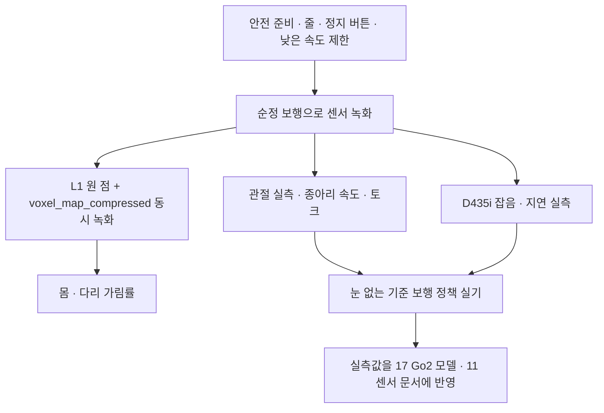

> 분류: A/정책학습 · 설계 (40 평가 · 실기 시험)
> 작성: 오흥재 (lead 세션 작성)
> 근거: `C:/Users/AI-WS01/s2_lab/_external/l1_go2_floor_v2.py` (L1 바닥 투영 실측) · `inbox/jay/20261013-go2-app-study/REPORT-astra-10.md` (앱 역분석 · `rt/utlidar/voxel_map_compressed`) · Go2 URDF `C:/isaac/ext/go2_rl_robotlab/resources/go2/urdf/go2.urdf` 160 · 748~749 행 · Isaac Lab `unitree.py` 170~176 · ASTRA 19f Q2 · fable 20e Q2
> 요지: Go2 가 오면 첫 주에 「시뮬이 틀린 곳」 부터 잰다. 눈 없는 기준 보행, 관절 한계, D435i 잡음, L1 원 점과 칸 지도, 몸 가림. 그 뒤 단계별 실기 판정
> 상태: 초안 · 팀장 검토 전 · Go2 도착일 미확인

# 42 · 실기 시험

## 1. 첫 주 시험 순서

| # | 시험 | 재는 것 | 왜 | 출처 · 메모 |
|---|---|---|---|---|
| T1 | 순정 보행 녹화 | 걷는 동안 D435i depth · L1 `utlidar/cloud` · IMU · 관절 상태 · odom 을 같은 시각으로 | 시뮬 센서 모델의 기준 자료 | 순정 보행은 Unitree 기본 제어 |
| T2 | 관절 실측 | 종아리 최고 속도 · 무부하/부하 토크 · PD 응답 지연 | 시뮬은 모든 관절 30 rad/s, URDF 종아리는 15.70 rad/s | **실측** 이 URDF 를 이긴다 (17 문서) |
| T3 | D435i 잡음 | 계단 · 틈 · 징검돌 모형 앞 정지 depth 의 구멍 비율 · 가장자리 잡음 · 지연 | START 는 필터 이름만 적음(논문 미기재 값) | deep-research 결과 evidence/deep-research-start-missing-values.json |
| T4 | L1 동시 녹화 | 원 점(`utlidar/cloud`)과 로봇이 보내는 칸 지도(`voxel_map_compressed`) 의 `resolution` · `width` · 누적 시간 | Unitree 가 몇 초를 모아 칸을 만드는지 앱 역분석으로는 알 수 없음 | REPORT-astra-10 132 행 「로봇 내부 확인 불가」 |
| T5 | 몸 가림 | 서 있을 때 · 걸을 때 앞발 · 뒷발 주변 바닥 점 비율 | 시뮬 투영은 가림을 넣지 않은 상한(뒷발 0.4 s 에 100 %) | `l1_go2_floor_v2.py` |
| T6 | 눈 없는 기준 보행 | S1 정책(또는 NVIDIA)의 평지 · 경사 · 낮은 계단 | 실기 차이를 일찍 드러냄 | 80 문서 약점 6 |

## 2. 안전

- 안전 줄(START 야외 영상처럼 사람이 줄을 잡음, 영상 2:12~2:40) · 무선 정지 · 첫 실행은 명령 상한 0.3 m/s.
- 정책 실행 전 순정 모드로 일어선 상태 확인. 낙하 높이가 있는 무대 계단은 매트와 보조자 둘.
- 실기 결과는 성공 · 실패 · 개입 횟수 · 영상으로 남긴다. 시뮬 성공률을 실기 성공률로 쓰지 않는다(ASTRA 19f Q5).

## 3. 단계별 실기 판정 (후보)

| 단계 | 실기 시험 | 통과 후보 | 등급 |
|---|---|---|---|
| S1 | 평지 정지 · 회전 · 옆 · 뒤, 낮은 계단 조이스틱 | 넘어짐 0 · 개입 0 / 10 회 | **가정** |
| S1 | 무대 계단 오르기 · 내리기 조이스틱 | 10 회 중 9 회 이상 개입 없이 | **가정** |
| S2 | 실험실 틈 · 징검돌 모형 전진 | 10 회 중 8 회 이상 | **가정** |
| S3 | 앱 목표 → 장애물 우회 → 도착(평지) | 10 회 중 8 회 이상 | **가정** |
| S4 | L1 켜고 징검돌 옆 걸음 | 시험 지형 · 기준은 S2 결과 뒤 등록 | 미정 |

## 4. 측정값이 바꾸는 문서

- T2 → 17 Go2 모델(관절 한계 · 액추에이터), 16 보상(관절 속도 벌점).
- T3 → 11 센서 · 12 지각(depth 잡음 모델 · clip).
- T4 · T5 → 11 센서 · 55 S4 (L1 입력 정의 · 누적 시간 · 「모름」 표시).
- 무대 계단 치수 → 41 평가 7 절 · 15 지형.

## 5. 미확인

- Go2 도착일 · 무대 계단 치수 · D435i 장착 브래킷 위치 · Orin 등 탑재 계산기.
