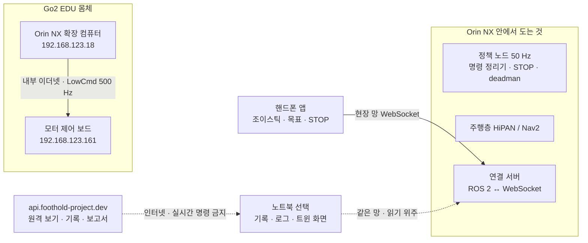

> 분류: B/항법 · 앱 · 실기 연결 설계 (통신 · 관제)
> 작성: 오흥재 (lead 세션)
> 근거: APPROVED-DIRECTION N-5 · O-4 · O-5 · 42 §1.1 C1~C9 · 23 · foothold-app README(`sim/v2_link.py` ROS 2 ↔ WebSocket 127.0.0.1:8790 · `sim/v2_gate.py` 로그인 관문 0.0.0.0:8453) · unitree_rl_lab README(sim2real `--network eth0`) · Go2 EDU 망 주소(커뮤니티 · 서드파티 문서, 아래 출처)
> 요지: 로봇이 걷는 데 필요한 것은 전부 로봇 안(Orin NX)에서 돈다. 핸드폰 앱은 같은 현장 망으로 로봇 안의 연결 서버에 붙어 명령 · STOP 만 보낸다. 노트북 · 클라우드는 조종 경로에 없다. 장면 넷과 시험 체크리스트, 앱이 지킬 것을 적는다
> 상태: 초안 · 팀장 검토 · 현민 공유 전 · 망 주소 중 Wi-Fi AP 쪽은 실기 도착 뒤 확인

# 43 · 통신 · 관제

## 0. 한 문장

**로봇의 뇌는 로봇 안에 있고, 핸드폰은 리모컨일 뿐이다.** 그래서 노트북이 꺼져도, 인터넷이 끊겨도 로봇은 스스로 서거나 멈춘다.

## 1. 장비와 역할

| 장비 | 하는 일 | 없으면 |
|---|---|---|
| Go2 모터 제어 보드 (192.168.123.161) | 관절 모터 구동. 우리 정책의 LowCmd 를 받음 | 걸을 수 없음 |
| **Orin NX (192.168.123.18)** | 정책 노드 · 명령 정리기 · STOP · deadman · 주행층 · **연결 서버** | 걸을 수 없음 |
| **핸드폰 앱** | 조이스틱 `vx · vy · wz` · 목표 찍기 · STOP · 상태 보기 | 사람이 조종 못 함(로봇은 서 있음) |
| 노트북 | 개발 때 정책 파일 올리기 · bag 기록 · 로그. 무대에서는 트윈 화면 · 녹화(선택) | **조종에 영향 없음** |
| 클라우드 (api.foothold-project.dev) | 원격 보기 · 기록 저장 · 보고서 | 영향 없음 |
| 순정 리모컨 | 비상 · 대체 경로(순정 보행) | 보조자 비상 수단 없음 |

주소 출처: 192.168.123.161 은 Go2 몸체 제어 보드, 192.168.123.18 은 Orin(Jetson), 노트북은 같은 대역 고정 주소(예 192.168.123.99)로 붙는다([Classmethod 가이드](https://dev.classmethod.jp/articles/go2-unitree-python-sdk/) · [ACRE Lab Wiki](https://github.com/ACRE-Lab-NCSU/ACRE-Wiki/wiki/Unitree-Go2) · [MyBotShop 포럼](https://forum.mybotshop.de/t/unitree-go2-network-setting/1153)). 커뮤니티 문서라 **실기 도착 첫날 ping 으로 확인**한다. Go2 내장 Wi-Fi 의 AP 주소는 이번 조사에서 확인하지 못했다(실기에서 확인).

## 2. 연결 서버를 로봇에 두면 핸드폰만으로 되는 이유

- foothold-app 의 연결 서버(`v2_link.py`)는 ROS 2 토픽과 앱의 WebSocket 을 잇는 프로그램이다. ROS 2 가 도는 컴퓨터에서 돌아야 한다. 실기에서는 그 컴퓨터가 **Orin NX** 다.
- 핸드폰은 Orin NX 와 **같은 망**에 있으면 브라우저나 앱으로 `ws://<Orin 주소>:<포트>` 에 바로 붙는다. 중간에 노트북이 필요 없다.
- 노트북에 연결 서버를 두면 「핸드폰 → 노트북 → 로봇」 이 되어 노트북이 꺼지면 조종이 끊긴다. 그래서 두지 않는다.

## 3. 장면 넷

| 장면 | 망 구성 (예) | 조종 | 노트북 | 목적 |
|---|---|---|---|---|
| **1 실험실 유선** (실기 첫 주) | 노트북 이더넷 192.168.123.99 ↔ 랜선 10 m ↔ Go2. 핸드폰은 노트북 핫스팟 또는 같은 공유기 | 노트북 브라우저 앱 · 핸드폰 | 정책 올리기 · bag 기록 · 로그 | 무선 없이 정책 · STOP · deadman 확인 |
| **2 실험실 무선** | (a) Go2 내장 Wi-Fi 에 핸드폰 접속 (b) 우리 공유기(예 192.168.50.0/24)에 Orin(무선 또는 공유기-로봇 유선)과 핸드폰 접속 | 핸드폰 앱 | 같은 망에서 기록만 | (a)(b) 의 지연 · 끊김 · 정지 거리 비교 → 무대 연결 선택 |
| **3 무대** | 장면 2 에서 고른 쪽. 행사장 Wi-Fi 는 쓰지 않음 | 핸드폰 앱 · 보조자 순정 리모컨 | 트윈 화면 · 녹화(빠져도 시연 지속) | 시연 |
| **4 끊김** (모든 장면) | 망이 끊기면 | deadman 0.3 s(가정) 안 STOP → 서기 유지 · 자동 재개 없음 | | 안전 |

공유기는 장면 2 결과로 정한다. 내장 Wi-Fi 로 지연 · 끊김 기준을 넘으면 사지 않는다. 동선이 짧은 장면은 랜선이 가장 확실하나 줄 걸림 위험이 있어 보조자가 줄을 관리한다.

## 4. 시험 체크리스트 (42 §1.1 C1~C9 와 같은 항목)

| # | 무엇 | 방법 (가정) | 통과 (가정) |
|---|---|---|---|
| C1 | 유선 명령 지연 | 앱 버튼 시각 대 정책 노드 수신 시각, 100 회 | 95 분위 ≤ 50 ms |
| C2 | 무선 명령 지연 (내장 · 공유기 각각) | 같은 방법 | 95 분위 ≤ 100 ms |
| C3 | deadman | 망을 뽑았을 때 STOP 까지 시간 | ≤ 0.4 s |
| C4 | STOP 정지 거리 | 0.5 m/s 직진 중 STOP | ≤ 0.3 m |
| C5 | 리모컨 우선 | 앱 명령 중 리모컨 입력 | 리모컨이 이김 |
| C6 | 사람 많은 곳 채널 | 휴대폰 여럿 켠 상태에서 C2 반복 | C2 와 같음 |
| C7 | 배터리 | 시연 순서 전체 연속 | 여유 ≥ 30 % |
| C8 | 노트북 제거 | 시연 중 노트북 끔 | 시연 지속 |
| C9 | 연결 서버 위치 | Orin 에서 도는지 확인 | 노트북 없이 C1~C4 통과 |

## 5. 앱이 반드시 지킬 것 (현민 공유용 요지)

1. 실시간 명령(조이스틱 · STOP)은 **현장 로컬망의 로봇 안 연결 서버로만** 보낸다. 클라우드 경로 금지.
2. 명령은 몸 기준 세 칸 `vx · vy · wz`. 허용 범위는 로봇이 내보내는 「지형 · 정책별 표」 를 따른다(고정 제한 금지).
3. STOP 은 래치: 한 번 누르면 사람이 해제할 때까지 아무것도 재개하지 않는다.
4. 화면에 「지금 정책(우리 / 순정)」 과 연결 상태(지연 · 끊김)를 늘 보인다. 정책 전환은 로봇을 세운 뒤에만.
5. Nav2 대체 경로를 쓸 때만 계단 구간에서 collision_monitor 를 끈다.

## 6. 열린 것

- Go2 내장 Wi-Fi 의 망 구성(AP 주소 · 대역 · 여러 기기 접속 가능 여부): 실기 첫날.
- foothold-app 연결 서버를 Orin(aarch64 · ROS 2)에 올리는 판과 포트(현민 확인).
- api.foothold-project.dev 와 로봇 사이 원격 보기 경로(읽기 전용 중계 방식) 설계: 이번 단계 밖.
