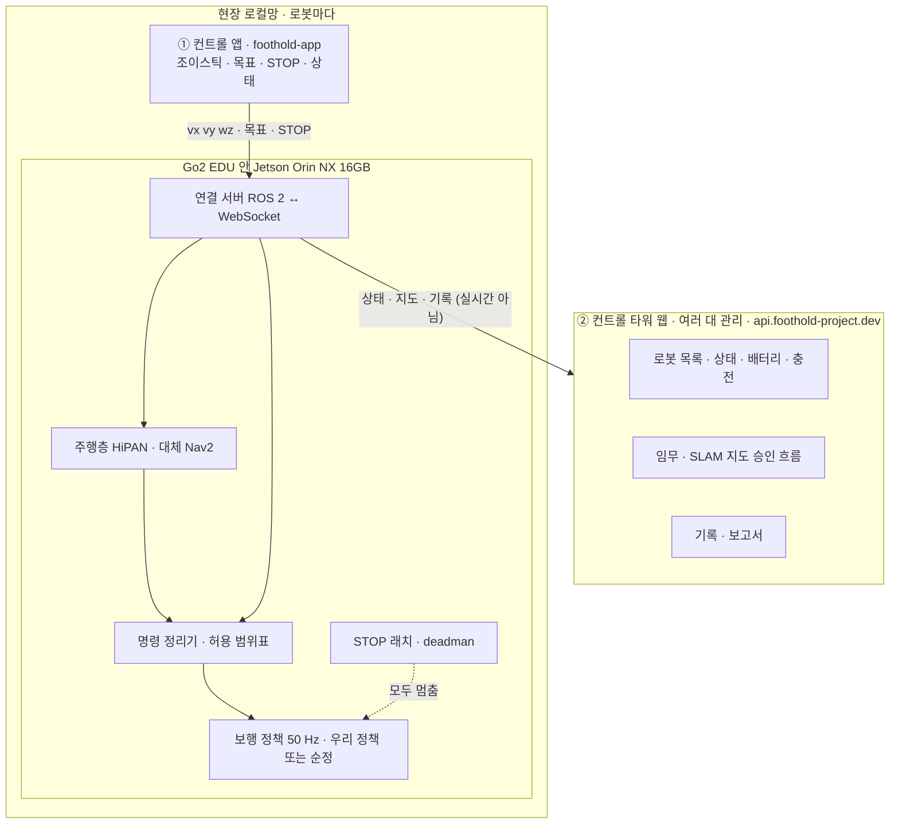

> 분류: B/항법 · 앱 · 협업 기준 (현민 전달용 초안)
> 작성: 오흥재 (lead 세션 · 팀장 논의용 초안)
> 근거: APPROVED-DIRECTION N · O · Q · 43 통신 · 관제 · 14 명령 생성기 · 23 Nav2 대체 · 31 판단층 · 42 실기 · ANALYSIS-app-prd-553.md · foothold-app README(`sim/v2_link.py` · `sim/v2_gate.py`)
> 요지: 앱은 둘이다. ① 컨트롤 앱(foothold-app, 우선): 시뮬 · 실기 Go2 한 대를 조이스틱 · 목표 임무 · SLAM · HiPAN 으로 운용 ② 컨트롤 타워 웹: 여러 대(예 10 대)의 상태 · 임무 · 승인 · 충전을 관리. 둘 다 같은 로봇 계약(속도 세 칸 · STOP · 허용 범위표 · 목표 · 상태)을 따른다
> 상태: 초안 · 팀장 논의 전 · 현민 전달 전 · 「논의할 것」 절이 팀장 결정 대기

# 44 · 앱 기준 (현민 전달용)

## 0. 한 장 요약

- **실시간 조종은 현장 로컬망에서 로봇 안 연결 서버로만** 간다. 컨트롤 타워(클라우드)는 실시간 명령을 보내지 않는다(43).
- 보행이 어떤 정책이든(우리 정책 · 석헌 AME-2 판 · Unitree 순정 보행) **같은 계약**으로 붙는다. 앱은 정책 내부를 몰라도 된다.

## 1. 하드웨어 (팀 공통 · 모든 판 동일)

| 항목 | 사양 | 앱이 알아야 할 점 |
|---|---|---|
| 로봇 | Unitree Go2 **EDU** | 저수준 제어(LowCmd)로 우리 정책을 올릴 수 있는 판. 순정 보행 · 순정 앱도 있음 |
| 계산기 | Jetson **Orin NX 16GB** (Go2 확장, 192.168.123.18 · 커뮤니티 문서 기준, 실기 첫날 확인) | 정책 · 주행층 · 연결 서버가 여기서 돎 |
| 깊이 카메라 | Intel RealSense **D435i**, 몸 앞 아래 35° | 지도 재구성(S2)과 주행층 입력. 앱에 깊이 화면 표시 가능 |
| 라이다 | 순정 **L1** (Go2 내장) | 발 주변 지형(2 차 S4)과 SLAM. 몸 가림이 있음 |
| 사지 않는 것 | XT-16 등 외장 라이다 | 센서 목록에서 뺀다 |

## 2. 로봇 계약 (모든 앱 · 모든 보행 판 공통)

| 이름 | 방향 | 내용 |
|---|---|---|
| **속도 명령** | 앱 → 로봇 | 몸 기준 세 칸 `vx`(앞 +) · `vy`(왼 +) · `wz`(반시계 +), 단위 m/s · rad/s. 이어진 지형 학습 범위: 앞뒤 · 옆 크기 0~1.0(학습 커리큘럼으로 1.5 까지), 회전 ±2.0. 저속(0~0.3)도 학습함 |
| **허용 범위표** | 로봇 → 앱 | 지금 정책 · 지형에서 받아들이는 범위. 예: 듬성한 지형(징검다리 · 틈)에서는 옆 ±0.2 · 뒤 −0.3 까지 연속 2 초 · 최대 0.6 m · 회전 이동 중 ±1.0 · 제자리 ±1.2. 앱은 고정 제한 대신 이 표를 따르고, 잘렸을 때 「명령 범위 조정」 경고 |
| **STOP** | 앱 → 로봇 | 래치. 누르면 모든 명령 0 · 주행 목표 취소 · 판단층 조언 무시. 로봇은 ① 제자리 자세 유지 → ② 순정 모드 → ③ 평지에서만 힘 빼기. **자동 재개 없음**, 사람이 해제 |
| **deadman · 생존 신호** | 앱 ↔ 로봇 | 앱 신호가 끊기면 0.3 s(가정) 안 STOP 과 같은 동작 |
| **목표** | 앱 → 로봇 | 지도 틀 `x · y · yaw` + `map_ver`. 주행층(HiPAN, 대체 Nav2 + 깃발 추종기)이 받음. 취소 · 도착 · 실패 응답 |
| **상태** | 로봇 → 앱 | 지금 정책 이름(우리 · 순정 · AME-2 판) · 판 번호 · 배터리 · 자세 · 속도 · 연결 지연 · STOP 상태 · 지형 판정(이어진 / 듬성한) · 주행 상태 |
| **판단층 조언** | 로봇 → 앱 | Laya · Jev 의 조언(계속 · 멈춤 권고 · 다른 길). 1 단계는 기록 · 참고 표시만, 이후 단계별 권한(속도 낮춤 · 정지 요청 → 경로 제안, 31 · 팀장 확인 대기) |

## 3. ① 컨트롤 앱 (foothold-app · 우선)

| 기능 | 기준 |
|---|---|
| 조이스틱 | 세 칸 모두(옆 · 뒤 포함). 허용 범위표로 제한 |
| 목표 임무 | 지도에서 점 · 방향을 찍어 보냄 → 주행 상태 표시 · 취소 |
| SLAM | 지도 만들기 · 저장 · `map_ver` 관리(11/30 트랙) |
| 정책 표시 · 전환 | 화면에 지금 정책. 전환은 로봇을 세운 뒤에만. 비교 시연 순서 NVIDIA → v2 → 최종 |
| STOP | 늘 보이는 큰 버튼, 래치 표시 |
| 연결 | 현장 로컬망 WebSocket(로봇 안 연결 서버). 지연 · 끊김 표시 |
| Nav2 대체 | 계단 구간에서 collision_monitor 를 끄는 규칙(대체 경로를 쓸 때만) |
| 순서 | **시뮬 먼저**(Isaac Sim, 이어서 MuJoCo · Gazebo 시뮬 간 확인), 실기는 그다음 |

## 4. ② 컨트롤 타워 웹 (여러 대 · 다음 순위)

예: 회사가 임무용 Go2 10 대를 운용한다.

| 기능 | 기준 |
|---|---|
| 로봇 목록 | 대마다 상태 · 위치 · 배터리 · 충전 중 · 현재 임무 · 정책 판 · 연결 |
| 승인 흐름 | 담당자가 올린 SLAM 지도 · 임무 계획을 관리자가 확인 · 승인 · 반려 |
| 임무 관리 | 임무 배정 · 진행 · 완료 · 실패 기록 |
| 기록 · 보고서 | 주행 기록 · 사건(STOP · 낙상) · 판단층 조언 기록 |
| 통신 | api.foothold-project.dev 경유. **실시간 조종은 하지 않음**(조종은 각 현장 컨트롤 앱) |

## 5. 석헌 AME-2 판을 같은 앱에 붙이는 기준

- AME-2 판도 **2 절 계약 그대로**: 속도 세 칸 입력 · 허용 범위표 · 상태(정책 이름 「AME-2」) · STOP · deadman.
- 차이는 정책 내부(AME-2 는 고도 지도 · 우리는 깊이 재구성)뿐이라 앱은 바꿀 것이 없다.
- 우리 프로젝트에서의 설명: 「같은 보행층 계약 위에 정책을 바꿔 끼우는 구조라 AME-2 계열과 START 계열을 같은 앱 · 같은 평가로 비교한다」.

## 6. 논의할 것 (팀장 결정 뒤 현민 전달)

1. 컨트롤 타워의 사용자 역할(관리자 · 담당자 · 보기 전용)과 승인 단계 수.
2. 컨트롤 앱 · 타워 일정: 컨트롤 앱 11/7 시뮬 시연 기준, 타워는 11/30 뒤 또는 최소 판.
3. 연결 서버를 Orin 에 올리는 담당(현민 · lead)과 Orin 의 ROS 2 판.
4. 판단층 조언을 화면에 어디까지(참고만 · 승인 버튼).
5. 석헌 AME-2 판의 정책 노드가 2 절 계약을 따르도록 누가 맞추는지.
