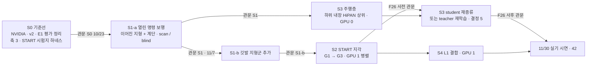

> 분류: A/정책학습 · 설계 (50 실험 단계 · 전체 지도 · 동결 규칙)
> 작성: 오흥재 (lead 세션 초안 · fable 20f 가 v1 으로 고쳐 씀)
> 근거: 00-OVERVIEW · 14 · 18 · 41 · fable 20e (1 → 3 → 2 순서 · F26) · ASTRA 19f (G0 · G1 · G3 갈래) · evidence/E1-vs-v2-axis*.csv · APPROVED A(동결) · G-3 · H(학습 승인 시점) · VERIFY-fable-20f 4 절 · P28~P31
> 요지: S0 기준선 → S1 열린 명령 보행(S1-a 이어진 지형 · S1-b 깃발 지형군) → S3 주행층 결합 → S2 지각(다른 GPU 에서 병렬) → S4 L1. 단계마다 바꾸는 것은 하나, 관문은 41 의 숫자를 학습 전에 해시로 등록한다. 동결 · 변경 관리 규칙을 여기에 둔다
> 상태: v1 · 팀장 검토 전 · 순서의 변경 제안(결정 5 · 7)은 팀장 결정 대기

# 50 · 실험 단계 지도

## 0. 쉬운 요약

실험은 다섯 단계다. **S0** 는 자(평가 도구)를 먼저 만들어 옛 모델 셋(NVIDIA · v2 · E1)을 같은 자로 잰다. **S1** 은 카메라 없이 「명령 세 칸을 전부 열어도 험지를 걷나」 를 배운다(11/7 의 몸통). **S3** 는 그 보행 위에 「목표까지 길 찾기」 를 올린다. **S2** 는 카메라로 발밑 지도를 그리는 눈을 단다(다른 GPU 에서 S3 와 동시에). **S4** 는 발밑 라이다를 더해 징검다리에서 옆 · 뒤 걸음을 연다. 단계마다 「무엇 하나를 바꾸나」 와 「몇 점을 넘어야 다음인가(관문)」 를 학습 전에 적고, 설정을 해시로 고정(동결)한다. 학습 중 버그를 고치면 새 판 번호를 붙인다. 번호 S2 · S3 는 층 순서(지각 → 주행)이고 실행 순서는 S1 → S3 → S2 다.

## 1. 순서와 병렬

이름 S2 · S3 은 「층」 순서(지각 → 주행)를 따른 번호이고, 실행 순서는 S1 → S3 → S2 이다(fable 20e 판정 ①: 1 → 2 → 3 으로 가면 2 가 막힐 때 3 이 없다). **검증 제안(팀장 결정 5 · 7)**: S1 을 S1-a(이어진 지형 + 계단, 11/7) 와 S1-b(깃발 지형군 추가) 로 나누고, S3 teacher 를 11/10 날짜 관문에서 「S2 가 F26 사전 관문을 넘었으면 S2 하위, 아니면 S1 하위」 위에서 시작한다. 그 전 GPU 0 의 11/3~11/10 은 S3 코드 디버그(짧은 실행)에 쓴다. 이유는 VERIFY 20f P30: S1 하위 위에서 배운 S3 teacher 는 듬성한 패치를 우회하는 습관을 갖고, student 재증류만으로는 바뀌지 않는다.

## 2. 단계 요약

| 단계 | 바꾸는 것 하나 | 입력 | 관문(41 §9 의 숫자) | 실패 갈래(60) | 문서 |
|---|---|---|---|---|---|
| S0 | 없음(평가 자만 넓힘) | NVIDIA · v2 · E1 체크포인트 | 세 판이 축 1 · 2 · 3 · START 시험지 숫자를 가짐 · 기준 해시 등록 | 하네스가 늦으면 S1 학습은 시작 | 51 |
| S1-a | 명령 생성기(14) + 정사각 칸 + 종아리 한계 | Isaac Lab Go2 velocity env · scan / blind 두 판 | 축 2 9/9 · 축 1 범위 안(scan v2 이상 · blind ≥ 0.67) · 축 3 이어진 · 계단 진행 ≥ 0.8 · 무대 계단 칸 J ≥ 0.9 | C | 52 |
| S1-b | 깃발 지형군 추가(15 메시 생성기) | S1-a 체크포인트 이어 학습 | 깃발 지형군 레벨 중앙값 ≥ 5 · 축 1 하락 0 | C | 52 |
| S3 | 주행층 추가 | 하위 고정(hash) · 22 환경 | Corridor ≥ 90 · Room ≥ 85 · 보행 지형 방 ≥ 70 · 진입각 ≤ 15° · 충돌 ≤ 5 % | D | 54 |
| S2 | 지각(TR-Net 지도 · 발 가장자리 보상) | S1-b 와 같은 명령 생성기 · 지형 | G1: 축 1 하락 0 · START 시험지 ≥ S1 + 10 %p / G3: gap ≥ 0.99 · stepping_stones ≥ 0.24 · START 시험지 ≥ G1 + 5 %p · MEV < G1 / F26 | A · B | 53 |
| S4 | L1 발 주변 채널 (+ 듬성한 지형 옆 · 뒤 명령) | S2 최종 | 축 3 듬성한 옆 · 뒤 칸 진행 ≥ 0.6 · 생존 ≥ 0.9 · 앞 칸 하락 0 | 명령 정리기 규칙으로 남김 | 55 |

## 3. 규칙 (모든 단계 공통)

- 학습 전에 41 §9 의 판정 기준을 등록하고 해시를 남긴다. 결과를 보고 넓히지 않는다.
- 한 단계에서 바꾸는 것은 하나. 둘을 바꾸면 결과를 결합 효과로만 말한다(ASTRA 19f Q3). S4 처럼 둘이 불가피하면 대조 한 판을 먼저 둔다.
- 검증 사다리를 단계마다 밟는다: L0 답을 아는 입력으로 CPU 시험(negative control 포함) → L1 실제 Isaac Lab 짧은 실행(학습은 첫 10 update, 평가는 예행 8 판) → L2 첫 update 로그 확인 → L3 본 학습(무인 사슬 · heartbeat) → L4 평가. **가짜 cfg 시험만으로는 통과가 아니다. 실제 Kit 첫 실행이 관문이다**(10/16 · 10/18 교훈).
- 한 시드로 끝까지 간다. 다중 시드는 맨 마지막(90 D9).
- 실패도 결과다. 좋은 결과가 나올 때까지 다시 돌리지 않는다. 다시 돌리면 새 판 번호.
- 2 단계 학습 시작은 설계 동결 뒤 Linux 이전을 마친 시점에 팀장이 직접 승인한다(APPROVED H). 다른 세션의 승인은 승인이 아니다.
- GPU 두 장 상태를 보고마다 한 줄 적고, 다음 GPU 일을 끝나기 전에 걸어 둔다(70).

## 4. 동결 · 변경 관리 (APPROVED A · lead 추가 2-(4))

| 항목 | 규칙 |
|---|---|
| 동결 대상 | 설계 문서 26 장 + `foothold_s2/` cfg + 하네스 + 41 §9 기준 파일 `evidence/baselines/gates-v1.json` |
| 동결 방법 | 커밋 해시 + git 태그 `s2-freeze-v1` + `evidence/baselines/manifest-v1.json`(문서 · cfg · 하네스 · 기준 파일 · 입력 체크포인트의 sha256, 날짜, 승인자) |
| 판 번호 | 단계-판: `S1a-v1`, `S1a-v1.1`(버그 수정), `S2-G1-v1` … 실행 폴더 이름과 체크포인트 이름에 붙인다 |
| 버그 수정 | 학습 중 코드 · cfg 를 고치면 **새 판**(소수점 번호)으로 분리하고 90 결정 기록에 「무엇을 · 왜 · 결과에 미치는 영향」 한 줄. 돌고 있는 판의 파일은 고치지 않는다(`dont-edit-a-running-shell-script`) |
| 관문 숫자 | 동결 뒤 바꾸지 않는다. 바꿔야 하면 `gates-v2.json` 으로 다시 등록하고 v1 결과는 v1 기준으로 그대로 보고 |
| 기록 | 판마다 `params/`(Hydra 덤프) · `command.txt`(명령 원문 · 시각 · PID) · 체크포인트 sha256 · 하네스 커밋 |

## 5. 갈래 비교 (ASTRA 19f Q3 · Q7)

| 갈래 | 지형 입력 | 발 가장자리 보상 | 위치 |
|---|---|---|---|
| S1-scan | 정답 높이 스캔(시뮬 전용) | 없음 | S1 |
| G0 = S1-blind | 없음 | 없음 | S1 |
| G1 | 재구성 지도 | 없음 | S2-a |
| G2 | 없음 | 있음 | 예산 남을 때만 |
| G3 | 재구성 지도 | 있음 | S2-b |

권고 순서 G0 → G1 → G3. G2 를 빼면 지도와 보상의 상호작용은 분리하지 못했다고 적는다. 추종식은 전 갈래 정확 추종(16, 팀장 승인).
