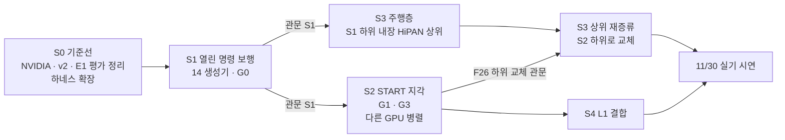

> 분류: A/정책학습 · 설계 (50 실험 단계 · 전체 지도)
> 작성: 오흥재 (lead 세션 작성)
> 근거: 00-OVERVIEW · 14-COMMAND-GENERATOR · 41-EVAL-AXES · fable 20e (1 → 3 → 2 순서 · F26 관문) · ASTRA 19f (G0 · G1 · G3 갈래) · evidence/E1-vs-v2-axis*.csv
> 요지: S0 기준선 → S1 열린 명령 보행 → S3 주행층 결합 → S2 지각(다른 GPU 에서 병렬) → S4 L1. 단계마다 바꾸는 것은 하나, 관문을 넘어야 다음으로 간다
> 상태: 초안 · 팀장 검토 전 · 시간은 가정

# 50 · 실험 단계 지도

## 1. 순서와 병렬

이름 S2 · S3 은 「층」 순서(지각 → 주행)를 따른 번호이고, 실행 순서는 S1 → S3 → S2 이다(fable 20e 판정 ①: 1 → 2 → 3 으로 가면 2 가 막힐 때 3 이 없다).

## 2. 단계 요약

| 단계 | 바꾸는 것 하나 | 입력 | 관문(요약) | 문서 |
|---|---|---|---|---|
| S0 | 없음(평가 자만 넓힘) | NVIDIA · v2 · E1 체크포인트 | 세 판이 41 의 축 1 · 2 · 3 에서 재현되는 숫자를 가짐 | 51 |
| S1 | 명령 생성기(14) | Isaac Lab Go2 velocity env · 정답 높이 스캔 또는 눈 없음 | 축 2 E1 수준 · 축 1 이어진 지형 v2 이상 · 축 3 이어진 지형 통과 | 52 |
| S3 | 주행층 추가 | S1 하위 고정 | 평지 · 장애물 방에서 목표 도달 · 앱 손 조종과 같은 인터페이스 | 54 |
| S2 | 지각(TR-Net 높이 지도 · 발 가장자리 보상) | S1 과 같은 명령 생성기 | 틈 · 징검다리 v2 이상 + F26 | 53 |
| S4 | L1 발 주변 채널 | S2 | 듬성한 지형 옆 · 뒤 칸이 범위 안으로 | 55 |

## 3. 규칙 (모든 단계 공통)

- 학습 전에 41 의 판정 기준을 등록하고 해시를 남긴다. 결과를 보고 넓히지 않는다.
- 한 단계에서 바꾸는 것은 하나. 둘을 바꾸면 결과를 결합 효과로만 말한다(ASTRA 19f Q3).
- 첫 실제 실행은 짧게(첫 10 update 또는 예행 평가 8 판) 먼저 돌려 Traceback · 메모리 · steps/s 를 잰다.
- 한 시드로 끝까지 간다. 다중 시드는 맨 마지막(90 결정 D9).
- 실패도 결과다. 좋은 결과가 나올 때까지 다시 돌리지 않는다.

## 4. 갈래 비교 (ASTRA 19f Q3 · Q7)

| 갈래 | 재구성 지도 | 발 가장자리 보상 | 위치 |
|---|---|---|---|
| G0 | 없음(눈 없음 또는 정답 높이 스캔) | 없음 | S1 |
| G1 | 있음 | 없음 | S2-a |
| G2 | 없음 | 있음 | 예산 남을 때만 |
| G3 | 있음 | 있음 | S2-b |

권고 순서 G0 → G1 → G3. G2 를 빼면 지도와 보상의 상호작용은 분리하지 못했다고 적는다.
