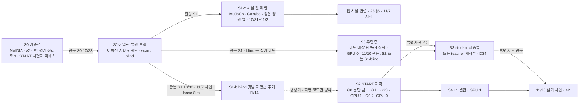

> 분류: A/정책학습 · 설계 (50 실험 단계 · 전체 지도 · 동결 규칙)
> 작성: 오흥재 (lead 세션 초안 · fable 20f 가 v1 으로 고쳐 씀)
> 근거: 00-OVERVIEW · 14 · 18 · 41 · fable 20e (1 → 3 → 2 순서 · F26) · ASTRA 19f (G0 · G1 · G3 갈래) · evidence/E1-vs-v2-axis*.csv · APPROVED A(동결) · G-3 · H(학습 승인 시점) · **K-I(시뮬 간 확인 S1-x · 11/7 Isaac Sim, 팀장 승인 10/20 00:1x)** · JEPLO 2609.15770v1 246 · 249 행 · **APPROVED L(S2 20,000 회 · 11/10 대비책)** · VERIFY-fable-20f 4 절 · P28~P31
> 요지: S0 기준선 → S1 열린 명령 보행(S1-a 이어진 지형 · S1-b 깃발 지형군) → S3 주행층 결합 → S2 지각(다른 GPU 에서 병렬) → S4 L1. 단계마다 바꾸는 것은 하나, 관문은 41 의 숫자를 학습 전에 해시로 등록한다. 동결 · 변경 관리 규칙을 여기에 둔다. S1-a 뒤 S1-x 시뮬 간 확인(MuJoCo · Gazebo, K-I)을 두고 앱 시뮬 연결은 그 위, 11/7 시연은 Isaac Sim
> 상태: v1.4a(10/29 verifier 막음 2 반영: S5-a 관문은 CURRICULUM v0.5a C8 명세로, 순서 S4 → S5 팀장 확인) · v1.4(10/29 자세 명령 단계 S5-a · S5-b 추가, 팀장 결정 10/29 01:2x lead 전달 · planner 초안) · v1.3 · 팀장 검토 전 · K-I · L · 결정 1 · 2 · 3 · 7 · 8(APPROVED M · fable 20l) 반영 · 순서(S1-a/b 분리 · 11/10 하위 선택 관문)는 팀장 승인 10/19 23:2x(D34~D36) · **20r sonnet 정책 노드 조사 반영(fable 10/20)**

# 50 · 실험 단계 지도

## 0. 쉬운 요약

실험은 다섯 단계다. **S0** 는 자(평가 도구)를 먼저 만들어 옛 모델 셋(NVIDIA · v2 · E1)을 같은 자로 잰다. **S1** 은 카메라 없이 「명령 세 칸을 전부 열어도 험지를 걷나」 를 배운다(11/7 의 몸통). 그 정책을 다른 시뮬(MuJoCo · Gazebo)에서 같은 명령으로 돌려 같은 동작이 나오는지 보는 **S1-x** 를 거쳐 앱을 붙인다(11/7 시연 자체는 Isaac Sim). **S3** 는 그 보행 위에 「목표까지 길 찾기」 를 올린다. **S2** 는 카메라로 발밑 지도를 그리는 눈을 단다(다른 GPU 에서 S3 와 동시에). **S4** 는 발밑 라이다를 더해 징검다리에서 옆 · 뒤 걸음을 연다. 단계마다 「무엇 하나를 바꾸나」 와 「몇 점을 넘어야 다음인가(관문)」 를 학습 전에 적고, 설정을 해시로 고정(동결)한다. 학습 중 버그를 고치면 새 판 번호를 붙인다. 번호 S2 · S3 는 층 순서(지각 → 주행)이고 실행 순서는 S1 → S3 → S2 다.

## 1. 순서와 병렬

이름 S2 · S3 은 「층」 순서(지각 → 주행)를 따른 번호이고, 실행 순서는 S1 → S3 → S2 이다(fable 20e 판정 ①: 1 → 2 → 3 으로 가면 2 가 막힐 때 3 이 없다). **팀장 승인 10/19 23:2x(D34 · D36) · 10/20 00:5x(J-A · J-D)**: S1 을 S1-a(이어진 지형 전체 + 계단, 11/7) 와 S1-b(blind 판에 깃발 · 듬성한 지형, 11/14) 로 나누고, S3 teacher 를 11/10 날짜 관문에서 「S2 가 F26 사전 관문을 넘었으면 S2 하위, 아니면 **S1-blind** 하위(실기 가능)」 위에서 시작한다. 그 전 GPU 0 은 11/3~11/4 에 **S2-G0(S2 틀에서 눈만 끈 판, 20,000 회 · 18~28 h)** 을 돌려 눈 효과의 한 변수 기준선을 실제로 만들고, 11/5~11/10 은 S3 코드 디버그(짧은 실행 · S2-G1 중간 체크포인트 내장 1 회)에 쓴다. S2 세 판은 **20,000 회**(논문의 2 배, **팀장 승인 L** 10/20 00:4x: 이어진 지형을 더한 만큼 듬성한 지형 노출을 START 이상으로, 15 §5). G3 평가 끝은 11/6 08:00 ~ 11/8 08:00 이고(70 §1.2), G3 가 11/10 을 넘기면 11/10 관문은 G1 결과로 판정하고 G3 는 11/14 까지 계속한다(L 대비책). S1-b 는 S2 의 입력이 아니고 생성기 · 지형 코드만 공유한다(VERIFY-lead-final 1). 이유는 VERIFY 20f P30: S1 하위 위에서 배운 S3 teacher 는 듬성한 패치를 우회하는 습관을 갖고, student 재증류만으로는 바뀌지 않는다. Go2 는 기본 10/26 주 · 최악 11/7 도착으로 가정한다(D38, 70 §1.1). **K-I(팀장 승인 10/20 00:1x · D50)**: 11/7 시연은 Isaac Sim 이고, JEPLO 처럼(IsaacLab 학습 뒤 별도 MuJoCo 평가 환경, **논문** 2609.15770v1 246 · 249 행) S1-a 정책을 MuJoCo · Gazebo 에서 같은 명령 열로 돌려 속도 추종 · 생존 · 방향 이탈을 Isaac 값과 비교하는 **S1-x** 를 10/31~11/2 에 둔다. 앱 시뮬 연결(23 §5)은 S1-x 에서 숫자가 맞은 시뮬 위에 선다.

## 2. 단계 요약

| 단계 | 바꾸는 것 하나 | 입력 | 관문(41 §9 의 숫자) | 실패 갈래(60) | 문서 |
|---|---|---|---|---|---|
| S0 | 없음(평가 자만 넓힘) | NVIDIA · v2 · E1 체크포인트 | 세 판이 축 1 · 2 · 3 · START 시험지 숫자를 가짐 · 기준 해시 등록 | 하네스가 늦으면 S1 학습은 시작 | 51 |
| S1-a | 명령 생성기(14, heading 30 % 포함 K-G) + 정사각 칸 + 종아리 한계 + 16 보상 14 항(v2 와는 결합 효과) | Isaac Lab Go2 velocity env · scan / blind 두 판 | 축 2 9/9(hold 시드 3 중 2) · 축 1 범위 안 32 칸(scan 판정 26 칸 v2 이상 · 41 §8 · blind ≥ 0.67) · 축 3 이어진 · 계단 진행 ≥ 0.8 · 방향 이탈 ≤ 0.1(초과면 heading 같은 기준 75 % 새 판 S1a-v1.1) · 무대 계단 칸 J ≥ 0.9 | C | 52 |
| S1-x (10/31~11/2, K-I · **Linux 에서**) | 시뮬만 바꿈(정책 · 명령 열 고정) | S1-a blind ONNX · MuJoCo `unitree_mujoco` · Gazebo ROS 2 패키지. 공식 sim2sim 경로(Isaac Lab → `unitree_mujoco` → `ctrl --network eth0`)의 `unitree_sdk2` 가 Ubuntu 전제라 **Linux 이전(10/22~23) 뒤**에 돈다(Windows 네이티브 불가 · WSL2 미확인). 공식 `go2_ctrl` 대신 **우리 정책 노드**(파이썬 · DDS 어댑터 교체)가 같은 자리(sonnet DESIGN-policy-node 7b5cf869 · 42 §1.2 · lead 20r) | Isaac 값 대비 속도 추종비 차 ≤ 0.10 · 생존 차 ≤ 0.05 · 방향 이탈 차 ≤ 0.05 · 축 2 9 칸 판정 동일(41 §9, **가정**) | 어긋나면 「시뮬 차이」 기록 · 앱 시뮬 연결은 Isaac 으로 | 52 §2 |
| S1-b (11/8~11/14) | blind 판에 깃발 · 듬성한 지형군 추가(15 메시 생성기 · START 식 제자리 회전 · 물러나기) | S1-a blind 체크포인트 이어 학습 | 깃발 지형군 레벨 중앙값 ≥ 5 · 축 1 하락 0(41 §8) · 뒤 0.3(2 s · 0.6 m) · 제자리 회전 칸 · vy_obs 기록 | C | 52 |
| S2-G0 (11/3~11/4, GPU 0) | 없음(S2 틀에서 지도 입력만 0) | 14 생성기 · 15 지형군 둘 · 16 보상 · 3072 · **20,000**(L) | 관문 없음(기준선). 축 1 · START 시험지 · 축 3 기록 | A · B | 53 |
| S3 | 주행층 추가 | 하위 고정(hash: S2 또는 S1-blind) · 22 환경 · 카메라 35° | Corridor ≥ 88.6 · Room ≥ 85.1 · 보행 지형 방 ≥ 70(S1-blind 하위판은 듬성한 방 빼고 계단 방만, 결정 3 · 두 벌) · 진입각 ≤ 15°(S2 하위판) · 충돌 ≤ 5 % | D | 54 |
| S2 | 지각(TR-Net 지도 · 발 가장자리 보상) | S2-G0 과 같은 생성기 · 지형 · 보상 · 3072 · 20,000(L) · G1 36~60 h → G3 36~60 h | G1: 축 1 S2-G0 대비 하락 0(41 §8) · START 시험지 ≥ S2-G0 + 10 %p / G3: gap ≥ 0.99 · stepping_stones ≥ 0.24 · START 시험지 ≥ G1 + 5 %p · MEV < G1 / F26. **G3 가 11/10 을 넘기면 11/10 관문은 G1 결과 · G3 는 11/14 까지**(L) | A · B | 53 |
| S4 | L1 발 주변 채널 (+ 듬성한 지형 옆 · 뒤 명령) | S2 최종(G1 또는 G3) | 축 3 듬성한 옆 · 뒤 칸(명령 2 s · 기준 거리 = 속도 × 2 s) 진행 ≥ 0.6 · 생존 ≥ 0.9 · 앞 칸 하락 0(41 §8) | 명령 정리기 규칙으로 남김 | 55 |
| **S5-a** 하위 자세 명령(팀장 결정 10/29: 기본 보행 졸업 → S3 연결 뒤) | 명령 칸 3 → 5(h 지면 기준 높이 · roll 세계 틀, SPEC-hipan-go2 1.5 · 21 :67) + 보상 두 항(높이 · roll 추종) | S3 를 통과한 하위 student 해시에서 이어 학습 · 명령 생성기에 h · roll 재표본 · CURRICULUM v0.5 C8a(h 0.28~0.34) → C8b(h 0.1~0.4) → C8c(roll ±0.3 → ±1.0) | 높이 추종은 **구간별** 중앙 오차 ≤ 0.02 m + 기울기 ≥ 0.8 + 전환 응답(CURRICULUM v0.5a C8a · C8b, 고정 높이 정책 반례 차단) · roll ≤ 0.1 rad · **낮은 통로 칸**(천장 0.45 · 0.40 · 0.35 · 0.30 m, h 명령 = H − 몸통 윗면 0.057 − 센서 돌출 s − 여유 0.05, 64 env 통과 ≥ 0.9 · 몸통 · 센서 충돌 episode ≤ 5 %, 분모 전부) · 유지 축 전부(GATE-v3 점수표, h 공칭) · 축 1 · 3 진짜 하락 아님(41 §8) (전부 **가정**, verifier OPINION-posture-stage 반영) | 추종 미달 → 범위를 한 단 좁혀 재개(처방 꼴) · 유지 축 미달 → GATE-v3 규칙 5 | CURRICULUM v0.5 §2b C8 |
| **S5-b** 상위 재학습(5 칸) | HiPAN 출력 3 → 5 칸 · r6 5 칸 · 등급표 머리 위 장애물 행(22 §3 :48) 을 「h 0.1 m 이상이면 통과 가능」 으로 | S5-a 하위 고정 해시 · 22 환경에 낮은 통로 · teacher 18 h + student 6 h(21 예산, 가정) | S3 관문(41 §9 S3 행) 재통과 + 낮은 통로가 있는 방에서 S3 판 대비 SR 상승(논문 Table IV 방향, 값은 우리 측정) | 하락이면 S3 판 유지 · 자세는 2 차 | 21 §4 · 54 |

S5 자리: S3 뒤(팀장 결정). **순서는 S4 → S5-a → S5-b**(verifier 권고: 지형 보행 본류의 발 주변 관측 보완이 먼저) · **실기 2 차는 좁은 높이 명령 추종 검증만**(roll 전체 · 자율 통로 통과는 약속 없음) 으로 적고 **팀장 확인** 전이다(CURRICULUM v0.5a §2c 9). 한 단계에 하나 규칙대로 하위(S5-a) 와 상위(S5-b) 를 나눴다.

## 3. 규칙 (모든 단계 공통)

- 학습 전에 41 §9 의 판정 기준을 등록하고 해시를 남긴다. 결과를 보고 넓히지 않는다.
- 한 단계에서 바꾸는 것은 하나. 둘을 바꾸면 결과를 결합 효과로만 말한다(ASTRA 19f Q3). S4 처럼 둘이 불가피하면 대조 한 판을 먼저 둔다.
- 검증 사다리를 단계마다 밟는다: L0 답을 아는 입력으로 CPU 시험(negative control 포함) → L1 실제 Isaac Lab 짧은 실행(학습은 첫 10 update, 평가는 예행 8 판) → L2 첫 update 로그 확인 → L3 본 학습(무인 사슬 · heartbeat) → L4 평가. **가짜 cfg 시험만으로는 통과가 아니다. 실제 Kit 첫 실행이 관문이다**(10/16 · 10/18 교훈).
- 한 시드로 끝까지 간다. 다중 시드는 맨 마지막(90 D9).
- 실패도 결과다. 좋은 결과가 나올 때까지 다시 돌리지 않는다. 다시 돌리면 새 판 번호.
- 2 단계 학습 시작은 설계 동결 뒤 Linux 이전을 마친 시점에 팀장이 직접 승인한다(APPROVED H). 다른 세션의 승인은 승인이 아니다.
- 역할(D41): 구현 rl + lead(Sonnet 코딩 세션), 감시 Haiku 하위 작업, 검증 fable(관문마다 L0 · L1 · 판정), ASTRA 1 회, sol 스크립트만(18 §6).
- GPU 두 장 상태를 보고마다 한 줄 적고, 다음 GPU 일을 끝나기 전에 걸어 둔다(70).

## 4. 동결 · 변경 관리 (APPROVED A · lead 추가 2-(4) · VERIFY-lead-final 16 · 두 단계)

| 항목 | 규칙 |
|---|---|
| **1 단계 동결 (설계 문서, 10/22)** | 대상: 설계 문서 25 장 + APPROVED-DIRECTION + 41 §9 관문 **후보**. 방법: 커밋 해시 + git 태그 `s2-design-v1` + `evidence/baselines/manifest-design-v1.json`(문서 sha256 · 날짜 · 승인자). 코드는 이때 아직 없다 |
| **2 단계 동결 (단계별 cfg · 하네스 · 관문 해시, 각 학습 직전)** | 대상: 그 판의 `foothold_s2/` cfg(Hydra 덤프) · 하네스 커밋 · `gates-v1.json`(그 판에 해당하는 관문 값 · vy_obs 규칙 · 비교 대상 판 이름 · 범위 안 32 칸 목록 · S1-scan 판정 26 칸 · 비교 규칙 `real_drop = newcombe · margin 0.05`(41 §8) · `hold` 시드 3 중 2 · S3 두 벌) · 입력 체크포인트 sha256. 방법: 태그 `s2-<판>-v1`(예: `s2-S1a-v1` 10/24 · `s2-S2-G0-v1` 11/3 · `s2-S2-G1-v1` · `s2-S2-G3-v1` · `s2-S3-v1` 11/10 · `s2-S4-v1`) + `manifest-<판>.json`. 학습 시작 명령은 이 태그에서만 |
| 판 번호 | 단계-판: `S1a-v1`, `S1a-v1.1`(버그 수정), `S2-G1-v1` … 실행 폴더 이름과 체크포인트 이름에 붙인다 |
| 버그 수정 | 학습 중 코드 · cfg 를 고치면 **새 판**(소수점 번호)으로 분리하고 90 결정 기록에 「무엇을 · 왜 · 결과에 미치는 영향」 한 줄. 돌고 있는 판의 파일은 고치지 않는다(`dont-edit-a-running-shell-script`) |
| 관문 숫자 | 2 단계 동결 뒤 바꾸지 않는다. 바꿔야 하면 `gates-v2.json` 으로 다시 등록하고 v1 결과는 v1 기준으로 그대로 보고. 1 단계와 2 단계 사이에 후보가 바뀌면 90 에 한 줄 |
| 기록 | 판마다 `params/`(Hydra 덤프) · `command.txt`(명령 원문 · 시각 · PID) · 체크포인트 sha256 · 하네스 커밋 |

## 5. 갈래 비교 (ASTRA 19f Q3 · Q7)

| 갈래 | 지형 입력 | 발 가장자리 보상 | 위치 |
|---|---|---|---|
| S1-scan | 정답 높이 스캔(시뮬 전용) | 없음 | S1(v2 와 결합 효과 비교) |
| S1-blind | 없음 | 없음 | S1(실기 하위 · 11/10 「아니오」 하위) |
| **G0 = S2-G0** | 없음(S2 틀 · map 토큰 0) | 없음 | S2(눈 효과의 한 변수 기준선, J-A) |
| G1 | 재구성 지도 | 없음 | S2-a |
| G2 | 없음 | 있음 | 예산 남을 때만 |
| G3 | 재구성 지도 | 있음 | S2-b |

권고 순서 S2-G0 → G1 → G3(G0 와 G1 은 env · 반복 · 보상 · 지형 · 신경망이 같고 지도 입력만 다르다). G2 를 빼면 지도와 보상의 상호작용은 분리하지 못했다고 적는다. 추종식 · 보상 14 항은 전 갈래 공통(16, 팀장 승인).
