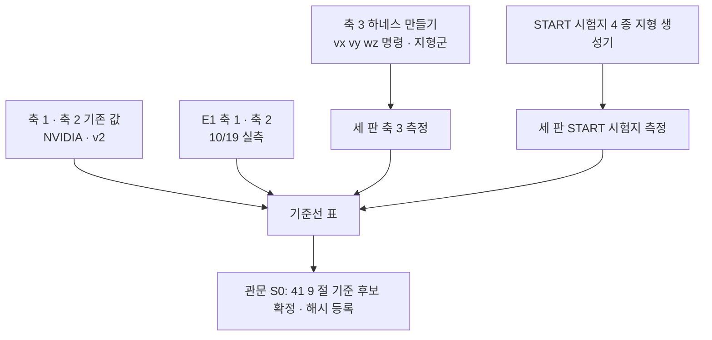

> 분류: A/정책학습 · 설계 (50 실험 단계 · S0 기준선)
> 작성: 오흥재 (lead 세션 작성)
> 근거: evidence/E1-vs-v2-axis1.csv · evidence/E1-vs-v2-axis2.csv · `s2_lab/eval_e1_v2axes/` (10/19 실행) · `sim/eval/eval_generalization.py` · `sim/eval/eval_command_response.py` · 41-EVAL-AXES
> 요지: 새 학습 전에 비교 대상 셋(NVIDIA · v2 · E1)을 같은 자로 잰 표를 완성하고, 축 3 하네스를 만든다
> 상태: 초안 · 팀장 검토 전 · E1 축 1 · 2 는 10/19 실측 완료

# 51 · S0 기준선

| 항목 | 내용 |
|---|---|
| 목적 | 「무엇보다 나아졌나」 의 자를 먼저 만든다 |
| 입력 | NVIDIA `nvidia_pretrained.pt` · v2 체크포인트 · E1 `s2_lab/step1_run_b2/fixtures/model_20000.pt` (sha256 `c8951b79…2df47e8`) |
| 바꾸는 것 | 없음. 평가 자만 넓힌다 |
| GPU · 시간 | 축 1 한 판 약 27 분 · 축 2 약 5 분 (E1 실측, GPU 0). 축 3 · START 시험지는 세 판 × 약 1~2 시간 **가정** |
| 관문 | 세 판 모두 축 1 · 2 · 3 · START 시험지 숫자를 가짐, 41 9 절 기준을 팀장이 확정하고 해시 등록 |
| 실패 시 | 축 3 하네스가 늦으면 S1 학습은 시작하고 축 3 은 S1 평가 전까지 완성(학습과 평가 도구 준비를 병행) |
| 산출물 | `evidence/baselines/` 표 · 하네스 판 커밋 · 등록 파일 |

## 할 일

1. E1 결과 정리 완료(10/19): 축 1 0.4479 · 축 2 9/9. 1.5 m/s 0 % 는 범위 밖 속도 추종 실패, gap 0~1 %, stepping_stones 0 %.
2. 축 3 하네스: `eval_generalization.py` 에 `--command vx vy wz` 와 지형군 목록 인자. 41 4 절의 칸.
3. START 시험지 지형 생성기(15 문서와 공유).
4. 「건넘」 R · S · J 집계를 기존 하네스 출력에 추가(41 5 절).
5. NVIDIA · v2 축 3 측정. v2 는 옆 명령을 학습하지 않았으므로 옆 칸은 「학습 범위 밖」 표시.
