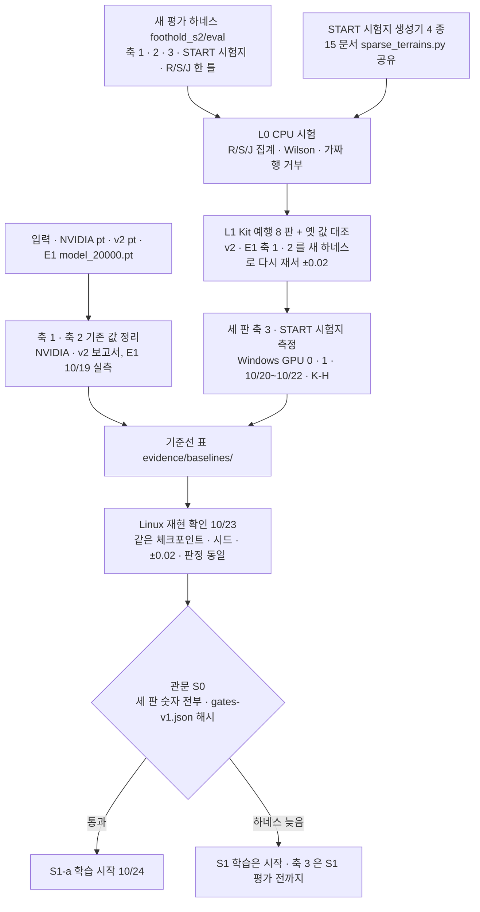

> 분류: A/정책학습 · 설계 (50 실험 단계 · S0 기준선)
> 작성: 오흥재 (lead 세션 초안 · fable 20f 가 v1 으로 고쳐 씀)
> 근거: evidence/E1-vs-v2-axis1.csv · E1-vs-v2-axis2.csv · `s2_lab/eval_e1_v2axes/`(10/19 실행 · `run_axis1.sh` · `run_axis2.sh` · `harness/` · `summarize.py`) · `sim/eval/eval_generalization.py` · `sim/eval/eval_command_response.py` · 41-EVAL-AXES · 15 문서 8 절 · APPROVED G-5 · H(평가 도구 재사용) · **K-H(이사 전 Windows, 팀장 승인 10/20 00:1x)** · VERIFY-fable-20f 4 절 · P32
> 요지: 새 학습 전에 비교 대상 셋(NVIDIA · v2 · E1)을 같은 자로 잰 표를 완성한다. 평가 도구는 41 설계대로 새로 만들고(축 1 · 2 · 3 · START 시험지 · R/S/J 한 틀), v2 · E1 하네스는 옛 값 재현 대조용으로만 쓴다(팀장 정정 10/19). 이 단계가 임계 경로다(S1 관문을 재려면 10/23 까지 서야 한다). K-H: 이사 전 Windows 에서 10/20~10/22 에 끝내고, 이사일(10/23)은 Linux 재현 확인(같은 체크포인트 · 같은 시드 몇 판이 같은 숫자)만
> 상태: v1.2 · 팀장 검토 전 · E1 축 1 · 2 는 10/19 실측 완료 · K-H 반영 · S0 세 판 표(evidence/baselines/, 10/20 SC-1 · SC-2) · 결정 2 · 7 반영(fable 20l) · **20s lead 답 8 항 반영(fable 10/20)**

# 51 · S0 기준선

## 0. 쉬운 요약

새 모델을 만들기 전에 「무엇보다 나아졌나」 를 잴 자를 먼저 만든다. 옛 모델 셋(NVIDIA 기본 · 우리 v2 · 눈 없이 명령을 연 E1)을 똑같은 시험에 올려 숫자를 적어 둔다. 자(평가 도구)는 41 문서 설계대로 **새로** 만든다. 옛 도구(v2 · E1 하네스)는 「새 도구가 옛 모델에서 옛 점수를 그대로 내나」 를 확인하는 대조용이다. 새 도구에는 축 1 · 축 2 와 함께 「험지에서 옆 · 뒤 · 회전」 을 재는 축 3 과 START 논문 시험지(징검돌 · 평균대 · 디딤 빔 · 틈)가 들어간다. 10/23 까지 안 서면 S1 의 점수를 잴 수 없다. 이 일은 이사(Linux 이전) 전에 지금 쓰는 Windows 기계에서 끝내고, 이사하는 날은 「같은 모델 · 같은 시드로 같은 숫자가 Linux 에서도 나오나」 만 확인한다(팀장 승인 K-H).

## 1. 흐름

## 2. 한 장

| 항목 | 내용 |
|---|---|
| 목적 | 「무엇보다 나아졌나」 의 자를 먼저 만든다 |
| 입력 | NVIDIA `C:/isaac/IsaacLab/logs/rsl_rl/unitree_go2_gap_nvidia/nvidia_pretrained_source/nvidia_pretrained.pt`(sha256 `1891ab2b…def96f3`, S0 run_manifest.json 32 개 동일 · fable 20l 확인, 전체 값은 41 §1 표) · v2 `…/2026-09-25_17-29-36_20260925_v2g2-feetair01_seed42_iter3000/model_3000.pt`(sha256 `e5c21321…5ab2fee`, 41 §1 표) · E1 `C:/Users/AI-WS01/s2_lab/step1_run_b2/fixtures/model_20000.pt` (sha256 `c8951b797dbe41570009e9de35589d56b7ea1d10092728af17761d46a2df47e8`) |
| 바꾸는 것 | 없음. 평가 자만 넓힌다 |
| GPU · 시간 | 축 1 한 판 약 27 분 · 축 2 약 5 분 (E1 **실측**, GPU 0). 관문 판정 칸은 칸당 200 판(41 §8 · 20s)이라 범위 안 32 칸 한 판 약 44 분, 기준 판 200 판 재측 1 회를 더해 관문당 약 1.5 h(27 분 실측의 에피소드 길이 비례 **가정**). 축 3 · START 시험지는 세 판 × 약 1~2 시간 **가정**. **전부 Windows 에서 10/20~10/22**(K-H · D49). 이사일 10/23 은 Linux 재현 확인(축 2 9 칸 + 축 1 8 칸 × 2 판 ≈ 1 시간, **가정**)만 |
| 관문 S0 | 세 판 모두 축 1 · 2 · 3 · START 시험지 숫자를 가짐(Windows) + Linux 재현 확인 통과(10/23). 41 §9 기준을 팀장이 확정해 **후보**로 1 단계 동결(10/22)에 넣고, 해시 등록은 각 학습 직전 2 단계 동결 때(50 §4) |
| 결과별 갈래 | 축 3 하네스가 10/23 까지 안 서면 → S1-a 학습은 10/24 에 시작하고 축 3 은 S1 평가(10/30) 전까지 완성. START 시험지 생성기가 안 서면 → S1-b(11/14, D36) 와 S2(11/3) 의 선행 작업이 밀리므로 60 G 로 기록하고 D41 역할 안에서 Sonnet 코딩 세션을 더 띄운다(O5 는 닫힘) |
| 산출물 | `evidence/baselines/` 표(판 × 축 × 칸 CSV) · 하네스 판 커밋 · `gates-v1.json` · `manifest-v1.json`(50 §4) |

## 3. 할 일

1. E1 결과 정리 완료(10/19): 축 1 0.4479 · 축 2 9/9. 1.5 m/s 0 % 는 범위 밖 속도 추종 실패, gap 0~1 %, stepping_stones 0 %(**실측** evidence csv, 20f 재계산 일치).
2. 새 평가 하네스 `foothold_s2/eval/`(**Windows 에서 지금 만든다**, K-H. **팀장 정정 10/19**: 재사용이 아니라 41 설계 바탕으로 새로. v2 `sim/eval/*.py` · E1 `s2_lab/eval_e1_v2axes/harness/` 는 참고 · 대조용): 축 1(16 종 × 3 속도 · 성분 넷) · 축 2(9 칸 · `hold` 세 칸은 시드 42 · 43 · 44 로 세 번, 결정 7 · S0 표 `axis2_cells.csv` 의 `seeds_failed` 열) · 축 3(`--command vx vy wz` · 지형군 목록 · 명령 방향 진행 · 방향 이탈) · START 시험지 · R/S/J 집계 · Wilson · `command.txt` · manifest 를 한 틀에. 파일 `axis1.py` · `axis2.py` · `axis3.py` · `start_sheet.py` · `rsj.py`.
3. START 시험지 지형 생성기(15 문서 `sparse_terrains.py` 와 공유). 8 × 4 m 칸 · 10 레벨 · 논문 치수. 평가 규약 「6 m 통과 · 500 판 · 무작위 지형 10」(START 354 행).
4. 옛 값 대조: 새 하네스로 v2 · E1 체크포인트의 축 1 · 축 2 를 다시 재서 0.9419 · 0.4479 · 8/9 · 9/9 가 ±0.02(축 2 는 판정 동일) 안에 나오는지. 어긋나면 새 하네스를 고친다.
5. NVIDIA · v2 축 3 측정. v2 · NVIDIA 는 옆 명령을 학습하지 않았으므로 옆 칸은 「학습 범위 밖」 표시로 잰다(숫자는 남긴다).
6. 세 판 START 시험지 측정(R · 주파율 · MEV). 여기까지 Windows GPU 0 · 1, 10/22 까지(K-H).
7. **Linux 재현 확인(이사일 10/23, K-H)**: v2 · E1 체크포인트 · 시드 42 로 축 2 9 칸 + 축 1 범위 안 8 칸(rough6 6 종 × 0.5 m/s + gap · stepping_stones 1.0 m/s, **가정**)을 Linux 에서 다시 돌려 Windows 값과 **8 칸 평균 차 ±0.02 이고 칸별로는 Wilson 95 % 구간이 겹치며**(100 판 · 0.9 면 구간 폭이 약 ±0.06 이라 칸별 ±0.02 는 표집 잡음보다 좁다, VERIFY-lead-final2 18) 축 2 9 칸 판정 동일이면 통과. 어긋나면 드라이버 · Isaac 판 차이를 기록하고 **10/23 밤 GPU 두 장으로 세 판 전부 Linux 에서 재측정**(축 1 세 판 × 27 분 + 축 2 + 축 3 · 시험지 세 판 × 1~2 h ≈ 6~8 h, **가정**) 해 S0 관문을 10/24 12:00 으로 민다(S1-a 학습 시작 10/24 00:00 은 유지, 관문 숫자는 Linux 값 기준). Windows 값은 참고로 남긴다.

## 4. 검증 사다리

| 단 | 무엇 | 통과 |
|---|---|---|
| L0 CPU | R/S/J 집계: J ≤ min(R, S) · Wilson(100 판 · 0.9) = 0.826~0.945 · J > R 가짜 행은 오류 | 기대값 |
| L0 CPU | 축 3 명령 주입: cfg 의 `lin_vel_x · y · ang_vel_z` 가 (vx, vy, wz) 로 고정되고 새 하네스의 명령 검사가 세 칸 다 봄(옛 `eval_generalization.py` 의 `verify_commands` 는 vx 만 봤다, 375~390 행, 참고) | 검사 |
| L1 대조 | 새 하네스로 v2 · E1 옛 값 재현 ±0.02 (Windows) | 표 |
| L1 Linux | 이사일 재현 확인: 같은 체크포인트 · 시드로 축 2 9 칸 + 축 1 8 칸이 Windows 값과 평균 ±0.02 · 칸별 Wilson 겹침 · 판정 동일. 어긋나면 세 판 재측정(§3-7) | 표 |
| L0 CPU | 시험지 치수(15 §9) | 치수 |
| L1 Kit | 축 3 예행 8 판(rough 1 종 × 좌 · 뒤) 끝까지 돌고 CSV · `command.txt` 남음. 시험지 10 레벨 메시가 뜸 | 파일 |
| L4 | 세 판 전체 측정 | 표 |

## 5. 검증할 가설 · 열린 항목

- H51-1: v2 의 축 3 옆 칸이 「진행 ≈ 0 · yaw 회전 대체」 로 나온다(명령 잠금의 증거). 축 3 지표가 이것을 잡아야 한다.
- 열린 항목: (닫힘) NVIDIA 체크포인트 경로 → 41 §1 표 · 축 3 평가 시간 규칙(듬성한 뒤 · 옆 칸은 결정 2 로 닫힘 · 41 §4, 나머지는 가정) · 축 3 듬성한 뒤 · 옆 칸의 S0 재측정 여부(새 규칙 2 s · 속도 × 2 s, 기록용 · lead 판단). 하네스 담당은 확정(18 §6 · D41: lead 가 Sonnet 코딩 세션으로 · fable 검증).
