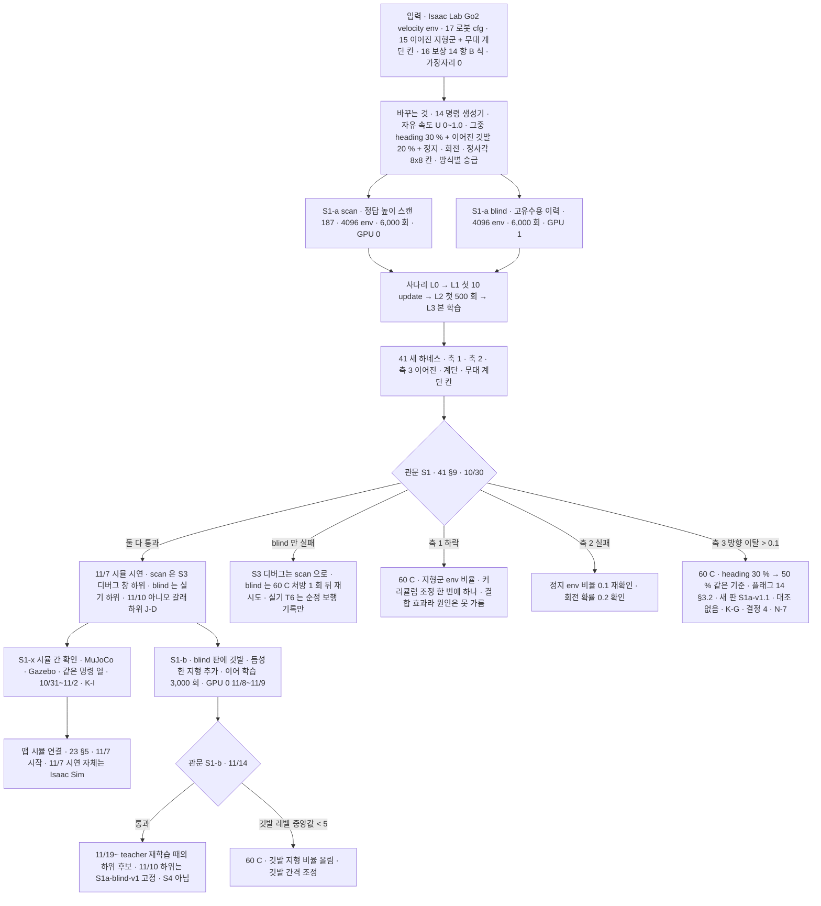

> 분류: A/정책학습 · 설계 (50 실험 단계 · S1 열린 명령 보행)
> 작성: 오흥재 (lead 세션 초안 · fable 20f 가 v1 으로 고쳐 씀 · 20g 반영)
> 근거: 14-COMMAND-GENERATOR · 15 · 16 · 17 · 18 · 41 §9 · v2 보고서 6-3~6-9 · 9-2 · JEPLO 2609.15770v1 표 III · Isaac Lab 2.3.2 Go2 rough env · training-benchmarks.md 19 행 · evidence/E1-vs-v2-axis1.csv · fable 20e Q2 · APPROVED H · I · J-A · J-D · J-F · **K-G · K-I(팀장 승인 10/20 00:1x)** · VERIFY-fable-20f P10 · P29 · VERIFY-lead-final 1 · 2 · 3 · 7 · 20 · 21 · 22 · **VERIFY-lead-final2 2 · 3 · 5 · 6 · 11 · 20 · 25(20j)** · JEPLO 2609.15770v1 249 행
> 요지: 명령 생성기 하나만 바꾼 Go2 보행을 학습해, 이어진 지형 전체(계단 포함)에서 명령이 다 열린 보행을 먼저 확보한다(11/7 의 몸통). S1-a(이어진 지형 · scan 과 blind 두 판, 11/7) 와 S1-b(깃발 · 듬성한 지형을 blind 판에 더함, 11/14) 로 나눈다(D35 · D36). S1 의 보상은 16 문서 14 항이고, S1 대 v2 는 「결합 효과」 다. S2 의 눈 효과 기준선은 S1 이 아니라 S2-G0(53) 이다. 이어진 지형 자유 속도 env 의 30 % 는 heading 모드(K-G, 14 §3.2)이고 방향 이탈 > 0.1 이면 0.75 새 판 S1a-v1.1. 관문 S1-a 뒤 S1-x 시뮬 간 확인(MuJoCo · Gazebo, K-I)을 두고 앱 시뮬 연결은 그 위에 선다. 11/7 시연은 Isaac Sim 10/21 S1-a 실패 뒤 현재 진단 경로는 S2-G0 두 명령 판이며, 이 문서의 S1-b 흐름은 당시 등록 계획이다.
> 상태: v1.3 · 팀장 검토 전 · K-G · K-I · 최종 점검 2(20j) 반영 · **팀장 결정 1 · 2 · 4 · 7 · 8 반영(APPROVED M · 10/20 09:4x · fable 20l)** · **20m 승인 차이 넷 반영(fable 10/20)** · **20s lead 답 8 항 반영(fable 10/20)** · 10/21 S1-a 실패·Rx1 중단·G0 현재 경로 연결 · 기존 관문 보존

# 52 · S1 열린 명령 보행

## 0. 쉬운 요약

카메라 없이, 「명령 세 칸을 전부 열어도 Go2 가 험지(계단 · 경사 · 박스 · 울퉁불퉁)를 걷나」 를 먼저 확인하는 단계다. v2 와 달리 명령을 만드는 방식(14)을 바꾸고, 보상(16) · 로봇 모델(17) · 무작위화도 새 설계대로 바꾼다. 그래서 v2 와의 차이는 「여러 가지를 함께 바꾼 결과」(결합 효과)이지 명령 하나의 효과가 아니다. 두 판을 돌린다. **scan 판**은 시뮬만 아는 「정답 높이 스캔」 을 눈으로 주어 v2 와 같은 관측 조건에서 비교하고, **blind 판**은 눈 없이 몸 감각만으로 걷게 해 진짜 로봇에 올릴 수 있는 판을 만든다. 둘 다 4096 대 로봇으로 6,000 번 반복(약 7 시간, 다른 조건에서 잰 값으로 추정)이다. 11/7 에는 이어진 지형 전체에서 앞 · 뒤 · 옆 · 회전 명령이 되는 것과 무대 계단 칸에서 조이스틱 조종을 시뮬로 보인다. 깃발로 건너는 듬성한 지형은 그 뒤 S1-b 에서 blind 판에 더한다.

**10/21 현재 경로, 위와 §1~§3의 원래 계획과 구분**: S1-a scan의 판정 26칸은 676/5200 = 0.130으로 v2의 4845/5200 = 0.932에 미달했다(§6). 회복 처방 S1a-Rx1은 14:38에 중단됐고 완료·전체 평가·승격은 미확인이다. 팀장 [G0 결정](https://github.com/foothold-project/foothold-lab/issues/555#issuecomment-6310259601)의 다음 진단은 START 구조·지도 없는 S2-G0의 두 명령 판 `diag-G0-open`과 `diag-G0-start`(각 1500회 · seed 42)다. 결과 영상을 보고 걷는 자세를 먼저 판독한다. 두 판 모두 정상 보행이면 S2-G0 본선, START 명령 판만 정상 보행이면 START 명령에서 열린 명령으로 넓히는 커리큘럼, 둘 다 기어가면 Go2 이식의 보상 크기·PD를 점검한다. 열린 명령 판만 정상, 미완료 또는 영상 판단 불명확은 다음 처방 미등록으로 lead에게 남긴다. 이 짧은 진단은 §2 관문 통과가 아니며 S1-a 체크포인트를 부모로 이어받지 않는다. §3의 지형 비율·커리큘럼·종아리 처방은 자세가 회복된 뒤 험지 손실이 남을 때 검토한다. 현재 G0의 완료 결과는 이 문서에서 미확인이다. 근거: [EXP-MAP 현재 경로](../20261021-experiments/EXP-MAP.md) · [밤 기록](NIGHT-REPORT-1021.md).

## 1. 세부 흐름

S1-b 는 S2 의 입력이 아니다(VERIFY-lead-final 1). S2 는 처음부터 학습하고(53 §4) S1-b 와는 **생성기 · 지형 코드만 공유**한다. S2 의 눈 효과 기준선은 S2 틀에서 눈만 끈 **S2-G0**(53 §2, 팀장 승인 J-A)이다.

## 2. 한 장

| 항목 | 내용 |
|---|---|
| 목적 | 「명령이 다 열린 Go2 보행」 을 먼저 확보. 11/7 시뮬 시연(이어진 지형 전체 명령 열림 + 조이스틱, D22) · S3 디버그 창의 하위(scan) · 실기 하위와 11/10 「아니오」 갈래 하위(blind, **J-D**) |
| 바꾸는 것 | 명령 생성기(14 문서) + 그 생성기가 전제하는 정사각 칸(15) · 종아리 한계(17) · PIE DR(17 §5) · **16 문서 14 항 보상(B 식 · 가장자리 0)**. v2 와는 이 모두가 다르므로 관문의 「v2 대비」 는 **결합 효과**다(VERIFY-lead-final 3). 종아리 한계만 바꾼 대조판(2,000 회)은 예산 남을 때 선택 |
| 관측(두 판, D35) | scan: 정답 높이 스캔 187 점(v2 와 같은 격자, 시뮬 전용). blind: 고유수용 이력 10 × 45(13 §2). critic(두 판 공통): o_t + 몸 선속도 3 + 발 접촉 4 = 52(**가정** · 13 §2 · lead 승인 10/20 · 20m). 둘 다 같은 시드 · 같은 생성기 |
| 지형 · 명령 | S1-a: 이어진 지형군 6 종 + 무대 계단 칸(15 §3) · **23 열**(이어진 지형만이라 정수 배정 · 우리 변경 · 15 §2 · 20m), 자유 속도(U[0, 1.0], J-F · **그중 heading 모드 30 %**, K-G · 14 §3.2 비율 표) 80 % + 이어진 깃발 20 % + 정지 · 회전. S1-b: blind 판에 듬성한 지형군(깃발 + START 식 제자리 회전 + 물러나기 −0.3 · 2 s · 최대 0.6 m, 14 §3 · D39 · J-B · 결정 2)을 더해 이어 학습, 11/8~11/9 GPU 0 · 관문 11/14(D36). scan 판의 S1-b 는 예산 남을 때 |
| 액추에이터 | 종아리 URDF 15.70 rad/s · 45.43 N·m DCMotor(17, D19). 실측값은 S1 cfg 에 넣지 않고 별도 이어 학습판에만(VERIFY-lead-final 21) |
| env · 반복 · 시간 | 4096 · 24 steps · 6,000 회 ≈ 7.0 h / 판(**다른 조건 실측 + 가정**: 4.17 s/회는 Windows · NVIDIA 식 env · 눈 없음에서 잰 값, 18 §4 · VERIFY-lead-final 22). S1-b 이어 학습 3,000 회 3.5~5 h. S1-b 의 p_advance 는 자체 반복 수 기준 T_start 0 · T_end 1,500(15 §5 · VERIFY-lead-final 7) |
| 관문 S1-a (41 §9, 10/30) | 축 2 9/9(`hold` 세 칸은 시드 42 · 43 · 44 중 둘 이상 문턱 안, 결정 7) · 요 추종 ≥ 0.80 / 축 1 범위 안 32 칸(16 종 × {0.5, 1.0}, 고정 목록): scan 은 **판정 26 칸**(gap · rails · floating_ring 6 칸은 기록만, 결정 1)에서 v2 대비 진짜 하락 아님(41 §8 (A)(B) · 칸당 200 판 · 결정 8 · N-6 · 20s), blind 는 평균 ≥ 0.67 · 생존 ≥ 0.95 / 축 3 이어진 지형 · 계단 선속도 칸(대각 · 앞 + 회전 포함) 진행 ≥ 0.8 · 생존 ≥ 0.95 · 방향 이탈률 ≤ 0.1(이탈 = |실제 요 변화 − ∫ wz_cmd dt| > 30°, 41 §4 · 평가 도구 yaw_dev_deg) · 제자리 회전 칸 요 추종비 ≥ 0.80 · 생존 ≥ 0.95 / 무대 계단 칸 시나리오 J ≥ 0.9. **방향 이탈률 > 0.1 이면 heading 같은 기준 30 % → 50 %(플래그 14 §3.2 · N-7) 새 판 S1a-v1.1**(K-G · 결정 4, 대조 없음) |
| 관문 S1-b (11/14) | 깃발 지형군(틈 · 징검돌) 레벨 중앙값 ≥ 5 at 3,000 회 · 축 1 범위 안 32 칸 S1-a 대비 진짜 하락 아님(41 §8 (A)(B) · 200 판) · 축 3 듬성한 뒤 0.3 칸(명령 2 s · 기준 거리 0.6 m, 결정 2) 진행 ≥ 0.6 · 생존 ≥ 0.9(D39) · 제자리 회전 ±1.2 칸 징검돌 · 틈 생존 ≥ 0.9(J-B, 평균대 · 빔은 기록) · vy_obs 95 분위 기록(14 §6 규칙) |
| 시뮬 간 확인 S1-x (K-I) | 관문 S1-a 통과 뒤 S1-a blind(실기 하위) 정책(ONNX)을 MuJoCo(`unitree_mujoco`, Unitree 공식) · Gazebo(ROS 2 Go2 패키지 후보)에서 **같은 명령 열**(축 2 9 칸 + 평지 · 무대 계단 칸 방향 7 칸 = 16 칸, 칸당 50 판 · 시드 42)로 돌려 속도 추종 · 생존 · 방향 이탈을 Isaac 값과 비교(Isaac 기준값은 S1-x 직전 같은 16 칸 · 50 판으로 따로 잼, VERIFY-lead-final2 11)(41 §9 S1-x 행 · **가정**: 추종비 차 ≤ 0.10 · 생존 차 ≤ 0.05 · 방향 이탈 차 ≤ 0.05 · 축 2 판정 동일). 10/31~11/2 · lead(Sonnet 코딩) · fable 검증(70). **11/7 시연은 Isaac Sim**, 앱 시뮬 연결(23 §5)은 S1-x 에서 숫자가 맞은 시뮬 위. 근거: JEPLO 가 IsaacLab 학습 뒤 별도 MuJoCo 평가 환경을 둠(**논문** 2609.15770v1 246 · 249 행) |
| 실기 연결 | T0(안전 연결 시험: 시뮬 10/30 까지 · 실기 도착 첫 주) 통과 뒤에만 T6 에 S1-a blind(**날짜 관문**, 70 §1.1 · VERIFY-lead-final2 3). Go2 기본 도착이면 T6 는 10/31~11/2, 최악이면 11/8~11/14(42) |
| 산출물 | 체크포인트(판 번호 S1a-scan-v1 · S1a-blind-v1 · S1b-blind-v1) · 학습 로그(방향별 노출 · 승급 기록 · 제자리 회전 · 물러나기 비율, 14 §6) · 평가 CSV(R/S/J) · 비교 영상(같은 지형 · 시드 · 명령으로 v2 와 나란히) |

## 3. 결과별 갈래 (이 숫자가 나오면 → 다음은 이것)

아래 표는 S1-a 학습 전에 등록한 원래 갈래다. 현재 실패 뒤 첫 코칭은 §0의 S2-G0 두 판이며, 아래 숫자나 처방을 새 판의 결과 없이 자동 적용하지 않는다. §2의 판정값과 41 §8·§9, 봉인 gates는 바꾸지 않는다.

| 신호 (학습 전 등록) | 뜻 | 다음 |
|---|---|---|
| 첫 500 회 안에 NaN 1 회 이상 · 500 회째 에피소드 평균 길이가 100 회째보다 짧음 · KL 평균이 0.005~0.02 밖(13 §7 L2 와 같은 범위) 가운데 하나 | 학습 틀이 안 선다(v2 보상 곡선과는 보상 항 · 시작점이 달라 단위가 다르므로 비교하지 않는다, VERIFY-lead-final2 6) | 멈추고 L0 로 돌아감(생성기 · 보상 단위 시험). 새 판 번호 |
| 레벨 ≥ 7 표본의 전진 비율 > 명령 분포 + 10 %p (14 §6) | 승급이 전진에 치우침(명령 잠금 재발) | 60 C: 방식별 승급 규칙 로그 점검 · 깃발 지형 비율 ↑ |
| 축 2 `turn` 낙상 > 0.10 | 정지 · 회전 노출 부족 | 정지 env 0.1 · 회전 확률 0.2 가 실제 로그에 그 비율로 찍혔는지. 아니면 생성기 버그 |
| 축 1 판정 26 칸(결정 1) 이 41 §8 (A)(B) 불통과 (scan · 200 판 · N-6) | 결합 효과가 험지를 해침(원인은 못 가름) | 60 C 처방 하나씩(지형군 비율 → 커리큘럼 시작 범위 좁힘 → 예산 남으면 종아리 한계 대조판) |
| blind 평균 < 0.67 이고 scan 은 통과 | 눈 없음의 한계 | S3 디버그 · 11/7 은 scan 으로. blind 는 처방 1 회 뒤 재시도, 그래도 안 되면 실기 T6 는 「순정 보행 기록만」 이고 11/10 「아니오」 갈래는 「S3 없음 → 60 D」 |
| 축 3 옆 칸 진행 < 0.8 인데 방향 이탈(|실제 요 변화 − ∫ wz_cmd dt| > 30°) | 옆 명령을 회전으로 대신함 | 방향 이탈로 실패 처리 · 추종 보상 가중치 확인 · 노출 시간 확인 |
| **축 3 이어진 지형 · 계단 방향 이탈 > 0.1**, 또는 축 1 실패 성분이 방향 위주(넘어짐 아님, 41 §2) | 방향 유지 압력 부족(heading 30 % 가정이 낮음, K-G) | 60 C 처방 하나: heading 같은 기준 30 % → **50 %**(플래그 14 §3.2 처방 행 · 결정 4 · N-7) 새 판 **S1a-v1.1**. 대조 판(heading 0 %)은 없으므로 「heading 효과」 단독 결론 금지(결합 효과로만) |
| 축 2 확장 저속 칸(0.1~0.4, v2 9-2) 추종비 < 0.5 | 저속 학습(J-F)이 안 됨 | 자유 속도 크기 분포 로그 확인(0.5 미만 비율 0.5) |
| 둘 다 통과 | | 11/7 시연 · S1-b 시작 · scan 은 S3 디버그 하위 · blind 는 실기 · 「아니오」 갈래 하위 |

### 중단된 S1a-Rx1의 중간 점검 계획

**코드 · 계획, 결과 아님**: S1a-Rx1은 추종 커널 lin·ang `std=0.25`(분모 `std²=0.0625`, 16 §3), 발 지면 아래 종료 여유 0.25 m, 행동 원소 클립 17의 세 변경 묶음이었다(17 §7). 실행 로그의 옛 이름 `S1a-v1.1`과 이 문서 표의 **heading 30 % → 50 % 처방 `S1a-v1.1`은 별개**다. 후자는 lead 명명 인계상 미실행이다([Rx1 카드](../20261021-experiments/EXP-S1a-Rx1.md)).

| Rx1 중간 시점 | 당시 계획된 판독 | 확인 범위 |
|---|---|---|
| 1500회 | `random_rough` 정지 비율 ≤ 0.383 **그리고** 6초 전진 거리 중앙값 ≥ 0.69 m | 중간 점검선이며 최종 관문 아님. Rx1 결과 미확인 |
| 3000회 | 회전 추종 ≥ 0.264. 미달이면 D4 진단을 준비하고 본 학습은 계속한다는 계획 | 최종 회전 추종 ≥ 0.80 관문과 다름. Rx1 결과 미확인 |
| 6000회 뒤 | 봉인 gates v1.1의 칸당 200판 평가 후 lead 판정 | 학습 완료·평가·S1-b 승격 미확인 |

Rx1은 14:38에 중단됐다([EXP-MAP 중단 기록](../20261021-experiments/EXP-MAP.md)). D2의 seed 42·1500회 진단, 두 시드·1100회 진단, D3의 1500회 진단을 Rx1 자체의 중간 점검 결과로 대체하지 않는다. 세 변경의 개별 효과, blind 성능, 최종 관문은 미확인이다. 09:17 시작 기록과 09:23 직접 진행 답은 시각을 구분하며, 뒤의 답을 앞선 기동 승인으로 소급하지 않는다([#555 정정](https://github.com/foothold-project/foothold-lab/issues/555#issuecomment-6304887684)).

## 4. 검증 사다리

| 단 | 무엇 | 통과 |
|---|---|---|
| L0 CPU | 14 §9 · 15 §9 · 16 §8 · 17 §9 의 단위 시험 전부 + 관측 조립(13 §7) | 기대값 |
| L0 AST | cfg 의 term 이름이 실제 Isaac Lab 2.3.2 등록 이름과 같음(가짜 cfg 금지), sibling import 검사 | 통과 |
| L1 Kit | 첫 10 update: Traceback 0 · 장당 메모리 · steps/s(목표 ≥ 20,000) · 체크포인트 파일 · 방식별 env 수 로그 | 로그 |
| L1 평가 | 새 하네스 예행 8 판이 S1 체크포인트(10 update 짜리)에서 끝까지 돎 | CSV |
| L2 | 첫 update 로그 확인(보상 · 에피소드 길이 · KL · 노출) → 그 뒤 무인 사슬 + heartbeat(Haiku 감시, 18 §6) | 로그 |
| L3 | 본 학습 6,000 회 · GPU 상태 보고 한 줄 | 체크포인트 |
| L4 | 41 전체 평가 · 관문. 판정은 fable(18 §6 역할) | 표 |

2 단계 동결(50 §4): S1-a cfg · 하네스 · `gates-v1.json` 해시는 10/24 00:00 학습 직전에 `s2-S1a-v1` 태그로 고정한다.

## 5. 11/7 시연 연결

- 시뮬: 이어진 지형 전체에서 앞 · 뒤 · 옆 · 대각 · 회전 · 저속 명령(축 3 표)과 무대 계단 칸 조이스틱 경로(앞 0.5 · 정지 · 회전 · 내려오기). 계단은 평가 한 칸이고 초점이 아니다(D22).
- **시연 모듈 · 담당 · 날짜 · GPU**(VERIFY-lead-final2 20): `foothold_s2/sim/isaac_teleop.py`(조이스틱 → 세 칸 → 정책 50 Hz · Isaac Sim 창 · 녹화 · 정지 · 회전 · 저속 포함, **lead(Sonnet)**, 18 §6)를 10/27 부터 만들고, **11/6 리허설(GPU 0, 1 h, 처방 판 포함 최신 S1-a 체크포인트)** → 11/7 시연 GPU 0(S2-G0 평가는 11/4 에 끝남, 70). **실패 갈래**: S1-a scan · blind 둘 다 관문 실패면 시연은 처방 1 회 판(S1a-v1.1)으로, 그마저 없으면 v2 체크포인트와 S1-a 판을 **같은 지형 · 시드 · 명령으로 나란히**(「명령 열림 전후」 비교 영상 + 축 3 표)로 보이고 관문 미달을 그대로 적는다(60 C). 시연을 위해 관문을 바꾸지 않는다.
- 앱 연결은 시뮬 먼저(Isaac Sim 에 23 의 명령 어댑터를 붙여 앱 손 조종 → 정책, D23). 실기는 42 T0 → T6 이후.

## 6. 검증할 가설 (14 §10 · 13 §8)

- H14-2 이어진 지형 명령 개방이 v2 험지 성적을 해치지 않는다. **10/21 S1-a scan 에서 불지지**: 판정 26 칸 676/5200 = 0.130 대 v2 4845/5200 = 0.932, `real_drop`(gates v1 `752362ef`, [#555 판정](https://github.com/foothold-project/foothold-lab/issues/555#issuecomment-6298224538)). 반증된 것은 S1-a 의 결합 구성(열린 명령 + 속도 추정기 없는 MLP + 우리 지형 진행 + B 추종식)이며, 명령 개방 단독 · START 전체는 반증되지 않는다([분석](../20261021-experiments/ANALYSIS-astra-start-to-go2.md)). 당시 명령 × 정책 구조 2×2 제안은 결과 전 검토안이었고, 현재 다음 경로는 §0의 S2-G0 명령 두 판이다. E1 은 눈 없이 0.4479 였으며 신경망 · 지형 · 학습량도 달랐다.
- H14-3 정지 env 0.1 효과 유지(새 구조에서는 가설, APPROVED C). S1-a 결과로 판정 보류(결합 실패로 분리 불가).
- H14-7 저속 U[0, 1.0] 표집이 고속 추종을 해치지 않는다.
- H14-8 heading 30 %(K-G) 가 방향 이탈을 ≤ 0.1 로 잡으면서 요축 노출을 지킨다(대조 없음 · 결합 효과). S1-a 결과로 판정 보류(결합 실패로 분리 불가).
- H13-5 scan 과 blind 의 차이 = 눈의 값의 **결합 효과**(한 변수 비교가 아님 · 한 변수는 S2-G0 대 G1, VERIFY-lead-final2 25). S1-a 결과로 판정 보류(결합 실패로 분리 불가).
- H14-1 · H14-6 (S1-b) 깃발 방식이 듬성한 지형 노출을 보장하고, START 식 제자리 회전이 좁은 발판에서 낙하율로 드러난다.

## 7. 열린 항목

- 무대 계단 칸 치수(실측은 선택, 없으면 0.15 m 대표값, 41 §7).
- S1-b 와 S3 디버그 창이 GPU 0 을 나눠 쓰는 순서(11/8~11/9 S1-b 우선, 가정 · 70).
- 종아리 한계만 바꾼 대조판을 돌릴 예산.
- S1-x 시뮬 선택(MuJoCo `unitree_mujoco` 우선 · Gazebo 는 현민 앱 어댑터가 ROS 2 면)과 지형(평지 + 무대 계단 칸, 가정) · Go2 모델 라이선스 확인(70 §4).
