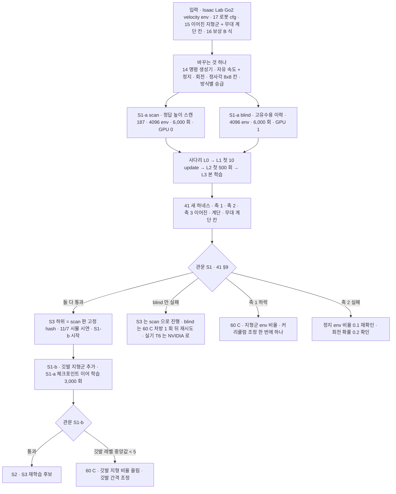

> 분류: A/정책학습 · 설계 (50 실험 단계 · S1 열린 명령 보행)
> 작성: 오흥재 (lead 세션 초안 · fable 20f 가 v1 으로 고쳐 씀)
> 근거: 14-COMMAND-GENERATOR · 15 · 16 · 17 · 18 · 41 §9 · v2 보고서 6-3~6-9 · JEPLO 2609.15770v1 표 III · Isaac Lab 2.3.2 Go2 rough env · training-benchmarks.md 19 행 · evidence/E1-vs-v2-axis1.csv · fable 20e Q2 · APPROVED H(11/7 문구 · 계단은 평가 한 칸) · VERIFY-fable-20f P10 · P29
> 요지: 명령 생성기 하나만 바꾼 Go2 보행을 학습해, 이어진 지형 전체(계단 포함)에서 명령이 다 열린 보행을 먼저 확보한다(11/7 의 몸통). S1-a(이어진 지형 · scan 과 blind 두 판, 11/7) 와 S1-b(깃발 · 듬성한 지형 추가, 11/14) 로 나눈다(팀장 승인 10/19 23:2x, D35 · D36)
> 상태: v1 · 팀장 검토 전

# 52 · S1 열린 명령 보행

## 0. 쉬운 요약

카메라 없이, 「명령 세 칸을 전부 열어도 Go2 가 험지(계단 · 경사 · 박스 · 울퉁불퉁)를 걷나」 를 먼저 확인하는 단계다. v2 와 다른 것은 명령을 만드는 방식(14) 하나뿐이다. 두 판을 돌린다. **scan 판**은 시뮬만 아는 「정답 높이 스캔」 을 눈으로 주어 v2 와 같은 조건에서 비교하고, **blind 판**은 눈 없이 몸 감각만으로 걷게 해 진짜 로봇에 올릴 수 있는 판을 만든다. 둘 다 4096 대 로봇으로 6,000 번 반복(약 7 시간)이다. 11/7 에는 이어진 지형 전체에서 앞 · 뒤 · 옆 · 회전 명령이 되는 것과 무대 계단 칸에서 조이스틱 조종을 시뮬로 보인다. 깃발로 건너는 듬성한 지형은 그 뒤 S1-b 에서 더한다.

## 1. 세부 흐름

## 2. 한 장

| 항목 | 내용 |
|---|---|
| 목적 | 「명령이 다 열린 Go2 보행」 을 먼저 확보. S2 · S3 의 하위 보행과 11/7 시뮬 시연(이어진 지형 전체 명령 열림 + 조이스틱, APPROVED H) |
| 바꾸는 것 하나 | 명령 생성기(14 문서). 나머지는 Isaac Lab Go2 rough 기본 + v2 에서 검증된 설정 + 17 의 종아리 한계 + 16 의 B 식 추종 |
| 관측(두 판, **팀장 승인 D35**) | scan: 정답 높이 스캔 187 점(v2 와 같은 격자, 시뮬 전용). blind: 고유수용 이력 10 × 45(13 §2). 둘 다 같은 시드 · 같은 생성기 |
| 지형 · 명령 | S1-a: 이어진 지형군 6 종 + 무대 계단 칸(15 §3), 11/7. S1-b: + 듬성한 지형군(깃발 + 물러나기 −0.3, 14 §3 · D39), 11/8~11/14 GPU 0. **팀장 승인 D36** |
| 액추에이터 | 종아리 URDF 15.70 rad/s · 45.43 N·m DCMotor(17, **팀장 승인**) |
| env · 반복 · 시간 | 4096 · 24 steps · 6,000 회 ≈ 7.0 h / 판(**실측** 4.17 s/회, 18 §4). S1-b 이어 학습 3,000 회 3.5~5 h |
| 관문 S1-a (41 §9) | 축 2 9/9 · 요 추종 ≥ 0.80 / 축 1 범위 안 32 칸: scan 은 v2 대비 진짜 하락 0, blind 는 평균 ≥ 0.67 · 생존 ≥ 0.95 / 축 3 이어진 지형 · 계단 방향별 진행 ≥ 0.8 · 생존 ≥ 0.95 · 방향 이탈 ≤ 0.1 / 무대 계단 칸 시나리오 J ≥ 0.9 |
| 관문 S1-b (11/14) | 깃발 지형군(틈 · 징검돌) 레벨 중앙값 ≥ 5 at 3,000 회 · 축 1 범위 안 S1-a 대비 진짜 하락 0 · 축 3 듬성한 뒤 0.3 칸 진행 ≥ 0.6 · 생존 ≥ 0.9(D39) · 옆 vy_obs 분포 기록. S1-b blind 는 S2 관문의 G0 기준선(53 §2)이 된다 |
| 실기 연결 | Go2 가 기본(10/26 주)대로 오면 S1-a blind 를 42 T6 에 올려 실기 차이를 11/2 전에 본다. 최악(11/7)이면 11/8~11/14 | D38 · 42 |
| 산출물 | 체크포인트(판 번호 S1a-scan-v1 · S1a-blind-v1 · S1b-v1) · 학습 로그(방향별 노출 · 승급 기록, 14 §6) · 평가 CSV(R/S/J) · 비교 영상(같은 지형 · 시드 · 명령으로 v2 와 나란히) |

## 3. 결과별 갈래 (이 숫자가 나오면 → 다음은 이것)

| 신호 (학습 전 등록) | 뜻 | 다음 |
|---|---|---|
| 첫 500 회에 보상이 v2 첫 500 회 곡선의 50 % 미만이거나 NaN | 학습 틀이 안 선다 | 멈추고 L0 로 돌아감(생성기 · 보상 단위 시험). 새 판 번호 |
| 레벨 ≥ 7 표본의 전진 비율 > 명령 분포 + 10 %p (14 §6) | 승급이 전진에 치우침(명령 잠금 재발) | 60 C: 방식별 승급 규칙 로그 점검 · 깃발 지형 비율 ↑ |
| 축 2 `turn` 낙상 > 0.10 | 정지 · 회전 노출 부족 | 정지 env 0.1 · 회전 확률 0.2 가 실제 로그에 그 비율로 찍혔는지. 아니면 생성기 버그 |
| 축 1 범위 안 32 칸 중 Wilson 상한 < v2 값인 칸 ≥ 1 (scan) | 명령 개방이 험지를 해침 | 60 C 처방 하나씩(지형군 비율 → 커리큘럼 시작 범위 좁힘) |
| blind 평균 < 0.67 이고 scan 은 통과 | 눈 없음의 한계 | S3 · 11/7 은 scan 으로. blind 는 처방 1 회 뒤 재시도, 그래도 안 되면 실기 T6 는 NVIDIA 로 하고 기록 |
| 축 3 옆 칸 진행 < 0.8 인데 yaw 변화 > 30° | 옆 명령을 회전으로 대신함 | 방향 이탈로 실패 처리 · 추종 보상 가중치 확인 · 노출 시간 확인 |
| 둘 다 통과 | | S3 하위 = scan 판(시뮬) · blind 판은 실기 후보 · S1-b 시작 |

## 4. 검증 사다리

| 단 | 무엇 | 통과 |
|---|---|---|
| L0 CPU | 14 §9 · 15 §9 · 16 §8 · 17 §9 의 단위 시험 전부 + 관측 조립(13 §7) | 기대값 |
| L0 AST | cfg 의 term 이름이 실제 Isaac Lab 2.3.2 등록 이름과 같음(가짜 cfg 금지), sibling import 검사 | 통과 |
| L1 Kit | 첫 10 update: Traceback 0 · 장당 메모리 · steps/s(목표 ≥ 20,000) · 체크포인트 파일 · 방식별 env 수 로그 | 로그 |
| L1 평가 | 새 하네스 예행 8 판이 S1 체크포인트(10 update 짜리)에서 끝까지 돎 | CSV |
| L2 | 첫 update 로그 확인(보상 · 에피소드 길이 · KL · 노출) → 그 뒤 무인 사슬 + heartbeat | 로그 |
| L3 | 본 학습 6,000 회 · GPU 상태 보고 한 줄 | 체크포인트 |
| L4 | 41 전체 평가 · 관문 | 표 |

## 5. 11/7 시연 연결

- 시뮬: 이어진 지형 전체에서 앞 · 뒤 · 옆 · 대각 · 회전 명령(축 3 표)과 무대 계단 칸 조이스틱 경로(앞 0.5 · 정지 · 회전 · 내려오기). 계단은 평가 한 칸이고 초점이 아니다(APPROVED H).
- 앱 연결은 시뮬 먼저(Isaac Sim 에 23 의 명령 어댑터를 붙여 앱 손 조종 → 정책, APPROVED H). 실기는 42 T6 이후.

## 6. 검증할 가설 (14 §10 · 13 §8)

- H14-2 이어진 지형 명령 개방이 v2 험지 성적을 해치지 않는다(scan 판에서 직접 비교). E1 이 눈 없이 0.4479 였던 것과 다른 결과가 blind 판에서 나와야 한다(E1 은 신경망 · 지형 · 학습량도 달랐다).
- H14-3 정지 env 0.1 효과 유지(새 구조에서는 가설, APPROVED C).
- H13-5 scan 과 blind 의 차이 = 눈의 값.
- H14-1 (S1-b) 깃발 방식이 듬성한 지형 노출을 보장한다.

## 7. 열린 항목

- 무대 계단 칸 치수(실측은 선택, 없으면 0.15 m 대표값, 41 §7).
- S1-b 와 S3 디버그 창이 GPU 0 을 나눠 쓰는 순서(11/8~11/9 S1-b 우선, 가정).
