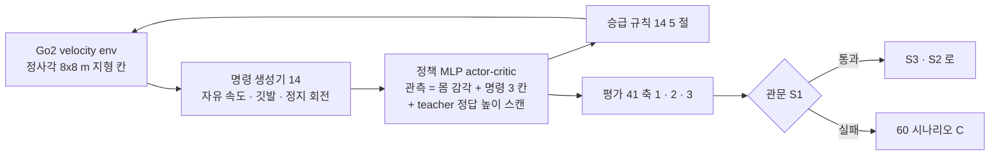

> 분류: A/정책학습 · 설계 (50 실험 단계 · S1 열린 명령 보행)
> 작성: 오흥재 (lead 세션 작성)
> 근거: 14-COMMAND-GENERATOR · v2 보고서 6-3~6-9 · JEPLO 2609.15770v1 표 III (evidence/maicode-jeplo-deep) · Isaac Lab Go2 rough env · training-benchmarks.md 19 행 (5080 1 장 4096 env 약 23,000 steps/s) · fable 20e Q2
> 요지: 명령 생성기 하나만 바꾼 Go2 보행(G0)을 학습해, 이어진 지형과 계단에서 명령이 다 열린 보행을 먼저 확보한다. 11/7 시연의 몸통이다
> 상태: 초안 · 팀장 검토 전

# 52 · S1 열린 명령 보행 (G0)

| 항목 | 내용 |
|---|---|
| 목적 | 「명령이 다 열린 Go2 보행」 을 먼저 확보. S2 · S3 의 하위 보행과 11/7 조이스틱 시연 |
| 바꾸는 것 하나 | 명령 생성기(14 문서). 나머지는 Isaac Lab Go2 rough 기본 + v2 에서 검증된 설정 |
| 관측 | 1 안: v2 처럼 정답 높이 스캔 187 점(시뮬 전용, 실기는 그대로 못 씀). 2 안: 눈 없음(몸 감각 이력). 팀장 결정 필요(90 열린 결정 O3) |
| 지형 | 이어진 지형 6 종 + 계단 + 무대 계단 치수 칸 + 듬성한 지형(omni 배치). 15 문서 |
| 액추에이터 | 종아리 관절 속도 한계 URDF 15.70 rad/s 반영(17 문서, fable 20e F13) |
| GPU · 시간 | 5080 1 장 4096 env 약 23,000 steps/s(실측) → 1,500 회 약 104 분. 명령 개방으로 학습량 2~4 배 가정 → 3,000~6,000 회 · 4~8 시간 **가정** |
| 관문 S1 | 축 2 9/9 · 요 추종 ≥ 0.80 / 축 1 범위 안 32 칸 v2 대비 진짜 하락 0 / 축 3 이어진 지형 · 계단 방향별 진행 ≥ 0.8 · 생존 ≥ 0.95 (41 9 절 후보) |
| 실패 시 | 축 1 하락이면 60 시나리오 C(지형 분업 비율 · 커리큘럼 조정, 한 번에 하나), 축 2 실패면 정지 env 비율(v2b 0.1) 재확인 |
| 산출물 | 체크포인트 · 학습 로그(방향별 노출 · 승급 기록, 14 6 절) · 평가 CSV · 비교 영상(같은 지형 · 시드 · 명령) |

## 검증할 가설 (14 8 절)

- H14-1 깃발 방식이 듬성한 지형 노출을 보장한다.
- H14-2 이어진 지형 명령 개방이 v2 험지 성적을 해치지 않는다. E1 이 눈 없이 0.4479 였던 것과 다른 결과가 나와야 한다(E1 은 신경망 · 지형 · 학습량도 달랐다).
- H14-3 정지 env 0.1 효과 유지.

## 11/7 시연 연결

- 무대 계단 치수 칸과 조이스틱 경로(앞 · 정지 · 회전)를 평가에 포함.
- 실기는 42 문서 T6 이후.
