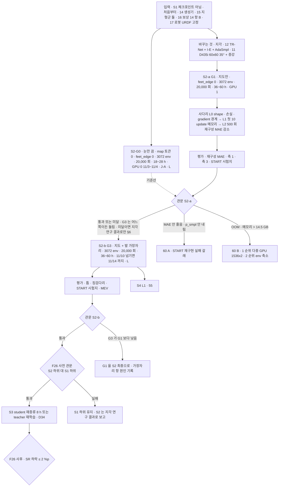

> 분류: A/정책학습 · 설계 (50 실험 단계 · S2 START 지각)
> 작성: 오흥재 (lead 세션 초안 · fable 20f 가 v1 으로 고쳐 씀)
> 근거: START 2512.13153v1 (TR-Net 126~139 · 169 · AdaSmpl 185~217 · 발 가장자리 239~257 · 예산 221 · 실기 379 행) · 선행 2409.15692v2 95 행 · Table V(305~353 행) · Fig. 8 (evidence/maicode-trcr-deep) · RESEARCH-astra-19g · evidence/deep-research-start-*.json · ASTRA 19f Q3 · fable 20e R1~R7 · F15 · F26 · 11 · 12 · 13 · 18 §4 · 41 §9 · VERIFY-fable-20f P1 · P2 · P11 · P14 · P27 · P28 · **APPROVED L(S2 20,000 회 · 11/10 대비책, 팀장 승인 10/20 00:4x)** · 70 §1.2
> 요지: 14 생성기 · 15 지형군 둘 · 16 보상 위에 START 의 depth 높이 지도 재구성과 발 가장자리 보상을 단계적으로 얹는다(S2-G0 눈만 끈 판 → G1 → G3). G0 는 GPU 0, G1 · G3 는 GPU 1 에서 S3 와 병렬. F26 사전 관문을 넘을 때만 하위 보행을 바꾼다. 실측값은 S2 cfg 에 넣지 않는다. 반복 수는 논문의 2 배인 20,000(L: 이어진 지형을 더한 만큼 듬성한 지형 노출을 START 이상으로). G3 가 11/10 을 넘기면 11/10 관문은 G1 결과로 판정하고 G3 는 11/14 까지
> 상태: v1.3 · 팀장 검토 전 · 미기재 값은 가정 · S2-G0 는 팀장 승인 J-A · 반복 20,000 은 팀장 승인 L · 결정 2 · 8 반영(APPROVED M · fable 20l) · **20q N 절 반영(fable 10/20)**

# 53 · S2 START 지각 (G1 · G3)

## 0. 쉬운 요약

로봇에 눈을 단다. 머리 카메라 깊이 영상을 START 의 TR-Net 이 발밑 높이 지도로 바꾸고(12), 그 지도로 징검돌 · 평균대 · 디딤 빔 · 틈을 건너게 배운다. 세 판을 돈다. **G0** 는 같은 조건에서 눈만 끈 판(기준선), **G1** 은 지도를 더한 판, **G3** 는 거기에 「돌 가장자리에 디디면 벌점」(16) 을 더한 판이다. 그래야 「눈이 도움이 됐나」 와 「벌점이 도움이 됐나」 를 각각 한 가지만 다른 두 판으로 말할 수 있다. 로봇 3,072 대로 20,000 번 반복(논문 10,000 의 2 배. 우리는 논문에 없는 이어진 지형을 절반 가까이 섞어서, 같은 횟수면 징검다리 연습량이 논문의 절반밖에 안 되기 때문이다. 팀장 결정 L). G1 · G3 는 한 판에 36~60 시간(GPU 1), G0 는 카메라가 없어 18~28 시간(GPU 0). G3 가 11/10 까지 못 끝나면 11/10 판단은 G1 결과로 하고 G3 는 11/14 까지 이어 돌린다. S1 의 체크포인트는 쓰지 않고 처음부터 배운다. 다 되면 S3 의 길 찾기 밑에 깔 수 있는지 관문(F26)을 본다. 진짜 로봇에서 잰 값은 이 학습 설정에 넣지 않고 따로 이어 학습한다.

## 1. 세부 흐름

## 2. 갈래와 순서

| 갈래 | 바꾸는 것 | 관문(41 §9) |
|---|---|---|
| **S2-G0** (눈만 끈 판, **팀장 승인 J-A**) | S2 틀 그대로(3072 · **20,000**(L) · 16 보상 14 항 B · 15 지형군 둘 · 14 생성기(물러나기 켬 · §4) · 13 actor · I-E 는 prop 토큰만)에서 지도 입력만 0(`map_input = none`) · feet_edge 0 | 관문 없음. 축 1 범위 안 32 칸 · START 시험지 · 축 3 · 재구성 없음 을 기록해 G1 과 F26 (2) 의 **기준선**. GPU 0 11/3~11/4, 18~28 h(18 §4 · L). 이로써 「눈의 효과」 는 S1 이 아니라 이 판과 G1 의 한 변수 비교다(VERIFY-lead-final 1 · 2) |
| S2-a (G1) | S2-G0 위에 재구성 지도 + I-E 지도 토큰 + AdaSmpl. 보상 그대로(feet_edge 0) | 재구성 MAE 기록(보고 항목) · 축 1 범위 안 32 칸 **S2-G0 대비** 진짜 하락 아님(41 §8 (A)(B) · 결정 8 · N-6) · START 시험지 4 종 R 평균 ≥ **S2-G0 + 10 %p** |
| S2-b (G3) | G1 + 발 가장자리 보상(−1.0, 거리 2.5 · 5 cm, 계수 1 · 0.5) | gap ≥ 0.99 · floating_ring ≥ 0.99 · stepping_stones 1.0 m/s ≥ 0.24(v2 이상) · START 시험지 R 평균 ≥ G1 + 5 %p · MEV < G1 · 축 3 듬성한 뒤 0.3 칸(물러나기, D39 · 명령 2 s · 기준 거리 0.6 m, 결정 2) 진행 ≥ 0.6 · 생존 ≥ 0.9 · 옆 vy_obs 기록 |

## 3. 수치 출처 등급 (행 번호는 `s2_lab/_papers/*.txt` 기준)

| 부품 | 값 | 등급 |
|---|---|---|
| 지도 범위 · 해상도 | 뒤 0.5 ~ 앞 1.1 m · 폭 0.8 m · 0.05 m | **논문** START 127 행 |
| depth | 60 × 60 · 2 프레임 · 10 Hz | **논문** 221 행(시뮬 60×60) · 127 행(H2 = 2) · 379 행(실기 10 Hz) |
| 몸 감각 이력 H1 | 10 | **선행(START 미기재)** 2409.15692v2 95 행 |
| TR-Net GRU · rough MLP | 1 층 128 · [128, 256] ELU | **선행** Table V 305 · 311 행 |
| U-Net | 16 → 32 → 64 → 32 → 16 → 1 | **선행** Fig. 8 |
| I-E attention · actor | token 64 · head 1 · [512, 256, 128] | **선행** Table V 339 · 353 행 |
| latent | VAE 16 · 발 지도 16 · 몸 지도 16 · 속도 3 | **선행** 2409.15692v1 본문 · v2 35 행 |
| CNN 두 개 | 채널 · 커널 목록 길이 불일치(305 · 331 행) | 원문 불일치 → **가정**(12 §3 · §4 의 선택) |
| AdaSmpl 식 · 통계 창 · 분모 | p = tanh(CV(R)) (**논문** 193 행) · 창 · 분모는 없음 | **가정** (원문 · 선행 · 중국어 자료에서 없음, 12 §5) |
| 지형 전환 p_max · T_start · T_end | 없음, 인쇄 식 오류를 `min(max(z,0),p_max)` 로 정정 | **가정** · 정정 기록(15 §5: 0.9 · 1,000 · 8,000, T = 반복 수 · 20,000 회 기준, L) |
| PPO | 24 steps · 5 epochs · 4 minibatches · lr 1e-3 · γ 0.99 · λ 0.95 · clip 0.2 · entropy 0.01 | **가정** (Isaac Lab Go2 cfg, 18 §1) |
| env · 반복 | 3072 · **20,000** | env 는 **논문** 221 행 · **팀장 승인**(F-D3). 반복 수는 **우리 변경**(논문 10,000 의 2 배 · **팀장 승인 L** 10/20 00:4x: 이어진 지형군 0.46 을 더한 만큼 듬성한 지형 노출을 START 이상으로, 지형 비율 0.46 / 0.50 / 0.04 는 그대로, 15 §5 · 18 §2) |
| depth 전처리 · clip | near 0.2 · far 3.0 m · 87° 수평 FOV · 가장자리 잡음 · 구멍 · 흐림 | **가정** (11 §2, ASTRA 19g 「0.2~3.0 은 START 본문에 없음」) |
| 카메라 무작위화 | 위치 ±10 mm · pitch ±1° · FOV 86~88° · 지연 0~15 ms | **논문(위임)** PIE 표 II(START 580 행 [31] = PIE 확인) |
| 가림막 학습 | 0~2 개 무작위 도형 · Perlin 구멍 U[0, 0.4] · 가우시안 잡음 | **논문** JEPLO 239~241 행 · **코드** `spherical_depth_generator.py` (11 §2.1) |

## 4. 학습 틀 (fable 20e R1 · F15)

- START 방식 단일 단계 비대칭 PPO + TR-Net 손실(거친 지도 MSE · 정제 지도 L1, 169 행) + AdaSmpl. DAgger 없음(13 §3).
- 지도 틀: 중력 정렬 yaw 틀(R2, 12 §3).
- 속도 추종 보상: 정확 추종형 하나(16 §3, **팀장 승인**).
- gradient 경계(지도 손실 · actor 손실 · 정답 대체)를 12 §6 그림과 코드로 고정(ASTRA 19f Q3).
- 처음부터 학습한다(S1 체크포인트 이어 학습 아님). 관측 차원이 달라 이어 학습이 안 되고, START 도 처음부터다.
- **명령 생성기(14)는 S2 에서도 물러나기 모드를 켠다**(lead 20q 지시 「S2 도 물러나기 켬」 · APPROVED N 반영): 깃발 env 가 깃발을 하나 이상 지난 뒤 재추출 때 확률 0.15 로 직전 깃발 쪽 vx ∈ [−0.3, −0.1] · 2 s · 최대 0.6 m(14 §3 물러나기 행 · 결정 2 · D39). S2-G0 · G1 · G3 모두 같은 cfg(한 변수 비교 유지). 근거: 41 §9 S1-b · S2-b 행이 축 3 듬성한 뒤 0.3 칸(진행 ≥ 0.6 · 생존 ≥ 0.9)을 S2-b 관문으로 두므로 학습에도 같은 명령이 있어야 하고, START GRU 가 지나온 땅을 지도 뒤쪽(−0.5 m)에 기억한다(14 §3 · 논문 2512.13153 136~138 행). S4 확장(옆 걸음 · 후진 −0.5)은 S2 에서 여전히 0(14 §3 S4 행). cfg 키 이름은 코드(sonnet · `foothold_s2` 명령 생성기)가 정한다.

## 5. GPU · 시간

- 논문: 3072 env · 약 10,000 회 · A6000(48 GB) 16.6 시간(221 행).
- 우리: 18 §4 표의 값, 반복 20,000 회(L)라 G1 · G3 판마다 36~60 h(q 0.5~1.0 가정 · 반복 2 배) **GPU 1 한 장**, S2-G0 18~28 h **GPU 0**(11/3~11/4). 날짜 계산은 70 §1.2(G3 평가 끝 11/6 08:00 ~ 11/8 08:00 으로 11/10 안, 처방 재시도가 끼고 길면 11/11 → 대비책). depth + TR-Net 메모리 미측정 → 첫 10 회에서 잰다. S2-G0 는 카메라 · TR-Net 이 없어 메모리 걱정이 없다. 16 GB 가 모자라면 18 §5 순서(1 순위 다중 GPU 1536 × 2, 그 동안 S3 는 멈춤 · 70 에 기록, 2 순위 env 축소 + steps 증가). 초안의 「두 장 분산」 은 기본이 아니라 B 갈래다(VERIFY 20f P14). **B 갈래가 발동하면 S2-G0 는 GPU 0 에서 돌지 못하고 G1 · G3 DDP 가 끝난 뒤 GPU 0 에서 돈다**(70 §1.2 B 행 · 60 B). S3 디버그 창도 그 뒤로 민다.

## 6. 결과별 갈래 (이 숫자가 나오면 → 다음은 이것)

| 신호 (학습 전 등록) | 뜻 | 다음 |
|---|---|---|
| 첫 10 update 최대 메모리 > 14.5 GB 또는 OOM | 16 GB 부족 | 60 B |
| G1 1,000 회에 징검돌 레벨 0~2 재구성 MAE > 5 cm(정답 대비, 선행 Table II 최고 난이도 5.21 cm 를 쉬운 레벨 상한으로, **가정**) | TR-Net 이 안 배움 | 60 A: 지도 손실 경계 · 시간 정렬 · GRU 리셋 점검(ASTRA 19g 「층 크기보다 정렬이 위험」). 새 판 |
| G1 2,000 회에 p_smpl > 0.7 | 정책이 정답 지도에 의존 | 60 A 2 차: 정답 지도 teacher(G0-gt)로 학습 뒤 재구성으로 전환하는 보조 일정 검토(기록) |
| G1 6,000 회에 틈 · 징검돌 레벨 중앙값 < 3 (20,000 회의 30 %. 10,000 회 기준 3,000 을 비율로 옮김, **가정**. MAE 1,000 회 · p_smpl 2,000 회 신호는 커리큘럼과 무관해 그대로) | 지각이 있어도 못 건넘 | 60 A · 15 p_advance 가정값(1,000 · 8,000) 점검 |
| S2-G0 평가(11/4): START 시험지 R 평균이 S1-a blind(S1a-blind-v1, 10/30 평가값. 11/4 에 S1-b 는 아직 없음)와 10 %p 넘게 다름 | S2 틀과 S1 틀의 차이(env · 반복 · 신경망)가 큼 | 기록만. 기준선은 S2-G0 로 유지(한 변수) |
| G1 끝: START 시험지 R 평균 < S2-G0 + 10 %p | 지도가 효과 없음 | G3 는 돌리되 S2 를 「지각 연구 결과」 로만 보고. F26 안 감 |
| G3 끝: G3 < G1 (START 시험지 R 또는 MEV) | 가장자리 항이 해로움 | G1 을 S2 최종으로(S4 입력도 G1). 마스크 문턱(16 §2) 점검 기록 |
| G3 끝: gap ≥ 0.99 · stepping_stones ≥ 0.24 · 시험지 ≥ G1 + 5 %p | S2 성공 | F26 사전 관문 → S3 재증류/재학습(D34) · S4 시작 |
| Go2 첫 주 실측(T2 관절 · T3 깊이)이 S2 학습 중에 나옴 | 실측 관절 한계 · 깊이 잡음 | **S2 cfg 에 넣지 않는다**(URDF 고정, VERIFY-lead-final 21). 별도 이어 학습판(S2-G3-v1.1-real, 60 E)에만 넣어 S1 · S2-G0 · G1 비교에 변수를 더하지 않는다 |
| **G3 평가가 11/10 00:00 까지 안 끝남**(반복 2 배 · G1 처방 재시도 · B 갈래 · 메모리 문제) | 일정 초과 | **L 대비책(학습 전 등록)**: 11/10 관문(F26 사전 (1)(2) · S3 하위 선택 D34)은 **G1 결과로 판정**하고 G3 는 **11/14 까지** 계속. 그때 S4 는 G3 뒤(최대 11/14 시작 · 평가 11/21 끝, 11/25 안). G3 가 뒤에 G1 을 넘으면 11/19~11/24 에 student 재증류 1 회(8 h) 추가 · S4 입력은 G3 로(70 §1.2 · 55 §8) |

## 7. F26 하위 교체 관문 (사전 · 사후로 나눔, VERIFY 20f P28)

- **사전**(S2 결과만으로 판정, 비교 대상 판 고정): (1) 축 1 이어진 지형 16 칸(rough6 + wave · discrete_obstacles × {0.5, 1.0})의 S 생존이 41 §8 결정 8 판정((A) 16 칸 평균 차이 하한 ≥ −0.03 · (B) 어느 칸도 상한 < −0.10 아님 · N-6)으로 **S1a-blind-v1**(실기 하위 · sha256 고정) 대비 진짜 하락 아님(41 §9 F26 사전 행의 정의 하나) (2) START 시험지 R 평균 ≥ **S2-G0 + 10 %p**. 둘 다 넘으면 재증류(또는 D34 에 따라 teacher 재학습)를 **실행**한다(70 에 기본 일정 8 h).
- **사후**(재증류 뒤 판정): (3) student 재증류판은 Corridor · Room SR 하락 ≤ 2 %p. (3′) teacher 재학습판은 관문 S3 전체 재통과(54 §2). 어기면 S1-blind 하위 + 원 student 를 유지하고 S2 는 「지각 추가 연구」 결과로 보고.
- **11/10 대비책(L)**: G3 가 11/10 을 넘기면 사전 (1)(2) 는 G1 결과로 판정하고 G3 는 11/14 까지. 뒤늦게 G3 가 G1 을 넘으면 재증류 1 회 추가(70 §1.2).
- 2 단계 동결(50 §4): S2-G0 · G1 · G3 각 판 직전에 cfg · 하네스 · `gates-v1.json` 해시를 태그로 고정한다.

## 8. 검증 사다리

| 단 | 무엇 | 통과 |
|---|---|---|
| L0 CPU | 12 §9 전부(shape · 손실 · AdaSmpl · gradient 경계) · 11 §7(증강 · 쿼터니언) · 16 §8(14 항 · 마스크) | 기대값 |
| L1 Kit | 3072 env + 60×60 광선 카메라 + TR-Net 첫 10 update: 메모리 · steps/s · 재구성 MAE · p_smpl 로그 · 깊이 영상 한 장 저장 | 로그 · 그림 |
| L1 평가 | 새 하네스 START 시험지 예행 8 판 | CSV |
| L2 | 첫 500 회 재구성 MAE 감소 · 보상 상승 · NaN 0 | 곡선 |
| L3 | 본 학습 20,000 회(L · q 실측으로 시간 갱신). G1 은 J-E 디버그 창용 중간 체크포인트를 11/4 까지 하나 남긴다 | 체크포인트 |
| L4 | 41 전체 + START 시험지 500 판 × 4 종 × 10 레벨 | 표 |

## 9. 산출물

갈래별 체크포인트(S2-G0-v1 · S2-G1-v1 · S2-G3-v1) · 재구성 오차 곡선 · AdaSmpl 정답 사용 비율 · 축 1 · 3 · START 시험지 CSV(R/S/J · 주파율 · MEV) · 재구성 지도 영상(정책에 들어가는 지도와 정답 비교) · 벌점 켜짐 비율.

## 10. 열린 항목

- G0-gt · G2 를 돌릴 예산(90 O6).
- 저자 문의(90 O8).
