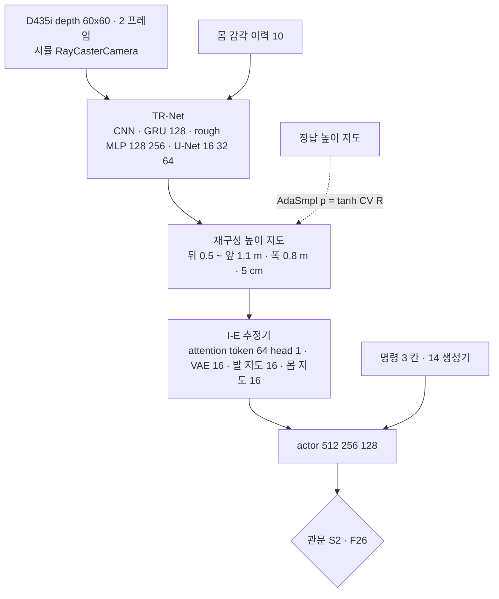

> 분류: A/정책학습 · 설계 (50 실험 단계 · S2 START 지각)
> 작성: 오흥재 (lead 세션 작성)
> 근거: START 2512.13153v1 (TR-Net 126~172 · AdaSmpl 687~693 · 발 가장자리 239~257 · 예산 221 행) · 선행 2409.15692v2 부록 D Table V · Fig. 8 (evidence/maicode-trcr-deep) · RESEARCH-astra-19g · evidence/deep-research-start-missing-values.json · deep-research-start-chinese-sources.json · ASTRA 19f Q3 · fable 20e R1~R7 · F15 · F26
> 요지: S1 과 같은 명령 생성기 위에 START 의 depth 높이 지도 재구성과 발 가장자리 보상을 단계적으로 얹는다(G1 → G3). S3 과 다른 GPU 에서 병렬로 돌리고, F26 관문을 넘을 때만 하위 보행을 바꾼다
> 상태: 초안 · 팀장 검토 전 · 미기재 값은 가정

# 53 · S2 START 지각 (G1 · G3)

## 1. 갈래와 순서

| 갈래 | 바꾸는 것 | 관문 |
|---|---|---|
| S2-a (G1) | S1 위에 재구성 지도 + I-E 추정기 + AdaSmpl. 보상은 S1 그대로 | 재구성 오차(정답 대비) 기록 · 축 1 이 S1 대비 하락 없음 · 틈 지형 향상 |
| S2-b (G3) | G1 + 발 가장자리 보상(거리 2.5 · 5 cm, 계수 1 · 0.5) | 틈 · 징검다리 v2 이상 · START 시험지 전진 |

## 2. 수치 출처 등급

| 부품 | 값 | 등급 |
|---|---|---|
| 지도 범위 · 해상도 | 뒤 0.5 ~ 앞 1.1 m · 폭 0.8 m · 0.05 m | 논문 127 행 |
| depth | 60 × 60 · 2 프레임 · 10 Hz | 논문 221 · 913 행 |
| 몸 감각 이력 H1 | 10 | 선행 2409.15692v2 213 행 |
| TR-Net GRU · rough MLP | 1 층 128 · [128, 256] ELU | 선행 Table V |
| U-Net | 16 → 32 → 64 → 32 → 16 → 1 | 선행 Fig. 8 |
| I-E attention · actor | token 64 · head 1 · [512, 256, 128] | 선행 Table V |
| latent | VAE 16 · 발 지도 16 · 몸 지도 16 · 속도 3 | 선행 2409.15692v1 본문 |
| CNN 두 개 | 채널 · 커널 목록 길이 불일치 | 원문 불일치 → **가정**(채널 목록 유지, 커널 수정은 우리 보완) |
| AdaSmpl 통계 창 · 분모 | 없음 | **가정** (원문 · 선행 · 중국어 자료에서 없음) |
| 지형 전환 p_max · T_start · T_end | 없음, 인쇄 식 오류 `min(max(z,0),p_max)` 로 정정 | **가정** · 정정 기록 |
| PPO | 24 steps · 5 epochs · 4 minibatches · lr 1e-3 · γ 0.99 · λ 0.95 · clip 0.2 · entropy 0.01 | **가정** (Deep Robotics rl_training 3d05d3b · legged_gym 기본) |
| depth 전처리 · clip | 0~2 m clip · 87° 수평 FOV · 가장자리 잡음 · 구멍 · 흐림 | **가정** (Extreme Parkour · ETH 2505.11164) |
| 카메라 무작위화 | 위치 ±10 mm · pitch ±1° · FOV 86~88° · 지연 0~15 ms | 같은 연구실 PIE 2408.13740v3 Table II(START 의 [31] 이 PIE 인지 대조 필요) |
| 가림막 학습 | 0~2 개 무작위 도형 | **코드** JEPLO (evidence/maicode-jeplo-deep) |

## 3. 학습 틀 (fable 20e R1 · F15)

- START 방식 단일 단계 비대칭 PPO + TR-Net 손실(거친 지도 MSE · 정제 지도 L1) + AdaSmpl. DAgger 없음.
- 지도 틀: 중력 정렬 yaw 틀(R2).
- 속도 추종 보상: 정확 추종형 하나로 통일(R4, 주행층 결합 대비).
- gradient 경계(지도 손실 · actor 손실 · 정답 대체) 를 그림과 코드로 고정(ASTRA 19f Q3).

## 4. GPU · 시간 (가정)

- 논문: 3072 env · 약 10,000 회 · A6000(48 GB) 16.6 시간(221 행).
- 우리: 5080 16 GB. depth + TR-Net 메모리 미측정. 첫 10 회에서 잰다. env 를 줄이면 steps/env 를 늘려 반복당 표본을 지킨다.
- Linux 이전 뒤 GPU 두 장 분산(70 문서). 시간 추정 18~30 시간(fable 20e Q6 추정).

## 5. F26 하위 교체 관문 (fable 20e)

S2 하위가 S1 하위보다 (1) 축 1 이어진 지형 생존 같거나 높음 (2) START 시험지 기준선 도달 + 10 %p 이상 (3) S3 상위 재증류 뒤 목표 도달률 하락 ≤ 2 %p. 하나라도 어기면 교체하지 않고 S2 는 「지각 추가 연구」 결과로만 보고.

## 6. 실패 시

60 시나리오 A(START 재구현 실패) · B(16 GB 부족).

## 7. 산출물

갈래별 체크포인트 · 재구성 오차 곡선 · AdaSmpl 정답 사용 비율 · 축 1 · 3 · START 시험지 CSV · 재구성 지도 영상(정책에 들어가는 지도와 정답 비교).
