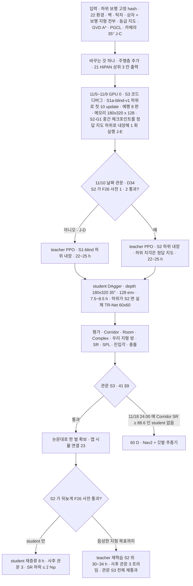

> 분류: A/정책학습 · 설계 (50 실험 단계 · S3 주행층)
> 작성: 오흥재 (lead 세션 초안 · fable 20f 가 v1 으로 고쳐 씀 · 20g 반영)
> 근거: HiPAN 2604.26504 42 · 268~272 · 279~291 · 338~368 · 478~496 · 526~535 · 630 · 645~700 · 728 · 754 · 876~880 행 (evidence/maicode-hipan-deep) · 21 · 22 · 23 · 18 §4 · 41 §9 · fable 20e Q2 · F21~F24 · ASTRA 19f Q3 · APPROVED B · J-C · J-D · J-E(팀장 승인 10/20) · VERIFY-fable-20f P26 · P28 · P30 · VERIFY-lead-final 4 · 5 · 6 · 20 · **VERIFY-lead-final2 5 · 10 · 16(20j)** · HiPAN 661 행
> 요지: 하위 보행을 고정해 넣고 HiPAN 상위(depth + 목표 → 속도 명령)를 학습한다. 학습 환경에는 HiPAN 의 방 · 장애물에 보행층 지형 전부를 깐다. 하위는 11/10 날짜 관문으로 고르고(S2 통과면 S2, 아니면 **S1-blind**), S2 하위의 지각은 teacher 단계에서 정답 지도로 대신한다(우리 변경). 카메라는 35° 하나. 늦어지면 Nav2 + 깃발 추종기로 같은 세 칸을 채운다
> 상태: v1.2 · 팀장 검토 전 · 관문 수치는 후보 · 결정 3(하위별 두 벌 · APPROVED M · fable 20l) 반영 · 하위 선택 · 내장 방식 · 카메라는 승인(D34 · D42 · D43 · D44)

# 54 · S3 주행층

## 0. 쉬운 요약

「저기로 가」 를 받으면 길을 찾는 층을 올린다. HiPAN 논문 방식이다. 먼저 시뮬이 다 아는 지도를 보는 **teacher** 가 길 찾기를 배우고, 그 다음 카메라만 보는 **student** 가 teacher 를 따라 배운다. 이때 그 밑에서 실제로 걷는 것은 우리 보행층이다. 11/10 에 「눈 달린 보행(S2)이 준비됐나」 를 보고, 됐으면 S2 보행을, 아니면 눈 없는 S1-blind 보행(진짜 로봇에 올릴 수 있는 쪽)을 밑에 깐다. S2 보행을 밑에 깔 때 teacher 단계에서는 보행층의 눈(TR-Net)에 카메라 대신 시뮬이 아는 정답 지도를 넣어 비용을 아끼고, student 단계에서 진짜 카메라로 바꾼다. 방 안에는 벽 · 탁자 · 상자뿐 아니라 계단 · 틈 · 징검다리 · 평균대 · 외나무도 깐다. teacher 는 「밑에서 걷는 로봇이 뭘 할 수 있나」 를 겪으며 배우므로, 징검다리를 못 건너는 보행 위에서 배우면 징검다리를 **피해 가는** 길 찾기가 된다. 안 되면 Nav2 로 길만 받아 깃발 추종기가 같은 세 칸을 채운다.

## 1. 세부 흐름

## 2. 한 장

| 항목 | 내용 |
|---|---|
| 목적 | 목표를 주면 길을 찾아 가는 층. 앱 목표 임무(11/30) |
| 바꾸는 것 하나 | 주행층 추가(하위 고정 hash) |
| 명령 | 1 차는 `vx vy wz` 세 칸만. 몸 높이 · 기울기 없음(**논문** HiPAN 754 행 「w/o Pos. Adjustment」 판, 21 §3). 상위 출력은 하위 학습 범위로 clip(21 §6) |
| 카메라 | D435i 한 대, 아래로 35°(11 §2). HiPAN 의 tilt 0 을 쓰지 않는다 → **우리 변경 · 팀장 승인 J-C**. 높은 장애물 가시 손실은 H21-5 |
| 학습 환경 | HiPAN WFC 타일 + 벽 · 탁자 · 매달린 상자(**논문** 42 행) + **보행층 지형 전부**(우리 추가, APPROVED B · D14). 지형 조각은 15 문서 생성기 재사용(22) |
| A* 비용 | 듬성한 지형은 「통과 가능 · 접근 방향 제약」, 틈 폭이 하위 능력 밖이면 통과 불가. 하위 보행의 축 1 · 3 · START 시험지 결과로 등급표를 만든다 → **가정**(22 §3). S1-blind 하위면 듬성한 지형은 전부 「통과 불가」 |
| 하위 선택(**D34 + J-D**) | 11/10 날짜 관문: S2 가 F26 사전 (1)(2) 통과면 S2 하위, 아니면 **S1a-blind-v1 하위**(S1-a blind 체크포인트 sha256 고정 · 실기 가능. 11/10 에 S1-b 는 아직 없고 S1-scan 은 시뮬 전용이라 안 씀, VERIFY-lead-final2 5). S1-blind 위에서 배웠고 S2 가 뒤늦게 통과하면 teacher 재학습(30~34 h, 11/19~11/24)으로 듬성한 지형 목표를 잇는다 |
| 하위 내장(**J-E**) | S2 하위일 때 teacher 단계는 하위의 TR-Net 입력을 정답 높이 지도로 대신(depth 렌더 · GRU 없음, 비용은 S1 하위와 같음) → **우리 변경**. student 단계는 실제 60×60 depth + TR-Net 으로 바꿔 확인(21 §4 · §6). 이 경로는 디버그 창에서 S2-G1 중간 체크포인트로 반드시 한 번 돈다 |
| 예산 | 논문: teacher 1,024 대 18 시간 · student 128 대 6 시간(**논문** 535 행, RTX 4090). 우리: teacher 22~25 h · student 7.5~8.5 h + 하위 depth 비용 미측정(18 §4) · GPU 0 |
| 관문 S3 · S2 하위판 (41 §9 후보) | Corridor SR ≥ 88.6 % · Room ≥ 85.1 %(논문 자세 없는 판 98.4 · 94.5 의 0.9 배 = 88.56 · 85.05, 661 행) · 보행 지형 방(계단 · 틈 · 징검다리) 도달 ≥ 70 % · 외나무 진입각 오차 ≤ 15° · 충돌 에피소드 ≤ 5 % · SPL 기록 |
| 관문 S3 · S1-blind 하위판 (**팀장 결정 3** 10/20 09:4x) | 듬성한 지형 방(틈 · 징검다리 · 외나무)은 평가에서 빼고 **계단 방 도달 ≥ 70 %** · Corridor SR ≥ 88.6 % · Room ≥ 85.1 % · 충돌 에피소드 ≤ 5 % · SPL 기록(외나무 진입각은 듬성한 방이 빠지므로 해당 없음). 두 벌 다 학습 전 gates-v1.json 에 등록 |
| 사후 관문 | student 재증류판 (3): Corridor · Room SR 하락 ≤ 2 %p. teacher 재학습판 (3′): 관문 S3 전체 재통과(VERIFY-lead-final 6) |
| 산출물 | 상위 teacher · student 체크포인트(S3-T-v1 · S3-S-v1) · 방별 도달률 · SPL · 경로 영상 · 명령 히스토그램(방향별) · 추종 오차(teacher 단계 정답 지도 하위 대 student 단계 실제 하위, H21-6) |

## 3. 결과별 갈래 (이 숫자가 나오면 → 다음은 이것)

| 신호 (학습 전 등록) | 뜻 | 다음 |
|---|---|---|
| 디버그 창(11/5~11/9)에서 128 env × 180×320 depth(+ 하위 60×60) 첫 10 update 메모리 > 14.5 GB | student 증류가 한 장에 안 듦 | env 64 로 줄이고 시간 2 배, 기록. 또는 S2 끝난 뒤 두 장 |
| 디버그 창에서 S2-G1 중간 체크포인트 내장이 안 돎(Traceback · 추종 오차 95 분위 > S1 하위의 2 배) | 하위 내장 어댑터 · 정답 지도 대체 경로 문제 | 11/10 전에 고침. 못 고치면 11/10 은 「아니오」 로 S1-blind |
| teacher 2,000 회(PGCL 레벨 1~2)에서 Corridor 부목표 도달 < 50 % | 하위 내장 · 전이가 안 됨 | 하위 호출 주기(50 Hz 의 5 스텝마다) · 명령 clip · r9 한계 점검. 새 판 |
| teacher 끝: PGCL 최종 수준 도달 못 함(d 가 경로 길이를 못 넘음) | 장거리 탐색 실패 | IR r2 · PGCL 「꾸준히 성공」 횟수 가정값 점검(21 §8). 기록 |
| student: teacher 대비 Corridor SR 하락 > 10 %p | 증류 부족 | DAgger 반복 · 데이터 2 배. 기록 |
| student: Room SR 이 teacher 대비 5 %p 넘게 하락 | 카메라 35° 로 머리 위 장애물이 덜 보임(H21-5) | 기록 · 2 차 자세 명령과 함께 재검토. 자세는 바꾸지 않는다(J-C) |
| 11/18 24:00 까지 Corridor SR ≥ 88.6 % 인 student 없음 | 60 D | Nav2 + 깃발 추종기로 앱 목표 임무(23). 험지 구간은 조이스틱 |
| 우리 지형 방 도달 < 70 % 인데 Corridor ≥ 88.6 % | 지형 등급 · 진입 부목표 문제 | 22 §3 비용 계수 · 진입 방향 부목표 점검. S1-blind 하위판은 듬성한 방을 평가에서 빼므로(결정 3) 이 신호는 계단 방에서만 뜬다. S2 하위판에서 징검다리 우회면 → D34 재학습 경로 |
| 관문 통과 | 한 벌 확보 | 앱 시뮬 연결(23 §5) · F26 사후 |

## 4. 순서 (fable 20e + 검증 20f + 20g)

1. S3 코드(21 · 22)는 10/24 부터 짠다(18 §6: 환경 · A* · PGCL 은 lead, teacher · student · 하위 내장 어댑터는 rl, Sonnet 코딩 세션). 11/5~11/9 GPU 0 에서(11/4 08:00 S2-G0 평가가 끝난 뒤, 70 §1 · VERIFY-lead-final2 10) **디버그 창**: S1a-blind-v1 하위로 첫 10 update · 예행 8 판 · 메모리, 그리고 **S2-G1 중간 체크포인트(약 3,000 회)를 정답 지도 하위로 내장해 한 번 실행**(J-E 경로 검증). 11/8~11/9 는 S1-b 학습(3.5~5 h)과 GPU 0 을 나눠 쓴다(짧은 실행이라 가능, 60 §5 규칙).
2. 11/10 날짜 관문에서 하위를 고르고(S2 또는 S1-blind) teacher 본 학습 → student → 평가(11/15~11/18). 11/10 부터 GPU 0 은 S3 전용.
3. S2 가 F26 사전 관문을 늦게(11/10 뒤) 넘으면 student 만 재증류(8 h, 사후 관문 (3))하되, S1-blind 위 teacher 의 우회 습관은 남는다는 것을 결과에 적는다(**논문** 876~880 행). 11/30 듬성한 지형 목표에는 teacher 재학습(30~34 h, 11/19~11/24, 사후 관문 (3′)) 이 필요하다(D34 · 70 §1).

## 5. 검증 사다리

| 단 | 무엇 | 통과 |
|---|---|---|
| L0 CPU | 등급 지도 → GVD → A* 가 답을 아는 방(벽 하나 · 틈 하나)에서 우회 · 통과 경로를 내고, 부목표 간격 d 표본이 맞음. negative control: 통과 불가 틈만 있는 방은 「경로 없음」 | 기대 경로 |
| L0 CPU | 하위 내장 어댑터: 상위 명령 (0.5, 0, 0) 이 50 Hz 하위 관측의 cmd 칸에 5 스텝 유지되고 clip 범위 밖 값은 r9 벌점. S2 하위 모드에서 TR-Net 입력 자리에 정답 지도 텐서 `(N, 32, 16)` 가 들어가고 depth 버퍼는 비어 있음 | 검사 |
| L1 Kit | 22 방 6 개 메시 · 128 env depth 180×320(35°) · 첫 10 update · 예행 8 판(SR 계산기 끝까지) · S2-G1 중간 체크포인트 내장 1 회 | 로그 |
| L2 | teacher 첫 500 회 부목표 도달률 상승 | 곡선 |
| L3 · L4 | 본 학습 · 41 §9 관문(판정은 fable) | 표 |

2 단계 동결(50 §4): S3 cfg · 하위 hash · 관문 해시는 11/10 teacher 학습 직전에 `s2-S3-v1` 태그로 고정한다.

## 6. 판단층 연결 (31)

Laya / Jev 는 이 층 위에서 **그림자 모드로 확정**(D28) 「목표 바꾸기 · 멈춤」 을 조언하고 기록만 한다. 시뮬 rollout 기록을 재생해 오프라인으로 판단을 모은다(31 §8).

## 7. 열린 항목

- 관문 수치 확정(O7).
- 방 여섯 개를 늘릴지 · 지형 패치 비율(22).
- student 단계에서 S2 하위의 60×60 depth 렌더가 `mesh_prim_paths` 에 방 장애물을 포함할 때의 메모리(18 §4 미측정).
