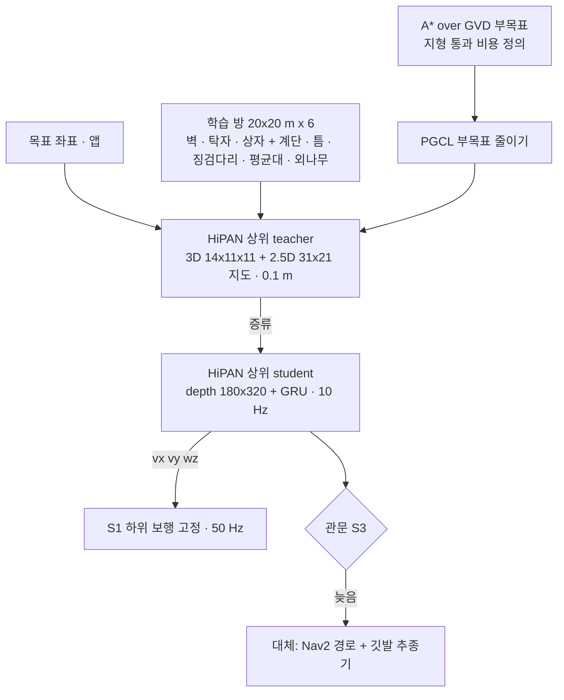

> 분류: A/정책학습 · 설계 (50 실험 단계 · S3 주행층)
> 작성: 오흥재 (lead 세션 작성)
> 근거: HiPAN 2604.26504 (42 · 290~291 · 338~368 · 486~491 · 526~535 행, evidence/maicode-hipan-deep) · fable 20e Q2 · F21~F24 · ASTRA 19f Q3 · 팀장 10/19 「주행층에도 보행 지형 전부」
> 요지: S1 하위 보행을 고정해 넣고 HiPAN 상위(depth + 목표 → 속도 명령)를 학습한다. 학습 환경에는 HiPAN 의 방 · 장애물에 보행층 지형 전부를 깐다. 늦어지면 Nav2 + 깃발 추종기로 같은 세 칸을 채운다
> 상태: 초안 · 팀장 검토 전

# 54 · S3 주행층

| 항목 | 내용 |
|---|---|
| 목적 | 목표를 주면 길을 찾아 가는 층. 앱 목표 임무 |
| 바꾸는 것 하나 | 주행층 추가(S1 하위 고정 hash) |
| 명령 | 1 차는 `vx vy wz` 세 칸만. 몸 높이 · 기울기 없음(HiPAN 754 행 자세 없는 판) |
| 학습 환경 | HiPAN WFC 타일 + 벽 · 탁자 · 상자(42 행) + **보행층 지형 전부**(우리 추가). 지형 조각은 15 문서 생성기 재사용 |
| A* 비용 | 듬성한 지형은 「통과 가능 · 접근 방향 제약」, 틈 폭이 하위 능력 밖이면 통과 불가. 하위 보행의 S1 축 3 결과로 비용표를 만든다 → **가정** |
| 예산 | 논문: teacher 1,024 대 18 시간 · student 128 대 6 시간(535 행, RTX 4090). 우리: 22~33 시간 **가정** (fable 20e Q6) |
| 관문 S3 | 평지 방에서 목표 도달률(0.2 m) · SPL 을 HiPAN 표의 우리 판으로 기록 + 계단 · 틈이 있는 방에서 막힘 없이 도달. 기준값은 S1 결과 뒤 등록 |
| 실패 시 | 60 시나리오 D: Nav2 경로 + 깃발 추종기(14 문서의 깃발 방식과 같은 계산)로 세 칸을 채운다. 11/30 SLAM · Nav2 트랙과 연결 |
| 산출물 | 상위 teacher · student 체크포인트 · 방별 도달률 · 경로 영상 |

## 순서 (fable 20e)

1. S1 하위 고정 → S3 상위 학습 → 「논문대로 한 벌」 확보.
2. S2 가 F26 관문을 넘으면 하위만 S2 로 바꾸고 상위 student 재증류(HiPAN 876~880 행: 하위가 바뀌면 상위가 받은 명령 → 결과 관계가 달라진다).

## 판단층 연결 (31 문서 예정)

Laya / Jev 는 이 층 위에서 그림자 모드로 「목표 바꾸기 · 멈춤」 을 조언한다. Jev 1.14 의 이미지 · Box 는 제작사가 제품용 아님이라고 명시(danger zone) → 기록만.
