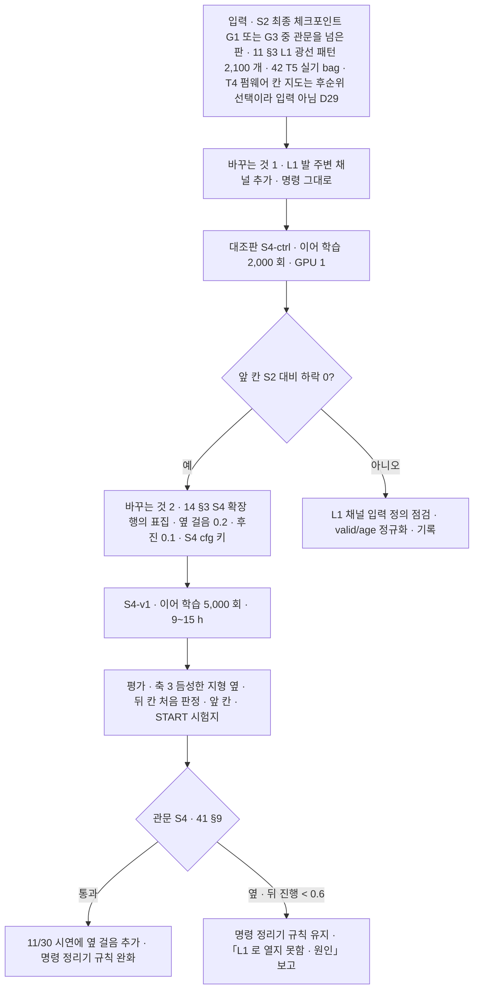

> 분류: A/정책학습 · 설계 (50 실험 단계 · S4 L1 발 주변 채널)
> 작성: 오흥재 (lead 세션 초안 · fable 20f 가 v1 으로 고쳐 씀)
> 근거: `C:/Users/AI-WS01/s2_lab/_external/l1_go2_floor_v2.py` 실측(10/19 lead · fable 20f 재실행) · Unitree 공식 L1 bag · Go2 URDF radar_joint 748~749 행 · REPORT-astra-10 63~77 행 · ASTRA 19f Q3 · fable 20e F20 · JEPLO 2609.15770v1 29 행 · 11 §3 · 41 §9 · APPROVED B(L1 「내려다보듯」) · H(L1 은 2 차 확정 · 실기 녹화는 센서 토픽 bag) · VERIFY-fable-20f P19
> 요지: D435i 가 못 보는 옆 · 뒤 발 주변을 L1 로 채워, 듬성한 지형에서 옆 · 뒤 명령을 연다. 보지 못한 칸은 「모름」 으로 넘긴다. L1 은 2 차로 확정됐고 11/30 필수가 아니다
> 상태: v1.1 · 팀장 검토 전 · 실기 가림률 미측정 · 결정 2 · 8 반영(fable 20l)

# 55 · S4 L1 결합

## 0. 쉬운 요약

사람이 징검다리를 건널 때 발을 디디기 직전에 **아래를 내려다보듯**, 로봇 턱 밑의 작은 라이다(L1)로 네 발 주변 바닥을 본다(APPROVED B). 머리 카메라는 앞만 보기 때문에 옆이나 뒤로 걸을 때 디딜 곳을 모르는데, L1 이 그 자리를 채운다. 공식 녹화를 돌려 보니 가만히 서 있을 때 L1 메시지 5 개(0.5 초)만 모아도 네 발 주변 5 cm 칸이 다 찬다(몸에 가리는 것은 아직 안 넣은 상한). 이 정보를 높이 지도 옆에 「높이 · 봤나 · 얼마나 오래됐나」 세 겹으로 넣고, 그제야 징검다리에서 옆 · 뒤 명령을 학습에 넣는다. 못 본 칸은 평평하다고 꾸미지 않고 「모름」 으로 넘긴다. 이 단계는 2 차이고 11/30 에 꼭 필요하지는 않다.

## 1. 세부 흐름

## 2. 지금 아는 것 (실측 · 상한)

| 모은 메시지 수(첫 · 끝 간격) | 앞발 왼 · 오 | 뒷발 왼 · 오 | 앞쪽 바닥 왼 · 오 |
|---|---|---|---|
| 2 개 (0.1 s) | 100 · 100 % | 75 · 94 % | 81 · 88 % |
| 3 개 (0.2 s) | 100 · 100 % | 88 · 94 % | 91 · 95 % |
| 4 개 (0.3 s) | 100 · 100 % | 100 · 94 % | 95 · 97 % |
| **5 개 (0.4 s · 10 Hz 에서 0.5 s 창)** | 100 · 100 % | **100 · 100 %** | 96 · 98 % |
| 10 개 (0.9 s) | 100 · 100 % | 100 · 100 % | 96 · 100 % |

평평한 바닥 · 정지(h 0.32) · 몸 가림 없음 가정의 **상한**이다(**실측** `l1_go2_floor_v2.py`, fable 20f 가 원본과 창 확장 사본으로 재실행). 뒷발 쪽 점은 앞발 쪽의 약 1/8. 초안의 「0.4 s 누적」 은 이 「메시지 5 개」 를 뜻한다(VERIFY 20f P19).

## 3. 입력 정의 (가정 · 실기 T4 · T5 뒤 확정)

- 메시지 5 개 누적(0.5 s), odom 으로 자세 보정, 5 cm 격자, 칸마다 (높이 · valid · 관측 나이). 보지 못한 칸을 평평한 바닥으로 채우지 않는다(ASTRA 19f Q3): valid 0 이면 높이 0 · age 1.
- 시뮬: L1 광선 패턴을 bag 의 광선 방향 분포에서 뽑아 RayCaster 로 흉내(11 §6) → **가정**. 몸 가림은 실기 bag 에서 잰 마스크를 덧씌움 → **가정**.
- 대안: JEPLO 식 구면 depth(2° 격자, **논문** 2609.15770v1 29 행) 로 넣는 방법. 1 차 안은 격자.
- 실기 자료는 **센서 토픽 bag 기록**(`utlidar/cloud` · IMU · 관절 · odom · D435i)이다(D29). 펌웨어 칸 지도(`voxel_map_compressed`) 기록은 후순위 · 선택.
- Go2 가 기본(10/26 주)대로 오면 42 T5(몸 · 다리 가림률)가 11/2 전에 나와 S4(11/10~) 입력 정의를 실측으로 확정할 수 있다. 최악(11/7)이면 T5 는 11/14 에 나오므로 **대조판과 본 판 모두** 가림 마스크 없이 돌리고(한 변수 유지), 마스크는 S4-v1.1 이어 학습으로 따로 넣는다(D38, **가정**, VERIFY-lead-final2 21).

## 4. 바꾸는 것 둘 → 대조 한 판

S2 최종 정책(G3 가 관문을 넘으면 G3, 아니면 G1, 53 §6) 위에 (1) L1 채널 추가 와 (2) 명령 생성기에서 듬성한 지형 옆 · 뒤 칸 개방, 둘이다. 그래서 「L1 채널만 추가 · 명령 그대로」 대조판(S4-ctrl, 이어 학습 2,000 회)을 먼저 둔다. 대조판 관문: 앞 칸(축 1 · 축 3 앞 · START 시험지) S2 대비 진짜 하락 0.

## 5. 관문 S4 (41 §9)

- 축 3 듬성한 지형 옆 · 뒤 칸이 처음으로 판정 대상: 명령 방향 진행 ≥ 0.6 × 명령 거리 · 생존 ≥ 0.9 → **가정**.
- 앞 칸 성적이 S2 대비 진짜 하락 0(41 §8 Newcombe · 결정 8).
- 대조판(S4-ctrl) 앞 칸 하락 0.

## 6. 결과별 갈래

| 신호 | 뜻 | 다음 |
|---|---|---|
| S4-ctrl 앞 칸 하락 | L1 채널이 지각을 흐림 | 입력 정의 점검(valid/age 정규화 · 격자 범위). 새 판. 해결 안 되면 S4 중단 · 기록 |
| S4-v1 옆 · 뒤 진행 < 0.6 | L1 로 못 열음 | 명령 정리기(31) 규칙 유지. 「L1 로 열지 못함 · 원인(가림 · 창 길이 · 노출)」 보고 |
| 옆 · 뒤(명령 2 s · 기준 거리 = 속도 × 2 s, 41 §4 결정 2) 진행 ≥ 0.6 · 생존 ≥ 0.9 · 앞 칸 하락 0(41 §8) | 성공 | 11/30 시연에 옆 걸음 추가(여유 있을 때). 명령 정리기(31 §5)의 허용 범위를 1 차 값(옆 vy_obs · 뒤 −0.3)에서 학습 범위(옆 ±0.5 · 뒤 −0.5)로 넓힘(기록) |

## 7. 검증 사다리

| 단 | 무엇 | 통과 |
|---|---|---|
| L0 CPU | 격자화: 점 하나를 (0.19, 0.14, −0.32) 에 넣으면 FL 칸 valid 1 · 높이 −0.32 · age 0, 나머지 valid 0 · age 1. negative control: 점 없음 → 전부 모름 | 기대값 |
| L0 CPU | bag 재실행 표(2 절)가 스크립트로 다시 나옴 | 표 |
| L1 Kit | RayCaster 2,100 광선 × 3072 env 첫 10 update 메모리 · steps/s | 로그 |
| L2 · L3 · L4 | 대조판 → 본 판 → 41 | 표 |

## 8. 일정

70 과 같다: 대조판 S4-ctrl 11/10~11/12, 본 판 11/13~11/16, 평가 11/17~11/18(GPU 1, S2 G3 평가가 11/8 08:00 까지 끝난 뒤. G3 가 11/14 까지 밀리면(L 대비책) S4 는 대조판 11/14~16 · 본 판 11/16~19 · 평가 11/20~21, 70 §1.2). 재시도는 11/19~11/24 여유 창. **11/30 필수 아님**(70 문서). L1 은 2 차로 확정(D31). p_advance 의 T 는 S4 자체 반복 수(0 부터 · T_end 2,500, 15 §5).

## 9. 열린 항목

- 실기 가림률 · 누적 창(42 T5 뒤).
- 구면 depth 대안을 쓸지.
- S4 뒤 명령 정리기 완화 폭.
