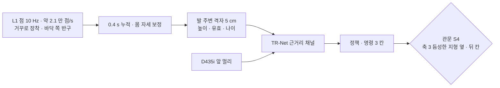

> 분류: A/정책학습 · 설계 (50 실험 단계 · S4 L1 발 주변 채널)
> 작성: 오흥재 (lead 세션 작성)
> 근거: `C:/Users/AI-WS01/s2_lab/_external/l1_go2_floor_v2.py` 실측(10/19) · Unitree 공식 L1 bag · Go2 URDF radar_joint 748~749 행 · REPORT-astra-10 (voxel_map_compressed) · ASTRA 19f Q3 · fable 20e F20 · JEPLO 구면 depth 2609.15770v1 29 행
> 요지: D435i 가 못 보는 옆 · 뒤 발 주변을 L1 로 채워, 듬성한 지형에서 옆 · 뒤 명령을 연다. 보지 못한 칸은 「모름」 으로 넘긴다
> 상태: 초안 · 팀장 검토 전 · 실기 가림률 미측정

# 55 · S4 L1 결합

## 1. 지금 아는 것 (실측 · 상한)

| 모은 시간 | 앞발 왼 · 오 | 뒷발 왼 · 오 | 앞쪽 바닥 왼 · 오 |
|---|---|---|---|
| 0.1 s | 100 · 100 % | 75 · 94 % | 81 · 88 % |
| 0.2 s | 100 · 100 % | 88 · 94 % | 91 · 95 % |
| 0.4 s | 100 · 100 % | 100 · 100 % | 96 · 98 % |

평평한 바닥 · 정지 · 몸 가림 없음 가정의 **상한**이다. 뒷발 쪽 점은 앞발 쪽의 약 1/8.

## 2. 입력 정의 (가정 · 실기 T4 · T5 뒤 확정)

- 0.4 s 누적, odom 으로 자세 보정, 5 cm 격자, 칸마다 (높이 · 유효 · 관측 나이). 보지 못한 칸을 평평한 바닥으로 채우지 않는다(ASTRA 19f Q3).
- 시뮬: L1 광선 패턴을 bag 의 광선 방향 분포에서 뽑아 RayCaster 로 흉내 → **가정**.
- 대안: JEPLO 식 구면 depth(2° 격자) 로 넣는 방법. 1 차 안은 격자.

## 3. 바꾸는 것 하나

S2 최종 정책 위에 L1 채널 추가 + 명령 생성기에서 듬성한 지형 옆 · 뒤 칸을 연다. 두 가지이므로 「L1 채널만 추가 · 명령 그대로」 대조를 먼저 한 번 둔다.

## 4. 관문 S4

- 축 3 듬성한 지형 옆 · 뒤 칸이 처음으로 판정 대상: 명령 방향 진행 ≥ 0.6 × 명령 거리 · 생존 ≥ 0.9 → **가정**.
- 앞 칸 성적이 S2 대비 하락 없음.

## 5. 실패 시

듬성한 지형 옆 · 뒤는 「명령 정리기」 가 막는 규칙으로 남기고(80 약점 3), 결과를 「L1 로 열지 못함 · 원인」 으로 보고.

## 6. 일정

11/25 이후 또는 S2 가 일찍 끝나면 그 뒤. 11/30 필수 아님(70 문서).
