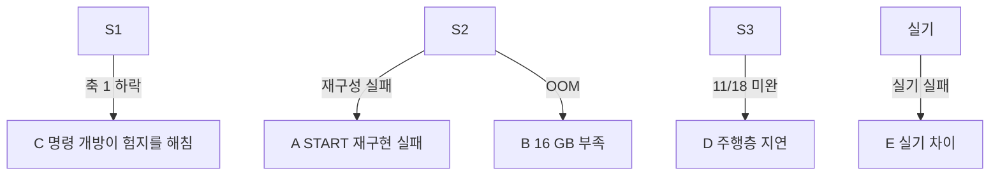

> 분류: A/정책학습 · 설계 (60 갈래 시나리오)
> 작성: 오흥재 (lead 세션 작성)
> 근거: 50-STAGES · 80-RISKS · fable 20e Q6 · ASTRA 19f Q4 · Q6 · REPORT-seokheon-ame2.md 128 행 · Isaac Lab multi-GPU 문서 https://isaac-sim.github.io/IsaacLab/main/source/features/multi_gpu.html
> 요지: 막히는 곳 다섯마다 「어디서 알아채고 어디로 가는지」 를 미리 적는다. 목표(11/7 · 11/25 · 11/30) 는 낮추지 않고, 막혀도 남는 결과를 만든다
> 상태: 초안 · 팀장 검토 전

# 60 · 갈래 시나리오

| 갈래 | 알아채는 신호 | 1 차 대응 | 2 차 대응 | 남는 결과 |
|---|---|---|---|---|
| **A** START 재구현 실패 | 재구성 오차가 1,000 회 뒤에도 정답 대비 줄지 않음 · AdaSmpl 정답 비율이 내려가지 않음 · 정책이 재구성 지도만으로 틈을 못 건넘 | 정답 높이 지도로 학습한 G0 를 teacher 로 두고 지도 손실 경계 · 시간 정렬 · GRU 리셋부터 점검(ASTRA 19g 「층 크기보다 정렬이 위험」) | 지각을 정답 높이 스캔 + 실기 L1 · D435i 높이 지도(고전 매핑)로 대체 | S1 열린 명령 보행 · 「START 재구현에서 막힌 곳」 기록 |
| **B** 16 GB 부족 | 첫 10 회 OOM 또는 메모리 > 15 GB | env 수를 줄이고 steps/env 를 늘려 반복당 표본 유지 | Linux 다중 GPU(각 GPU 가 env 를 나눠 가짐, 메모리 합치기 아님). Linux 전용 | 같은 방법 · 다른 env 배치 기록 |
| **C** 명령 개방이 험지를 해침 | S1 축 1 범위 안 칸 v2 대비 진짜 하락 · 높은 레벨에 전진 명령만 남음(14 6 절 경고) | 지형군 env 비율 조정(한 번에 하나) · 깃발 지형 비율 올림 | 명령 범위 커리큘럼 시작 범위를 좁혀 늦게 엶 | E1 · v2 · S1 세 판 비교로 「개방의 비용」 수치화 |
| **D** 주행층 지연 | 11/18 까지 S3 상위 student 없음 | Nav2 경로 + 깃발 추종기로 같은 세 칸을 채움(54 문서) | 앱 목표 시연은 평지 장애물만, 험지 구간은 조이스틱 | S1 하위 + Nav2 로 앱 목표 임무 |
| **E** 실기 차이 | 42 T6 에서 넘어짐 · 미끄러짐 · 관절 포화 | 실측값(관절 · 지연 · 잡음)을 시뮬에 넣어 재학습(체크포인트에서 이어 학습) | 무대 계단 높이를 학습 분포 중앙에 두고 계단 전용 미세 조정 | 실기 차이 표 · 시뮬 수정 전후 비교 |

## 조합 규칙

- 두 갈래가 동시에 오면 A · B 는 S2 GPU 에서, C 는 S1 GPU 에서 처리해 한쪽 막힘이 다른 쪽을 멈추지 않게 한다(70 GPU 배치).
- 대응은 한 번에 하나. 바꾼 것과 그 결과를 90 결정 기록에 남긴다.
