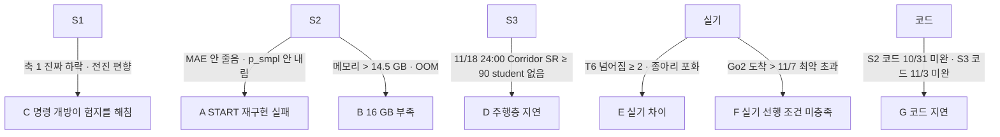

> 분류: A/정책학습 · 설계 (60 갈래 시나리오)
> 작성: 오흥재 (lead 세션 초안 · fable 20f 가 v1 으로 고쳐 씀)
> 근거: 50-STAGES · 52~55 · 70 · 80 · 18 §5 · 41 §9 · fable 20e Q6 · ASTRA 19f Q4 · Q6 · REPORT-seokheon-ame2.md 128 행 · Isaac Lab multi-GPU 문서 · APPROVED H(STOP · 학습 승인 · Windows 11/7) · **K-G(heading 처방 0.75)** · **L(S2 20,000 회 · 11/10 대비책)** · VERIFY-fable-20f 4 절
> 요지: 막히는 곳 일곱마다 「어떤 숫자가 나오면 알아채고 어디로 가는지」 를 미리 적는다. 목표(11/7 · 11/25 · 11/30)는 낮추지 않고, 막혀도 남는 결과를 만든다. 갈래로 가려면 그 갈래의 코드가 미리 있어야 한다
> 상태: v1 · 팀장 검토 전

# 60 · 갈래 시나리오

## 0. 쉬운 요약

계획대로 안 될 때를 미리 적어 두는 문서다. 「이 숫자가 나오면 문제다」(신호), 「그러면 먼저 이것을 해 본다」(1 차 대응), 「그래도 안 되면 이렇게 돌아간다」(2 차 대응), 「그래도 남는 결과」 를 갈래마다 적는다. 신호는 전부 숫자다. 사람이 「느낌상 안 되는 것 같다」 로 바꾸지 않기 위해서다. 갈래 D(길 찾기가 늦으면 Nav2 로 대체)처럼 **대체 코드가 미리 있어야 갈 수 있는** 갈래는 70 일정에 그 코드 날짜를 넣었다.

## 1. 그림

## 2. 갈래 표

| 갈래 | 알아채는 신호 (숫자 · 학습 전 등록) | 1 차 대응 | 2 차 대응 | 남는 결과 |
|---|---|---|---|---|
| **A** START 재구현 실패 | G1 1,000 회에 징검돌 레벨 0~2 재구성 MAE > 5 cm(정답 대비) · 2,000 회에 p_smpl > 0.7 · 6,000 회에 틈 · 징검돌 레벨 중앙값 < 3(20,000 회 기준 · L, 53 §6) · G1 끝 START 시험지 R 평균 < S2-G0 + 10 %p (53 §6) | 지도 손실 경계 · 시간 정렬(10 Hz 틱) · GRU 리셋부터 점검(ASTRA 19g 「층 크기보다 정렬이 위험」). 정답 지도로만 학습한 G0-gt 를 짧게 돌려 「지각 빼고는 되나」 확인. 새 판 번호 | 지각을 정답 높이 스캔(S1-scan) + 실기 L1 · D435i 고전 높이 지도(매핑)로 대체하는 안을 기록. S3 는 S1 하위로 진행 | S1 열린 명령 보행 · 「START 재구현에서 막힌 곳」 기록 · G0-gt 상한값 |
| **B** 16 GB 부족 | 첫 10 update 최대 메모리 > 14.5 GB 또는 OOM (18 §5) | **1 순위** Linux 다중 GPU 1536 × 2(**팀장 승인** F-D3). 그 동안 S3 는 멈추고 70 에 기록 | **2 순위** env 를 줄이고 steps 를 늘려 반복당 표본 73,728 유지(예: 2048 × 36), 기록 | 같은 방법 · 다른 env 배치 기록 |
| **C** 명령 개방이 험지를 해침 | S1 축 1 범위 안 32 칸 중 Wilson 상한 < v2 값인 칸 ≥ 1(scan) 또는 평균 < 0.67(blind) · 레벨 ≥ 7 표본의 전진 비율 > 명령 분포 + 10 %p (14 §6) · **축 3 이어진 지형 · 계단 방향 이탈 > 0.1** 또는 축 1 실패 성분이 방향 위주(K-G) | 지형군 env 비율 조정(한 번에 하나) · 깃발 지형 비율 올림. **신호가 방향 이탈이면 heading 비율 0.30 → 0.75**(v2 E 판 값, v2 보고 556 행) **새 판 S1a-v1.1**(K-G · D48. 대조 판이 없어 「heading 효과」 단독 결론 금지). 새 판 | 명령 범위 커리큘럼 시작 범위를 좁혀 늦게 엶(vx · vy ±0.5 에서 시작) | E1 · v2 · S1 세 판 비교로 「개방의 비용」 수치화 |
| **D** 주행층 지연 | 11/18 24:00 까지 Corridor SR ≥ 90 % 인 S3 student 체크포인트 없음 (54 §3) | Nav2 경로 + 깃발 추종기로 같은 세 칸을 채움(23). **추종기 노드와 시뮬 시험은 11/10 전에 서 있어야 한다**(70) | 앱 목표 시연은 평지 · 장애물만, 험지 구간은 조이스틱 | S1 하위 + Nav2 로 앱 목표 임무(시뮬 연결 먼저, APPROVED H) |
| **E** 실기 차이 | 42 T6 10 회 중 넘어짐 ≥ 2 · 종아리 \|q̇\| 명령이 15.70 rad/s 를 넘는 비율 > 5 % · 발 힘 센서 접촉 판정이 시뮬과 20 % 이상 다름 | 실측값(관절 · 지연 · 잡음)을 시뮬에 넣어 체크포인트에서 이어 학습(새 판) | 무대 계단 높이를 학습 분포 중앙에 두고 계단 전용 미세 조정(계단은 평가 한 칸이지만 시연 안전용) | 실기 차이 표 · 시뮬 수정 전후 비교 |
| **F** 실기 선행 조건 미충족 | Go2 가 최악 가정(11/7, D38)보다 늦음 · D435i 브래킷이 도착 + 3 일 안에 없음 · 앱 정책 노드 모드(23) 11/14(최악 11/20) 미완 · SLAM 지도 틀 계약 11/20 미정 (70 §1.1, **D37**) | 최악(11/7) 안이면 70 §1.1 최악 열로 옮기고 실기 창 약 3 주를 **기록**. 그보다 늦으면 11/26~30 실기 범위를 「T1~T7 첫 주 시험 + 조이스틱 계단 + 앱 시뮬 연결 시연」 으로 줄여 기록(목표 자체는 낮추지 않음) | 앱 목표 실기는 12/9 발표 전 마지막 주로 | 시뮬 전 단계 결과 + 실기 첫 주 표 |
| **G** 코드 지연 | S2 코드(12 · 11 · 15 메시 생성기 · 16 마스크 · runner)가 10/31 L0 통과 못 함 · S3 코드(21 · 22)가 11/3 L1 못 함 · 축 3 하네스가 10/23 못 섬 (70) | rl · lead 가 Sonnet 코딩 세션을 더 띄움(18 §6 역할, D41) · 모듈 우선순위(지형 생성기 → 하네스 → 생성기 → 지각) · ASTRA 코드 확인은 그대로 1 회 | S2 는 S2-G0 · G1 만 · S3 는 D 갈래로 · S0 축 3 는 S1 평가 전까지 | 끝난 모듈의 L0 · L1 기록 · 다음 단계 인계 |

## 3. STOP 과 안전 (APPROVED H)

갈래와 무관하게 **STOP 은 위험 시 모든 것을 멈춘다**(자동 재개 없음). 멈춘 뒤 로봇이 자세를 유지하는 방법(정책 0 명령 유지 / sport mode 복귀 / Damp)은 23 §4 와 42 §2 에서 설계한다. 시뮬 평가에서도 STOP 시나리오(명령 0 뒤 T 까지 관측, 41 §5 의 S) 를 같은 규칙으로 잰다.

## 4. 확장 연구 후보 (1 차 범위 밖 · 팀장 질문 10/19 → J-B 로 대체)

| # | 후보 | 상태 |
|---|---|---|
| R1 | 좁은 발판 위 제자리 몸 돌리기(산양처럼) | **1 차에 넣음(팀장 승인 10/20 J-B)**: 듬성한 지형 명령 표집을 START 식(전진 < 0.3 이면 0 · 그때 wz U[−1.2, 1.2], 2512.13153 225~233 행)으로 하여 발판 위 제자리 회전이 학습 노출에 들어간다(14 §3). 몸 폭 때문에 못 도는 좁은 평균대 · 디딤 빔은 결과(축 3 지형별 낙하율, H14-6)로 드러나게 둔다. 「연구 후보」 로 따로 두지 않는다 |

## 5. 조합 규칙

- 두 갈래가 동시에 오면 A · B 는 S2 GPU(GPU 1)에서, C 는 S1 GPU 에서, D 는 S3 GPU(GPU 0)에서 처리해 한쪽 막힘이 다른 쪽을 멈추지 않게 한다(70 GPU 배치). 단 B 의 1 순위(다중 GPU)는 두 장을 쓰므로 그때는 S3 가 쉰다.
- **다중 GPU 발동 시 관문 날짜 규칙**(VERIFY-lead-final 20): 두 장을 묶는 동안 멈춘 판의 관문 날짜는 묶인 시간만큼 뒤로 민다(기록). 11/10 하위 선택 관문은 최대 11/12 까지, 11/18 D 판정은 최대 11/20 까지 밀 수 있고 11/25 학습 끝은 고정이다(**가정**).
- **S2 20,000 회 대비책**(APPROVED L · 70 §1.2): G3 평가가 11/10 00:00 까지 안 끝나면 11/10 관문(F26 사전 · S3 하위 선택)은 G1 결과로 판정하고 G3 는 11/14 까지. S4 는 G3 뒤로. 다중 GPU 규칙과 겹치면 더 늦은 날짜 하나를 쓴다. 학습 전에 `gates-v1.json` 에 등록한다.
- 대응은 한 번에 하나. 바꾼 것과 그 결과를 90 결정 기록에 남기고 새 판 번호를 붙인다(50 §4).
- 신호 숫자는 `gates-v1.json` 에 관문 숫자와 함께 등록한다. 결과를 보고 바꾸지 않는다.
